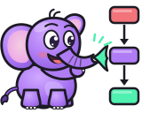
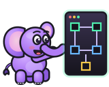
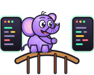
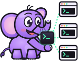
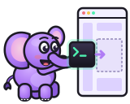
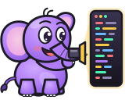
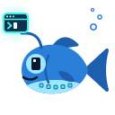

# rs-rich-cli

<picture>
  <source media="(prefers-color-scheme: dark)" srcset="https://raw.githubusercontent.com/buchochelliq-labs/rs-rich-cli/main/docs/assets/rs-rich/hero-dark.svg">
  
</picture>

[](https://github.com/buchochelliq-labs/rs-rich-cli/actions/workflows/ci.yml)
[](https://crates.io/crates/rs-rich)
[](https://docs.rs/rs-rich)
[](https://github.com/buchochelliq-labs/rs-rich-cli#develop)
[](LICENSE)
[](https://buchochelliq-labs.github.io/rs-rich-cli/)

**Python's [`rich`](https://github.com/Textualize/rich), ported to Rust and held to
it byte for byte**, with the [`rich-cli`](https://github.com/Textualize/rich-cli)
tool and a stack built on top: charts and diagrams, pickers and forms, a
reactive terminal UI framework (intuiTUIve), a terminal recorder, and images
in the terminal. Tracking **`rich` 15.0.0** and **`rich-cli` 1.8.1**
([`UPSTREAM.toml`](UPSTREAM.toml)); every parity claim is a golden test
captured from the real Python library.

**📖 [Documentation, tutorial and gallery](https://buchochelliq-labs.github.io/rs-rich-cli/)**


| A game on intuiTUIve | A Yazi-style file manager |
|---|---|
|  |  |

Every picture here is a [terminal recording](https://buchochelliq-labs.github.io/rs-rich-cli/recordings/)
made by `rich record` from a script in [`docs/tapes/`](docs/tapes/), re-run
by CI on every change.

## Install and try

```bash
cargo install rs-rich-cli
rich --print '[bold magenta]Hello[/] [green]World[/]'
rich README.md          # Markdown, JSON, CSV, source, notebooks, images…
rich --demo             # the guided tour; Ctrl+C stops
```

In Rust, `cargo add rs-rich` and `use rich::Console`:

```rust
use rich::Console;

let console = Console::new();
console.print_str("[bold red]Hello[/] [green]World[/] — 42");
```

[Getting started](docs/getting-started.md) has a complete program; the
[tutorial](docs/tutorial/index.md) builds up from there.

## New in 0.0.22

Published on 2026-10-25 ([release notes](docs/releases/0.0.22.md)).
Parity, the plugin marketplace and a terminal web browser:

- **Parity with rich 15.0.0:** the widget, live display and document
  modules ported or recorded as divergences, `scope.py` ported, a verdict
  for every divergence, and the differential fuzzer on Markdown, trees,
  columns, progress, Pretty and JSON.
- **The marketplace:** the new `rs-rich-marketplace` crate (a signed index,
  verified installs, a lockfile), `rich plugin` with `browse` and
  `publish`, and WASM plugins on by default.
- **intuiTUIve:** flush panel titles, a tree table, `min_size` with a node
  of its own, labels that change in place, a three-state check box,
  options known by key and a live action list.
- **[Noctiluca](docs/guide/noctiluca.md)** (new): a web browser for the
  terminal, on intuiTUIve and a headless Chrome. Watch
  [its promo](docs/assets/noctiluca/promo.mp4) (AI-generated, MIT).
- **Recording:** a tape writes an APNG only when asked. Memo has a spot for
  every crate.

The [changelog](CHANGELOG.md) lists every change.

> **Early releases, and the versions say so.** The crates version independently
> by ordinary SemVer; the number is *not* tied to the upstream release. Expect
> breaking API changes. Which upstream version is tracked lives in
> [`UPSTREAM.toml`](UPSTREAM.toml). See [AGENTS.md](AGENTS.md) for why the
> version is not mirrored.

## Workspace

Each package follows independent SemVer. The Python releases being tracked are
recorded separately in [`UPSTREAM.toml`](UPSTREAM.toml).

A `vX.Y.Z` tag selects a coordinated workspace release; a `<crate>-vX.Y.Z`
tag selects only that crate. See [the release documentation](docs/BRANCHING.md#releases).

These are the manifest versions in this checkout. Publication status is recorded
in the release notes; the crates.io links show available packages.

<!-- BEGIN MANIFEST VERSIONS -->
| Package | Manifest version |
|---|---|
| [`rs-rich`](https://crates.io/crates/rs-rich) | `0.0.13` |
| [`rs-rich-plugin-api`](https://crates.io/crates/rs-rich-plugin-api) | `0.0.7` |
| [`rs-rich-macros`](https://crates.io/crates/rs-rich-macros) | `0.0.7` |
| [`rs-rich-ext`](https://crates.io/crates/rs-rich-ext) | `0.0.20` |
| [`rs-rich-cli`](https://crates.io/crates/rs-rich-cli) | `0.0.23` |
| [`rs-rich-art`](https://crates.io/crates/rs-rich-art) | `0.0.16` |
| [`rs-rich-mermaid`](https://crates.io/crates/rs-rich-mermaid) | `0.0.9` |
| [`rs-rich-lumis`](https://crates.io/crates/rs-rich-lumis) | `0.0.7` |
| [`rs-rich-record`](https://crates.io/crates/rs-rich-record) | `0.0.11` |
| [`rs-rich-interact`](https://crates.io/crates/rs-rich-interact) | `0.0.11` |
| [`rs-rich-micro`](https://crates.io/crates/rs-rich-micro) | `0.0.9` |
| [`rs-rich-diagram`](https://crates.io/crates/rs-rich-diagram) | `0.0.6` |
| [`rs-rich-data`](https://crates.io/crates/rs-rich-data) | `0.0.7` |
| [`rs-rich-ratatui`](https://crates.io/crates/rs-rich-ratatui) | `0.0.8` |
| [`rs-rich-intuituive`](https://crates.io/crates/rs-rich-intuituive) | `0.0.8` |
| [`rs-rich-web`](https://crates.io/crates/rs-rich-web) | `0.0.6` |
| [`rs-rich-embed`](https://crates.io/crates/rs-rich-embed) | `0.0.6` |
| [`rs-rich-marketplace`](https://crates.io/crates/rs-rich-marketplace) | `0.0.2` |
| [`noctiluca`](https://crates.io/crates/noctiluca) | `0.0.2` |
<!-- END MANIFEST VERSIONS -->

| | Package | Role | Import / installed name |
|---|---|---|---|
|  | `rs-rich` | faithful port of Python rich 15.0.0 | `use rich` |
|  | `rs-rich-ext` | additions and plugin registry | `use rich_ext` |
|  | `rs-rich-macros` | checked markup and derive macros (via `rs-rich-ext`'s `macros` feature) | `use rich_ext::richf` |
|  | `rs-rich-cli` | CLI tracking Python rich-cli 1.8.1 | executable `rich` |
|  | `rs-rich-art` | FIGlet, image→ASCII, animated GIFs | `use rich_art` |
|  | `rs-rich-plugin-api` | the plugin contract: highlighters, themes, boxes, renderers, fence renderers, components | `use rich_plugin_api` |
|  | `rs-rich-mermaid` | Mermaid flowcharts drawn as text, ```` ```mermaid ```` fences | `use rich_mermaid` |
|  | `rs-rich-diagram` | graph model, layered layout and `Diagram` renderable; DOT (Graphviz) sources and ```` ```dot ```` fences | `use rich_diagram` |
|  | `rs-rich-data` | tabular data: CSV/TSV, JSONL, serde and Arrow row sources, type inference and column statistics | `use rich_data` |
|  | `rs-rich-ratatui` | ratatui interop: rich renderables as ratatui widgets, buffer and style conversions, ratatui widgets in rich-interact | `use rich_ratatui` |
|  | `rs-rich-intuituive` | intuiTUIve: a reactive, retained terminal UI framework (signals, a retained tree, widgets, sprites and pixel buffers) on rich-interact | `use intuituive` |
|  | `rs-rich-web` | serving intuiTUIve apps, or any terminal program, to a web browser over a WebSocket, drawn by a vendored xterm.js or an accessible DOM renderer | `use rich_web` |
|  | `rs-rich-embed` | a terminal pane and a web view for intuiTUIve apps, over swappable PTY and browser backends | `use rich_embed` |
|  | `rs-rich-lumis` | the lumis (tree-sitter) code highlighter | `use rich_lumis` |
|  | `rs-rich-record` | scripted terminal recordings (`rich record`): screenshots, casts, GIF, APNG and MP4, with terminal graphics and held keys | `use rich_record` |
|  | `rs-rich-interact` | interactive components: pickers, input, forms, pagers, explorers; the terminal session, keys, natural dates and time zones | `use rich_interact` |
|  | `rs-rich-micro` | micro assets: emoji-sized inline images written `:micro:name:` | `use rich_micro` |
|  | `rs-rich-marketplace` | the plugin marketplace client: a minisign-signed index and its key chain, listings, version resolution, verified installs and the lockfile | `use rich_marketplace` |
|  | `noctiluca` | a terminal web browser on intuiTUIve and rs-rich-embed's Chrome engine: page text as terminal text, controls as widgets, images as media regions | the `noctiluca` binary; `use noctiluca` |
|  | `rs-rich` (PyPI) | Python bindings: Rich's API over the Rust core, plus the port's crates (`rs_rich.ext`, `rs_rich.chart`, `rs_rich.diagram`, `rs_rich.interact`, `rs_rich.tui`, ...) | `import rs_rich` |

The published package names carry an `rs-` prefix because `rich` is already taken
on crates.io by an unrelated crate. The library targets keep the short names, so
you still write `use rich::…`.

The dependency arrow only ever points one way: `rich-cli → rich-ext → rich` and
`rich-cli → rich-art → rich`, with `rich-ext → rich-macros` behind ext's optional
`macros` feature; the other crates sit beside them (the full graph is in
[AGENTS.md](AGENTS.md)). Core depends on none of them, and nothing depends back
on the CLI. This keeps the core a clean mirror and
makes upstream syncs a mechanical diff-and-port. See
[docs/ARCHITECTURE.md](docs/ARCHITECTURE.md).

## Status

**Usable, not complete.** Read that literally — the parts listed as done are
byte-parity tested against real Python `rich` 15.0.0, and the parts that aren't
listed genuinely aren't there.

**Ported and parity-tested:** colour (truecolor/256/standard downgrade) · styles ·
markup · `Text` (wrapping, justification incl. full, overflow, spans, `markup()`) ·
`Console` (capture, export to HTML/SVG, paging, control codes) · `Segment` ·
themes · highlighters · `Table` · `Panel` · `Rule` · `Align` · `Padding` ·
`Columns` · `Constrain` · `Tree` · `Layout` · `Screen` · `Markdown` · `Syntax` ·
`JSON` · `Pretty` · `Traceback` · `Progress` (incl. `track()` and
`RenderableColumn`) · `Spinner` · `Status` · `Live` · `LogRender` · `Bar` ·
`Prompt` · emoji · filesize.

**Not ported:** Windows legacy-console support (a console without VT
processing shows raw escape sequences; use Windows Terminal), Jupyter integration, and `inspect`/`repr` of Python objects
(no Rust equivalent — see [#19](https://github.com/buchochelliq-labs/rs-rich-cli/issues/19)).
A `log`/`tracing` handler (`RichHandler`) lives in `rs-rich-ext`.

**Known to differ from upstream**, deliberately and with reasons, in
[docs/DIVERGENCES.md](docs/DIVERGENCES.md) — most notably syntax highlighting uses
`syntect` rather than Pygments, so highlighted code is *not* byte-identical.

Per-module detail is in [docs/PORTING.md](docs/PORTING.md). What comes next, and
why, is in [docs/ROADMAP.md](docs/ROADMAP.md); the tracking epic is
[#16](https://github.com/buchochelliq-labs/rs-rich-cli/issues/16).

## Releases

Each release has notes in [`docs/releases/`](docs/releases/) (the newest
published one is [0.0.22](docs/releases/0.0.22.md)), and
[`CHANGELOG.md`](CHANGELOG.md) lists every change. What comes next is in the
[roadmap](docs/ROADMAP.md) and the [0.0.23 plan](docs/plans/0.0.23.md). The
manifest table above describes this checkout; crates.io is the source for
published versions.

## Leaner builds

`Syntax` (syntect) and `Markdown` (pulldown-cmark) are default features of
`rs-rich` and `rs-rich-ext`. If you use neither, turn them off and drop
syntect, its bincode 1.x and a second `fancy-regex` from your build:

```toml
rs-rich = { version = "0.0.10", default-features = false }
rs-rich-ext = { version = "0.0.17", default-features = false }  # if you use it
```

## The `rich` command

The CLI covers upstream's `--markdown` · `--rst` · `--syntax` · `--json` · `--csv` ·
`--ipynb` · `--print` · `--rule` · `--panel` · `--padding` · `--pager` ·
`--export-html` · `--export-svg`, the alignment and width flags, and every
other rich-cli 1.8.1 option. Beyond upstream it has subcommands to:

- read and compare: `inspect`, `view`, `diff` (text, patches, images and
  merge conflicts), `hex`, `unicode`, `ansi explain`, `log`, `profile`;
- draw data and structure: `chart`, `dot`, `mermaid`, `deps`, `schema`;
- ask in a script: `choose`, `filter`, `input`, `confirm`, `write`, `file`,
  `color`, `date`, `pager`, `explore`, `approve`, `jump`;
- record and present: `record` (tapes into PNG, SVG, GIF, APNG, MP4 and
  casts), `capture`, `banner`, `shell`, `micro`, and `serve` (a program in a
  browser, behind the off-by-default `serve` feature).

See [Using the CLI](docs/cli.md), the [CLI walkthrough](docs/guide/cli/walkthrough.md)
and the [CLI reference](docs/cli-reference.md).

## Develop

```bash
cargo fmt --all
cargo clippy --all-targets -- -D warnings
cargo test
```

Golden parity fixtures are captured from the real Python library:

```bash
pip install "rich==15.0.0"
python scripts/capture_golden.py
```

## Extending

Add your own highlighters/renderables in `rich-ext` and register them onto a
`Console` — the core never needs to know. See [docs/PLUGINS.md](docs/PLUGINS.md).

Plugins, micro packs and themes come from the plugin marketplace: search it
with `rich plugin search` or `rich plugin browse`
([the CLI guide](docs/cli.md#install-plugins-from-the-marketplace-0022)), or
on the docs site's [Marketplace page](https://buchochelliq-labs.github.io/rs-rich-cli/latest/marketplace/).
Packages marked `✓ official` are rs-rich's own.

## Contributing / maintaining

The maintenance contract — the mirror/ext boundary, versioning, the parity
workflow, and how to sync a new upstream release — is in
[AGENTS.md](AGENTS.md) and [CONTRIBUTING.md](CONTRIBUTING.md). There are two
skills to drive the common flows: `sync-upstream` and `port-module`.

## License

MIT — matching upstream `rich`. See [LICENSE](LICENSE).
