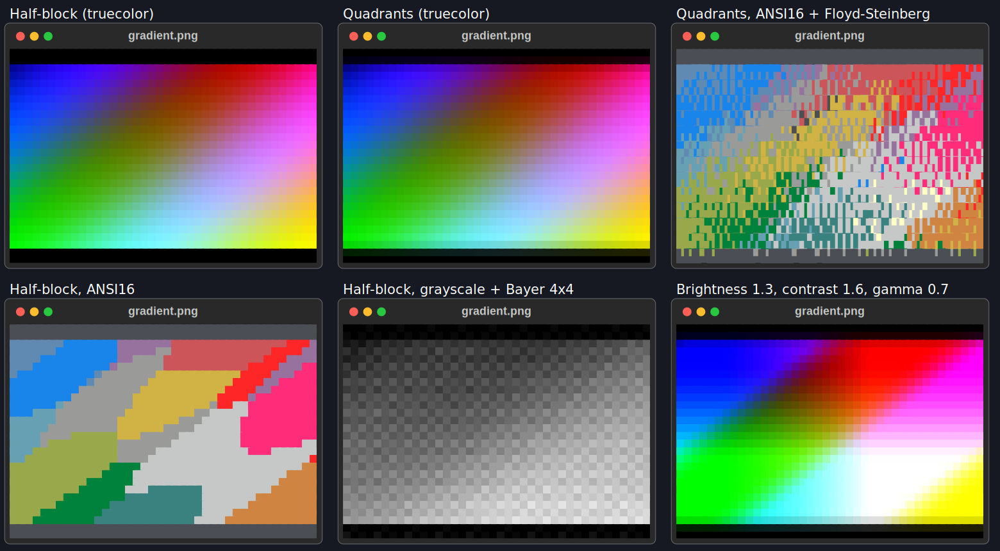
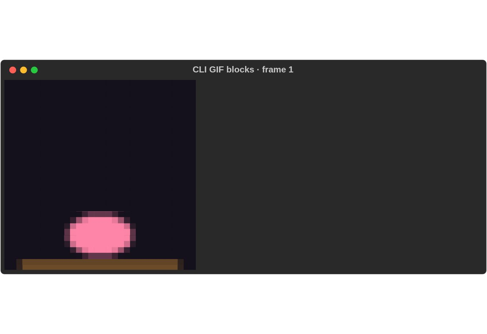
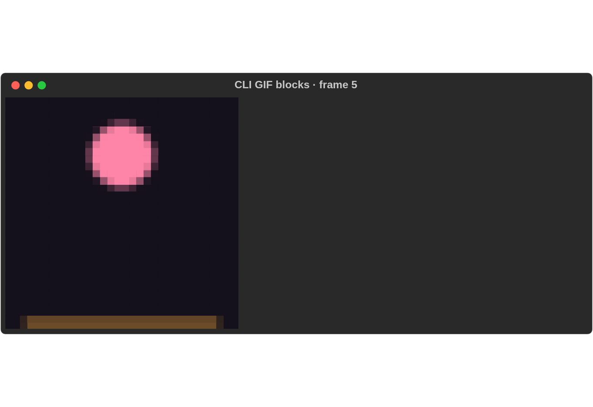
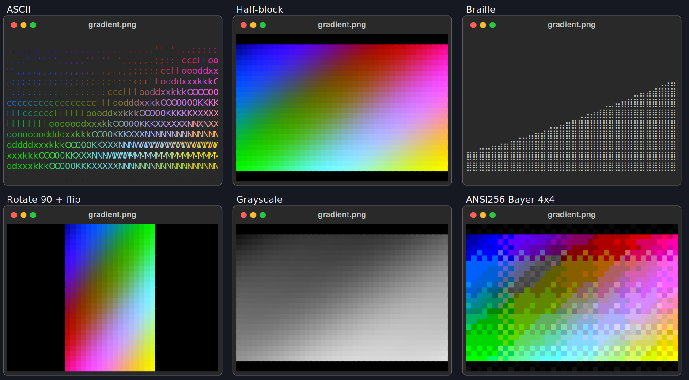
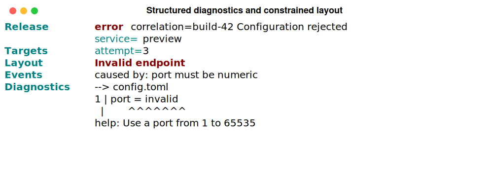

# Using the CLI

`rich` renders files that are painful to read in a terminal — Markdown, Org,
AsciiDoc and man pages, JSON, CSV, source code, notebooks, images — and
compares images, text files and
patches. It also explores structured data (`inspect`), shows any file (`view`),
looks inside bytes, characters and escape sequences (`hex`, `unicode`,
`ansi explain`), lists the environment (`env`) and captures a command's output
(`capture`). It draws charts and diagrams (`chart`, `mermaid`, `dot`, `deps`,
`schema`, which also reads SQL DDL and Arrow and draws ER diagrams),
profiles data files (`profile`), asks questions in scripts
(`choose`, `input`, `confirm`, ...), shows micro assets (`micro`) and
records terminal sessions (`record`). This
page is organised by what you are trying to do. For the complete list of
options, see the
[CLI reference](cli-reference.md).

**Assumes** you can run commands in a terminal. Examples use real CLI output;
sections marked with a version need at least that version. The latest
published release is 0.0.22 (see the
[0.0.22 release notes](releases/0.0.22.md)), which this page describes.

---

## Take the guided tour

```bash
rich --demo-list              # list core, workflows, art
rich --demo --demo-section workflows  # play one group
rich --demo                   # one pass, 3 seconds between sections
rich --demo --demo-delay 5    # a slower tour
rich --demo --demo-delay 0    # skip section pauses
rich --demo --no-color > tour.txt  # finite, colour-free transcript
```

The tour walks through markup, a pushed theme, tables, panels, layouts,
Markdown (including `~~~` strikethrough), syntax, progress with speed and time
remaining, notebooks, JSON Lines, logs, config profiles, batch planning and
parallel HTML/SVG exports, a two-file watch, `rich inspect`, a text `rich diff`,
`rich view`, the `hex`, `unicode` and `ansi explain` inspectors, an upstream
theme file, a `rich capture --redact` of a shell one-liner, and rich-art's
banners, Braille, half-blocks, quadrants, ASCII, ANSI16 and tone adjustments,
Atkinson dithering with OKLab colours, checkerboard and terminal-default alpha
backgrounds, crop/background controls, image diffs and GIF playback. The watch example ends itself: its last
edit writes invalid JSON, and `--watch-exit-on-error` stops the watch.
It shows commands alongside the CLI examples. URL fetching, external paging
and terminal-specific Sixel support are explained without opening a browser,
fetching a URL or launching a pager.

It runs once and exits. **Ctrl+C stops the tour**, restores the cursor and
cleans up temporary examples. Config files are ignored so the tour works
without setup; its profile example uses an isolated bundled configuration.
It never writes into your current directory. `--demo-delay` accepts 0–60
seconds and only affects section pauses on a terminal; watch/GIF examples
have their own short playback. Redirected output has no pauses or animation.
A build without the `art` feature explains that the art sections are unavailable.
`--demo-list` lists stable section names without playback. Use
`--demo --demo-section core|workflows|art` to select a group (supply one name);
unknown names fail before playback. Use `--demo` on its own for the full tour,
optionally with `--demo-section`, `--demo-delay`, `--no-color` or
`--no-config`; other rendering options and resources are rejected.

## Read a file

Point `rich` at a file and it picks a renderer from the extension: `.md`,
`.rst`, `.org`, `.adoc`, `.json`, `.csv`, `.tsv` and `.ipynb` get their own (as
do man pages, [below](#org-asciidoc-and-man-pages)); **anything else with an
extension is syntax-highlighted**.

```bash { .rich-playground data-kind="cli" }
rich README.md
rich data.json
rich main.rs
```

Force a renderer when the extension is missing or misleading:

```bash { .rich-playground data-kind="cli" }
rich --markdown CHANGELOG
rich --syntax --width 100 script
rich markdown CHANGELOG
rich syntax --width 100 script
```

Code is highlighted by syntect. `--code-theme NAME` picks one of its themes
(`ansi_dark` and `ansi_light` use the terminal's own colours), and a build with
the `lumis` feature adds `--highlighter lumis` with lumis's themes. Both are
also config keys (`code_theme`, `highlighter`), which a project's `rich.toml`
may set. `rich doctor` lists the highlighters and themes available. See the
[code highlighters guide](guide/ext/code-highlighters.md).

### Show part of a file, with line numbers

rich-cli's source options work on source files, CSV and notebooks:

```bash { .rich-playground data-kind="cli" }
rich main.rs --head 20            # the first 20 lines (-h 20)
rich main.rs -n -g                # line numbers and indentation guides
rich script --lexer python        # highlight as Python, whatever the name
rich log.csv --tail 5             # the last 5 rows (-t 5)
rich notebook.ipynb -n --no-wrap  # numbered code cells, long lines cropped
```

`-h` is `--head`, as in rich-cli; help is `--help`. As upstream,
`--tail N` shows the last `N - 1` lines of source (all `N` rows of a CSV).
Automatic mode renders a file as syntax once one of these options is given.

Upstream's other text options are here too: `--emoji` replaces `:emoji:`
codes (they are left as typed otherwise), `--soft` leaves long lines for the
terminal to wrap, `-W/--max-width N` narrows the output, and `--force-terminal`
writes colour into a pipe. With `--print` and `--rule`, `-L/-C/-R/-F`
(`--text-left`, `--text-center`, `--text-right`, `--text-full`) justify the
text; like rich-cli on rich 15, a bare line only shows it once `--width` or a
panel gives it a width to fill. `--rule-style` and `--rule-char` set the rule's
line.

### reStructuredText

`--rst` renders reStructuredText as rich-cli does, through a port of
`rich-rst`. A `.rst` file is detected by its extension:

```bash { .rich-playground data-kind="cli" }
rich README.rst
rich --rst docs/intro.txt
rich --rst notes.rst --lexer ruby   # code blocks that name no language
```

Titles are drawn in double-bordered panels, admonitions in titled panels,
field lists as a table and code in a bordered `Syntax` panel. The port covers
the common subset of reStructuredText; DIVERGENCES §35 lists what it leaves
out.

### Org, AsciiDoc and man pages

*New in 0.0.19.* Upstream renders Markdown and reStructuredText only; this
port also renders Org files, AsciiDoc and man pages from their roff source,
in the same look as Markdown: the same heading styles, list markers, code
panels and tables.

```bash
rich notes.org                    # headlines, TODO keywords, tags, drawers
rich guide.adoc                   # sections, admonitions, source blocks
rich ls.1                         # a man page's roff source
rich --org TODO                   # force a format: --org, --asciidoc, --man
rich asciidoc README.txt          # or as a subcommand (also adoc, roff)
rich --format man page.txt        # or by name, as --format takes data formats
zcat /usr/share/man/man1/ls.1.gz | rich --man -
```

Org covers the headline tree with `TODO`/`DONE` keywords (and those a
`#+TODO:` line declares), priorities and tags, emphasis, lists with
checkboxes, source, example, quote and verse blocks, tables, links, drawers
and planning lines (shown dim and compact), and `#+TITLE` and the other
keywords. AsciiDoc covers the document header and attributes (`{name}`
references), sections, lists (with checklists, description and callout
lists, and `+` continuations), source blocks with callouts, literal, example,
sidebar and quote blocks, tables, admonitions, links and image placeholders;
macros it does not draw are shown as written. Man pages cover the man macros
(`.TH`, `.SH`, `.TP`, `.IP`, `.RS`, the font macros, `.nf`, `.EX`, `.UR`, …),
font and special-character escapes, conditionals, tbl tables, and the common
mdoc macros of BSD pages.

Detection is careful, because these extensions are also used for other
things. A flag always wins. Otherwise:

| Input | Shown as |
|---|---|
| `.org`, `.adoc`/`.asciidoc`, `.man`/`.roff`/`.mdoc` | that document |
| `.1` to `.9` (also `.3pm`, `.1ssl`, …) | a man page when it holds roff, else as before (`syslog.1` stays a log) |
| `.asc` | AsciiDoc when the content says so (it is also a PGP signature) |
| no extension (`TODO`, `LS`) | a document only when the content is unmistakably Org, AsciiDoc or roff |
| any other extension | never a document: `gen.c` stays C even if it quotes `.TH` |
| piped input | plain text, as upstream; `--format auto` detects a likely document |

To see such a file's source instead, ask for it: `rich --syntax notes.org`
(or any source option, such as `--line-numbers`). `--lexer LANG` names the
language of code blocks that name none, such as a man page's examples. Links
show their target after the text unless `-y/--hyperlinks` asks for terminal
hyperlinks, as for Markdown. Content the renderer does not show (an
`include::` it does not follow, an equation, a block that never closes) is
named in a warning on stderr; `--report json` keeps stderr to its report.

Read from standard input with `-` (including `-p -` for markup):

```bash
cat data.csv | rich --csv -
cat data.csv | rich csv -
```

Input modes without a resource also read stdin until EOF. Interactive input
prints a hint: finish with Ctrl-D on Unix, or Ctrl-Z then Enter on Windows.
With no mode and no resource, `rich` runs its capability demo. The demo accepts
`--no-color`; layout, style, paging, hyperlink and export options require a
resource or render mode and are rejected for the demo.

Repeated scalar options use the last value, including `--width` and export paths.

## Watch a resource

Watch a local file while editing it:

```bash
rich --watch report.md
```

Local files are watched through operating-system file events (inotify,
FSEvents, ReadDirectoryChangesW or kqueue, via the `notify` crate). Each file's
*parent directory* is watched and events are filtered by path, so atomic
rename-over saves and delete-and-recreate are caught. A render only happens
when the file's contents changed: the file is hashed with a bounded buffer, so
same-size edits with preserved timestamps are detected and metadata-only
events are ignored. Atomic saves, temporary disappearance, malformed
intermediate content, and later recovery are handled as successive frames; a
failed frame is reported and the watcher keeps running. `Ctrl-C` terminates
the interactive watch.

Watch several files at once — each keeps its own render mode (auto-detected
from its extension unless a mode flag is given) and gets its own live region
with the file name as a header:

```bash
rich --watch README.md status.json data.csv
```

A change to one file re-renders only that file's region; the regions repaint in
place through the `rich-ext` Live coordinator instead of clearing the screen,
and each region is cropped to an equal share of the terminal height (a
`… N more lines` marker shows what is hidden). Errors stay visible inside the
failing file's region and clear when the file becomes valid again. On
`Ctrl-C` the last frame is left on screen and the cursor is restored. A single
watched file keeps the full-viewport clear-and-repaint of earlier releases.

| option | default | effect |
|---|---|---|
| `--watch-debounce SEC` | `0.1` | Quiet period that collapses a burst of events (an editor's write, rename and chmod) into one re-render. A file that keeps changing still refreshes at least every 10 debounce windows. `0` renders on every event. |
| `--watch-poll` | off | Skip file events and poll local files every `--watch-interval`. Use it on network filesystems (NFS, SMB, some container mounts) where events are not delivered. |
| `--watch-interval SEC` | `1` | Polling interval for `--watch-poll`, for the automatic polling fallback, and for URLs; at most 86400. |
| `--watch-exit-on-error` | off | End the watch when a render fails, restoring the terminal, printing the error and exiting with that render's non-zero exit code. |

If file events cannot be set up (for example the watch limit is exhausted or a
parent directory does not exist), the watcher prints one notice and falls back
to polling at `--watch-interval`. Idle watching does not busy-loop in either
mode. Recursive directory and glob watching are not supported; name each file.

URLs can be watched when the default `fetch` feature is enabled. A URL is
always polled, and must be the only watched resource:

```bash
rich --watch --watch-cache --watch-interval 5 https://example.com/data.json
```

`--watch-cache` hashes each fetched response and only renders changed bodies.
Without it, URLs are fetched and rendered every interval. When stdout is
redirected or piped, `--watch` renders exactly one snapshot and exits instead
of entering an interactive loop; with several files the snapshot is each file
rendered once, in order, byte-identical to separate `rich FILE` runs. A binary built with `--no-default-features`
does not support URL fetching, including URL watches. Watch cannot be combined
with batch or explicit/automatic paging.

!!! tip "Filenames that begin with a dash"

    Everything after a bare `--` is treated as the resource, however much it
    looks like an option: `rich -- -weird-name.md`.

## Use preferred subcommands

0.0.6 adds task-oriented subcommands while keeping every existing flat flag
working without warnings:

```bash { .rich-playground data-kind="cli" }
rich markdown README.md
rich json data.json
rich csv data.csv
rich ipynb notebook.ipynb
rich diff before.png after.png --threshold 2
rich image photo.png --width 60
```

The subcommands route through the same renderers as `--markdown`, `--json`,
`--csv`, `--ipynb`, `--diff` and `--image`. Common options such as `--width`,
`--no-color`, `--sanitize`, `--panel`, `--padding`, exports and alignment keep
their existing behavior where the mode supports them.

## Neutralize terminal controls in input

By default, the upstream modes (`rich FILE`, `--print`, `--markdown`, `--json`,
`--csv`, …) keep ESC bytes in input, matching upstream `rich` behavior. Use
`--sanitize` when displaying content you do not trust:

```bash { .rich-playground data-kind="cli" }
rich --sanitize suspicious.txt
```

The option replaces terminal controls with visible inert text before rendering,
so `ESC[2J` becomes `␛[2J` instead of clearing the screen. LF and TAB are
preserved for layout and CSV/TSV structure. The sanitizer covers decoded file,
stdin and URL text; literal `--print` input; JSON and notebook string values
decoded from escapes such as `\u001b`; panel/table titles and captions; rule
titles; and SVG document titles. It does not strip styling generated by `rich`
itself, and the upstream modes' defaults remain unchanged when the option is
absent.

`rich view`, `rich schema`, `rich log` and the text `rich diff` (`--diff` on
anything but two images) have no upstream behaviour to keep, so, like `less`,
they sanitize
**by default**: a
file that sets the window title, writes the clipboard (OSC 52) or hides a
hyperlink shows those sequences as inert text instead. Pass `--no-sanitize` to
let such a file's escapes reach the terminal. With sanitizing on, `rich diff`
also shows controls in file names and the summary line, and two ANSI captures
are still compared by their colours: only their SGR styles are kept, and OSC
strings, C1 controls such as U+009B and stray ESC bytes are removed or shown.

`rich capture --sanitize` does the same to the captured output (keeping its
colours) before it is shown, exported, recorded with `--cast` or reported. The
command line in the capture's title is always shown inertly.

A `sanitize = false` in a working-directory `rich.toml` is ignored (see
[Config profiles](#config-profiles)); `--no-sanitize`, or `sanitize = false` in
`~/.config/rich/config.toml` or a `--config` file, still turns it off.

Error messages always show terminal controls in the paths and other input they
quote, so `rich $'x\e]0;title\a.txt'` reports `cannot read x␛]0;title␇.txt`.

## Render a CSV as a table

```bash { .rich-playground data-kind="cli" }
rich --csv team.csv --title "Team"
```

```text
             Team
┏━━━━━━━┳━━━━━━━━━━┳━━━━━━━━━┓
┃ name  ┃ role     ┃ commits ┃
┡━━━━━━━╇━━━━━━━━━━╇━━━━━━━━━┩
│ Ada   │ author   │     120 │
│ Grace │ reviewer │      98 │
└───────┴──────────┴─────────┘
```

The delimiter and whether row 1 is a header are **detected**, not assumed, so
semicolon- and tab-separated exports work without a flag. Numeric columns are
right-aligned automatically.

### Show each column's type (0.0.16)

`--infer` types each column from its cells (integer, float, boolean, date,
timestamp, text, or null when every cell is empty) and shows the type under
its heading. A number column right-aligns even when some cells are null
tokens (`NA`, `N/A`, `null`, empty), which without `--infer` make it text:

```text
$ rich --csv orders.csv --infer
┏━━━━━━━━━┳━━━━━━━━┳━━━━━━━━┳━━━━━━━━━━━━┓
┃      id ┃ amount ┃ region ┃ when       ┃
┃ integer ┃  float ┃ text   ┃ date       ┃
┡━━━━━━━━━╇━━━━━━━━╇━━━━━━━━╇━━━━━━━━━━━━┩
│       1 │    4.5 │ eu     │ 2026-10-01 │
│       2 │     NA │ us     │ 2026-10-02 │
│       3 │     12 │ eu     │ 2026-10-03 │
└─────────┴────────┴────────┴────────────┘
```

It applies wherever a file is drawn as a table: `--csv`, and `rich FILE.csv`
or `FILE.tsv`. `--head`/`--tail` cut the rows first, so the types describe
the rows shown. Inference is opt-in: without `--infer` the table is exactly
rich-cli 1.8.1's, and with any other mode `--infer` is a usage error. For the
evidence behind each type, use `rich profile`.

### Style cells by value (0.0.19)

`--style-rule` styles the cells, rows or columns of a data table by what they
hold. It is repeatable, and each rule is `COLUMN OP VALUE:STYLE`, or
`COLUMN OP VALUE:TARGET:STYLE` to style more than the cell:

```bash { .rich-playground data-kind="cli" }
rich --csv services.csv --style-rule 'latency>500:bold red'
rich services.csv --style-rule 'status=failed:row:on red' --style-rule 'note empty:dim'
rich services.csv --rules rules.toml
```

| Part | Written as |
|---|---|
| `COLUMN` | a header (`p99 ms`), a header in double quotes when it holds a comparison, a `:` or a comparison word (`"a<b"`), or `#N` for the 0-based column `N` |
| `OP` | `==` or `=`, `!=`, `<`, `<=`, `>`, `>=`, `*=` (contains), `^=` (starts with), `$=` (ends with), or a word after a space: `eq`, `ne`, `lt`, `le`, `gt`, `ge`, `contains`, `starts_with`, `ends_with`, `empty`, `not_empty` |
| `VALUE` | the text up to the next `:`, trimmed. A number compares as a number (a cell that is text parsing as a number counts; one that does not never matches an ordering); anything else compares as text. In double quotes it is always text and may hold a `:` (`when="12:30"`, `code="200"`; `\"` and `\\` escape). `empty` and `not_empty` take none |
| `TARGET` | `cell` (the default), `row`, or `column` (every cell of the column, when any cell matches) |
| `STYLE` | the rest: any style, which may itself hold a `:` (`link https://…`) |

Where several rules match, their styles combine in order, the later one
winning. Rules restyle; they never change the text, and without them the table
is exactly rich-cli 1.8.1's. `--rules FILE` reads the same rules from TOML
rule tables, after the rules before it on the command line:

```toml
[[rules]]
column = "status"     # a header, or a 0-based index
op = "eq"             # or ==, !=, <, <=, >, >=, contains, starts_with, ends_with, empty, not_empty
value = "failed"
style = "on red"
target = "row"        # cell (default), row or column
```

Rules apply wherever the CLI draws a data table from a file: `--csv` (and
`rich FILE.csv` or `FILE.tsv`), `rich profile`'s table of columns, and
`rich inspect --table`'s records. Elsewhere they have no effect, so a
[config profile](#config-profiles) can carry rules without stopping other
commands. A rule that does not parse is a usage error (exit 2) that names it
and says what is wrong (`rich: --style-rule: rule "latency>:red": no value
after ...`), and a rule naming a column the table lacks is drawn without, with
a warning on stderr.

## Profile a data file (0.0.16)

`rich profile` says what each column of a CSV, TSV or JSON Lines file holds:
its inferred type, how many cells are null, how many distinct values there
are, the minimum, maximum and mean, and a distribution (a histogram for a
numeric column, the most common values for any other), then a map of where
the nulls are.

```bash
rich profile orders.csv
rich profile orders.csv --columns region,amount --top 3
curl -s https://example.com/events.ndjson | rich profile
rich profile orders.csv --report json > profile.json
```

```text
$ rich profile orders.csv --columns region,amount --top 3 --width 72
orders.csv: 24 rows, 2 columns

┏━━━━━━━━┳━━━━━━━┳━━━━━━━━━┳━━━━━━━━━━┳━━━━━━┳━━━━━┳━━━━━━━━━┓
┃ column ┃ type  ┃   nulls ┃ distinct ┃  min ┃ max ┃    mean ┃
┡━━━━━━━━╇━━━━━━━╇━━━━━━━━━╇━━━━━━━━━━╇━━━━━━╇━━━━━╇━━━━━━━━━┩
│ region │ text  │  2 (8%) │        4 │ apac │  us │         │
│ amount │ float │ 4 (17%) │       20 │ 7.25 │ 250 │ 63.3855 │
└────────┴───────┴─────────┴──────────┴──────┴─────┴─────────┘

region · text · 2 nulls (8%) · 4 distinct
  eu   ████████████████████████ 9
  us   ████████████████████████ 9
  apac ████████                 3
  + 1 other value (1 cell)

amount · float · 4 nulls (17%) · median 50.95 (p25 21.825, p75 82.95)
  [0, 25)    ████████████████████████ 6
  [25, 50)   ████████████████         4
  ...
  [225, 250] ████                     1

missing values (% null; rows top to bottom, 2 rows each)
      region amount
1-2
3-4          ▒▒▒▒▒▒▒
...
0 [ ░▒▓█] 100
```

The format comes from the extension (`.csv`, `.tsv`, `.jsonl`, `.ndjson`),
else from the first character (`{` or `[` is JSON Lines); CSV is sniffed as
`--csv` sniffs it, and the first row is a header unless every cell in it is
a number. Empty cells, `null`, `NULL`, `NA` and `N/A` count as null (JSON
Lines, profiled path by path as [below](#nested-json-lines-0019), have JSON's
own `null`). A file or stdin is streamed, not read into memory: past `--sample
N` rows (10,000 by default) the types, statistics and distributions describe a
uniform sample, the heading prints the sample size (`sampled 10,000 of
3,000,000 rows`, or for JSON Lines `sampled to 10,000 values a path`), and the
null counts and the map still count every row. A row with more cells than the
header is noted rather than refused.

`--columns a,b` profiles only those columns, in that order; `--top N` sets
how many common values are shown (5). `--report json` writes the profile
itself to stdout (`rows`, `sample`, `sampled`, and per column `type`,
`nulls`, `null_rate`, `distinct`, the statistics and the `distribution`),
as `doctor --report json` writes its diagnostics; a failure is the usual
error envelope on stderr. A column `--columns` names that is not there is a
data error (exit 4).

`--style-rule` and `--rules` style the table of columns
([Style cells by value](#style-cells-by-value-0019)). Rules name its headings
and compare the profile's own values, so `nulls`, `absent` and `distinct` are
counts: `rich profile orders.csv --style-rule 'nulls>0:row:yellow'`.

### Nested JSON Lines (0.0.19)

JSON Lines are profiled **path by path**: each key of a nested object is its
own path (`user.plan`), the items of an array are `tags[]`, and a key of the
objects in an array is `items[].sku`. A key that holds `.`, `[`, `]`, `"`,
`\`, a control character or surrounding spaces, or is empty, is written as a
JSON string in brackets, as jq and JSONPath write it: `["http.status"]`,
`meta["k8s.io/name"]`. A record that is not an object is the path `value`.

```text
$ rich profile requests.jsonl --columns 'user.plan,["http.status"],items[].qty' --width 72
requests.jsonl: 12 records, 3 paths
! marks 2 paths holding more than one JSON type besides null:
["http.status"], items[].qty
1 line is not JSON and was skipped: line 13 (expected value)

┏━━━━━━━━━━━━━━━━━┳━━━━━━━━━┳━━━━━━━━━┳━━━━━━━━━┳━━━━━━┳━━━━━━┳━━━━━━━━┓
┃ path            ┃ types   ┃  absent ┃ distin… ┃  min ┃  max ┃   mean ┃
┡━━━━━━━━━━━━━━━━━╇━━━━━━━━━╇━━━━━━━━━╇━━━━━━━━━╇━━━━━━╇━━━━━━╇━━━━━━━━┩
│ user.plan       │ str 89% │ 3 (25%) │       3 │ free │ team │        │
│                 │ · null  │         │         │      │      │        │
│                 │ 11%     │         │         │      │      │        │
│ ["http.status"] │ ! num   │  1 (8%) │       6 │  200 │  503 │ 303.1… │
│                 │ 82% ·   │         │         │      │      │        │
│                 │ str 18% │         │         │      │      │        │
│ items[].qty     │ ! num   │ 9 (75%) │       4 │    1 │    5 │   2.75 │
│                 │ 75% ·   │         │         │      │      │        │
│                 │ str 25% │         │         │      │      │        │
└─────────────────┴─────────┴─────────┴─────────┴──────┴──────┴────────┘

user.plan · text · 3 absent (25%) · 1 null (11%) · 3 distinct
  free ████████████████████████ 3
  ...
```

For each path the table shows:

- **types**: the mix of JSON types its values had (`str`, `num`, `bool`,
  `obj`, `arr`, `null`), most common first. One type is its name alone; a
  path with more than one type besides `null` is **mixed**, marked `!` and
  named in a note, so a field that is sometimes a number and sometimes a
  string shows as such rather than as one inferred type.
- **absent**: the records that do not hold the path at all, counted apart
  from an explicit `null` (which is in the mix, and under the path's heading
  as `1 null`). The missing-value map counts a record as missing a path when
  it lacks it or holds only `null` there.
- **distinct**, **min**, **max**, **mean** and the distribution below: of the
  path's values, as for a column (an array's items count one by one, so
  `items[].qty` has more values than records). An object or array that is
  walked into has none of its own.

Paths are bounded. `--depth N` (4 by default) is the most steps a path has, a
key or `[]` each: an object or array at the last step is not walked into, and
its JSON text is its value, as in a flat profile. `--max-paths N` (200) is
the most paths profiled, in the order first seen; the paths seen after that
are not profiled (nor anything below them), and a note and a last table row
say how many there were (`+ 12 more paths not profiled (max_paths 200)`),
naming the first. Each path keeps at most `--sample N` values; presence, the
type mix, nulls and the map count every record, so the input is read once, in
linear time and bounded memory. `--columns` names paths, as written
(`--columns 'user.plan,["http.status"]'`).

A line that is not JSON is counted and skipped, never fatal: a note gives the
count, the first line numbers and why (`malformed` and `malformed_lines` in
the JSON). Input with no record at all is still a data error (exit 4).

`--flat` profiles JSON Lines as 0.0.16 did: one row per record, the top-level
keys as columns (nested values as their JSON text, absent keys as nulls), and
a line that is not JSON a data error. CSV and TSV are always flat, and
`--depth`, `--max-paths` and `--flat` with them are a usage error.

`--report json` of a nested profile adds, without changing any key a flat
profile has: `paths` (`depth`, `max_paths`, whether any path was `sampled`,
whether the cap was met as `capped`, and the first hundred paths past it as
`dropped`), `malformed` and `malformed_lines` when lines were skipped, and per
column `present`, `absent`, `values` (every value seen, `null`s included),
`types` (a count per JSON type seen: `string`, `number`, `boolean`, `object`,
`array`, `null`) and `mixed`. A nested column's `nulls` counts explicit
`null`s and its `null_rate` is over its values; `type` is the type inferred
from its sampled values, or `object` or `array` for a path that only ever
held one.

## Stream JSONL and logs

Use `jsonl` / `--jsonl` for newline-delimited JSON. Each line is parsed and
rendered independently, so the command can consume long streams without holding
the complete input in memory:

```bash { .rich-playground data-kind="cli" }
tail -f app.jsonl | rich jsonl -
rich --jsonl events.ndjson
```

Malformed records fail fast by default and report the line number.

### Logs: `rich log`

Use `log` / `--log` for logs: JSON Lines and the common text formats. Each
record is written as it is read:

```bash { .rich-playground data-kind="cli" }
rich log app.jsonl
tail -f app.jsonl | rich log -
```

Objects with `timestamp`, `time` or `@timestamp`, `level` or `severity`, and
`message` or `msg` are flattened into a readable log line; remaining fields are
printed as compact JSON. Other values fall back to compact JSON.
`--log-presentation rich` shows typed fields and coloured levels instead (see
[Rich log presentation](#rich-log-presentation)). With none of the options
below, the output is what it has always been.

**Text logs (0.0.19).** A line that is not JSON is read by the first parser
that knows its format, and becomes a record with fields like a JSON one:

| `--parser` | Reads | For example |
|---|---|---|
| `logfmt` | `key=value` pairs | `time=… level=info msg="cache warm" keys=12` |
| `level` | a line that starts with a level | `ERROR request failed host=db`, `[warn] disk full`, `INFO:app.db:connected` |
| `timestamp` (`rfc3339`) | a line that starts with an ISO 8601 time | `2026-10-18T10:00:01Z WARN app::db: pool low size=2` |
| `access` (`nginx`, `apache`) | access logs, the level from the status (5xx error, 4xx warn) | `127.0.0.1 - - [18/Oct/2026:10:00:02 +0000] "GET / HTTP/1.1" 404 0` |

`--parser auto`, the default, tries each in that order; `--parser logfmt`
(or another name) reads with that one only, and `--parser text` with none.
Words such as `host=db` at the end of a message become fields too. A line no
parser reads is never dropped: after a record it joins it, as a stack trace
does, and is written indented under it; before any record it is written as
text. Blank lines are skipped, and colour codes are taken out before a line
is read.

```bash { .rich-playground data-kind="cli" }
rich log app.log --parser logfmt
```

**Filters.** `--level LEVEL` keeps one level, `LEVEL+` that level and the
ones above it (trace, debug, info, warn, error, fatal); give several with
commas or by repeating it. A record keeps its continuation lines.

```bash { .rich-playground data-kind="cli" }
rich log app.jsonl --level warn+
rich log app.jsonl --level debug,error
```

`--where EXPR` keeps the records whose fields pass a test. Repeat it: every
test must pass.

| `EXPR` | Keeps a record whose field… |
|---|---|
| `service=api` | equals the value (`==` works too) |
| `service!=api` | is missing, or differs |
| `latency_ms>500`, `>=`, `<`, `<=` | orders after (or before) the value |
| `msg~time(d )?out` | matches the regular expression |
| `msg!~retry` | is missing, or does not match |
| `trace_id` | is there |
| `!trace_id` | is missing |

Dots reach into nested fields (`http.status`) and lists (`tags.0`), and
`message`, `level` and `time` also find `msg`, `severity` and `timestamp`.
Levels compare by severity (`level>=warn`), numbers as numbers (a logfmt
value that is a number too), times as instants whatever their offsets
(`time>=2026-10-18T10:00:00Z`), and anything else as text. A missing field
fails every test but `!=`, `!~` and `!FIELD`. The value may be quoted.

```bash { .rich-playground data-kind="cli" }
rich log app.jsonl --where 'service=api' --where 'latency_ms>500'
rich log app.jsonl --where 'msg~(?i)timeout'
```

**Follow a file.** `-f` / `--follow` reads FILE, then what is appended to
it, until Ctrl+C (exit 130). When the file is truncated or replaced, as log
rotation does, it says so on stderr and reads on from the start of the new
content. Standard input needs no `--follow`: it is read until it ends. A
line that grows past 1 MiB without ending is shown in 1 MiB pieces, with a
notice on stderr, rather than held.

```bash
rich log -f /var/log/app.jsonl --level warn+
```

**Fold repeats.** `--collapse` writes a run of identical records (their
times aside) once, with `× N (last TIME)` under it. It is on by default with
`--follow` (where, on a terminal, the count grows in place) and in the live
view; `--no-collapse` turns it off there.

```bash { .rich-playground data-kind="cli" }
rich log app.jsonl --collapse
```

**Groups and a summary.** `--group trace`, `span` or `correlation` gathers
the records by their trace id (`trace_id`, `traceId`, `trace.id`, …), span id
or correlation id (`correlation_id`, `request_id`, `x-request-id`, …): a
header for each group with its records, errors, warnings and how long it
took, its records indented under it, and the records without an id last.
It ends with a summary: the records shown, counts by level, and the groups
with errors. With `--follow`, a header is written whenever the group
changes.

```bash { .rich-playground data-kind="cli" }
rich log app.jsonl --group trace
```

```text
▸ trace 4bf92f3577b34da6 · 3 records · 1 error · 1 warning · 1.900s
  2026-10-18T10:00:00.000Z INFO request started {"service":"api","trace_id":"4bf92f3577b34da6"}
  …
Summary: 12 records
  error 2 · warn 3 · info 6 · no level 1
  2 traces with errors: 4bf92f3577b34da6 (1 error), 00f067aa0ba902b7 (1 error)
```

`--summary` adds the summary without groups, and `--no-summary` leaves it
out.

**Fields and times.** `--fields` lists each record's fields under it, one a
line, instead of on its line. `--time relative` shows each time since the
first record shown (`+1.250s`), `--time none` leaves times out, and `--time
absolute`, the default, shows them as written.

```bash { .rich-playground data-kind="cli" }
rich log app.jsonl --fields --time relative
```

**JSON out.** `--output jsonl` writes the records kept as JSON Lines, for
another program: JSON records with their fields unchanged, text records as
objects of their fields, and continuation lines as a `continuation` list.
When the input goes quiet a record is written before it is known to be
complete; continuation lines that come after that are written as an object
of their own, `{"continuation": [LINE, ...]}`. Read back by `rich log`, a
record's `continuation` list is its continuation lines again, such an
object's lines join the record before it, and so a record shows as it did.
With `--summary` the summary goes to stderr.

```bash
rich log app.log --level error --output jsonl | jq .msg
```

**Redaction.** `--redact` masks secrets as `rich capture --redact` does:
values under secret-looking keys (`password`, `token`, …), and bearer tokens,
API keys, JWTs and URL passwords in any text, with `********`.
`--redact-pattern REGEX` masks what REGEX matches too; repeat it. Filters
see the record before it is masked.

**Untrusted text.** A log is untrusted input, so `rich log` sanitizes by
default, as `rich view` does: terminal controls in keys (nested ones too),
values and continuation lines, such as an OSC 52 clipboard write in a JSON
field, are shown as inert symbols, in `--output jsonl` too. `--no-sanitize`
lets them through.

```bash { .rich-playground data-kind="cli" }
rich log app.jsonl --redact --redact-pattern 'card=\d+'
```

`--redact-preview` shows what would be masked instead of the records, and
writes nothing; see [Preview a redaction before you
share](#preview-a-redaction-before-you-share-0019).

**Live view.** `-i` / `--interactive`, on a terminal, shows the records in a
view that follows the end as they arrive (with `-f`, or from a pipe). `/`
types a filter that applies as you type: words that look like `--where`
tests (`service=api`, `latency_ms>500`) test a field, and other words must
appear in the record. Space pauses and resumes, Enter shows the record's
fields and continuation lines, Up and Down move, End follows again, and `q`
quits. Without a terminal the records are written as without `-i`.

```bash
rich log -i -f app.jsonl
```

If the delimiter cannot be determined and the file is not `.csv`/`.tsv`, `rich`
reports it and **exits non-zero** rather than inventing a one-column table:

```bash { .rich-playground data-kind="cli" }
rich --csv notes.txt
```

```text
rich: Could not determine delimiter
```

## Explore structured data

`rich inspect` (or `--inspect`) reads JSON, YAML, TOML, XML, INI or dotenv from a
file, a URL or stdin and draws it as a tree. It is not in upstream rich-cli.

```bash { .rich-playground data-kind="cli" }
rich inspect deploy.yaml
```

```text
deploy.yaml
├── defaults &defaults
│   ├── retries: 3
│   └── timeout: 30
└── servers
    ├── [0]
    │   ├── name: "alpha"
    │   ├── port: 8080
    │   └── << *defaults
    │       ├── retries: 3
    │       └── timeout: 30
    └── [1]
        ├── name: "beta"
        └── port: 8081
```

The format comes from the file name, else from the content; pass
`--format json|yaml|toml|xml|ini|env` when detection cannot tell. INI and dotenv
files show as a key table with their comments. These options change the view:

| Option | Effect |
|---|---|
| `--select EXPR` | Keep what a JSONPath expression selects, e.g. `$.servers[*].name` |
| `--filter EXPR` | Keep what a JSONPath expression selects and the containers above it, so the tree keeps its shape (sequences are renumbered) |
| `--highlight EXPR` | Show the lines a JSONPath expression selects in reverse video |
| `--find TEXT` | List keys and values containing TEXT (any case), with context |
| `--flatten` | One `path` / `value` row per value |
| `--table` | Records as a table, or a path/value table; [`--style-rule`](#style-cells-by-value-0019) styles the records by key (0.0.19) |
| `--max-depth N`, `--max-length N` | Fold deeper containers; show at most N items each |
| `--show-paths` | Print each value's path next to it |
| `--redact` | Mask values under keys such as `password`, `token` or `api_key` (also spelled with dashes, `api-key`), everything nested under such a key, and XML element text |
| `--compare PATH` | List what was added, removed or changed in PATH |

A document that does not parse is reported as `file:line:column` and exits 4.

### Filter and highlight

`--filter` keeps only what matches, and `--highlight` shows matches in reverse
video. With `--inspect` they take a JSONPath; for text, `--print` and
`--syntax` (including files shown as syntax by their extension, such as `.log`)
they take a regular expression, matched against each line.

```bash { .rich-playground data-kind="cli" }
rich app.log --filter 'WARN|ERROR' --highlight ERROR
rich inspect deploy.yaml --filter '$..port' --highlight '$.servers[1]'
```

They run as a pipeline, always in this order, whatever order the flags are
given in:

| Input | Order |
|---|---|
| `--inspect` | parse, `--redact`, `--select`, `--filter`, `--highlight`, then the view (`--find`, `--flatten`, `--table` or the tree) |
| text, `--print`, `--syntax` | read, `--sanitize`, markup or highlighting, `--filter`, each `--transform` in the order given, `--highlight`, then panel, padding and export |

So `--select` narrows first and `--filter`'s path is relative to the selection,
and a redacted value can be selected but never shows. `--compare` applies only
`--redact`; `--filter` and `--highlight` are refused with it, and
`--highlight` is refused with `--find`, `--flatten` and `--table`, which draw
no tree lines. Other modes, such as `--json` and `--markdown`, refuse these
flags, and `--inspect` refuses `--transform`. With any of them, `--syntax`
output is the highlighted text without the theme's background fill.

`--transform NAME` applies a text transform a plugin registered (see
[Plugins](#plugins)); repeat it to chain several, applied in the order given.
An unknown name is a usage error (exit 2) that lists the names there are, and
a transform that fails stops the command like a failed `--filter`
(`--transform NAME failed: …`, exit 4). A runtime plugin's transform returns
plain text, so it drops the styling before it, such as `--syntax`'s colours;
`--highlight` still applies after it.

```bash
rich --plugin shout.wasm --transform upper notes.txt
rich --plugin shout.wasm app.log --filter ERROR --transform upper --highlight TIMEOUT
```

Libraries get the same stages from `rich_ext::transform` and
`rich_ext::data::transform`, and plugins can add text transforms: see
[Transforms](guide/ext/transforms.md).

### Detect the format of piped input

Without a flag, piped text prints as plain text, as upstream does. Add
`--format auto` to detect what it is: JSON goes to the JSON renderer, YAML,
TOML, XML, INI and dotenv are highlighted, a likely Markdown,
reStructuredText, Org, AsciiDoc or man page document is rendered (0.0.19),
and anything else still prints as plain text. With `--format`, no RESOURCE
means stdin.

```bash
kubectl get pod web -o json | rich --format auto
curl -s https://example.com/config | rich --format yaml
```

A named format also overrides the file extension, and a document format
(`markdown`, `rst`, `org`, `asciidoc`, `man`) is the same as its mode flag. To
make detection the default,
set `format = "auto"` in your [config](#config-profiles); a mode you pick
explicitly, such as `--markdown`, ignores it.

### Explore it interactively

`rich explore FILE` opens the same document as a tree you move through, fold
and search, and prints the path of the node you pick, as the JSONPath
`--select` takes. It reads every format `rich inspect` reads, from a file or
stdin (`--format` as above), and paints on stderr, so a script captures the
answer:

```bash
rich --inspect --select "$(rich explore config.yaml)" config.yaml
port=$(rich explore --print value config.yaml)
kubectl get pods -o json | rich explore
```


| Key | Does |
|---|---|
| ↑ ↓, PageUp, PageDown, Home, End | Move |
| → ← | Open or fold a container; ← on a leaf goes to its parent |
| typing | Search keys and values, collapsed or not. The tree keeps each match's ancestors, so you see where it is, and the cursor goes to the best match |
| Ctrl+Y | Copy the focused node's path (`$.server.port`) |
| Alt+Y | Copy its value: a string as it is, anything else as indented JSON |
| Enter | Print the path, or the value with `--print value` |
| Escape | Cancel (exit 1) |

The line under the prompt shows where the focused node is
(`$ › server › port`), and a preview beside the tree (below it under 72
columns) draws its subtree. `--header`, `--height`, `--value QUERY` (start
searching) and `--mouse` work as for the other [interactive
commands](#ask-in-a-script), and so do the exit codes. Without a terminal it
prints the tree, as `rich inspect` does. A document with more than a million
nodes is refused (exit 3): narrow it first with `rich --inspect --select`.

Copies go to the terminal's clipboard through OSC 52, which works over SSH.
It is on only where the terminal is known to take it (kitty, iTerm2,
WezTerm, Windows Terminal, ghostty, Alacritty, foot, contour, rio, VS
Code), never when the output is not a terminal, and not inside tmux or
screen, which pass OSC 52 on only when configured to. On a terminal,
`RICH_CLIPBOARD=1` turns it on anyway and `RICH_CLIPBOARD=0` off; output
that is not a terminal never gets the escape, even with `RICH_CLIPBOARD=1`. When a copy cannot go
anywhere the footer says so.

## Render Markdown, and keep the links readable

```bash { .rich-playground data-kind="cli" }
rich notes.md
```

```text
                           Notes

See the docs (https://example.com/docs) for detail.
```

Link destinations are printed after the label, so a piped or redirected render
keeps them. Pass `-y/--hyperlinks` to emit real clickable
[OSC 8](https://gist.github.com/egmontkob/eb114294efbcd5adb1944c9f3cb5feda)
hyperlinks instead — useful in a terminal, lossy in a pipe:

```bash { .rich-playground data-kind="cli" }
rich --hyperlinks notes.md
```

## Frame and position the output

```bash { .rich-playground data-kind="cli" }
rich --panel rounded --panel-style dim --print "Ready"
```

```text
╭───────╮
│ Ready │
╰───────╯
```

A panel **shrinks to its content**. Use `-e/--expand` to fill the width instead.

`--panel` takes rich-cli's `ascii`, `ascii2`, `square`, `rounded`, `heavy`
and `double`, and every other box in rich's `box` module by its name in lower
case (`heavy_head`, `minimal`, `simple`, `markdown`, …): the names
`rich asset --kind box` offers. `none` means no panel.

- `--style` styles the content; `--panel-style` styles the border. They are
  different flags because they do different things.
- `--width N` bounds the *rendered block*, not the console, so `--center` still
  positions it within your real terminal width.
- `--title` and `--caption` interpret Rich markup; on a CSV they also become
  the table's title and caption. Rules interpret markup in their resource title.
- Notebooks use the same layout chain, so padding, panel, style, width and
  alignment apply to the complete notebook, including its outputs.

## Export what you rendered

```bash { .rich-playground data-kind="cli" }
rich report.md --export-html report.html
rich report.md --export-svg report.svg
```

The HTML is self-contained. The SVG references its font from a CDN, so it is
**not** self-contained offline. Both exports may be requested together, and
stdout is still printed once. Diff reports choose color blocks for HTML/SVG
independently of redirected stdout, which stays readable ASCII. Explicit
`--image-mode ascii`, `--image-mode none` and `--no-color` are respected; Sixel
requests use blocks in exported documents.

### A PNG of the output (0.0.19)

```bash
rich report.md --export-png report.png
rich capture --redact --export-png build.png -- make test
```

`--export-png PATH` writes a PNG image of what was rendered, beside (or
instead of reaching for) the SVG: no tape, no terminal emulator and no
browser. It is drawn by the same rasteriser as `rich record`'s screenshots,
with the same embedded DejaVu Sans Mono and Twemoji, so the same output gives
the same pixels on every machine. The image is as wide as the console
(`--width`), in rich's SVG export theme, inside a window frame titled like the
SVG's (the file name), and at the screenshots' 28-pixel text size. It may be
combined with `--export-html` and `--export-svg`, and works wherever they do,
`rich capture` included, except with `--batch` (a usage error for now). It
needs the `png` feature, on by default and implied by `record`; the library
call is `rich_record::render::png::segments_png`.

## Compare two images

```bash { .rich-playground data-kind="cli" }
rich --diff before.png after.png --threshold 2
```

Reports the regions that changed, and exits `5` when more than `2%` of the image
differs — which makes it usable as a CI gate. See
[Comparing images](image-diff.md) for the modes and how the comparison works.

## Compare text, source and patches

When the two files are not both images, `rich diff` compares them as text. It
is not in upstream rich-cli.

```bash { .rich-playground data-kind="cli" }
rich diff old.rs new.rs
```

```text
--- old.rs
+++ new.rs
@@ -1,4 +1,4 @@
1 1   fn main() {
2   -     let x = 1;
  2 +     let x = 2;
3 3       println!("{}", x);
4 4   }
old.rs → new.rs: 1 added, 1 removed (25.0% of lines changed)
```

- Source is syntax-highlighted by file name (or `--language NAME`), with the
  changed words emphasised inside each changed line.
- Captured terminal output (text containing escape sequences) is compared by
  its visible text, and a line whose text is the same but whose colours or
  styles changed is shown with `~`, so a colour regression is not invisible.
- `--side-by-side` puts old and new in two columns; `--context N` sets the
  unchanged lines kept around each change (default 3).
- `--threshold PCT` gates on the share of changed lines and exits `5` above
  it, as it does for images.
- Terminal controls in the files, and in their names, are shown as inert
  symbols by default, so a diff cannot clear the screen or retitle the window;
  `--no-sanitize` lets them through (see
  [Neutralize terminal controls in input](#neutralize-terminal-controls-in-input)).

A single input is read as a patch, such as `git diff` output. It renders as a
tree of the changed files with their counts, then each file's highlighted hunks:

```bash
git diff | rich diff -
git show HEAD | rich diff - --side-by-side
```

### Merge conflicts

`--conflicts` reads one file with the markers a merge left in it, and shows
each conflict numbered, with a few lines of context and ours, the diff3 base
(when the markers have one) and theirs side by side when the width allows,
stacked otherwise:

```bash
rich diff --conflicts src/config.rs
git diff --name-only --diff-filter=U | xargs -n1 rich diff --conflicts
```

```text
conflict 1 of 1, lines 2-8
1   fn timeout() -> u64 {
  ours: HEAD              │   base: merged common an… │   theirs: feature/env
3 <     30                │ 5 |     10                │ 7 >     env_or("TIMEOUT"
                          │                           │     , 10)
9   }
config.rs: 1 conflict (1 with a base)
```

- The sides are syntax-highlighted by file name (or `--language NAME`);
  `--context N` sets the lines kept around each conflict (default 3), and
  `--side-by-side` keeps the columns however narrow the terminal is.
- Like every other text diff it exits `0` whether or not there are conflicts.
  Markers that do not parse (out of order, nested, or never closed) exit `4`
  with the line named; `--threshold` does not apply.

## Compare benchmark runs

```bash
rich bench compare baseline.json candidate.json --threshold 10
rich bench compare target/criterion-main target/criterion
```

Each file is a benchmark run saved by `rich_ext::qa::bench` (or a criterion
output directory). The table shows each benchmark's change with a small
min/median/p95/max sparkline and marks regressions and improvements; a change
inside `--threshold` percent (default 5) or inside the noise counts as
unchanged. A change from a 0 ns baseline shows as `+inf%` and counts as a
regression unless it is within the noise. Any regression exits `5`. `--width N`
sets the table's width; `--report json` writes the success or failure envelope
to stderr. Controls in benchmark names are shown as inert text.

## Decode escape sequences

`rich ansi explain` lists every escape sequence in a capture with what it does:
colours and styles, cursor and screen control, OSC 8 hyperlinks, window titles
and raw escapes. Then it prints the text a terminal would show.

```bash { .rich-playground data-kind="cli" }
ls --color=always | rich ansi explain
rich ansi explain capture.txt --escapes-only
```

```text
┏━━━━━━━━┳━━━━━━━━━━━━━━━━━━━━━━━━┳━━━━━━━━━┳━━━━━━━━━━━━━━━━━━━━━━━━━━━━━━━━━━┓
┃ Offset ┃ Raw                    ┃ Kind    ┃ Meaning                          ┃
┡━━━━━━━━╇━━━━━━━━━━━━━━━━━━━━━━━━╇━━━━━━━━━╇━━━━━━━━━━━━━━━━━━━━━━━━━━━━━━━━━━┩
│ 0      │ ESC[1;31m              │ SGR     │ bold on, fg red                  │
│ 7      │ ERROR                  │ text    │ 5 characters                     │
│ 12     │ ESC[0m                 │ SGR     │ reset                            │
│ 17     │ ESC]8;;https://x.yESC\ │ OSC     │ open hyperlink to https://x.y    │
│        │                        │         │ (ST-terminated)                  │
…
```

`--ansi-inline` marks the escapes inside the text instead of listing them.
`--sanitize` does not apply here: the escapes are what you asked to see, and
they are only ever printed as visible text.

## Render a still image

```bash { .rich-playground data-kind="cli" }
rich --image photo.png --width 60
rich image photo.png --image-mode blocks --height 20
```

Renders a single picture instead of a comparison: `--diff` needs exactly two
images, `--image` needs exactly one. It shares the same `--image-mode`
(auto/sixel/blocks/quadrants/braille/ascii) and capability auto-detection as `--diff`, plus a new
`--height N` to bound the rendered rows independently of `--width`. `none` is
rejected for `--image`, because it means "draw nothing" and there is no
comparison report to fall back on. See
[Comparing images](image-diff.md) for how the renderer picks a mode.

### Fit, crop and transparent backgrounds

```bash { .rich-playground data-kind="cli" }
rich image photo.png --image-mode blocks --width 44 --height 12 --image-fit contain
rich image photo.png --image-mode blocks --width 44 --height 12 --image-fit cover --image-anchor top
rich image logo.png --image-fit contain --width 44 --height 12 --image-background '#542080'
rich image logo.png --image-mode blocks --width 44 --image-background default
rich image logo.png --image-mode blocks --width 44 --height 12 --image-fit contain --image-background checkerboard
```

`contain` centres the whole image in a padded rectangle; `cover` fills the
rectangle and crops excess edges around `--image-anchor` (default `center`).
Anchors are `center`, `top`, `bottom`, `left`, `right`, `top-left`, `top-right`,
`bottom-left` and `bottom-right`. An explicit anchor requires cover fitting;
contain always keeps the whole image centered. Both preserve aspect ratio assuming
terminal cells are twice as tall as they are wide. `stretch` fills the rectangle
exactly and ignores the aspect ratio. Fitting requires `--height`; width defaults
to the terminal width and is capped by available columns.

`--image-fit native` renders the image at its own pixel size instead, and needs
no `--height`. The image's pixels go 1 × 2 to a cell in `ascii` and `blocks`,
2 × 4 in `quadrants` and `braille`, and 8 × 16 for Sixel, rounded up to whole
cells, so a 16×16 icon is 16×8 cells as blocks. It is never enlarged to fill the
terminal. `--width`, the terminal width, `--image-max-width` and
`--image-max-height` only shrink it, keeping the aspect ratio. Set
`image_fit = "native"` in [your config](#config-profiles) to make it the default.

```bash { .rich-playground data-kind="cli" }
rich image icon.png --image-mode blocks --image-fit native
```

`--image-max-width N` and `--image-max-height N` are upper bounds that never
enlarge anything. Without fitting, the image keeps its aspect ratio and narrows
to respect a height cap; with fitting, they clamp the target rectangle.

`--image-background` says what transparent pixels become:

- `'#RRGGBB'` composites them onto that colour before resizing, and colours
  contain padding. Fit padding otherwise defaults to black.
- `default` leaves them to the terminal's own background. A pixel under half
  opacity after sampling is left unpainted: a blank in ASCII, a half or quadrant
  left out of the glyph in blocks and quadrants, no Braille dot, a transparent
  Sixel pixel. Contain padding is transparent too. A fully opaque image renders
  exactly as it does without the option.
- `checkerboard` composites them onto #999999 and #666666 squares, the
  image-editor convention for previewing transparency. With fitting, each square
  is two cells wide by one tall, so it looks square; without fitting, squares are
  a sixteenth of the image's longer side.

Without either `--image-background` or fitting, existing renderer behaviour is
preserved. Fitting rejects empty/zero dimensions
and rasters above 16 megapixels, including cover's intermediate resize; extreme
aspect ratios may therefore require a smaller size. These options apply to
`image`, not GIF playback or image comparisons.

Library equivalent:

```rust
use rich_art::{ImageAnchor, ImageArt, ImageFit, ImageMode};
let art = ImageArt::from_path("logo.png")?
    .mode(ImageMode::Blocks)
    .width(44).height(12)
    .fit(ImageFit::Cover)
    .anchor(ImageAnchor::Top)
    .background([84, 32, 128]);
// or .background_mode(ImageBackground::TerminalDefault / ::Checkerboard)
```

[See the actual renderings](demos.md) and [workflow recipes](recipes.md).

### Quadrant blocks

```bash { .rich-playground data-kind="cli" }
rich image logo.png --image-mode quadrants --width 60
```

Quadrant characters (`▘ ▀ ▌ ▛ ▚ ▜ ▙ █` and their complements) split every cell
into 2×2 pixels, doubling half-blocks' horizontal detail on edges and diagonals.
A cell still has only a foreground and a background colour, so each cell tries
the eight ways of splitting its four pixels into two groups. It paints each
group in its mean colour and keeps the split with the smallest summed squared
RGB error. Exact ties keep the earlier candidate, and a uniform cell is `█`.
Transparency composites onto black as in half-block mode, unless
`--image-background default` leaves the transparent quadrants unpainted. Quadrants also draw
`--diff` heatmaps, and fall back to ASCII without colour like blocks.

### Colour modes and dithering

```bash
rich image photo.png --image-mode blocks --width 60 --image-color ansi256
rich image photo.png --image-mode ascii --width 60 --image-color ansi256 --image-dither floyd-steinberg
rich image photo.png --image-mode quadrants --width 60 --image-color ansi16 --image-dither bayer4x4
rich image photo.png --image-mode blocks --width 60 --image-color grayscale
rich image photo.png --image-mode blocks --width 60 --image-color ansi16 --image-dither atkinson --image-color-distance oklab
rich image photo.png --image-mode sixel --image-color ansi16 --image-dither atkinson
rich --gif spin.gif --gif-mode blocks --image-color ansi256 --image-dither bayer4x4
```

Truecolor and no dithering remain the defaults (`--image-color truecolor`,
`--image-dither none`). The quantized modes are:

- `ansi256`: the fixed entries 16–255.
- `ansi16`: the 16 system colours, matched against rich's standard palette (the
  170/85 VGA table). The terminal theme decides how they finally look, so output
  follows the user's theme at the cost of fidelity.
- `grayscale`: the 26 neutral entries 16, 232–255 and 231, chosen by luma.

They apply to ASCII, half-block, quadrant and Sixel still images and to GIF
frames (`--gif`). Sixel then encodes exactly the palette's colours instead of
choosing up to 256 adaptive ones. Braille draws monochrome dots, so a reduced
`--image-color` is rejected there. Floyd–Steinberg, Bayer 4×4 and Atkinson work
with every quantized mode and require one, as does `--image-color-distance`.
Unsupported combinations are rejected rather than ignored. These controls do not
apply to image comparisons. GIF frames are dithered one at a time, so Bayer
dithering flickers least.

Preprocessing runs on the final sampled raster after fitting and background
compositing, before glyph selection. ANSI256 uses fixed entries 16–255,
excluding the first 16 terminal-theme-dependent colours. By default the nearest
colour is the one at the smallest squared distance in encoded RGB (luma for
grayscale), with ties choosing the lowest palette index.
`--image-color-distance oklab` measures in OKLab, a perceptual space, instead:
hues stay truer on the small ANSI16 palette, where RGB distance often falls back
to a gray. Error diffusion still accumulates in encoded RGB. Floyd–Steinberg
visits left-to-right, top-to-bottom and discards diffusion error at image
boundaries. Atkinson (`--image-dither atkinson`) spreads only six eighths of the
error, an eighth each to two pixels on the right and three below plus one two
rows down, which keeps highlights and shadows cleaner.

```rust
use rich_art::{ColorDistance, Dither, ImageArt, ImageColorMode, ImageMode};
let art = ImageArt::from_path("photo.png")?
    .mode(ImageMode::Blocks)
    .width(60)
    .color_mode(ImageColorMode::Ansi16)
    .dither(Dither::Atkinson)
    .color_distance(ColorDistance::Oklab);
```

The reusable builders live in art; `ImageOptions` remains source-compatible.

### Brightness, contrast and gamma

```bash { .rich-playground data-kind="cli" }
rich image photo.png --image-brightness 1.2 --image-contrast 1.4 --image-gamma 0.8
```

Each defaults to `1.0` (unchanged) and acts on every encoded channel value `v`
in `0..1`, clamping after each step. Alpha is never touched:

1. brightness `b`: `v × b`
2. contrast `c`: `(v − 0.5) × c + 0.5`
3. gamma `g`: `v^(1/g)`; values above 1 brighten mid-tones

The order is fixed: rotation and flips, then brightness, contrast and gamma, then
`--image-grayscale`, fitting and background, sampling, and colour quantization.
Brightness and contrast must be finite and at least 0; gamma must be finite and
greater than 0. The same keys work in configuration files (`image_brightness`,
`image_contrast`, `image_gamma`, `image_max_width`, `image_max_height`).

```rust
use rich_art::{ImageArt, ImageColorMode, ImageMode, ImageTransforms};
let art = ImageArt::from_path("photo.png")?
    .mode(ImageMode::Quadrants)
    .width(60)
    .max_height(20)
    .color_mode(ImageColorMode::Ansi16)
    .transforms(ImageTransforms { brightness: 1.2, gamma: 0.8, ..Default::default() });
```



This is a historical capture from the 0.0.10 binary; it predates Atkinson,
OKLab and the Sixel/GIF colour modes. Every panel is the binary's own SVG export
of one gradient fixture. It was made by `scripts/capture_image_modes_010.py`,
since replaced by `rich record` (see it at commit `9157264`).

## Watch a changing file

```bash
rich json status.json --no-config --watch --watch-interval 0.5
```

Interactive watch of one file clears and repaints the terminal viewport for
each changed frame; several files share the terminal as one live region each.
Invalid input or a missing file is recoverable. Local regular files are hashed
with a fixed 64 KiB buffer after each (debounced) file event, or on every poll
with `--watch-poll`, so same-size edits and atomic saves are detected even when
timestamps are preserved. Redirected stdout renders once and exits without
terminal clear codes. See [watch recipes](recipes.md#watch-json-while-editing).

## Draw charts and diagrams

`rich chart` draws numbers from a CSV, TSV, JSON or JSON Lines file, a URL
or stdin (0.0.15):

```bash { .rich-playground data-kind="cli" }
rich chart sales.csv                                  # every numeric column as a line
rich chart sales.csv --kind bar --x month --y api     # a bar per row, labelled
seq 1 20 | rich chart --kind spark                    # numbers piped in
```

```text
$ rich chart sales.csv --kind bar --y api --width 50
Jan ███████████████████████▌                 30
Feb █████████████████████████████████        42
Mar ███████████████████████████▌             35
Apr ████████████████████████████████████████ 51
May █████████████████████████████████████▋   48
```

Diagrams are drawn as text, with box-drawing characters:

```bash
rich mermaid flow.mmd               # a Mermaid flowchart (alias mmd)
rich dot services.dot               # a DOT (Graphviz) graph, natively (alias graphviz)
rich README.md                      # ```mermaid and ```dot fences draw too
rich deps --why syn                 # what pulls a crate into this Cargo workspace
rich deps --graph --depth 1         # the dependencies as a diagram
rich deps --features --package syn  # which features a crate has, and who asked
rich deps --audit audit.json        # `cargo audit --json` output; exit 5 on a vulnerability
rich schema order-v1.json order-v2.json   # what changed between two JSON Schemas
rich schema shop.sql                      # SQL DDL as a tree of tables (0.0.16)
rich schema --er shop.sql                 # the same tables as an ER diagram (0.0.16)
```

`.mmd`, `.mermaid`, `.dot` and `.gv` files are detected, so `rich FILE`
draws them too. A DOT construct the native parser does not support (node
ports, HTML-like labels, `record` shapes) is refused with its line, exit 4.
`--mermaid-backend mmdc` and `--dot-backend graphviz` hand the drawing to
Mermaid's or Graphviz's own tools where they are installed; like plugins, a
project's `./rich.toml` cannot turn them on. `--mermaid-backend off` and
`--dot-backend off` leave the fences as code blocks, as upstream renders
them.

### Dependency sizes, baselines and licence policy (0.0.19)

`rich deps` reads what Cargo and its tools already wrote; none of these
options runs a build or a scanner, or reaches the network.

**Sizes.** `--sizes` shows each crate's artifact size as bars and a table,
largest first, with the total. With no value it reads the target directory
`cargo metadata` names; give a directory to read another. Artifacts are
matched to packages through `cargo metadata` (`--metadata FILE` or a
manifest, as for the tree), and of each package's artifacts the newest is
taken. `--build-profile NAME` picks the profile (default: `debug` if it was
built, else `release`), `--source-sizes` adds each package's source files,
`--no-dev` leaves out the dev-only crates and `--top N` sets how many are
shown (20 by default). A file instead of a directory is read as `cargo
bloat --crates --message-format json` output, or a report saved with
`--save` (`-` for stdin). Put a manifest before `--sizes`, since the
argument after it is its value.

```bash
rich deps --sizes                                   # target/debug, matched to cargo metadata
rich deps ../app/Cargo.toml --sizes --build-profile release --source-sizes
cargo bloat --release --crates --message-format json > bloat.json
rich deps --sizes bloat.json --top 10               # each crate's share of the binary
```

**Baselines.** `--baseline FILE` compares `--timings` or `--sizes` with an
older report, unit by unit: deltas, new and removed units, and the
regressions flagged. A unit regresses when it grows by more than a
percentage *and* by more than a floor: by default 10% and 0.5s for build
times, 10% and 64KiB for sizes. `--threshold` sets either (`15%`, `2s`,
`500ms`, `100KiB`, `1MB`); give it twice for both, and `0s` or `0B` to drop
the floor. A new unit larger than the floor is a regression; so is the
total, compared the same way. `--save FILE` writes the report as JSON, to
keep as the next baseline; the baseline can also be the original input (a
timings report, cargo-bloat JSON or a target directory). Like `--audit`,
a regression exits 5 once the comparison is shown.

```bash
rich deps --sizes bloat.json --save sizes.json                  # on main: keep it
rich deps --sizes bloat.json --baseline sizes.json              # on a branch: compare
rich deps --timings target/cargo-timings/cargo-timing.html \
  --baseline timings.json --threshold 15% --threshold 1s
```

```text
$ rich deps --sizes bloat.json --baseline bloat-baseline.json --top 3
Sizes against the baseline (bloat-baseline.json → bloat.json)
2 regressions, 1 improvement, 13 unchanged, 1 new, 2 removed
total 1.7 MiB → 1.9 MiB: +263.5 KiB (+15.2%), a regression
regression: over 10% and over 64.0 KiB
…
rich: 3 regressions against the baseline (over 10% and over 64.0 KiB): toml_edit, regex_automata, the total
```

**Licence policy.** `--policy FILE` checks every crate's licence against an
allow and deny list, from a TOML file of rich's own (`allow`, `deny`,
`exceptions`, `conflicts`) or cargo-deny's `deny.toml` (its `[licenses]`
section), told apart by shape. Each SPDX expression is evaluated: an `OR`
passes when any choice is allowed, an `AND` when every part is, and `WITH`
exceptions are kept. It lists each violation (crate, version, expression,
why) and exits 5 when there is one. It also flags dependency licences that
conflict with the root crate's own (GPL code in an MIT crate, say),
clearly a heuristic and not legal advice; they fail the check only with
`conflicts = "deny"`. `--licenses --policy FILE` shows the licence groups
first.

```toml
# policy.toml
allow = ["MIT", "Apache-2.0", "Apache-2.0 WITH LLVM-exception", "Unicode-DFS-2016"]
deny = ["GPL-3.0", "AGPL-3.0"]
exceptions = [{ name = "ring", allow = ["OpenSSL"] }]
conflicts = "warn"   # "deny" fails the check on a conflict; "ignore" hides them
```

```bash
rich deps --policy policy.toml               # the crates cargo metadata lists
rich deps --policy deny.toml --no-dev        # cargo-deny's configuration
```

**SBOMs.** `--sbom FILE`, with `--licenses` or `--policy`, reads the
packages and licences from an SPDX (2.2, 2.3) or CycloneDX (1.4 to 1.6)
JSON document instead of `cargo metadata`, so the report and the policy
work for anything an SBOM describes. The document's root (what it
describes, or CycloneDX's `metadata.component`) is the crate conflicts are
checked against.

```bash
rich deps --licenses --sbom bom.cdx.json
rich deps --policy policy.toml --sbom bom.spdx.json
```

### Schemas: JSON Schema, SQL DDL and Arrow (0.0.16)

`rich schema` reads three formats into one model, so each draws the same
tree and any two compare:

- **JSON Schema** (`.json`, or text that is not SQL), as before; its output
  did not change.
- **SQL DDL**, by its `.sql` or `.ddl` extension, or text (on stdin, say)
  that starts with `CREATE` or a SQL comment. A `CREATE TABLE` subset is
  read: columns and types as written, `NOT NULL`, `DEFAULT`, `PRIMARY KEY`,
  `UNIQUE` and `REFERENCES`, on a column or on the table. What the reader
  skips (`CHECK` constraints, indexes, other statements) is listed dimmed
  under the drawing, each with its file and line, so nothing is dropped
  silently. DDL it cannot read (an unclosed parenthesis, say) is a data
  error, exit 4, naming the line.
- **Arrow** IPC files and streams (Feather v2), by their `.arrow`,
  `.feather`, `.arrows` or `.ipc` extension or an Arrow file's magic bytes.
  Only the schema is read, never the record batches. Reading Arrow needs the
  off-by-default `arrow` feature (`cargo install rs-rich-cli --features
  arrow`); without it an Arrow file is a usage error (exit 2) that names the
  feature. Arrow is read from a file, not a URL or stdin.

```text
$ rich schema shop.sql
shop.sql  2 tables
├── customers  table
│   ├── id (required)  BIGINT  primary key
│   ├── email (required)  VARCHAR(255)  unique
│   └── name  TEXT
└── orders  table
    ├── id (required)  BIGINT  primary key
    ├── customer_id (required)  BIGINT  → customers.id
    └── total  NUMERIC(10, 2)

shop.sql: line 10: orders.total: CHECK constraint skipped
shop.sql: line 12: CREATE INDEX statement skipped
```

Two schemas of any of these formats compare: `rich schema v1.sql v2.sql`,
`rich schema events.arrow events.json`. Two JSON Schemas still compare with
their `$ref`s followed, exactly as before. A JSON Schema or an Arrow file
against DDL holding a single table compares with that table.

`--er` draws the schema as an entity-relationship diagram instead: a box
per table with its columns, types and `PK`, `FK` and `UQ` markers, and an
edge per foreign key labelled with its columns and cardinality (`N:1`, or
`1:1` when the key is the table's primary key or a unique column). A schema
without tables (a JSON Schema, an Arrow file) is one box. `--er` takes one
schema.

See [Charts](guide/ext/charts.md#from-the-shell-rich-chart),
[Diagrams](guide/diagram/index.md) and
[Dependency graphs and JSON Schemas](guide/ext/sources.md) for every option,
and the [recordings](recordings.md#charts-from-data) to see them in a
terminal.

## Ask in a script

`rich choose`, `rich filter`, `rich input`, `rich confirm`, `rich pager`,
`rich write`, `rich file`, `rich color`, `rich asset`, `rich date` and
`rich explore` ([above](#explore-it-interactively)) are the interactive
components as shell commands, in the manner of gum. The
answer goes to stdout and the component paints on stderr, so a script
captures the answer with `$(…)`; keys come from the terminal even when stdin
is the list.

```bash
branch=$(git branch --format='%(refname:short)' | rich choose --header Branch)
file=$(ls | rich filter --preview 'rich {} --force-terminal')
name=$(rich input --prompt Name --placeholder 'Ada Lovelace')
rich confirm "Deploy $branch?" && ./deploy "$branch"
git log --color | rich pager
message=$(rich write --header 'Commit message' --char-limit 500)
$EDITOR "$(rich file src --extension rs)"
accent=$(rich color --format name)
icon=$(rich asset --value rocket)
due=$(rich date --header Due --min today)
```

- `choose` and `filter` take ITEMs as arguments or one per line on stdin;
  `--multi` picks several (Tab marks), `--selected ITEM` focuses or marks one,
  and `filter --value QUERY` starts with a query typed.
- `--preview COMMAND` shows COMMAND's output beside the list for the focused
  item. `{}` is the item, shell-quoted, and `$COLUMNS` is the pane's width;
  the command runs once per item, the first time it is focused, in the
  background, so keys (Ctrl+C included) work while it runs. A command still
  running after 5 seconds is killed and the pane says the preview timed out;
  at most 1 MiB of its output is kept. On Windows, where `cmd.exe` cannot
  quote them, items holding `"`, `%`, `!`, `^`, `&`, `|`, `<`, `>`,
  parentheses or a line break are not previewed.
- `input` takes `--prompt`, `--placeholder`, `--value`, `--default` and
  `--password`; `confirm` takes a QUESTION, `--default yes|no`,
  `--affirmative` and `--negative`.
- `pager` pages a FILE or stdin, keeping its colours: `/` searches, `q`
  quits. When the content starts with a table, its header stays on top
  while the rows scroll; `--sticky LINES` keeps the first LINES lines there
  instead, and `--sticky 0` nothing. On a terminal too short for them all,
  the last that fit stay and the ones before scroll away first. A table
  whose rows are divided by lines drawn like the one under a header
  (`show_lines` in a square box, or a table without a header) keeps
  nothing on top.
- `write` reads several lines: Enter starts a line, Ctrl+D submits. It takes
  `--header`, `--placeholder`, `--value`, `--height`, `--char-limit` and
  `--show-line-numbers`; piped stdin is the text to start from, its last
  line ending (`\n` or `\r\n`) dropped and tabs kept (shown as spaces).
  `--char-limit` counts grapheme clusters, so an emoji sequence or a letter
  with a combining accent is one character and is never cut.
- `file [DIR]` browses from DIR and prints the path picked: typing filters,
  → opens, ← goes up, Ctrl+T shows hidden files, and a preview shows the
  focused file. `--all` shows hidden files from the start, `--directory`
  picks directories (with `--file` too, either), `--extension EXT` keeps
  only files whose name ends in `.EXT` (any case; `tar.gz` works). A path
  that is not UTF-8 is printed byte for byte. A file is read for its preview
  in the background: one whose read does not finish at once (a stalled
  network mount) shows as unavailable, and the keys keep working.
- `color` picks one of rich's named colours, a colour from the 256 palette
  (Tab) or one typed as `#rrggbb` or `rgb(r,g,b)`, with a live swatch, and
  prints it as `--format hex` (the default), `name` or `rgb`.
- `asset` picks an emoji (printed as itself), a box style or a spinner
  (printed by name: the names of rich's `box` constants and spinners, in
  lower case) with `--kind emoji|box|spinner`. `--panel` takes every box
  style it offers. `--selected NAME` must be one it offers (exit 2
  otherwise).
- `date` picks a day on a month grid (`--kind date`, the default), a time of
  day (`--kind time`) or both (`--kind datetime`; Tab moves between them),
  and prints it in ISO 8601 form: `2026-10-17`, `14:30` (`14:30:05` with
  `--seconds`), `2026-10-17 14:30`. `--min` and `--max` limit it: days
  outside are dimmed and cannot be reached, and a time outside is refused
  with a message. `--value` starts somewhere other than today (in UTC),
  `--default` is the answer to an empty line and without a terminal, and
  the start unless `--value` is given; `--twelve-hour` shows AM and PM (the
  answer stays on a 24-hour clock). Without `--seconds` everything is to the
  minute: a value or a typed answer drops its seconds, and a limit is the
  minute that can be picked (`--min 09:00:30` is 09:01). `--seconds` and
  `--twelve-hour` need `--kind time` or `datetime`. The values are written
  as the kind prints them (a four-digit year; a date alone is midnight for
  `datetime`; `today` and `now` are understood), and one that does not
  parse, `--min` after `--max`, a `--default` outside them, or `--seconds`
  or `--twelve-hour` for a date is a usage error. The selected day is in
  brackets as well as reversed, so it reads without colour.
- `--height` (choose, filter, write, file, color, asset) is cut to the
  terminal's height.
- `--mouse` (choose, filter, confirm, file, color, asset, date) turns mouse
  reporting on: click a row to focus it and again to pick it (a row focused
  from the keyboard, or from the start, too), click a button, drag the
  border beside a preview. It is off by default because it
  takes text selection from the terminal, and it paints on the alternate
  screen.

The exit code says what happened: 0 answered (for `confirm`, yes), 1
cancelled with Escape (for `confirm`, no), 130 interrupted with Ctrl+C, 2 a
usage error, 3 no answer without a terminal. The global `--no-color`,
`--report json` and `--machine-json` apply: with `--report json` an answer
(exit 0) adds the success envelope on stderr and a failure its error
envelope.

Items are shown with terminal controls made visible (`␛]0;…`), so a file
name cannot retitle or recolour the terminal; the answer is the item as it
came.

Without a terminal (in CI, or with nothing to read keys from) they degrade
instead of waiting: `input`, `confirm`, `color`, `asset`, `date` and
`choose ITEM…` ask line by line on stderr and read the answer from stdin
(`date` checks it against `--min` and `--max`, and exits 3 when it is
outside or does not parse); `choose` from stdin
and `file` answer with `--selected` (with `--multi`, nothing marked is no
answer); `write` prints what stdin held; `filter` prints the lines that match `--value`, best first, blank lines
included, so it works as a fuzzy `grep`; `pager` writes the content out,
byte for byte. When the line prompt's input ends (stdin from `/dev/null`), `--default`
or `--selected` is the answer, as for an empty line; without one the command
exits 3, since there was no answer, rather than 1. `write` with no input at
all answers with `--value`. The prompt shows terminal controls in
`--header` and `--prompt` as text, as the full-screen form does.

Standard input is read as UTF-8, with invalid bytes shown as `�`. `choose`
and `filter` read at most 64 MiB and 1,000,000 lines of it, `write` at most
64 MiB, and `pager`
pages at most 64 MiB (without a terminal it streams any amount through), so
`yes | rich choose` ends with an input error (exit 3) instead of exhausting
memory. SIGTERM, SIGHUP and SIGQUIT give the
terminal back before the command ends. Ctrl+Z suspends a command as it would
any other program: the terminal is given back to the shell, and `fg` takes it
again and repaints.

## Run a command with a spinner (0.0.21)

`rich spin` runs a command with a spinner and a title until it exits, like
`gum spin`, and exits with the command's status, so it fits in `&&` chains
and `set -e` scripts:

```bash
rich spin --title "Building" -- cargo build --release && ./deploy
rich spin --spinner moon --show-output -- curl -sS https://example.com
rich spin --title "Testing" --show-error -- cargo test
```

- **Where it draws:** on stderr, one line redrawn in place, cleared when the
  command exits. The title is plain text, not markup.
- **The command's output:** held back while the spinner draws, and dropped
  unless `--show-output` prints it after (stdout to stdout, stderr to
  stderr), or `--show-error` prints it only when the command fails.
- **Without a terminal** (stderr is a pipe or a CI log), there is no
  spinner: the command just runs, its output going straight through.
- **The spinner:** any of rich's spinners by name (`--spinner dots`, the
  default; `line`, `moon`, `arc`, …). `rich asset --kind spinner` previews
  them. An unknown name is a usage error (exit 2).
- **Exit status:** the command's, or 128 plus the signal that ended it; 127
  when it cannot be started (126 when it is not executable). Ctrl+C reaches
  the command, and `rich spin` cleans up its line and reports how it ended.
- **Reduced motion:** with `RICH_A11Y=reduced-motion` (or `no-animation`,
  `screen-reader`, or `RICH_ANIMATION=0`) the title is drawn once, without
  animation.
- The command starts at the first word that is not an option, or after
  `--`; everything from there is its own, options included.

## Review and jump

`rich approve` and `rich jump` are two more interactive commands, with the
conventions [above](#ask-in-a-script): they paint on stderr, print the
answer on stdout, read keys from the terminal while stdin is the list, and
exit 0 answered, 1 cancelled, 130 interrupted, 2 on a usage error and 3
with no answer without a terminal.

### Approve, reject or skip a list

`rich approve` reviews ITEMs, or the lines on stdin, one by one or in bulk,
and prints one JSON line per item with its decision:

```bash
git branch --format='%(refname:short)' | rich approve --print approved | xargs -r git branch -D
rich approve --require-reason < requests.jsonl > decisions.jsonl
```

```json
{"index":0,"decision":"approved","reason":null,"item":"feature/old-login"}
{"index":1,"decision":"rejected","reason":"still in review","item":"fix/cache"}
{"index":2,"decision":"pending","reason":null,"item":"spike/wasm"}
```

`a` approves the focused item, `r` rejects it and `s` skips it, each moving
on to the next pending item; `A`, `R` and `S` ask for a reason first. `u`
takes a decision back. Space marks items and Ctrl+A marks every pending
one: a decision then applies to all the marked items. `p` hides the detail
pane, and Enter submits; Esc cancels (exit 1, nothing printed). With
`--mouse`, rows, the cell after the pointer (a mark) and the buttons under
the list click.

- Items are read as `--format lines` or `jsonl`; the default, `auto`, reads
  JSON Lines when every line is a JSON object. An object's label is
  `--label FIELD`, or the first of `title`, `name`, `label`, `summary` and
  `id`; its `description` and other plain fields are shown beside it, and
  one with nested values is previewed whole. `"item"` in the output is the
  object, or the line as a string.
- `--print approved` (or `rejected`) prints those items as they were read
  instead, one per line, for `xargs`.
- `--require-reason` asks for a reason on every rejection and refuses an
  empty one. `--auto-submit` submits once nothing is pending.
- Every item is in the output, pending ones too, so a script can tell what
  was not reviewed. The decisions are only recorded: what they lead to is
  the script's.
- Without a terminal, ITEMs given as arguments are asked about line by line
  on stderr (`a`, `r` or `s`, a reason after a colon: `r: not now`; an
  empty line skips and `q` stops). Items read from stdin leave nothing to
  ask on, so every item is printed as pending.

### Jump to anything

`rich jump` searches files, Markdown headings, code symbols, commands and
recent places in one fuzzy box, and prints the place picked: a path,
`path:line` for a heading or a symbol, or a command.

```bash
$EDITOR "$(rich jump --files --headings docs)"
rich jump --print shell --commands ~/.commands --recent ~/.jump-recent
```

Do not pass the bare place to `eval`: a file name is data, and one named
`$(…)` would run. `--print shell` prints a command that is safe to read
back, with the place in single quotes.

Results are grouped by source (Recent, Files, Headings, Symbols, Commands),
each showing its best five (`--limit N`) and how many more there are, and
the best match overall is focused, with a preview of the file at its line.
↑ and ↓ move across the groups and Alt+↑ ↓ jump between them. Tab narrows
the search to one source and Shift+Tab widens it again; typing `#` first
searches headings only, `@` symbols and `>` commands. With `--mouse`, a
click on a group's title narrows to it.

- It searches the files, headings and symbols under each DIR (default
  `.`), or those of them chosen with `--files`, `--headings` and
  `--symbols`. Hidden entries, `target` and `node_modules` are left out, and
  at most 20,000 files are listed and 1 MiB of each read.
- Symbols are found by their keyword at the start of a line (`fn`,
  `struct`, `enum`, `trait`, `mod`, `def`, `class`, `function`, `func`,
  `interface`) in common code files: a quick index, not a parser.
- `--commands FILE` adds FILE's commands, one per line, as `LABEL<TAB>COMMAND`
  or the command alone; a pick prints the command.
- `--recent FILE` shows FILE's places first, as Recent, and puts the pick at
  its top (the latest 50 are kept); a FILE that is not there yet is made.
- With `-` as DIR, or with stdin piped and no DIR, `--files`,
  `--headings`, `--symbols` or `--commands`, the
  entries come from stdin: lines, or JSON objects with `label` and
  optionally `source` (the group), `location` (what is printed), `detail`
  and `preview`.
- `--print json` prints `{"source":…,"label":…,"location":…}` instead.
- `--print shell` prints a POSIX shell command for the pick, the place
  single-quoted (a `'` in it written `'\''`): `cd -- 'DIR'` for a
  directory, `${EDITOR:-vi} +LINE -- 'FILE'` for `path:line` (without
  `+LINE` for a file), and a `>` command as it is, since it is one. A
  remembered command found in `--commands` is printed as a command too;
  any other place is a file.
- A place with a control character (a newline, an escape) is printed only
  by `--print json`, which escapes it; otherwise it exits 3. Such a place is
  never added to the `--recent` file, and one found there is skipped.
- Without a terminal it prints the best match for `--value QUERY`, or for a
  line read from stdin; with neither it exits 3.

## Use it in a script or CI

`rich` writes rendered output to stdout and diagnostics to stderr, so the two
can be separated:

```bash { .rich-playground data-kind="cli" }
rich --csv data.csv > table.txt 2> errors.txt
```

Exit codes are stable by failure class:

| Code | Meaning |
|---|---|
| `0` | Success. With `--diff --threshold`, the change is within the threshold. |
| `1` | Cancelled, or answered no: the interactive commands, and `rich plugin install` or `update` declined. |
| `2` | Usage/config error, such as an invalid flag or unsupported combination. |
| `3` | Input/read/write error, such as a missing file or failed output write. |
| `4` | Parse/render data error, such as malformed JSON or JSONL. |
| `5` | Threshold/gate failure, such as `--diff --threshold` exceeded, a vulnerability in `rich deps --audit FILE`, a regression in `rich deps --baseline FILE` or a violation of `rich deps --policy FILE`. |
| `130` | Batch interrupted with Ctrl+C. Started workers are stopped and reaped. |

`rich capture -- CMD` is the exception: once its output is shown and exported
it exits with the command's own status, or 128 + the signal number if a signal
killed it, as `time` and `env` do. With `--report json` that failure's envelope
has `"code": "command"` and the command's `status` and `signal` in `result`.

Check them:

```bash
if rich --csv "$f" > /dev/null 2>&1; then
  echo "readable"
else
  echo "could not render $f" >&2
fi
```

For automation, `--report json` emits a result/error envelope on stderr while
leaving stdout for rendered content:

```bash { .rich-playground data-kind="cli" }
rich --report json jsonl events.ndjson > rendered.txt 2> report.json
```

Successful reports include `ok`, `code`, `exit_code` and a `result` object.
Failures include the same status fields plus `message` and an `error` object.
The top-level `message` is retained for simple shell consumers; structured
consumers can read `error.message`. Informational exits such as `--help` and
`--version` print their normal text and do not emit a report envelope.

`--machine-json` is an alias for `--report json`. Doctor is an informational
exception: its JSON diagnostics are the stdout document; see below.

Colour is disabled automatically when output is not a terminal, and by
a non-empty `NO_COLOR` or `--no-color` when it is. `FORCE_COLOR` is unsupported;
setting it does not add escape sequences to redirected stdout. `COLUMNS` sets
the console width (80 when neither terminal width nor the variable is available).

`--pager` tries a non-empty `MANPAGER`, then `PAGER`, then `less` on Unix or
`more.com` on Windows. `--auto-pager` opts into paging only when stdout is a
terminal and output exceeds its viewport height; redirected stdout is never
paged. `--no-pager` disables configured explicit and automatic paging, while
`--no-auto-pager` disables only automatic paging.

`less` scrolls a table's header away with its rows. With
`PAGER='rich pager'`, the built-in pager pages the output instead and keeps
the header of a table on top:

```bash
PAGER='rich pager' rich data.csv --pager
```

GIF playback repeats once by default; `--loop 0` repeats
forever in a terminal. Pipes receive the first frame once, even with `--loop 0`.

---

The system pager also requires terminal stdin; piped input and `TERM=dumb`
fall back to printing directly. `LINES` sets the viewport height when provided.

## Convert many files at once

`--batch` takes files, directories (walked recursively) and globs, and runs each
one through the same render and export path a single-resource invocation uses:

```bash
rich --batch --markdown --export-html out.html --jobs 4 docs/
rich --batch --json 'reports/*.json' --continue-on-error
```

The plan is computed before anything is written, and it is deterministic: inputs
are sorted and de-duplicated, and each output path is decided up front. Symlinked
directories are not followed, so a link pointing at its own parent cannot make
the walk run forever. Globs apply `*` and `?` to the final path segment only.

Nothing is overwritten silently. If a planned output already exists the run stops
with exit code 3 and tells you to pass `--overwrite`. `--collision suffix` writes
`out-2.html`, `out-3.html`, … instead, stepping past both in-plan duplicates and
files already on disk; `--collision overwrite` (or `--overwrite`) opts in
explicitly.

`--jobs N` bounds concurrent subprocess workers for file exports. Their output
is spooled to temporary files to bound parent buffering, then replayed in input
order. Terminal-only batches stay serial. Default fail-fast stops scheduling new
work after an observed failure; in-flight workers finish. `--continue-on-error`
allows later scheduling. Worker startup and disk I/O mean more jobs do not
guarantee a speedup.

Batch progress shows completed, failed and total counts on stderr only when
stderr is a terminal and the report format is human. `--no-progress` disables
it; `--progress` enables the preference but still respects these destination
and report gates. Redirected stderr and `--report json` never receive progress.
Ctrl+C stops scheduling, kills and waits for started workers, and exits 130.
Machine reporting emits one interrupted envelope. Cancellation is not rollback:
exports already completed may remain; inputs are preserved.

Batch cannot be combined with `--diff`, `--gif`, `--watch`, `--pager` or
`--auto-pager`. Use `--no-pager` to disable configured paging.

Add `--dry-run` to report the plan without creating directories, export files or
worker spools:

```bash
rich --batch --markdown --export-html out.html --dry-run 'docs/tutorial/*.md'
```

Dry-run reports planning errors, including missing destination directories, but
does not render or validate each document's contents.

With `--report json` a batch emits exactly one envelope, and its `code` /
`exit_code` are the most severe class any item reached — so a data error stays 4
rather than collapsing into a generic input failure:

```json
{"ok": false, "code": "data", "exit_code": 4,
 "result": {"planned": 2, "attempted": 2, "completed": 1, "failed": 1, "skipped": 0,
            "failures": [{"resource": "b.json", "code": "data", "exit_code": 4,
                          "message": "invalid JSON: …"}]}}
```

`attempted` counts items the run actually reached and `skipped` those it never
got to after a fail-fast stop, so the numbers stay honest.

## Config profiles

Defaults can live in a `rich.toml` discovered in the working directory or the
platform config directory, or named explicitly with `--config PATH`:

```toml
[defaults]
mode = "markdown"
width = 100

[profiles.ci]
no_color = true
pager = false
collision = "suffix"
```

Select a named profile with `--profile ci`, and ignore every config file with
`--no-config`. Discovery checks `./rich.toml`, then
`$HOME/.config/rich/config.toml` (falling back to `USERPROFILE` when needed).
Both `[profiles.NAME]` and `[profile.NAME]` are accepted; the default selected
name is `default`.

Full TOML syntax is parsed against a strict schema: unknown keys, invalid types
and invalid values fail validation even in inactive profiles. Missing requested
profiles also fail. Defaults are merged first, then the selected profile,
regardless of table order. Explicit CLI values win, and an explicit subcommand
(`rich json file.json`) outranks configured `mode`. Profile `false` values cancel
inherited `true`. Inverse CLI flags such as `--no-watch`, `--no-overwrite`,
`--no-batch`, `--no-continue-on-error`, `--no-sanitize` and `--color` override
configured booleans. Option-looking values and operands after `--` remain data.
Parse errors identify the config file. A quoted `#` remains part of the value.

A profile (or `[defaults]`) can carry [style rules](#style-cells-by-value-0019)
as `[[rules]]` tables, the shape `--rules` files hold (0.0.19):

```toml
[[defaults.rules]]
column = "latency"
op = ">"
value = 500
style = "bold red"

[profiles.tables]
[[profiles.tables.rules]]
column = "status"
value = "failed"
style = "on red"
target = "row"
```

Rules add up rather than replace: the defaults' rules apply first, then the
selected profile's, then `--style-rule` and `--rules` on the command line, a
later rule winning wherever two set the same thing. They only touch data
tables, so `rich --profile tables README.md` is unaffected. A bad rule table
fails validation, naming the table (`profiles.tables.rules[0]`) and what is
wrong with it, and `config show` lists the rules in effect.

Inspect and validate without rendering:

```bash { .rich-playground data-kind="cli" }
rich config validate --config rich.toml --profile ci
rich config show --config rich.toml --profile ci --width 64
```

Both return JSON. `settings` includes configured values after profile and CLI
overrides, not all built-in CLI defaults. The schema supports image fit/anchor/
background, watch, sanitization, paging and batch options; see the
[workflow recipes](recipes.md) for complete examples. Machine reporting remains
a CLI option (`--report json`), not a config key. Release and validation status
are recorded in the [0.0.11 release notes](releases/0.0.11.md).

To see where each value comes from, and what it overrides:

```bash { .rich-playground data-kind="cli" }
rich config explain --config rich.toml --profile ci --width 64
rich config explain width --profile ci
rich config reference
```

`explain` tables every key across the layers the binary applies, lowest first:
built-in defaults, `NO_COLOR`, the config file's `[defaults]`, the selected
profile, then the command line. With a KEY it prints that key's chain.

A config `no_color = false` overrides `NO_COLOR`, as the
[NO_COLOR convention](https://no-color.org/) allows for user configuration, but
only from your own config: `~/.config/rich/config.toml` or a file named with
`--config`. A `rich.toml` found in the working directory belongs to the project
you are in, so it can turn colour off but not back on against `NO_COLOR`;
`config explain` notes when it was ignored. `--color` always overrides
`NO_COLOR`.

For the same reason a working-directory `rich.toml` cannot name a `theme_file`
(a file every command in that directory would read; a FIFO there would hang
them all), choose files for `rich` to write with `export_html` or `export_svg`,
or set `sanitize = false`. All are ignored: `theme_file` and the `export_*` keys
with a warning on stderr (unless the command line sets the same option), and
`config explain` notes each. Set them in your own config or on the command line
instead.
`reference` lists every source and key with its type, default and flag.

---

## Reuse named themes

Theme tables map style names to Rich style strings:

```toml
[defaults]
theme = "night"

[themes.night]
notice = "bold cyan"
warning = "bold yellow"
"markdown.h1" = "bold magenta"
```

```bash { .rich-playground data-kind="cli" }
rich --config rich.toml --theme night --print '[notice]Ready[/]'
rich --config rich.toml --theme night --theme-style 'notice=bold green' --print '[notice]Ready[/]'
```

Defaults, the selected profile's `theme`, then `--theme NAME` determine the
selected theme. When the config has no theme named by `--theme NAME`, an
installed, enabled marketplace theme whose id is NAME is used (`rich plugin
install`, below). Repeated
`--theme-style NAME=STYLE` bindings override configured bindings. Theme and style names start with an ASCII letter, digit or underscore;
subsequent characters may also be dots or hyphens. All definitions and references
are validated, including inactive profiles and themes. `rich config show` exposes
the selected theme. Batch workers receive the resolved bindings so parallel
exports use the same theme. These are CLI mappings onto the public `rich::Theme`
API; they add no core theme-stack behavior. `--no-color` and `NO_COLOR` still apply.

### Load an upstream theme file

`--theme-file PATH` reads a theme file in upstream rich's format, the one
`Theme.read` loads and `Theme.config` writes: a `[styles]` section of
`name = style` lines.

```ini
[styles]
notice = bold cyan
repr.number = underline magenta
```

```bash { .rich-playground data-kind="cli" }
rich --theme-file night.ini --print '[notice]Ready[/] in 42 ms'
```

The styles layer onto the built-in theme, and later layers override earlier ones:

1. The built-in default theme.
2. `--theme-file`, or `theme_file` in the config.
3. The selected config theme (`theme`, `--profile`, `--theme NAME`), or the
   installed theme `--theme NAME` falls back to.
4. `--theme-style NAME=STYLE` bindings.

A `theme_file` in a config file is relative to that config file, so the config
works from any directory; an explicit `--theme-file` replaces it. A `theme_file`
in a working-directory `rich.toml` is ignored with a warning; use
`~/.config/rich/config.toml`, a `--config` file or `--theme-file`. A file that
cannot be read or parsed stops with a usage error (exit 2) that names the file
and, where there is one, the line, for example
`--theme-file night.ini: line 4: style syntax error: …`, or for a config setting
`config ~/.config/rich/config.toml: theme_file night.ini: …`. Only a regular
file of at most 1 MiB is read: a FIFO, a device or a larger file is refused. The file is parsed with
the same `configparser` rules as upstream: names are lower-cased, `;` and `#`
lines are comments, and `[DEFAULT]` options apply to `[styles]`.

## Viewers

These commands are ours; upstream has none of them.

```bash
rich view FILE [--search TEXT] [--no-line-numbers] [--no-sanitize]  # detect, render, page
rich hex FILE [--offset N] [--length N] [--bytes-per-line N] [--group N] [--search BYTES]
rich unicode FILE [--limit N]                        # graphemes, code points, widths
rich env [PATTERN...] [--show-secrets]               # variables; `rich env PATH` checks entries
rich capture [--cast FILE] [--redact] [--redact-pattern REGEX]... [--redact-preview] -- COMMAND [ARGS...]
                                                     # run, show, export or record
```

`view` routes Markdown, CSV, notebooks, JSON Lines, images, GIFs and patches to
their renderers; shows source and structured data highlighted with line
numbers; and shows binary input as a hex dump. It pages by default unless a
paging flag is given, and shows terminal controls in the file as inert text
unless `--no-sanitize` is given (see
[Neutralize terminal controls in input](#neutralize-terminal-controls-in-input)). `--search` highlights case-insensitive matches and prints
a summary to stderr; for `hex` it takes bytes (`de ad`, `0xDEAD`, or quoted
text). `env` masks the values of secret-looking names, matched by whole segment
(`DB_PASS`, `*_KEY`, `*_TOKEN`, `*_DSN`, …), and masks credentials inside any
other value (URL passwords, token prefixes, JWTs, AWS key ids); masking is best
effort, and `--show-secrets` turns it off. `capture` sets `FORCE_COLOR`,
`CLICOLOR_FORCE` and `COLUMNS` for the child (`COLUMNS` is the panel's inner
width: `--width`, or the terminal's, less the four border columns), merges
stdout and stderr in order, then exits with the command's status (128 + the
signal number when a signal ended it), and
`--cast` writes asciicast v2 (the file is created before the command runs, so an
unwritable path fails first). Once the command exits, `capture` reads for at
most one more second: a background process that keeps the output open (`sleep
60 &`) does not keep `rich` waiting, and a notice on stderr says so. The viewer
options are rejected on other commands.

### Limits

The viewers render everything they read at once, so they read a bounded amount;
an endless input such as `/dev/zero` or `yes` ends instead of exhausting memory.

| Command | Reads at most | Beyond it |
|---|---|---|
| `view` (source, plain text, patches) | 8 MiB and 20,000 lines | shows the first part, with a notice on stderr |
| `view` (Markdown, CSV) | 8 MiB | renders the first part, with a notice |
| `view` (notebooks) | 64 MiB | a notice, then an invalid-notebook error |
| `view` (binary) | 64 KiB | hex dump of the first 64 KiB, with a notice |
| `hex` without `--length` | 64 KiB from `--offset` | shows those, with a notice; `--offset`/`--length` read any window |
| `unicode` | 64 KiB | shows those, with a notice |
| `inspect` (and `--compare`) | 64 MiB per document | input error (exit 3) |
| `choose`, `filter` (items from stdin) | 64 MiB and 1,000,000 lines | input error (exit 3) |
| `pager` (paging) | 64 MiB of FILE or stdin; without a terminal it streams any amount | input error (exit 3) |
| `capture` | 1 MiB or 20,000 lines of output | stops the command, with a notice (the exit status is then its signal's) |
| `--theme-file`, `theme_file` | 1 MiB, regular files only | usage error (exit 2) |

`hex` reads only the window it shows: a file is read from `--offset` by
seeking (a pipe or FIFO by skipping), so `rich hex /dev/urandom --length 16`
ends and `--offset` into a sparse gigabyte costs only the bytes shown.
`--bytes-per-line` takes 1 to 4096, and `--group` at least 1.

!!! warning "Experimental: check the output yourself"
    `capture --redact` and `--redact-pattern` are **experimental** and best
    effort. They can miss a secret, so read the capture, and any SVG, HTML or
    cast file it writes, before you share it. If a secret gets through, or
    anything else does not work as expected, please
    [report a bug](https://github.com/buchochelliq-labs/rs-rich-cli/issues/new?template=bug_report.yml).

`capture --redact` masks secrets before anything is shown, exported
(`--export-svg`, `--export-html`) or recorded (`--cast`). It masks the values
of secret-named keys (`password=…`, `API_KEY: …`, `--token=…`), bearer tokens,
GitHub, GitLab, Slack, Stripe, npm and `sk-` tokens, AWS access key ids, JWTs
and URL passwords. `--redact-pattern REGEX` adds a pattern of your own, and
can be repeated. When the pattern has a group named `secret`, only that group
is masked. Masks are stars as wide as what they replace, so the captured
screen keeps its layout. Hyperlink targets and other escape bodies are masked
too, with plain `********`. A pattern that gives up at run time (too much
backtracking) masks the rest of its line. The command line in the title, the
cast header and the `--report json` result is masked the same way, word by
word. With `--redact`, the value of a flag with a secret name is masked too,
both `--token VALUE` and `--api-key=VALUE`. One-letter flags such as `-p` or
`-u` are not masked, because they mean different things in different tools.
Keep secrets for those in the environment or a file. Output bytes are kept as
they are unless a mask covers them. An invalid pattern is a usage error (exit 2). The
detectors are `rich_ext::redact`; see
[Badges, size bars, formatters and redaction](guide/ext/badges-and-redaction.md#redaction).

```bash
rich capture --redact --export-svg deploy.svg -- ./deploy.sh
rich capture --redact-pattern 'order (?P<secret>\d{4})' --cast run.cast -- ./report.sh
```

### Preview a redaction before you share (0.0.19)

`--redact-preview` shows what `--redact` and `--redact-pattern` would mask,
and writes nothing:

```bash
rich capture --redact --redact-preview --export-svg deploy.svg -- ./deploy.sh
rich log app.log --redact --redact-preview
```

Each line with a match is shown with its number and the match highlighted,
then one line per match: its position (line:column), the rule that matched
(`key-value`, `token`, `jwt`, `pattern`, …), the text and its replacement. A
summary per source ends it: `output: 3 matches on 2 of 40 lines (key-value 2,
token 1)`. `rich capture` previews the command line (as its title and the
cast header would be masked) and the output; a secret inside an escape
sequence, such as a hyperlink's URL, is marked `(in an escape sequence)`.
`rich log` previews each line of the log as read, to its end, so not with
`--follow` or `--interactive`.

It is a dry run: no cast, no `--export-*` file and no log output is written,
and a line on stderr names what a run without the flag would write. The
command still runs. With `--report json` the preview is one JSON document on
stdout (`redact_preview.sources[].findings[]`, lines and columns from 1, with
`would_write` and an empty `written`). It exits 0, and needs `--redact` or
`--redact-pattern` (exit 2 without).

!!! warning "The preview shows the secrets"
    The preview is for you, before you share: it prints what it found
    unmasked. Do not share the preview itself.

The library calls are `Redactor::preview`, `preview_ansi` and `preview_args`
in `rich_ext::redact`; see
[Badges, size bars, formatters and redaction](guide/ext/badges-and-redaction.md#preview-what-would-be-masked).

## Inspect your environment

```bash { .rich-playground data-kind="cli" }
rich doctor
rich doctor --report json > doctor.json
rich doctor --config rich.toml --profile ci
```

Doctor ends with a capability table: colour depth, Unicode, hyperlinks, graphics
protocol, Sixel, size, interactivity and whether animation suits the output,
each with where the value came from (`COLORTERM=truecolor`, `stdout is not a
terminal`, an override). It is the same detection library code gets from
`rich_ext::capabilities`, and `--report json` carries it as `capabilities`.
Set `RICH_COLOR`, `RICH_UNICODE`, `RICH_HYPERLINKS`, `RICH_GRAPHICS`,
`RICH_ANIMATION`, `RICH_WIDTH` or `RICH_HEIGHT` to override a value in this
report for tests or CI. Except for `RICH_GRAPHICS`, these overrides change only
what doctor reports, not how output renders. `--image` decides Sixel from the
terminal, `RICH_GRAPHICS` and `RICH_SIXEL`: on a terminal it does not
recognise, `--image-mode sixel` stops with an error that says so.
`RICH_GRAPHICS=sixel` forces Sixel on and `RICH_GRAPHICS=none` (or `kitty`,
`iterm`) rules it out; a valid `RICH_GRAPHICS` wins over `RICH_SIXEL`, which
accepts `1`/`true`/`yes`/`on` and `0`/`false`/`no`/`off`.

Doctor also reports package/build features, stdout terminal status, dimensions and
colour policy, inferred Sixel support and selected image mode, how micro assets
would be drawn (`micro`: Kitty, iTerm2, Sixel, blocks or text, the reason, the
cell size in pixels and whether they animate), selected config/profile and pager
choice. `RICH_MICRO=kitty|iterm|sixel|blocks|text` picks the micro-asset
renderer on a terminal (redirected output always gets the text fallback), and
`RICH_CELL_PIXELS=WxH` gives the cell size when the terminal does not report
it; see [micro assets](guide/micro/index.md#drawing-on-a-terminal). It distinguishes detection from inference;
Sixel inference does not prove terminal support. It performs no terminal probes,
URL fetches or pager launches and does not dump the environment. It validates
configuration, so malformed config produces an actionable usage error.

Successful `doctor --report json` writes the diagnostics document to stdout,
not the rendered-content/report split used by rendering commands. Errors retain
the existing usage/error reporting contract. `--no-config` helps diagnose an
invalid local configuration independently.

## Run a program in a browser (0.0.18)

`rich serve` runs a terminal program in a web browser: one copy per tab,
each on a pseudo-terminal of its own, drawn by xterm.js. It is behind the
`serve` feature, off by default, so a default build has no network server:

```bash
cargo install rs-rich-cli --features serve
rich serve -- htop                        # prints http://127.0.0.1:8080/?token=…
rich serve --port 0 -- bash -l            # any free port
rich serve --max-sessions 2 -- python3    # at most two tabs at once
```

Open the printed address: it carries a random token, and the page and its
WebSocket refuse requests without it, or from another site's page. It
listens on `127.0.0.1` unless `--bind` says otherwise, and anyone who
reaches it with the token can use the program, so serving a shell beyond
this computer needs a reverse proxy with TLS and authentication in front
(`--allow-origin https://term.example.com` accepts the page from where the
proxy serves it). The program's exit ends its tab's session and the page
shows its status; Ctrl+C stops the server and every program (on Unix,
`SIGTERM` and `SIGHUP` too, and `rich` exits only once each program has
ended, killing one that ignores the hang-up a second later). See
[Serving an app to a browser](guide/intuituive/web.md#any-terminal-program)
for how a session runs, and rs-rich-web, the library underneath, which also
serves intuiTUIve apps.

## Plugins

```bash
rich plugins list
rich plugins info mermaid
rich plugins list --report json
rich --plugin ~/plugins/shout.wasm -m README.md   # a sandboxed WASM plugin
```

`rich plugins list` shows every plugin the binary has: the built-ins, any
linked into a custom build, and the runtime plugins loaded for this run, with
each one's source (`built-in`, `linked`, `native`, `wasm`), version, ABI and
capabilities. `rich plugins info NAME` shows one, with its path and
description.

A default build loads sandboxed WASM modules (the `wasm-plugins` feature, on
by default since 0.0.22). Native libraries, which run their own code with
your permissions, need `cargo install rs-rich-cli --features dylib-plugins`. `--plugin PATH` loads one for a single run, and is
repeatable. To load them every time, list them in your own config:

```toml
# ~/.config/rich/config.toml
[defaults]
plugins = ["plugins/shout.wasm"]   # relative to this file
```

A project's `./rich.toml` may not list plugins: `rich` ignores the list with a
warning, so running `rich` in a repository you cloned never loads that
repository's code. A file you name with `--config` is trusted like your own.

A loaded plugin draws the Markdown fences it registers (```` ```shout ````),
highlights printed text, and adds the transforms `--transform NAME` applies
(see [Filter and highlight](#filter-and-highlight)). A plugin that cannot load stops the command:
exit 3 when the file cannot be read, 2 otherwise (another ABI version, a name
another plugin already provides, a build without the loader). See the
[plugin guide](PLUGINS.md) for what plugins can do and the threat model.

### Install plugins from the marketplace (0.0.22)

`rich plugin` finds, installs and checks packages from the plugin
marketplace: WASM plugins, micro packs and themes. Every file is checked by
SHA-256 against a signed index.

The official marketplace,
[`buchochelliq-labs/rs-rich-marketplace`](https://github.com/buchochelliq-labs/rs-rich-marketplace),
goes live with 0.0.23. It lists the official packages:

- Mermaid, DOT and lumis, as crates;
- `textcase`, a WASM plugin: the `upcase`, `downcase`, `titlecase`,
  `snakecase`, `kebabcase` and `camelcase` transforms (the last four from
  0.2.0) and a `loud` fence;
- `wordplay`, a WASM plugin: the `rot13`, `reverse` and `slug` transforms;
- the built-in micro packs `status`, `dev` and `fun`;
- the themes `dusk`, `ocean` (both dark), `paper` (light), `high-contrast`
  (for a black background, every text colour at least 7:1) and `mono` (no
  colour).

Until the maintainer signs its first index, `rich plugin search` says
there is no `index.json` and exits 3.

The transforms run on `--print`, text and `--syntax`, in the order given:

```bash
rich plugin install textcase --yes
rich --transform titlecase -p "the quick brown fox"   # The Quick Brown Fox
rich --transform snakecase -p "parseHTTP2Header"      # parse_http2_header
rich plugin install wordplay --yes
rich --transform rot13 -p "Hello, World!"             # Uryyb, Jbeyq!
rich --transform reverse -p "drawer"                  # reward
rich --transform slug -p "Crème Brûlée, 2nd try!"     # crème-brûlée-2nd-try
```

Only ASCII letters change case (and only they rotate in `rot13`); a
non-ASCII character passes through whole, as part of its word. The
identifier cases and `slug` work line by line. `reverse` keeps each line
in place and reverses its characters, moving an accent, emoji sequence or
flag as one.

A theme file is upstream rich's `[styles]` format, so the source files in
`crates/rich-cli/official/themes/` also work directly:
`rich --theme-file crates/rich-cli/official/themes/dusk.ini -p "[1, None]"`.

```bash
rich plugin search                 # every package: kind, tier, version
rich plugin search --sort downloads # most downloaded first, with a Downloads column
rich plugin info textcase          # tier, source, versions, permissions; downloads, 👍/👎, reviews
rich plugin install textcase       # shows what it is and asks first
rich plugin install textcase --yes # in a script
rich -m README.md                  # textcase loads without --plugin
rich plugin list                   # what is installed, with no network
rich plugin disable textcase       # keep it, stop loading it
rich plugin update                 # the newest version this host loads
rich plugin verify                 # files against the lockfile, versions against the index
rich plugin remove textcase
rich plugin browse                 # all of it in a selector, provenance beside the list
```

`rich plugin info` also shows a package's downloads (in total and per
version), its 👍 and 👎 and a link to its reviews, when the marketplace
publishes them. They come from its `stats.json`, which is not signed and
only shown: nothing installs by it, and a missing or slow file is left out
without a word. `rich` itself sends nothing to be counted. To rate a
package, react 👍 or 👎 to its discussion in the marketplace repository's
Reviews category; to review it, comment there.

Before it writes anything, `install` shows the package's tier
(`official`, `reviewed` or `community`), its source and revision, the
artifact's URL, SHA-256 and size, and its capabilities and permissions,
then asks. Without a terminal it asks nothing: pass `--yes`, or it exits 3.
Answering no exits 1. A WASM plugin is loaded in the sandbox before it is installed, to check that its
manifest matches its listing.

An installed, enabled WASM plugin loads on every run. Its file is checked
against the lockfile first: a file that changed is not loaded, and the run
warns and goes on. An installed, enabled micro pack loads the same way,
into the user layer after your own `~/.config/rich/micro/` (so your own
asset keeps a name both have): its `:micro:` names expand on the next run,
and `rich micro packs` lists it. `rich plugin disable` stops either
loading. An installed, enabled theme is what `--theme ID` selects when your
config has no theme of that name (a config theme wins a clash). Its file is
checked against the lockfile when it is selected: a file that changed is not
used, and the run warns and reports the theme unknown. A disabled theme is
not found. A crate (Mermaid, DOT, lumis) is listed, never
installed: `rich plugin install mermaid` exits 2 and prints the `cargo add`
line to use instead.

`rich plugin verify` checks every installed file and every installed
version. It exits 4 when a file changed or a version is no longer listed
as it was installed, and reports a version yanked since with its reason
(exit 0); `rich plugin update` moves off it.

| Setting | Flag | Environment | Default |
|---|---|---|---|
| Install directory | `--plugin-dir DIR` | `RICH_PLUGIN_DIR` | `$XDG_DATA_HOME/rich/plugins` (`~/.local/share/rich/plugins`) |
| Marketplace | `--marketplace LOCATION` | `RICH_MARKETPLACE` | the official one |
| Trusted keys | `--marketplace-keys FILE` | `RICH_MARKETPLACE_KEYS` | the keys compiled in |

A marketplace location is an `https://` URL, or a directory (a path or a
`file://` URL) laid out as the marketplace repository is. A local one
serves each artifact from its own `artifacts/HOST/PATH`, never the
network. The official keys (generation 1) are compiled in since 0.0.23;
pass another `keys-N.json` with `--marketplace-keys` to trust a different
marketplace.

`rich plugin publish FILE --url URL` checks a package you made and writes
its listing to `packages/ID.json`, for a pull request to the marketplace
repository. It reads the id, version and capabilities from the package,
computes its SHA-256 and size, and needs no network. See
[the plugin guide](PLUGINS.md#rich-plugin-installing-from-the-marketplace-0022)
for the options and the checks.

Errors use the [exit codes](#use-it-in-a-script-or-ci) above, and
`--report json` writes the result or error envelope to stderr.

## Draw a banner (0.0.19)

`rich banner` draws text as a FIGlet banner, with rs-rich-art's FIGlet
renderer (byte-identical with `pyfiglet` for the bundled `standard` font).
It needs the `art` feature, which a default build has.

```bash
rich banner Hello
rich banner --gradient rainbow --align center "Ship it"
rich banner --gradient '#ff5f6d,#ffc371' --direction vertical --style bold v0.0.19
echo "Release notes" | rich banner --fit plain
rich banner --font slant Deploy        # an installed figlet's slant.flf
```

| Option | What it does |
|---|---|
| `--font NAME\|FILE` | `standard` (bundled, the default), a FIGfont `.flf` file, or the name of one in `$FIGLET_FONTDIR`, `/usr/share/figlet` or `/usr/local/share/figlet`. `--list-fonts` lists them |
| `--style STYLE` | A style for every row: `bold cyan`, `white on blue` |
| `--gradient COLORS` | Colours the strokes along two or more comma-separated colours, or a preset: `rainbow`, `sunset`, `ocean`, `forest`, `fire` |
| `--direction D` | `horizontal` (the default), `vertical` or `diagonal` |
| `--align A` | `left` (the default), `center` or `right` within the width |
| `-w, --width N` | Lay out to N columns (1 to 10000) instead of the terminal's width |
| `--fit F` | When the banner is wider than the width: `wrap` at spaces onto more banner rows (the default, as figlet does), print the text `plain` instead, or `none` (let it overflow) |
| `--force-terminal` | Colour and styles even when stdout is not a terminal |

With no words, or `-`, the text comes from stdin; a newline starts a new
banner row. Colour follows the terminal: a pipe gets the plain banner,
`NO_COLOR` and `--no-color` drop the colour and keep the strokes, and a
terminal with fewer colours shows each gradient colour as its nearest one.
A missing font exits 3, one that is not a FIGfont exits 4.

## Shell integration (0.0.19)

`rich shell init SHELL` prints a script for a shell's startup file. It sets
up the completions (the same script as `rich completions SHELL`), OSC 133
marks for the prompt and each command (terminals such as WezTerm, kitty,
iTerm2, Windows Terminal and VS Code use them to jump between prompts and
flag failed commands), OSC 7 so a new tab opens in the same directory, and a
status line after each command.

```bash
eval "$(rich shell init bash)"                            # ~/.bashrc, bash 4.4+
eval "$(rich shell init zsh)"                             # ~/.zshrc, after compinit
rich shell init fish | source                             # ~/.config/fish/config.fish
rich shell init pwsh | Out-String | Invoke-Expression     # $PROFILE
```

The status line is `rich shell status`, which a shell hook can call on its
own:

```text
$ cargo test
…
✖ error $ cargo test  exit 101  4.2s
```

Successes quicker than `--min-duration` (2 seconds in `init`, 0 when
`status` is run directly) print nothing; a failure always shows. The command
is shown as typed, with control characters made visible. Markers follow
`RICH_A11Y` (`ascii-symbols`, `word-symbols`, `screen-reader`) or
`--symbols unicode|ascii|words`. Leave parts out with `--no-completions`,
`--no-marks` and `--no-status`.

- Without `--command`, `status` shows `$RICH_SHELL_COMMAND`. The PowerShell
  hook sets it for the call and removes it after, since Windows PowerShell's
  legacy argument passing would split a command line with quotes in it.
- bash names the command from its history, and only when the history
  number moved on: a command history left out (`HISTCONTROL=ignorespace`,
  `ignoredups`, `HISTIGNORE`) shows as `-` rather than as the one before it.
- The OSC 7 directory is percent-encoded in every shell (bash and zsh
  byte by byte, fish with `string escape --style=url`, PowerShell with
  `[Uri]::EscapeDataString`), so a directory name with an escape or a BEL
  in it cannot end the sequence or start another.
- `--duration` and `--min-duration` take at most 10^9 seconds (exit 2
  past that).

`rich shell link [PATH[:LINE[:COL]]]...` prints paths, the working directory
by default, as OSC 8 `file://` links (or through `--editor
'vscode://file{path}:{line}'`); `--tilde` shows `$HOME` as `~`. Off a
terminal the paths are plain, unless `--links always`, which a prompt's
command substitution needs; `--prompt bash` or `--prompt zsh` marks the
escape sequences as zero-width so the line editor measures the prompt right
(for zsh, every `%`, a URL's `%20` included, is doubled so the prompt does
not expand it):

```bash
PS1='$(rich shell link --tilde --links always --prompt bash) \$ '        # bash
setopt prompt_subst
PROMPT='$(rich shell link --tilde --links always --prompt zsh) %# '       # zsh
```

The scripts call `rich` from `PATH`. They guard against being loaded twice,
keep the previous `PROMPT_COMMAND`, `PS0`, `PS1` and PowerShell `prompt`,
and keep `$?` and `$LASTEXITCODE` for whatever runs after them. In bash an
empty command line reports nothing. PowerShell gets no OSC 133 `C` mark
(that needs a PSReadLine hook).

## Record a terminal session

`rich record` runs a **tape**, a script of keys, waits and screenshots, in
`bash` (or `zsh`, `fish`, `sh`) on a real pseudo-terminal, and writes PNG,
SVG and text screenshots, an asciinema cast, a GIF, an MP4 (with FFmpeg)
and an HTML page, and an animated PNG when asked (`Output apng` or
`--format apng`). Every recording in these docs is one.

```bash
rich record demo.tape                     # writes recordings/demo/
rich record --format gif,apng demo.tape   # only the video, the APNG too
rich record --fps 35 game.tape            # every frame, up to 35 a second
rich record --check demo.tape             # fail if a screenshot changed
```

A tape can hold keys for a game (`KeyDown Up`, `KeyUp Up`, `Hold f 2s`),
report the kitty keyboard protocol so the program hears releases
(`Set KittyKeyboard on`), and records the Kitty, Sixel and iTerm2 images a
program draws into the video. The commands and options are in
[Record your own](recordings.md#record-your-own); a tape is code, so record
only tapes you trust.

## Shell completions and generated docs

```bash { .rich-playground data-kind="cli" }
rich completions bash > ~/.local/share/bash-completion/completions/rich
rich completions zsh > "${fpath[1]}/_rich"
rich docs man --output man/     # rich.1 plus one page per subcommand
rich docs markdown > rich.md
```

`--help`, the completion scripts (bash, zsh, fish, PowerShell), the Markdown and
man pages and `rich config reference` all come from one description of the
command line, so they cannot disagree. `rich <command> --help` shows one
command, such as `rich config explain --help`, `rich bench compare --help`,
`rich doctor --help` or `rich hex --help`; the viewer and tool commands list
their own options there, and every other `rich` option still applies.

## Where to go next

- [CLI reference](cli-reference.md) — every option, generated from the description behind `--help`
- [Comparing images](image-diff.md) — the image `--diff` workflow in depth
- [Micro assets in the CLI](guide/micro/cli.md) — `rich micro` and `:micro:name:` in text
- [Troubleshooting](troubleshooting.md) — error messages and what to do about them
- [Parity with Python rich](parity.md) — how close the output is, and where it differs

<a id="reading-utf-16-text-004-development"></a>

## Reading UTF-16 text (0.0.4)

Use `rich notes.txt --encoding utf-16` for a BOM-marked file, or explicitly
select `utf-16le` / `utf-16be` for headerless input. The same option works on
stdin and URLs. See [text encoding](troubleshooting.md#text-encoding) for strict
error handling and unchanged default decoding.

<a id="gif-half-block-rendering-004-development"></a>

## GIF half-block rendering (0.0.4)

```bash
rich --gif animation.gif --gif-mode blocks --width 40 --loop 2
rich animation.gif --gif-mode ascii
rich --gif first.gif second.gif --gif-mode blocks --loop 0
```

`--gif-mode` selects the GIF renderer independently of the image-diff-only
`--image-mode` flag (used by still images and diffs). Existing invocations default to ASCII. Blocks pack two
pixel rows into each terminal cell. GIF decoding retains the existing full-canvas
transparency/disposal handling, and animations keep their individual clocks.

| Destination | Explicit blocks behavior |
|---|---|
| Truecolor terminal | Full-color half-block frames |
| 256-color terminal | Half-blocks with quantized colors |
| 16-color terminal | Half-blocks with reduced color fidelity |
| `NO_COLOR`, `--no-color`, ASCII-only console, or no color capability | ASCII fallback |
| Redirected stdout | One ASCII frame; no animation controls or waiting |

The default loop count is one; `--loop 2` plays twice and `--loop 0` repeats
until interrupted. Normal completion restores the cursor. Ctrl-C terminates
playback promptly but, as with existing ASCII playback, may leave the cursor
hidden; restore it with `printf '\033[?25h'` in a Unix shell. Sixel GIF output
and GIF HTML/SVG export are not supported. Captures below are from real CLI PTY
output, not GIF export support.

Library callers select `.blocks(true).color(true)` on `AnimatedArt`.
`render_frame(index)` honors capabilities; the original `frame(index)` API still
returns ASCII art. Block height is an aspect-preserving cap; ramp/inversion
settings apply to ASCII fallback. Mixed-renderer stages retain per-frame widths.

Sequential frames captured from actual `--gif-mode blocks` CLI playback:





[Playback recordings and reproduction commands](https://github.com/buchochelliq-labs/rs-rich-cli/tree/main/.github/evidence/v0.0.4-gif).

### Speed, frame rate and limits (0.0.19)

```bash
rich --gif spinner.gif --speed 2                 # twice as fast
rich --gif spinner.gif --speed 0.5 --fps 12      # half speed, at most 12 frames a second
rich --gif spinner.gif --loop 0 --max-frames 48  # endless, but stop after 48 frames
rich --gif a.gif b.gif --loop 0 --max-duration 5 # stop after five seconds
```

`--speed X` divides every frame's delay by X; `--fps N` (default 30) caps
the frame rate after that; `--max-frames N` stops each animation after N
frames, holding the last one; `--max-duration SECS` stops the whole stage.
Each needs `--gif` and a number above 0, within bounds: `--speed` 0.001 to
1000, `--fps` 0.01 to 1000 and `--max-duration` up to 10^9 seconds (exit 2
outside them). Redirected output is unchanged:
one frame, whatever the controls.

## Optional syntax cache

For repetitive source files, build the CLI with
`cargo build -p rs-rich-cli --release --features syntax-cache`. This feature is
off by default and changes no CLI flags. It reuses parsing work within one
render; varied source files may see no speedup. See the
[measurements](benchmarks.md#004-repeated-source-syntax-results).

For faster highlighting of any source file, build with `--features onig`. That
uses the Oniguruma regex engine (C, compiled from bundled source, so a C compiler
is needed) instead of pure-Rust `fancy-regex`: 2–4× faster, with the same
output. It is off by default ([Divergences #26](DIVERGENCES.md)).

Disabling configured watch with `watch = false` or `--no-watch` also suppresses
inherited `watch_interval`, `watch_cache`, `watch_debounce`, `watch_poll` and
`watch_exit_on_error`. Explicitly passing those watch options without enabling
watch remains a usage error.

### Destination capabilities

The CLI snapshots its selected console's capabilities for nested image rendering.
Image HTML/SVG exports render the decoded image for a noninteractive destination;
terminal raster controls are excluded. `doctor --report json` includes
`terminal.provenance` with configured, detected and inferred capability origins.
Library applications can supply an explicit `rich_ext::target::RenderTarget`
without consulting the process environment.

### Rich log presentation

`rich log events.jsonl --log-presentation rich` renders typed fields and themed
severity labels. The default `plain` presentation preserves existing output.
Configuration uses `log_presentation = "rich"`; an explicit flag overrides it.
Messages remain literal, and machine report envelopes are unchanged.

The library's coordinated Live example (`cargo run -p rs-rich-ext --example
live_regions`) demonstrates ordinary messages between independently updated
regions. Resize dimensions are supplied explicitly. Empty viewports suspend
drawing and restore the cursor; growing establishes a fresh bounded area.

### Batch directories and filename templates

```sh
rich --batch --batch-preserve-dirs --batch-input-root input \
  --batch-name-template '{index}-{stem}.{output_ext}' \
  --export-html output --dry-run input
```

With directory preservation or a name template enabled, each export path names
an **output directory**. `{stem}`, `{input_ext}`, `{output_ext}` and one-based
`{index}` supply the complete filename; no extra extension is appended. Double
braces (`{{`/`}}`) escape literal braces. Templates cannot introduce paths.
`--batch-preserve-dirs` requires local inputs under `--batch-input-root`.
Missing directories are listed by dry-run and created once before execution;
dry-run never creates them. Template-only mode requires existing parents.
Existing error/suffix/overwrite policies apply after expansion. Alias checks are
repeated before worker startup; they do not guarantee protection against another
process swapping symlinks during a write. Cancellation retains created directories
and completed exports. Config keys are `batch_preserve_dirs`, `batch_input_root`
and `batch_name_template`; explicit flags override configuration.

### Still-image transforms and exports (0.0.9)

```sh { .rich-playground data-kind="cli" }
rich image photo.png --image-mode blocks --image-rotate 90 \
  --image-flip-horizontal --image-grayscale --image-color ansi256 \
  --image-dither bayer4x4 --export-html photo.html --export-svg photo.svg
```

Rotation accepts 0, 90, 180 or 270 clockwise degrees. Flips follow rotation;
`--image-flip-vertical` is also available. Grayscale composites alpha before
conversion and includes contain padding. Transform flags require still-image
mode. Bayer, like Floyd–Steinberg and Atkinson, needs a quantized
`--image-color` (see [Colour modes and dithering](#colour-modes-and-dithering)).
Defaults remain unchanged.

Config keys are `image_rotate` (integer), `image_flip_horizontal`,
`image_flip_vertical`, `image_grayscale` (booleans), `image_dither` and
`image_color_distance` (strings).
CLI flags override config, including `--no-image-flip-horizontal`,
`--no-image-flip-vertical` and `--no-image-grayscale`. Batch workers inherit the
resolved options. HTML/SVG exports render against an explicit noninteractive
text target; Auto never selects Sixel for an export, and explicit Sixel fails.

### Directory-preserving batch names

```sh
rich --batch input/ --batch-preserve-dirs --batch-input-root input/ \
  --batch-name-template '{index}-{stem}.{output_ext}' --export-html rendered/ --dry-run
rich --batch input/ --batch-preserve-dirs --batch-input-root input/ \
  --batch-name-template '{index}-{stem}.{output_ext}' --export-html rendered/ --jobs 4
rich --batch input/*.json --batch-name-template '{stem}.{output_ext}' --export-svg rendered/
```

Shells expand unquoted globs; directory traversal is performed by the CLI. In
these new naming modes export arguments identify directories. Templates produce
one complete leaf using `{stem}`, `{input_ext}`, `{output_ext}`, and one-based
`{index}`; `{{` and `}}` emit braces. Parent traversal, separators and invalid
platform names fail before rendering. Relative subdirectories come from the
canonical input root. Dry runs report missing directories without creating them.
Collision policies remain `error`, `suffix`, `overwrite`. Preflight rejects input
aliases. Batch exports retain directory handles in the parent and render into
private worker staging files. Publication uses those handles, rejects symlink or
junction traversal below the acquired root, and never truncates an existing file
through a symlink or hard link. Overwrite replaces the destination entry; other
hard links retain their original contents. Without overwrite permission, a file
that appears after planning causes an error, including in `suffix` mode: the
planned name is not silently changed or overwritten.

Only successful workers publish exports. HTML and SVG are published individually,
not as a transaction. Failed/cancelled batches retain completed exports and created
directories. A copy failure while creating a new output may leave a partial new
file; overwrite prepares a complete temporary file before replacement. Replacement
creates a new inode: on Unix replacement exports are owner-readable/writable only
(mode `0600`); on Windows a protected owner-only DACL is installed while the empty
temporary file is exclusively held, before copying any content. Other existing inode metadata is not
preserved. Publication checks cancellation between 64 KiB chunks and before
replacement; an individual operating-system filesystem call can still block.

Authority attaches to the directory objects acquired at batch startup (or the
nearest existing ancestor for a missing root). A later pathname replacement cannot
redirect the export. Renaming an acquired directory may relocate that same object
and its exports; the CLI does not freeze the filesystem namespace. This is not
input snapshotting, a sandbox for a compromised CLI account/private temporary
storage, or protection against privileged mount changes. Existing symlink roots
are resolved at initial acquisition; symlink subdirectories below that boundary
are rejected, even when their target is inside the root. See
[filesystem hardening #196](https://github.com/buchochelliq-labs/rs-rich-cli/issues/196).
The CLI currently requires UTF-8 output paths; it rejects unsupported paths rather
than silently replacing bytes. Legacy flat naming remains unchanged.

### Typed log presentation

`rich log events.jsonl --log-presentation rich` renders typed JSON fields using
`rich-ext::StructuredEvent`. The default `plain` presentation is unchanged.
Library users can attach caller-supplied diagnostics and opt into `log`/`tracing`
adapters without installing a global logger automatically.





These are real renderer outputs, made by `scripts/capture_expanded_v9.py`
(since replaced by `rich record`; see it at commit `9157264`).
Raw HTML/SVG exports, source fixture and provenance accompany the previews.
Braille uses fixed luminance thresholding with 2×4 dot cells; half-block uses top
foreground/bottom background pairs. Tests enumerate all eight Braille positions,
partial transparent cells and odd block heights. Quadrant blocks shipped in 0.0.10
(see above); GIF block playback continues to consume the existing block renderer.
