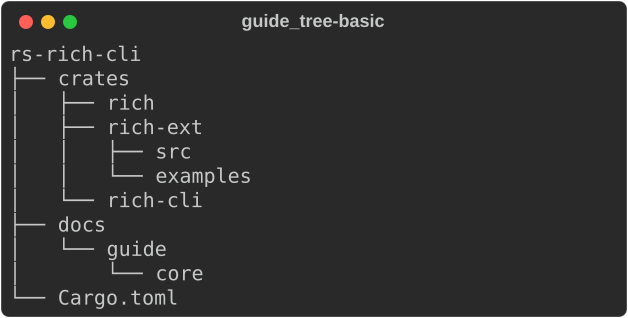
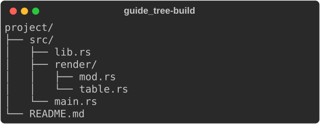
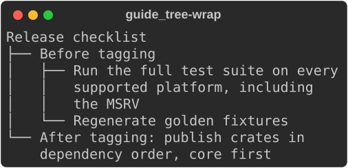
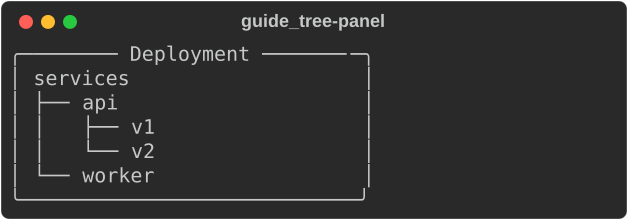

# Tree

[`Tree`](https://docs.rs/rs-rich/latest/rich/tree/struct.Tree.html) draws a
hierarchy with guide lines — a directory listing, a dependency graph, a
nested configuration. Each node has a label and any number of children.

```rust
use rich::{Console, Tree};
```

## Building a tree

`Tree::new(label)` makes the root. `add(label)` appends a child and returns
`&mut Tree` for it, so you descend by binding the result:

<div class="rich-playground-pair" markdown>

```rust
--8<-- "crates/rich/examples/guide_tree.rs:basic"
```

```text { .rich-playground data-kind="tree" data-width="50" }
rs-rich-cli
  crates
    rich
    rich-ext
      src
      examples
    rich-cli
  docs
    guide
      core
  Cargo.toml
```

</div>



- Chaining `add` goes one level deeper each time:
  `tree.add("docs").add("guide").add("core")`.
- To add siblings, keep the parent's `&mut Tree` in a variable and call `add`
  on it repeatedly. Each child borrows the parent mutably, so finish with one
  branch before starting the next — or build recursively, as below.

## Building from data

A recursive function that takes `&mut Tree` maps any nested structure onto a
tree:

<div class="rich-playground-pair" markdown>

```rust
--8<-- "crates/rich/examples/guide_tree.rs:build"
```

```text { .rich-playground data-kind="tree" data-width="50" }
project/
  src/
    lib.rs
    render/
      mod.rs
      table.rs
    main.rs
  README.md
```

</div>



## Long labels

Labels wrap to the available width, and continuation lines keep the guides
of their branch:

<div class="rich-playground-pair" markdown>

```rust
--8<-- "crates/rich/examples/guide_tree.rs:wrap"
```

```text { .rich-playground data-kind="tree" data-width="40" }
Release checklist
  Before tagging
    Run the full test suite on every supported platform, including the MSRV
    Regenerate golden fixtures
  After tagging: publish crates in dependency order, core first
```

</div>



## Trees inside other renderables

A `Tree` is a renderable like any other: put it in a panel, a table cell or a
layout region.

<div class="rich-playground-pair" markdown>

```rust
--8<-- "crates/rich/examples/guide_tree.rs:panel"
```

```text { .rich-playground data-kind="tree" data-title="Deployment" data-width="30" }
services
  api
    v1
    v2
  worker
```

</div>



A tree measures its widest label plus its guides (see
[measuring](console.md#measuring)), so in a table cell or under
`Align::center` it takes only the room it needs.

## Guides and styles

Upstream's options are all here, as builders on the root (or on a subtree
made with `Tree::new` and added with `add_tree`):

```rust
use rich::{Console, Tree};

let mut tree = Tree::new("[bold]release[/]")
    .guide_style("bold blue") // bold guides are heavy; "underline2" draws double ones
    .hide_root(true);         // start at the children
tree.add("core 0.0.10");
let mut cli = Tree::new("cli 0.0.20").style("green").expanded(false);
cli.add("not shown while collapsed");
tree.add_tree(cli);
Console::new().print(&tree);
```

`expanded(false)` hides a node's children, and a console that cannot
encode Unicode draws ASCII guides.

## See also

- [Layout](layout.md) — panels and constraints around a tree
- [Tutorial: layout](../../tutorial/04-layout.md#trees)
- API: [`Tree`](https://docs.rs/rs-rich/latest/rich/tree/struct.Tree.html)
