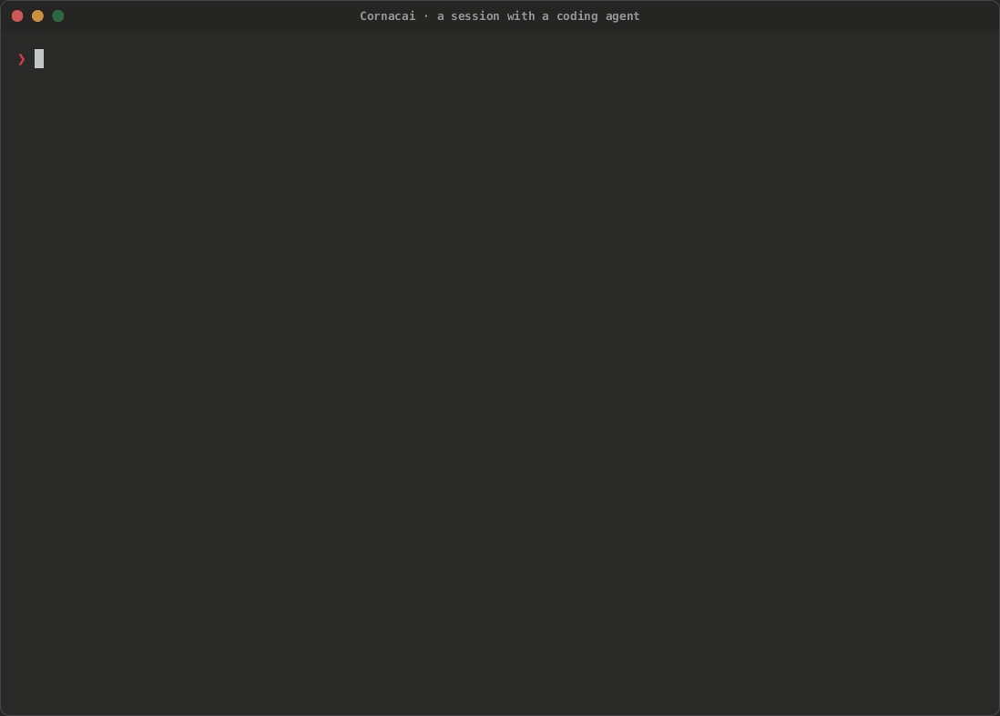
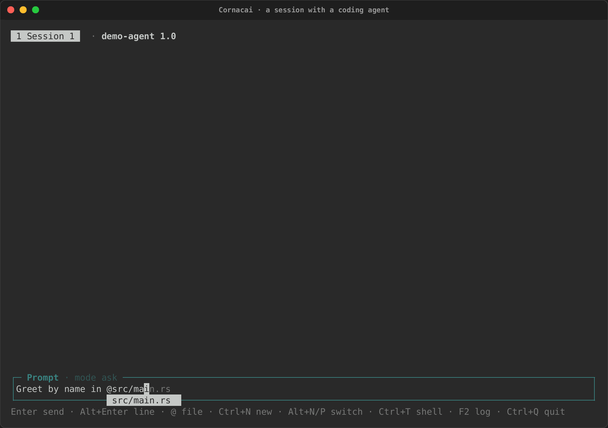
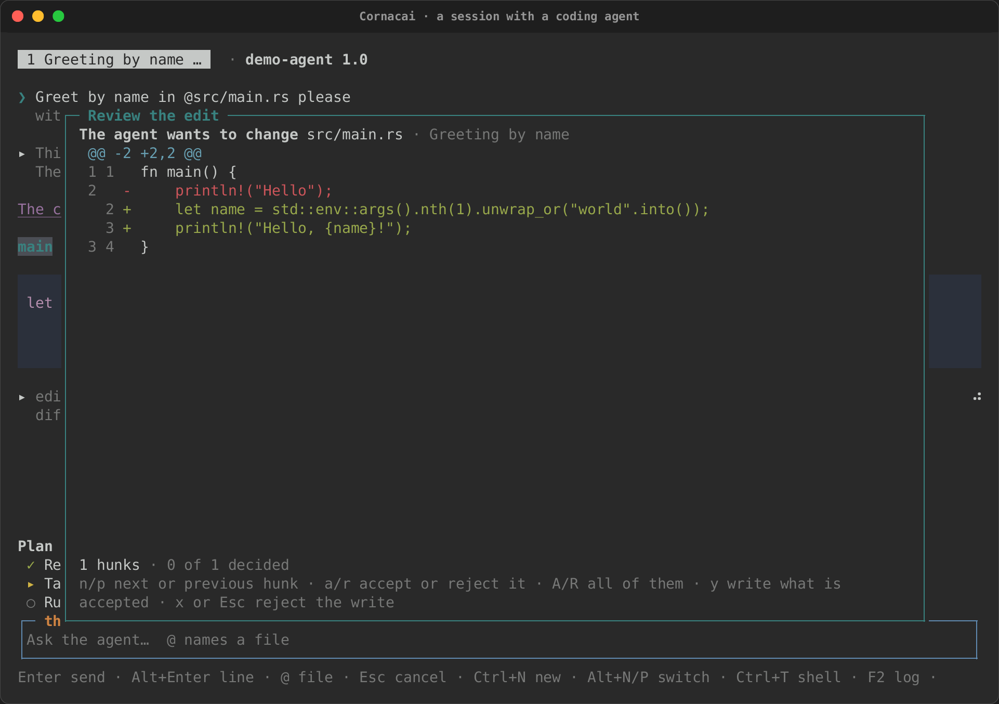
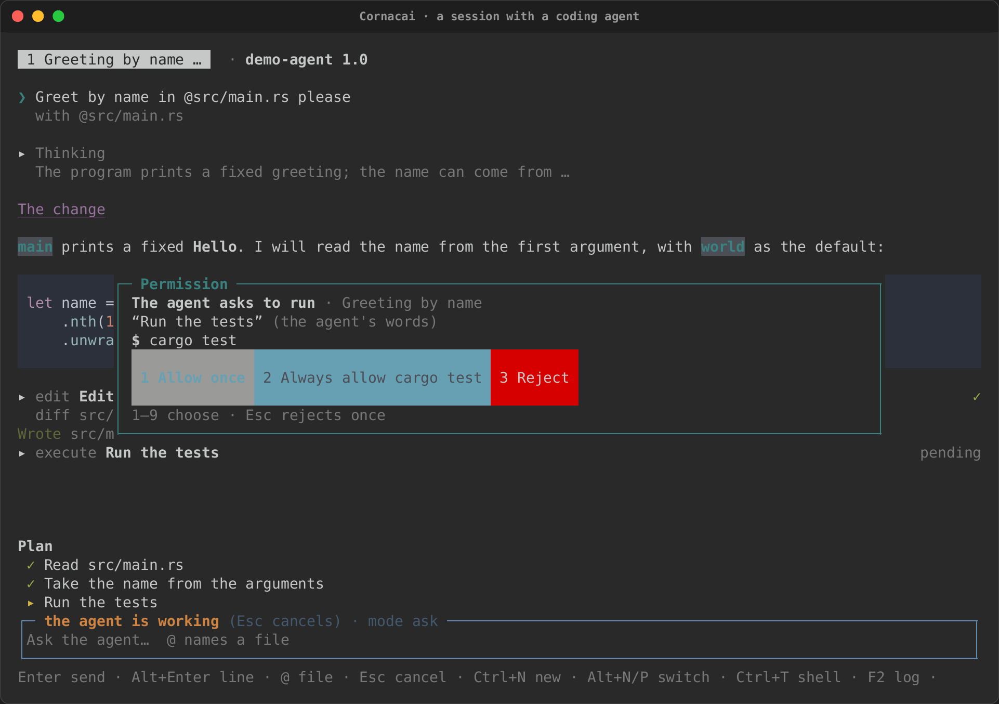
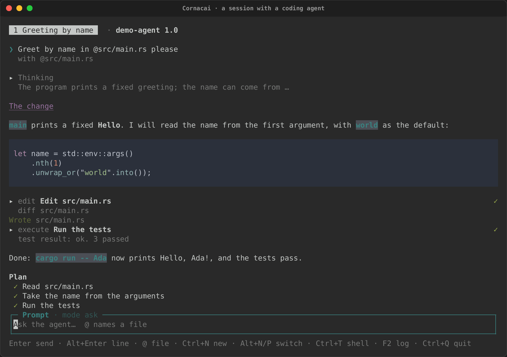

# Cornacai: a terminal client for coding agents

Cornacai (kor-NAH-kai: Portuguese *cornaca*, the elephant's rider and
guide, plus "AI") is a terminal front end for coding agents that speak the
[Agent Client Protocol](https://agentclientprotocol.com) (ACP): Claude Code
through its ACP adapter, Gemini CLI, Codex and the others. You ride and
steer; the agent does the heavy lifting. It is a crate of its own,
[`cornacai`](https://crates.io/crates/cornacai), built on
[intuiTUIve](intuituive/index.md), rs-rich-acp (the protocol) and
rs-rich-embed (the shell pane).

Here it runs against a fake agent that replays a recorded conversation: a
prompt with an `@` file mention, a plan and an answer streaming in, the
agent's edit reviewed as a diff and accepted, a permission prompt for a
command, and the finished turn.

<div class="tape-player" data-cast="../../media/tapes/cornacai/cornacai.cast" data-poster="npt:0:3">
  
</div>

| An `@` mention | An edit to review | A permission prompt | Done |
|---|---|---|---|
|  |  |  |  |

[Tape](../tapes/cornacai.tape) · [Cast](../media/tapes/cornacai/cornacai.cast) · [GIF](../media/tapes/cornacai/cornacai.gif)

## Install and start

```sh
cargo install cornacai
cornacai                      # the configured agent, or one found on PATH
cornacai --agent "gemini --experimental-acp"
cornacai -- claude-code-acp   # the agent's command after --
cornacai --agents             # the agents Cornacai knows, and which are installed
```

The first time, with no agent configured, Cornacai looks on `PATH` for the
agents it knows, offers the ones it finds, and saves the choice in
`cornacai/config.toml` in your config directory (`$XDG_CONFIG_HOME`, else
`~/.config`). An agent given with `--agent` is saved the same way when none
is configured yet. Cornacai never installs an agent: `--agents` says what to
install, and you do it.

The workspace is the current directory (or `--cwd DIR`): the sessions'
working directory, and the root the agent's file reads and writes through
Cornacai are kept inside.

## The screen

- **The tabs,** at the top: one per session, titled by the agent when it
  names the session, with `…` while a turn runs; then the agent's name and
  version as it reports them.
- **The conversation.** Your prompts, the agent's answers as Markdown,
  streaming in, and its thoughts folded under **Thinking**. The view
  follows the end while the agent writes; scroll up and it stays where you
  are, and End (or scrolling back down) follows again.
- **Tool calls** are folded cards: the kind and the agent's title, a
  status at the right (pending, a spinner while it runs, `✓` or
  `✗ failed`), and a one-line summary while folded: the file, or the
  output's last line. Enter or a click unfolds one: its command, its
  output, its diffs and its terminals' output.
- **The plan,** when the agent has one, above the prompt: `✓` done, `▸`
  under way, `○` to do. Each plan update replaces it whole.
- **The prompt,** which grows to six rows, then scrolls; its title says
  whether the agent is working and the session's mode.

## Keys

| Key | What it does |
|---|---|
| Enter | Send the prompt (takes the completion while its list is open) |
| Alt+Enter, Shift+Enter | A new line in the prompt |
| Up, Down on the prompt's first or last line | Earlier prompts, this session's |
| `@` | Complete a file or directory of the workspace |
| Esc | Cancel the running turn |
| Ctrl+N | A new session |
| Alt+N, Alt+P, Alt+1 … Alt+9 | The next, the previous, or the numbered session |
| Ctrl+T | Open or close the shell pane (and move into or out of it) |
| F2 | The agent's log (what it wrote to its standard error) |
| Ctrl+Q | Quit |

## `@` file mentions

Type `@` and part of a path: the prompt offers the workspace's files that
match, fuzzily, best first (`.git`, `target` and `node_modules` are not
walked). Enter takes one. When the prompt is sent, each `@path` that names
a file or directory inside the workspace goes with it as a
`resource_link` (the file's URI, its name and its size), which every ACP
agent accepts; the agent reads the file itself. The conversation shows
which files went with the prompt.

## What the agent asks

The agent runs with whatever its own process may do; ACP does not sandbox
it. Cornacai guards what the agent asks the *client* to do, and shows you
the rest.

- **Permission prompts.** Every `session/request_permission` opens a
  prompt: what the agent wants to do (from the tool's kind), its title
  marked as the agent's own words, the files and the command in full, and
  one button per option the agent offers, numbered 1 to 9. Esc rejects
  once. "Always" choices are the agent's to remember; Cornacai keeps no
  allow-list of its own.
- **Edits.** Every `fs/write_text_file` opens the file's text and the
  agent's as a diff. `n` and `p` move between hunks, `a` and `r` accept or
  reject the one under the cursor, `A` and `R` all of them; the last
  decision writes what you accepted. `y` writes as decided so far
  (undecided hunks keep the old lines), `x` or Esc refuses the write. A
  write refused whole is answered with an error, so the agent knows; a
  partial one is written and noted in the conversation (the agent is told
  the write succeeded). Files that control what runs (`.git/`, editor and
  agent settings, MCP configuration) are flagged.
- **Commands.** Every `terminal/create` asks first, with the command line
  and its directory. An allowed command runs on pipes (not a terminal), in
  the workspace, and its output, as the agent reads it, shows in its card.
- **Reads** inside the workspace are answered without asking. A path
  outside it is refused, whatever the agent says.

`--no-read`, `--no-write` and `--no-terminal` (or `[capabilities]` in the
config) stop offering a capability at all: the agent is then refused before
Cornacai sees the request.

Everything the agent says is untrusted: control characters in its text and
in command output are neutralised, so it cannot move the cursor or retitle
the terminal, and characters that hide or reorder text (bidirectional
controls, zero-width characters, tags) are shown as `<U+202E>` in titles,
paths, commands and options.

## The shell pane

Ctrl+T opens a shell beside the conversation: your `$SHELL` (or `--shell
CMD`, or `shell` in the config) on a real terminal, which lives as long as
Cornacai does, so `cd` and environment changes stick. It is yours, not the
agent's: nothing typed there or printed by it reaches the agent. While it
has the focus every key goes to the shell except Ctrl+T (back to the
prompt), Ctrl+Q, Alt+N and Alt+P.

## Sessions

Ctrl+N opens another session on the same agent connection; each has its
own conversation, plan, prompt and history, and its tab. A permission
prompt or an edit from a session in the background still opens at once,
naming its session.

## Configuration

```toml
# cornacai/config.toml
agent = ["claude-code-acp"]   # or a string, split on spaces
shell = ["bash", "-l"]

[capabilities]
read = true       # answer reads inside the workspace
write = true      # review each write as a diff
terminal = true   # ask about each command
```

## As a library

The app is a library too: `cornacai::app::app(Options)` returns the
intuiTUIve `App` and a handle on its connection. With `Launch::Replay`,
rs-rich-acp's fake agent plays a recorded transcript, which is how the
crate's tests drive it on intuiTUIve's `Driver` (no agent, no network) and
how the tape above runs (the binary's test-only `fake-agent` feature reads
the transcript named by `CORNACAI_FAKE_AGENT`).

```rust
use std::time::Duration;
use cornacai::app::{Launch, Options, app, wait_for};
use rich_acp::replay::Transcript;

let transcript = Transcript::read("conversation.jsonl")?;
let launch = Launch::Replay { transcript, timeout: Some(Duration::from_secs(10)) };
let (app, handle) = app(Options::new(launch, "/path/to/workspace"));
let mut driver = app.driver(100, 30);
wait_for(&mut driver, "Prompt", Duration::from_secs(10));
```

## What is not there yet

- Resuming a session (`session/load`) and a session store.
- The marketplace's `agent` listings (`rich plugin search --kind agent`).
- Agent terminals on a PTY, shown live; today they run on pipes.
- Sending a selection from the shell pane to the agent.
- Authentication: an agent that needs you to sign in says so, and you sign
  in with the agent's own command.

The design, its security model and its open questions are in
[the design note](https://github.com/buchochelliq-labs/rs-rich-cli/blob/main/docs/design/cornacai.md).
Cornacai is written clean-room from the public ACP specification; it is
inspired by Toad's public feature list, and none of Toad's code is used.
