# Charts

`rich_ext::chart` draws data with text:

- **`Sparkline`**: one line, one cell per value.
- **`BarChart`**: a label, a bar and a value per row.
- **`Histogram`**: raw values counted into bins, drawn as bars.
- **`LineChart`**: one or more series as lines or scattered points, with
  axes and a legend.

And the pieces of a dashboard:

- **`Gauge`** and **`BulletChart`**: a value against a range, with a target
  and threshold bands, on one line or the full width.
- **`Heatmap`**: a labelled grid of values drawn as shades, with a legend.
- **`StatusMatrix`**: rows and columns of states (pass, fail, skip, flaky
  or your own), each a symbol and a colour.
- **`KpiCard`**: a label, a value, its change, a sparkline and a status.
- **`Timeline`**: labelled ranges on a numeric or seconds scale, overlaps
  stacked, with milestones; a Gantt strip when every range has its own row.

And for comparing ([below](#distributions)):

- **`Distribution`** and **`DistributionSet`**: the count, quantiles and
  mean of a set of values, with a box-and-whisker strip on one line;
  several stacked on one scale.
- **`SmallMultiples`**: a grid of titled charts on one value scale, fitted
  to the width.

Every chart also says what it shows in words, for a screen reader
([accessible text](#accessible-text)).

And laid out as ratatui's widgets, so a ported app looks the same
([below](#ratatui-style-charts-and-canvases)):

- **`Chart`**: datasets on two axes, as lines, points, bars or areas.
- **`Canvas`**: shapes, text and a world map in world coordinates.
- **`FillGauge`** and **`LineGauge`**: ratatui's `Gauge` and `LineGauge`.

Each chart is a renderable. It measures itself, so it works in a `Table`
cell, a `Panel` or a `Live` display. It never writes a line wider than the
width it is given: when space is short it drops labels, values and axes
before it drops data.

A `Chart`, a `Canvas`, a vertical `BarChart`, a `Sparkline` and a
`FillGauge` also **fill the height they are given**, as ratatui's widgets
fill their area: a `Layout` region, a `Panel` with a height, or an
[intuiTUIve](../intuituive/index.md) node through
`renderable(move || chart(..))`. Their own height (`.height(n)`,
`.rows(n)`, `.bar_width(n)`) wins; printed on their own, with no height
given, they keep their defaults.

The examples come from
[`guide_charts.rs`](https://github.com/buchochelliq-labs/rs-rich-cli/blob/main/crates/rich-ext/examples/guide_charts.rs).
The module needs no feature:

```bash
cargo run -p rs-rich-ext --example guide_charts
cargo run -p rs-rich-ext --example charts            # every chart on one screen
cargo run -p rs-rich-ext --example charts -- --ascii
cargo run -p rs-rich-ext --example kpi_dashboard     # cards, a matrix and a timeline, live
```

The styles are theme keys (`chart.*`). Pass `rich_ext::extended_theme()` to
the console builder to get them, or define them in your own theme. Without
them the same defaults are used.

The same charts are in Python as [`rs_rich.chart`](https://buchochelliq-labs.github.io/rs-rich-cli/python/chart/),
and in the shell as [`rich chart`](#from-the-shell-rich-chart).

## Sparklines

`Sparkline::new(values)` draws each value as a cell whose height shows where
it falls between the smallest and largest value:

```rust
--8<-- "crates/rich-ext/examples/guide_charts.rs:sparkline"
```

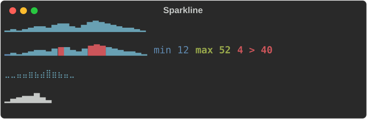

- It is one cell per value wide. Given fewer cells, it **resamples**: the
  values are split into as many equal buckets as there are cells, and each
  cell shows the mean of its bucket's values.
- `.min_max(true)` styles the lowest and highest cell (`chart.min`,
  `chart.max`) and writes `min 12 max 52` after the line.
- `.threshold(40.0)` styles the cells above 40 with `chart.over` and writes
  `4 > 40` (four values are above it).
- The words are what make the extremes and the threshold readable without
  colour. They are the first thing left out when the line does not fit.
- `.range(min, max)`, `.min(v)` and `.max(v)` fix the scale; values outside
  it are clamped. NaN and infinite values are gaps.

### Taller, backwards, with gaps

What ratatui's `Sparkline` has, and more rows than one:

```rust
--8<-- "crates/rich-ext/examples/guide_charts.rs:ratatui_sparklines"
```

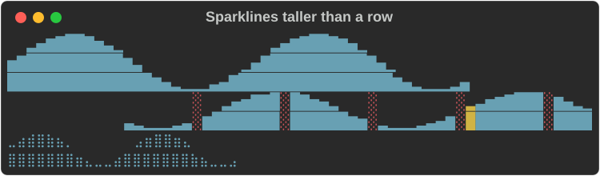

- `.rows(n)` makes it `n` rows tall, eight heights a row in blocks and
  four in Braille. Without it, it fills the height it is given.
- `.direction(Direction::RightToLeft)` puts the first value at the right
  edge, and the summary before the bars.
- `Sparkline::optional(values)` takes `Option<f64>`s: each `None` is a gap.
  `.absent(symbol, style)` draws gaps with a symbol down the whole column,
  as ratatui's `absent_value_symbol`.
- `.styles(vec![..])` gives each value a style of its own; it wins over
  the marks of `.min_max` and `.threshold`.
- `.levels(Levels::Three)` draws with ratatui's three-level set (` ▄█`),
  for fonts without the eighths.

## Bars

`BarChart` draws a row per bar: the label, the bar and the value.

```rust
--8<-- "crates/rich-ext/examples/guide_charts.rs:bars"
```

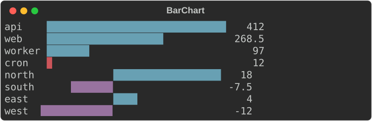

- Bars are measured from zero. The scale runs from the smallest to the
  largest value and always includes zero; `.max(100.0)` or `.range(..)`
  fix it.
- Blocks give eighth-cell precision (`█▉▊▋▌▍▎▏`). A value above zero always
  shows at least a sliver.
- Negative values extend left of zero, at whole-cell precision, in
  `chart.negative`. The written value keeps its minus sign, so the chart
  reads the same without colour.
- `Bar::new(label, value).style(..)` styles one bar; `.style(..)` on the
  chart styles them all. Both take a theme key or a style definition.
- The bar is 40 cells by default (`.bar_width(n)`). When the width is short
  the bar shrinks to 4 cells, then the values go, then the labels are cut
  with `…`.
- `.show_values(false)` leaves the values out; `.format(ValueFormat::Fixed(1))`
  writes them with one decimal instead of the compact form (`1.2k`, `3.4M`).

### Vertical bars

`.orientation(Orientation::Vertical)` stands the bars up side by side, with
the labels underneath:

```rust
--8<-- "crates/rich-ext/examples/guide_charts.rs:vertical"
```

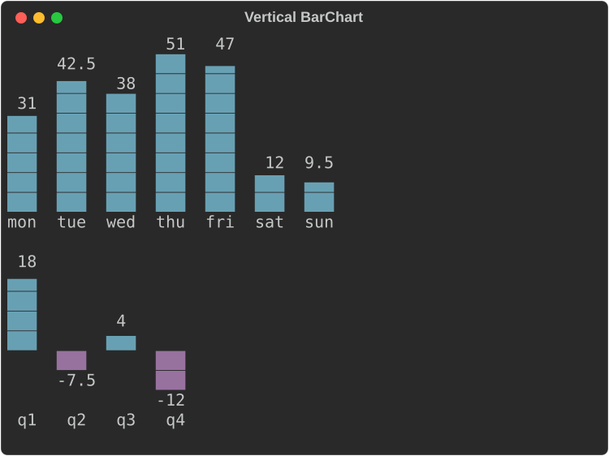

- `.bar_width(rows)` is the tallest bar's height here, 8 rows by default.
- Blocks give eighth-row precision (`▁▂▃▄▅▆▇█`), Braille half rows (`⣤⣿`),
  ASCII `#` and a half `.`. A value above zero always shows at least a
  sliver.
- Each bar gets a slot as wide as the widest label or value, with a cell
  between slots, and is up to 3 cells thick. Each value sits just above
  its bar.
- Negative values hang below the zero line at whole-row precision, their
  values under them.
- When the width is short the values go first, then the labels are cut
  (and left out below two cells), then the gaps between bars. Bars that
  still do not fit are left off the right.
- Without `.bar_width(..)` a vertical chart fills the height it is given,
  less its labels and values.
- `Histogram` takes `.orientation(..)` too.

### Groups, text values and styles

What ratatui's `BarChart` has, by this crate's names:

```rust
--8<-- "crates/rich-ext/examples/guide_charts.rs:ratatui_bars"
```

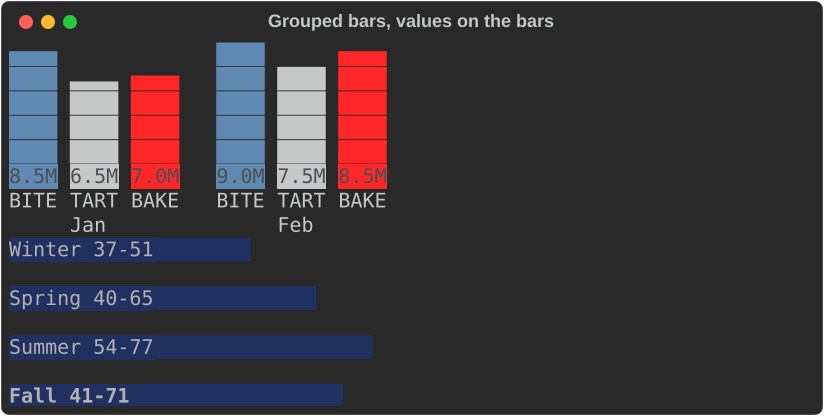

- `.group(BarGroup::new("Jan").bar(..))` adds bars with a label: centred
  under the group when vertical, on the row after it when horizontal.
  `.group_gap(n)` sets them apart (1 cell, or 2 rows, by default).
- `.thickness(n)` is ratatui's `bar_width`: how many cells wide a vertical
  bar is, or rows tall a horizontal one (a horizontal bar's label and value
  sit on its middle row). `.bar_width(n)` keeps its meaning here: the
  longest bar's length, or the tallest column's height.
- `.bar_gap(n)` is the space between bars: 1 cell vertical, no rows
  horizontal, by default.
- `Bar::new(..).text("76°")` writes text instead of the value.
- `.label_style(..)` and `.value_style(..)` style the labels and values,
  and a bar's own `.label_style(..)` and `.value_style(..)` go over them.
- `.values_inside(true)` writes each value on its bar, as ratatui does:
  from the start of a horizontal bar, running on past its end in the bar's
  colour; on the bottom row of a vertical one, centred and cut to its
  thickness. Without a value style, a value on its bar is the bar's colour
  reversed.

## Histograms

`Histogram::new(values).bins(n)` counts raw values into `n` bins of equal
width and draws them as a `BarChart`:

```rust
--8<-- "crates/rich-ext/examples/guide_charts.rs:histogram"
```

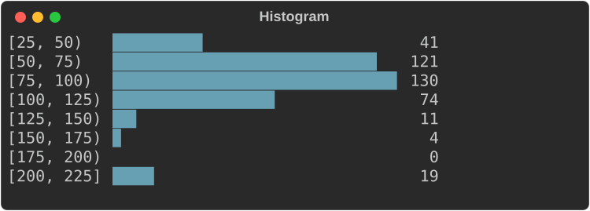

- Each label is `[low, high)`, and the last `[low, high]`, so every value
  falls in exactly one bin, the one its label names: a value on an edge
  counts in the bin that edge starts.
- The edges are written exactly, never rounded: when the compact form would
  round one (`1250` as `1.2k`), they are all written in full
  (`[1000, 1250)`). `.edges()` returns them without floating-point noise
  (`0.3`, not `0.30000000000000004`).
- Without `.range(min, max)`, the bin width is rounded up to 1, 2, 2.5 or 5
  times a power of ten and the first edge down to a multiple of it, so the
  labels are round numbers. The last bins may then be empty.
- With `.range(min, max)` the bins split that range exactly, and values
  outside it are not counted. NaN and infinite values are never counted.
- `.counts()` and `.edges()` return the numbers; `.to_bar_chart()` the chart.

## Line and scatter charts

A `LineChart` plots one or more `Series`. `Series::line(name, points)` joins
its points, `Series::scatter(name, points)` does not, and
`Series::from_values(name, values)` puts the values at x = 0, 1, 2, …

```rust
--8<-- "crates/rich-ext/examples/guide_charts.rs:line"
```

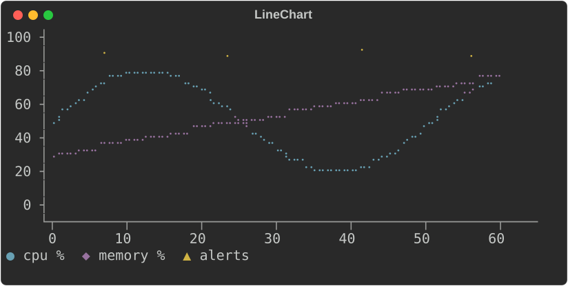

- The plot is Braille by default: each cell holds 2×4 dots, so a chart 60
  cells wide has 120 points across.
- Every row and column of the plot stands for one exact value, at its
  centre. Axis labels sit on evenly spaced rows and columns, and each label
  is the value of the row or column it is on; nothing is rounded to fit.
- Without `.y_range(..)` and `.x_range(..)`, each scale rounds out to a
  step of 1, 2, 2.5 or 5 times a power of ten that falls on whole rows or
  columns. The x scale may then run a little past the last point.
- When the compact format cannot write those round values exactly, as with
  years (`2015` would read `2.0k`) or millisecond timestamps, the labels are
  all written in full (`2015`, `2016`, …) rather than spreading the data
  thinly over a coarser, writable step.
- With a fixed range, a row or column gets a label only when the format
  writes its value exactly, so a range must divide into the rows for every
  label to show: `.y_range(0.0, 100.0)` on 11 rows labels every 20, on 10
  rows only `0` and `100`. `.y_format(..)` and `.x_format(..)` write the
  labels.
- It is `.height(rows)` rows of plot, an axis line, a row of x labels and
  the legend. Without `.height(..)` it takes 6 to 10 rows, near 8, picking
  the height its y labels divide best. It fills the width it is given, or
  `.width(n)`. When the width is short it drops the y labels, then the
  axes.
- A NaN or infinite value breaks a line.

### Without colour

Series are told apart by colour (`chart.series.1` to `chart.series.5`) and
by marker: the legend shows each series' marker in its colour. Braille dots
have no shape, so when the console shows no colour and there is more than
one series, the chart plots at cell resolution with each series' marker
instead:

```rust
--8<-- "crates/rich-ext/examples/guide_charts.rs:plain"
```

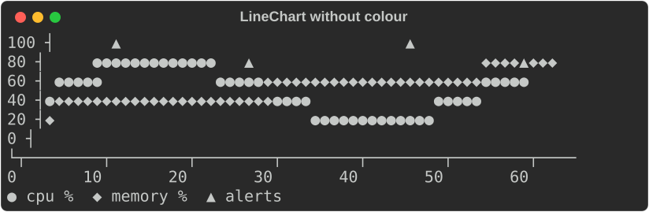

"No colour" is the console's [fidelity](capabilities.md) below `Rich`: no
colour system, `NO_COLOR`, or `no_color(true)`. `Series::marker('#')` picks
a series' marker; `.charset(Charset::Blocks)` asks for markers even with
colour.

## ASCII

`Charset` picks the glyphs: `Blocks`, `Braille` or `Ascii`. The default,
`Auto`, is blocks for sparklines and bars and Braille for line charts. An
ASCII-only console (its encoding is not UTF-8, or its fidelity is `Ascii`)
always gets `Ascii`, whatever the chart asks for, and its output holds no
character above U+007F:

```rust
--8<-- "crates/rich-ext/examples/guide_charts.rs:ascii"
```

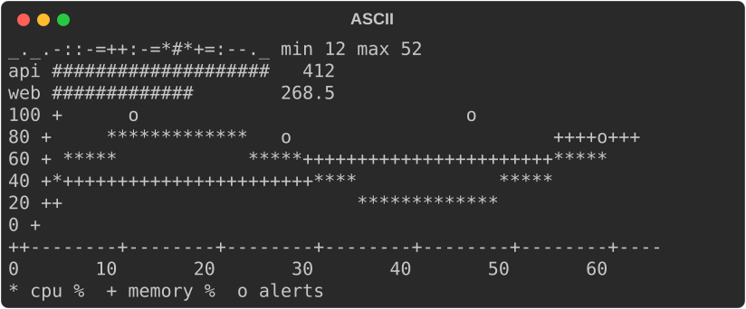

| Chart | ASCII |
|---|---|
| `Sparkline` | the ramp `_.-:=+*#`, lowest to highest |
| `BarChart`, `Histogram` | `#` for a cell, `=` for half a cell |
| `LineChart` | `*`, `+`, `o`, `x`, `.` per series; axes drawn with `-`, `+` and a vertical bar |
| `Gauge`, `BulletChart` | `#` and `=` for the bar, `.` and `:` for the bands, a vertical bar for the target |
| `Heatmap` | ten shades, ` .:-=+*#%@`, and `?` for a missing value |
| `StatusMatrix` | each state's ASCII symbol: `+` pass, `X` fail, `-` skip, `~` flaky |
| `KpiCard` | a border of `+`, `-` and vertical bars, `^` and `v` for the delta, the status's ASCII symbol |
| `Timeline` | `#` and `=` for ranges, `*` for milestones, `~` where a gap is cut |
| `Chart`, `Canvas` | `#` for the block markers, `*` for the others; axes and legends of `-`, `+` and vertical bars |
| `FillGauge`, `LineGauge` | `#` and `=` for the bar; `-` for the line |

Labels with characters above U+007F are written with `?` in their place, as
[`fidelity::ascii_text`](capabilities.md) does.

## ratatui-style charts and canvases

`LineChart` decides its own scales, labels and legend. For a chart laid
out exactly as ratatui's `Chart` (so a ported app looks the same) or one
whose every part you set, use `Chart`:

```rust
use rich_ext::chart::{Axis, AxisScale, Chart, Dataset, GraphType, Labels, Marker};

let cpu = Dataset::new([(0.0, 0.0), (5.0, 4.0), (10.0, 1.0)])
    .name("cpu")
    .graph_type(GraphType::Line)
    .marker(Marker::Ascii('*'));
let chart = Chart::new(vec![cpu])
    .x_axis(Axis::default().bounds(0.0, 10.0).title("t").labels(Labels::Auto(3)))
    .y_axis(Axis::default().bounds(0.0, 4.0).title("%").labels(Labels::Auto(3)))
    .hidden_legend_fraction(0.5, 0.5)
    .height(8);
```

```text
4│%        ***     ┌───┐
 │       **   **** │cpu│
 │     **         *└───┘
2│   **               **
 │ **
0│*                    t
 └──────────────────────
  0         5         10
```

- **`Axis`**:
  - bounds (or the data's extent);
  - a title and its style;
  - labels: `None` (no axis line), `Auto(n)`, `Values` at given values,
    `Text` spread evenly, or `Markup` spread evenly with styles of their
    own (`"[bold]0[/]"`, as ratatui's labels of styled spans);
  - `labels_align(HorizontalAlign::..)`, ratatui's `labels_alignment`: the
    y labels' alignment in their column, and how the first x label sits
    against the y axis line;
  - a scale: `Linear` or `Log`, where log labels fall on powers of ten;
  - a style.

  An axis with an empty `Values` list draws its line and takes no room
  for labels, as scope-tui's do.
- **`Dataset`**:
  - points;
  - a name for the legend;
  - a graph type: `Scatter`, `Line`, `Bar` (a line down to zero), or
    `Area` (a line with the area between it and `.fill_to(y)` filled,
    0 by default; ratatui's `fill_to_y`);
  - a marker: `Braille` (2×4 dots a cell), `Octant` (2×4, solid),
    `Sextant` (2×3), `Quadrant` (2×2), `HalfBlock`, `Bar` (`▄`), `Block`,
    `Dot`, or `Ascii(c)`;
  - a style.

  Later datasets win a cell.
- **The legend** is a box in a corner (`LegendPosition`). It hides itself
  when it would cover more than `hidden_legend_fraction` of the plot.
- **The layout** is ratatui's:
  - the y labels sit left of a `│` line and the x labels under a `─` line,
    meeting at `└`;
  - the y title sits at the top of the plot, and the x title at the right
    of its last row;
  - a short or narrow chart gives up parts in ratatui's order.
- **The height** is the height it is given, as ratatui's fills its area,
  or `.height(n)`; printed with no height, 15 rows.

An area chart, its end labels in bold and its y labels centred:

```rust
--8<-- "crates/rich-ext/examples/guide_charts.rs:ratatui_area"
```

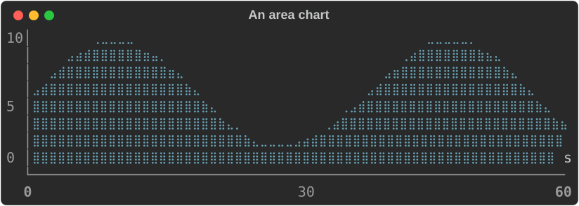

`Canvas` draws shapes in world coordinates, as ratatui's `Canvas` does:

```rust
use rich_ext::chart::{Canvas, Marker};

let canvas = Canvas::new()
    .x_bounds(-1.0, 1.0)
    .y_bounds(-1.0, 1.0)
    .height(10)
    .marker(Marker::Braille)
    .paint(|p| {
        p.circle(0.0, 0.0, 0.8, "cyan");
        p.line(-1.0, -1.0, 1.0, 1.0, "red");
        p.layer();
        p.print(-0.2, 0.0, "hi", "bold");
    });
```

`points`, `point`, `line`, `polyline`, `rect`, `circle`, `area` and
`print` are clipped to the bounds; `layer()` starts a layer drawn over the
ones before, and text is drawn last. Both are renderables: print them, put
them in a table or a panel, or show them in an
[intuiTUIve](../intuituive/index.md) app with
`renderable(move || chart(...))`, which fills its node and draws again when
the signals it reads change.

What the canvas adds to ratatui's, and what it shares:

- **A world map:** `p.map(MapResolution::Low, style)` draws the world's
  coastlines in longitude (`x`, -180 to 180) and latitude (`y`, -90 to
  90); narrower bounds show a region. `Low` is Natural Earth's 1:110m
  coastlines, simplified to about 1,200 points; `High` its 1:50m ones, to
  about 5,000 points, with more islands. The lines are joined, so the
  coasts stay whole at any size.
- **Markers:** `Quadrant` (2×2 a cell), `Sextant` (2×3), `Octant` (2×4)
  and `Bar` (`▄`), with the others. Quadrants are in every terminal font;
  sextants need one with Symbols for Legacy Computing (Unicode 13) and
  octants one with its supplement (Unicode 16). A font without them shows
  boxes, so choose them for terminals you know. An ASCII console gets `#`.
- **A background:** `.background("on #101828")` styles the cells nothing
  drew in and goes under what is drawn; a plain colour is taken as the
  background.
- **Shapes of your own:** implement `Shape` (`fn draw(&self, painter:
  &mut CanvasPainter)`) and draw it with `p.shape(&it)`: a wireframe, a
  sprite, a gauge of your own.

```rust
--8<-- "crates/rich-ext/examples/guide_charts.rs:map"
```

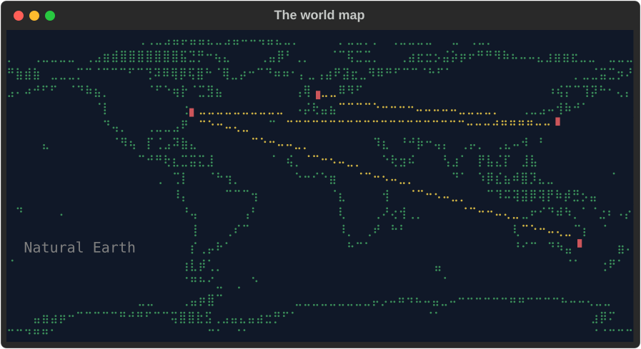

The map's data is our own, made from
[Natural Earth](https://www.naturalearthdata.com)'s public-domain
coastlines by `scripts/world_map.py`, which simplifies them and writes the
two small files (about 5 KB and 22 KB) the crate includes. Made with
Natural Earth.

### Gauges

`FillGauge` is ratatui's `Gauge` and `LineGauge` its `LineGauge`:

```rust
--8<-- "crates/rich-ext/examples/guide_charts.rs:ratatui_gauges"
```

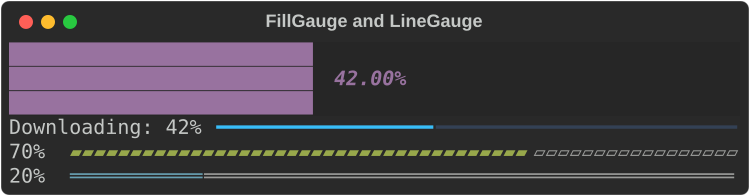

- **`FillGauge::new(ratio)`** (or `::percent(p)`) fills the width and
  height it is given, left to right: whole cells, or eighths at the edge
  with `.unicode(true)`. The label sits centred on the middle row,
  the percentage (`42%`) without one; over the filled part its colours are
  swapped, so it reads on the bar. `.style(..)` is ratatui's
  `gauge_style`: the foreground colours the bar, the background the rest.
  `.height(n)` fixes its height; printed on its own, it is one row.
- **`LineGauge::new(ratio)`** writes the label (` 42%` by default), a
  space, then a line to the edge: `.line(LineSet::Thin | Thick | Double)`
  or `.symbols('▰', '▱')`, the part up to the ratio in `.filled_style(..)`
  and the rest in `.unfilled_style(..)`.
- Both default to the theme keys `chart.gauge.filled` and
  `chart.gauge.unfilled`. On an ASCII console the bar is `#` (`=` for a
  half) and the line `-`.

## In tables and panels

A sparkline measures to one cell per value and a bar chart to its label, bar
and value, so they fit table columns. A line chart takes the width it is
given, or `.width(n)`:

```rust
--8<-- "crates/rich-ext/examples/guide_charts.rs:table"
```

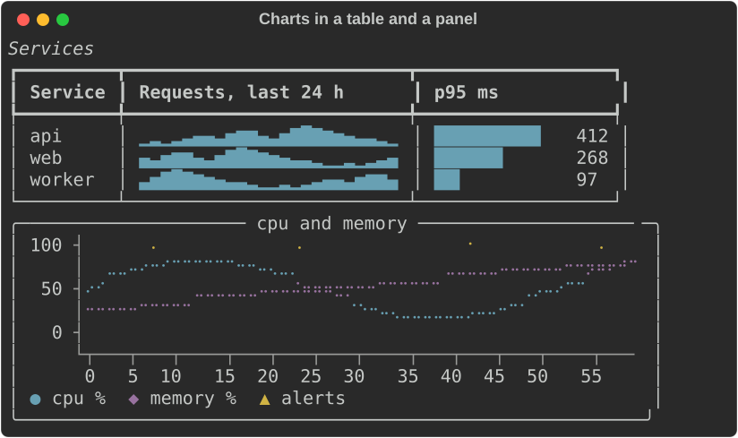

## Gauges and bullet charts

A `Gauge` shows one value against a range. `.target(t)` draws a `│` across
the bar where the target is, and each `Band` is a threshold: the band runs
up to its value, the bar takes the band's style while the value is in it,
and the band's name is written after the value.

```rust
--8<-- "crates/rich-ext/examples/guide_charts.rs:gauge"
```

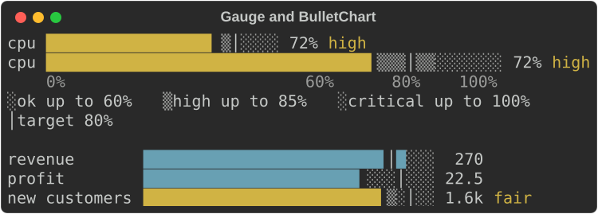

- The bar fills with eighth-cell blocks (`█▉▊▋▌▍▎▏`), half-cell Braille, or
  `#` and a half `=` in ASCII. The rest of the track is shaded by band,
  alternating `░` and `▒` (`.` and `:`), so each band's extent shows
  without colour.
- The scale runs from 0 (or the smallest of the value, the target and the
  bands) to the largest of them; `.range(min, max)` fixes it.
- The compact form is one line, with a bar of `.bar_width(n)` cells (20 by
  default). `.full_width(true)` fills the width and adds a scale line (the
  bounds, the target and the band edges, each at its cell) and a legend
  (`░ ok up to 60%  │ target 80%`).
- Given less width the bar shrinks to 4 cells, then the band's name goes,
  then the value, then the label is cut.
- `BulletChart` stacks gauges with their labels, bars, values and band
  names in aligned columns. Each keeps its own scale, target and bands.

## Heatmaps

A `Heatmap` is a grid of values, a row per label and a column per header,
each cell a shade from the lowest value to the highest:

```rust
--8<-- "crates/rich-ext/examples/guide_charts.rs:heatmap"
```

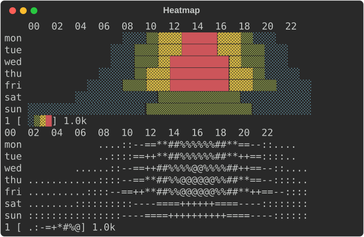

- Values are scaled into equal steps: five in blocks (` ░▒▓█`), ten in
  ASCII (` .:-=+*#%@`). The shade is the value, so the grid reads in black
  and white; with colour each step also takes a `chart.heat.N` style, cold
  to hot. `.range(min, max)` fixes the scale.
- A NaN or infinite value is drawn `·` (`?` in ASCII), never as a low value,
  and the legend says so.
- Each value is `.cell_width(n)` cells wide (2 by default). A header is
  written at its column's first cell when it fits with a space after the
  one before, so with narrow cells every second or third header shows.
- Given less width the cells narrow to one, then the row labels are cut,
  then neighbouring columns are merged, each showing the mean of its
  values, so every value still counts.

## Status matrices

A `StatusMatrix` is rows and columns of states, such as a test suite
across platforms. Each state is a **symbol and a colour**, never colour
alone, and the legend counts the cells in each:

```rust
--8<-- "crates/rich-ext/examples/guide_charts.rs:matrix"
```

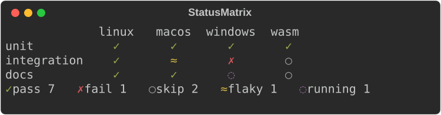

| State | Symbol | ASCII | Theme key |
|---|---|---|---|
| `pass` | `✓` | `+` | `chart.state.pass` |
| `fail` | `✗` | `X` | `chart.state.fail` |
| `skip` | `○` | `-` | `chart.state.skip` |
| `flaky` | `≈` | `~` | `chart.state.flaky` |

- `State::new(name, symbol, ascii, style)` adds a state, or replaces a
  built-in one with the same name. A symbol must take one cell; a wide one
  is replaced by its ASCII form.
- A name with no state is drawn `?` in `chart.state.unknown` and named in
  the legend as it is. A row shorter than the headers leaves its last cells
  blank.
- Columns are as wide as their widest header. Given less width the headers
  are cut (and left out below three cells), then the row labels, then the
  gaps; columns that still do not fit are left off the right.
- `.counts()` returns how many cells are in each state.

## KPI cards

A `KpiCard` is one key number: a label, the value, its change, an optional
sparkline and an optional `Status`:

```rust
--8<-- "crates/rich-ext/examples/guide_charts.rs:cards"
```

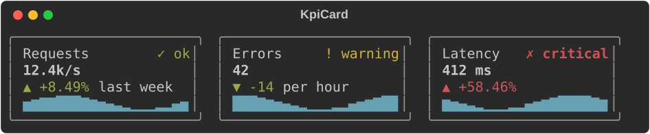

- The change is an arrow and a signed number: `▲ +8.49%`, `▼ -14`, `= 0`
  (`^`, `v` and `=` in ASCII). `.delta(d)` gives an amount,
  `.delta_percent(p)` a percentage and `.previous(v)` the percentage change
  from `v`. A change that is NaN or too large for an `f64` reads `= -`: no
  sign, and the flat arrow. It is styled `chart.delta.good` or `chart.delta.bad` by whether
  the change is for the better: `.higher_is_better(false)` for errors,
  latency and costs. The arrow and the sign carry the direction without
  colour.
- `Status::Ok`, `Warning`, `Critical` and `Unknown` are a symbol and a word
  (`✓ ok`, `! warning`, `✗ critical`, `? unknown`) in `chart.ok`,
  `chart.warning`, `chart.critical` or `chart.unknown`.
- A card measures to its content, so cards sit side by side in `Columns` or
  a table. `.width(n)` fixes its width, border included, and `.expand(true)`
  fills what it is given, as in a `Layout`. Cards with the same parts have
  the same height, so a row of them lines up.
- `.border(false)` leaves the border out; below 5 cells it goes anyway.

## Timelines and Gantt strips

A `Timeline` puts labelled ranges on a numeric scale, such as the steps of
a build in seconds. Ranges with the same row label share a row:

```rust
--8<-- "crates/rich-ext/examples/guide_charts.rs:timeline"
```

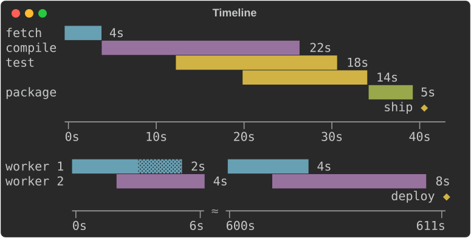

- Ranges on one row that overlap are **stacked** onto extra lines, so none
  hides another. A range that starts where the one before it on its line
  ends is drawn `▓` instead of `█` (`=` instead of `#`), so both show.
- A range covers every column whose centre value is inside it, and at least
  one. Its length is written after it when there is room
  (`.durations(false)` leaves them out), so it reads without the axis.
- `.milestone(label, at)` marks a point with `◆` (`*`) on a line under the
  ranges, its label beside it.
- The axis labels sit on evenly spaced columns and name each column's exact
  value, as on a line chart; `.unit("s")` writes a unit after every value.
  The scale is plain numbers: pass seconds (or any unit) as `f64`.
- **Compression:** when the range is wider than the plot, so that the
  shortest range would get less than a column, idle gaps are cut out when
  they are longer than both four times the shortest range and three
  columns' worth of the uncut scale. Each cut takes three columns with
  `≈` (`~`) on the axis, and each stretch is labelled at its start and end.
  `.compress(false)` keeps the scale linear; `.range(min, max)` fixes it.
- It fills the width given, or `.width(n)`. Given less, the row labels are
  cut so the plot keeps 8 columns.

## A dashboard

Cards, a matrix and a timeline in a `Layout`, rebuilt and passed to
`Live::update` on every tick, make a live dashboard. The
[`kpi_dashboard`](https://github.com/buchochelliq-labs/rs-rich-cli/blob/main/crates/rich-ext/examples/kpi_dashboard.rs)
example runs one; this is a frame of a smaller one:

```rust
--8<-- "crates/rich-ext/examples/guide_charts.rs:dashboard"
```

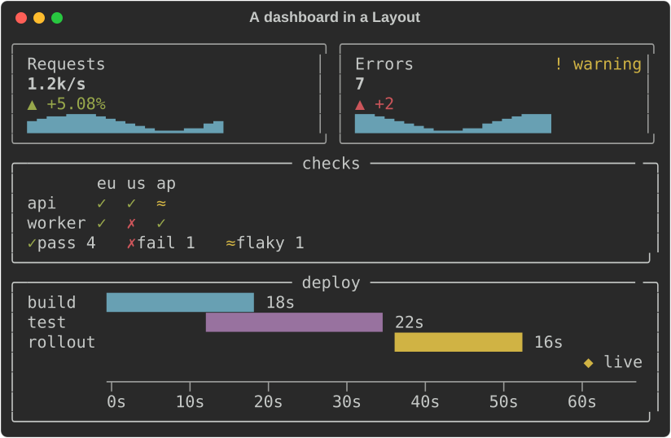

Cards take `.expand(true)` to fill their region. The layout fills the
console's height, so give `Live` a console with a fixed `.height(n)` or let
it take the terminal's.

## Distributions

`Distribution::new(values)` sums a set of values up on one line: a
box-and-whisker strip, then the numbers. A `DistributionSet` stacks several
on one scale:

```rust
--8<-- "crates/rich-ext/examples/guide_charts.rs:distribution"
```

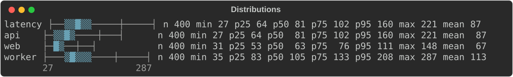

- **The strip** runs from the smallest value to the largest: `├` and `┤`
  at the ends, `─` whiskers, a shaded box `▒` from the first quartile to the
  third, the median `█`, and the 95th percentile a `┼` on the whisker when
  it has a cell of its own. In ASCII: `|`, `-`, `=`, `#` and `+`. The
  glyphs carry it, so it reads without colour. With colour, the box and the
  median are `chart.bar` (or `.style(..)`) and the whiskers `chart.axis`.
- **The numbers** are the count `n`, `min`, `p25`, `p50` (the median),
  `p75`, `p95`, `max` and `mean`, in `.format(..)` with `.unit(..)` after
  each value. NaN and infinite values are left out and counted
  (`2 ignored`).
- **Quantiles** are numpy's default, linear interpolation (Hyndman and
  Fan's type 7): for `n` sorted values, the `q` quantile sits at position
  `(n - 1) q`, between the two values either side of it. One value is every
  quantile. No values draw `no data` and `n 0`.
- `.summary()` returns the numbers as a `Summary`. `Summary::of(values)`
  and `quantile(&sorted, q)` compute them without drawing.
- The strip is `.strip_width(n)` cells (20 by default). Given less width it
  shrinks to 8 cells, then the numbers shorten to `min`, `p50` and `max`,
  then they go, then the label is cut. `.range(min, max)` fixes the scale,
  and `.numbers(false)` leaves the numbers out.
- **`DistributionSet`** draws every row on one scale: the smallest to the
  largest value of them all, or `.range(..)`. Labels, strips and numbers
  sit in aligned columns, and the scale's two ends are written under the
  strips. `.shared_scale(false)` gives each row its own scale.

## Small multiples

`SmallMultiples::new([(title, chart), …])` lays charts out in a grid, each
under its title, all on one value scale, so they compare at a glance:

```rust
--8<-- "crates/rich-ext/examples/guide_charts.rs:multiples"
```

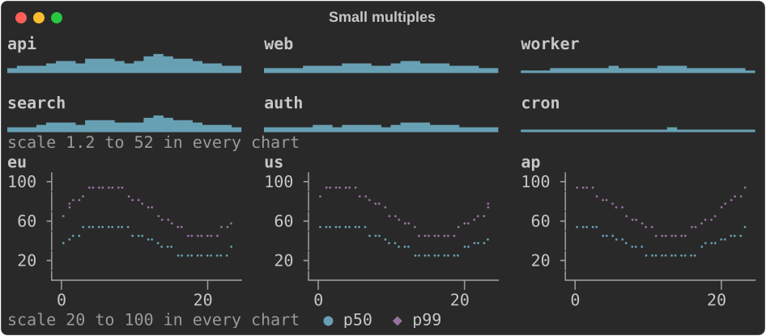

- **Columns:** `.columns(n)`, or as many as fit cells of at least
  `.min_cell_width(n)` (24 by default) with `.gap(n)` cells between them
  (2 by default). That is one column at 40 cells, three at 80 and four at
  120, never more than there are charts. Every cell is as wide; what is
  left over stays at the right. Charts fill the grid row by row.
- **One scale:** a `Facet` is a chart whose value scale can be shared: a
  `Sparkline` (its heights), a `BarChart` (its bars' lengths, from zero), a
  `LineChart` or a `Chart` (the y axis). Each converts with `.into()`. The
  grid fixes every chart's scale to the range of them all, so a taller bar
  is a larger value whichever chart it is in. When a chart has axis labels
  the range is rounded out to round numbers. `.range(min, max)` fixes it,
  and `.shared_scale(false)` leaves each chart its own.
- **One note** under the grid says the scale (`scale 0 to 60 in every
  chart`) and holds the one legend: the line charts' series, whose own
  legends are left out. `.note(false)` leaves it out.
- **Height:** `.height(rows)` makes each chart that many rows. Without it,
  a grid given a height (a `Layout` region, an intuiTUIve node) shares it
  among its rows of charts, less the titles, the gaps and the note.
  Printed on its own, each chart keeps its own height.
- Titles are `chart.title` (bold), cut to the cell. A blank line separates
  the rows of charts.

## Accessible text

Every chart implements `rich_ext::a11y::AccessibleText`: a few short lines
of plain words that say what the chart shows, for a screen reader, a log or
a test. There are no glyphs or box lines in it, and it reads the same
whatever the width or the console:

```rust
--8<-- "crates/rich-ext/examples/guide_charts.rs:accessible"
```

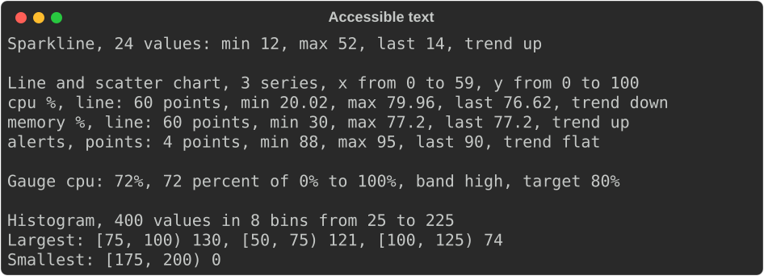

The first line says what the chart is, how much it holds and the ranges of
its axes. The lines after it give the key values:

| Chart | First line | Then |
|---|---|---|
| `Sparkline` | `Sparkline, 24 values: min 12, max 52, last 14, trend up`, with the gaps (`1 missing`) and a threshold (`4 above 40`) | |
| `BarChart` | `Bar chart, 4 bars in 2 groups, values from 2 to 4, 1 without a value` | every bar, up to six; else `Largest:` the three largest and `Smallest:` the smallest |
| `Histogram` | `Histogram, 400 values in 8 bins from 25 to 225` | each bin's count, up to six bins; else the largest and the smallest |
| `LineChart` | `Line chart, 3 series, x from 0 to 59, y from 0 to 100` | a line per series: its name, `line` or `points`, then `60 points, min 20.02, max 79.96, last 76.62, trend down` |
| `Chart` | `Chart, 2 datasets, x (t) from 0 to 10, y (%) from 0 to 4`, and `log scale` for a log axis | a line per dataset, as a line chart's |
| `Gauge`, `BulletChart` | `Gauge cpu: 72%, 72 percent of 0% to 100%, band high, target 80%` | a bullet chart: a line per gauge |
| `FillGauge`, `LineGauge` | `Gauge 50/100 GB: 50 percent` | |
| `Heatmap` | `Heatmap, 2 rows by 4 columns, values from 0 to 9, 1 missing` | `Highest 9 at api, wed; lowest 0 at web, mon` |
| `StatusMatrix` | `Status matrix, 3 rows by 3 columns: 4 pass, 2 fail, 1 skip` | the cells of each state but pass and skip: `fail: unit on windows, docs on macos` |
| `KpiCard` | `KPI Errors: 42, down 25% vs yesterday, better, status warning` | its sparkline's text |
| `Timeline` | `Timeline, 3 rows, 3 ranges, 1 milestone, from 0s to 52s` | each range (`compile from 4s to 31.5s, 27.5s`), twenty at most, and each milestone |
| `Canvas` | `Canvas, x from -180 to 180, y from -90 to 90: a world map, 4 points, 3 lines` | `Text:` what it printed |
| `Distribution` | `Distribution latency: 400 values, min 27, p25 64, median 81, …, mean 87` | |
| `DistributionSet` | `Distributions, 3 on a shared scale from 27 to 287` | each distribution's line |
| `SmallMultiples` | `Small multiples, 6 charts on a shared scale from 1.2 to 52` | each chart's title and text |

- Values are written in the chart's own format, counts with thousands
  separators.
- A series' **trend** is the least-squares line through its finite
  points: `up` or `down` when it rises or falls by at least a tenth of the
  values' range across the series, `flat` otherwise. A hump that ends where
  it began is flat.
- **In an intuiTUIve app**, draw a chart with `described(move || ..)`
  instead of `renderable(..)`. It looks the same, and its accessible name
  is the chart's text, its lines joined with `. `. The accessibility tree,
  [linear mode](../intuituive/index.md#linear-mode) and a screen reader
  read the description, and read it again when the data changes.
  `.label("CPU")` goes first: `CPU: Line chart, …`.
- From Python: `rs_rich.chart.describe(chart)`, or
  `rs_rich.ext.a11y.accessible_text(chart)`.

## From the shell: `rich chart`

`rich chart` draws data from a file, a URL or stdin with these charts, so a
shell pipeline can end in a picture. It reads CSV and TSV (the dialect
sniffed as `rich --csv` sniffs it), JSON (an array of records, of numbers or
of rows, or an object of columns), JSON Lines, or whitespace-separated
numbers.

```bash
rich chart sales.csv                                  # every numeric column as a line
rich chart sales.csv --kind bar --x month --y api     # a bar per row, labelled
rich chart sales.csv --kind heatmap                   # rows by series, as shades
seq 1 20 | rich chart --kind spark                    # numbers piped in
rich chart metrics.json --kind scatter --x t --y p50 --y p99
```

| Option | Meaning |
|---|---|
| `--kind spark\|bar\|line\|scatter\|heatmap` | What to draw; `line` by default |
| `--x COLUMN` | The positions (line, scatter: numbers) or labels (bar, heatmap). Default: the row number; for labels, the first column that is not all numbers |
| `--y COLUMN` | A series; repeat for several. Default: every numeric column but `--x` |
| `--width N` | The width to draw in |

Columns go by header or by 1-based number, so a CSV without a header works
too (its columns are `1`, `2`, ...). An empty cell or a JSON `null` is a gap.
A column that is not there, or a value that is not a number, is refused with
exit code 4 and a message naming the row (counted from 1, after the header)
and the column:

```text
$ rich chart sales.csv --y mobile
rich: no column "mobile"; the columns are "month", "api", "web"
$ rich chart sales.csv --x month
rich: row 1, column "month": "Jan" is not a number (a line or scatter chart's --x is a position; --kind bar takes labels)
```

```text
$ rich chart sales.csv --kind bar --y api --width 50
Jan ███████████████████████▌                 30
Feb █████████████████████████████████        42
Mar ███████████████████████████▌             35
Apr ████████████████████████████████████████ 51
May █████████████████████████████████████▋   48
```

[The recording](../../recordings.md#charts-from-data) shows it in a
terminal.

## Colours: palettes and helpers

`rich_ext::palette` has the colours charts and apps are often drawn in, as
ratatui's `style::palette` and its `palette` feature have:

- **`palette::tailwind`**: Tailwind CSS's 22 palettes (`SLATE` to `ROSE`),
  each with eleven shades from `c50` to `c950`, and `tailwind::ALL` with
  their names.
- **`palette::material`**: Material Design's 19 palettes, `c50` to `c900`,
  and the accents `a100` to `a700` of the 16 that have them.
- Each shade is a `#rrggbb` string, so it goes straight into markup
  (`format!("[on {}]", SLATE.c900)`), a style or a theme.
- **Colours from numbers**, each a truecolor `rich::Color`: `hsl(h, s, l)`
  and `hsv(h, s, v)`, with the hue in degrees; `oklab(l, a, b)`; and
  `okhsv(h, s, v)`, HSV whose hues are evenly spaced to the eye and whose
  value looks the same lightness at every hue, so a swatch of it has no
  bright bands.
- **`blend(a, b, t)`** mixes two colours, and **`gradient(&stops, t)`**
  picks a colour along several spaced evenly.

```rust
--8<-- "crates/rich-ext/examples/guide_charts.rs:palette"
```

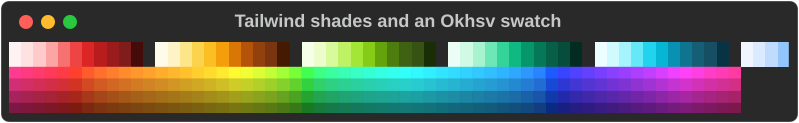

Credit: Tailwind CSS's palette is MIT licensed (Tailwind Labs); Material
Design's colours come from Material Design Lite, Apache License 2.0
(Google); Oklab and Okhsv are Björn Ottosson's, and the conversions are our
own code for his published formulas.

## The shared pieces

| Type | What it does |
|---|---|
| `Scale` | A linear scale. `Scale::from_values` skips NaN and infinities and never has an empty range: when every value is `v` the range is twice as wide as `v` with `v` in the middle (`0..1` for 0), and no values gives `0..1`. `.nice(n)` widens to round bounds; `.ticks(n)` gives about `n` round values inside it; `.normalize(v)` maps to 0..1 |
| `ValueFormat` | `Compact` (`950`, `0.25`, `1.2k`, `3.4M`, `1.0e15` from a thousand trillion) or `Fixed(decimals)` (at most `ValueFormat::MAX_DECIMALS`, 17; more are capped) |
| `Status` | A health level for a `KpiCard`: a symbol, a word and a theme key |
| `State` | A state of a `StatusMatrix` cell: a name, a symbol, an ASCII symbol and a style |
| `Band`, `Span`, `Milestone` | A gauge's threshold band; a timeline's range and point |
| `Charset` | `Auto`, `Blocks`, `Braille`, `Ascii` |
| `DotCanvas` | The Braille canvas the line chart draws on: set dots, draw lines, read cells |
| `Direction`, `Levels` | A sparkline's way (`LeftToRight`, `RightToLeft`) and block set (`Nine`, `Three`) |
| `BarGroup` | Bars with a label, set apart from the others |
| `Marker`, `Shape`, `MapResolution` | How a canvas marks what it draws; a shape of your own; the map's detail |
| `LineSet` | A line gauge's glyphs: `Thin`, `Thick`, `Double` |
| `Summary`, `quantile` | A distribution's numbers (`Summary::of(values)`), and one quantile of sorted values, interpolated linearly |
| `Facet` | A chart a `SmallMultiples` grid can hold and put on its shared scale: `Sparkline`, `BarChart`, `LineChart` or `Chart` |

Theme keys:

| Key | Default | Used for |
|---|---|---|
| `chart.axis` | `bright_black` | Axes and ticks |
| `chart.label`, `chart.value` | none | Labels, tick labels and values |
| `chart.bar` | `cyan` | Bars |
| `chart.negative` | `magenta` | Bars below zero |
| `chart.spark` | `cyan` | Sparklines |
| `chart.over` | `bold red` | Sparkline values above the threshold |
| `chart.min`, `chart.max` | `blue`, `bold green` | Sparkline extremes |
| `chart.series.1` … `.5` | `cyan`, `magenta`, `yellow`, `green`, `blue` | Series, by position (they cycle); timeline rows |
| `chart.track` | `bright_black` | A gauge's track and band shades |
| `chart.target` | `bold` | A gauge's target marker |
| `chart.gauge.filled`, `chart.gauge.unfilled` | `cyan`, `bright_black` | A `FillGauge`'s bar and the rest; a `LineGauge`'s two parts |
| `chart.ok`, `chart.warning`, `chart.critical`, `chart.unknown` | `green`, `yellow`, `bold red`, `bright_black` | `Status`, and bands that name them |
| `chart.delta.good`, `chart.delta.bad`, `chart.delta.flat` | `green`, `red`, `bright_black` | A KPI card's change |
| `chart.kpi.label`, `chart.kpi.value`, `chart.kpi.border` | none, `bold`, `bright_black` | A KPI card |
| `chart.heat.1` … `.5` | `blue`, `cyan`, `green`, `yellow`, `red` | Heatmap steps, cold to hot |
| `chart.state.pass`, `.fail`, `.skip`, `.flaky`, `.unknown` | `green`, `bold red`, `bright_black`, `yellow`, `magenta` | Status matrix states |
| `chart.milestone` | `bold yellow` | Timeline milestones |
| `chart.title` | `bold` | Small multiples' titles |
