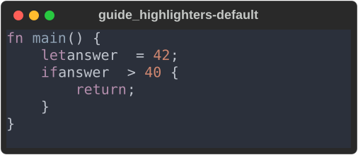
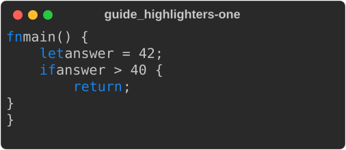
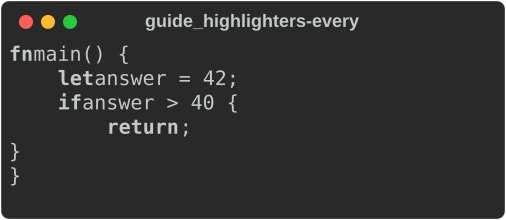
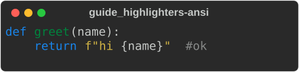

# Code highlighters

`Syntax`, Markdown code blocks, `source_view` and the diff views all highlight
code through one extension point, core's `CodeHighlighter`. Two adapters ship
with the port, and you can write your own in about 40 lines.

The examples come from
[`guide_highlighters.rs`](https://github.com/buchochelliq-labs/rs-rich-cli/blob/main/crates/rich-ext/examples/guide_highlighters.rs):

```bash
cargo run -p rs-rich-ext --example guide_highlighters --features testing,syntax
```

## Choose one

| | syntect (default) | lumis (`rs-rich-lumis`) |
|---|---|---|
| Parsing | TextMate grammars, regex-based | tree-sitter grammars |
| Code | Pure Rust by default; the `onig` feature swaps in the Oniguruma C library | C (tree-sitter's runtime and grammars) |
| Languages | syntect's default set | 116 with default features; bundles select fewer |
| Themes | 7 syntect themes, plus `ansi_dark` and `ansi_light` | 256 Neovim themes (default `monokai`), plus `ansi_dark` and `ansi_light` |
| Speed | 2–4× faster with `onig` | a fixed cost per language, then the fastest on long files ([benchmarks](../../benchmarks.md#0012-code-highlighters)) |
| Binary | about 15.7 MB for the CLI | about 169 MB for the CLI with every language; a bundle is far smaller |
| Minimum Rust | the workspace's (1.90) | 1.95 |

syntect is the default everywhere and is what upstream parity is measured
with. Choose lumis for tree-sitter's more precise parsing, its languages or its
themes, and accept the larger build.

A `Syntax` with no highlighter of its own uses syntect (core's default
`syntax` feature), with its default theme, `base16-ocean.dark`:

```rust
--8<-- "crates/rich-ext/examples/guide_highlighters.rs:default"
```



!!! warning "One tree-sitter per binary"
    lumis links tree-sitter's C runtime. Another crate that links a different
    version of that runtime (another tree-sitter highlighter, for example) cannot
    go into the same binary. That is why lumis lives in its own crate and is
    behind an off-by-default feature in the CLI.

In the CLI, choose with `--highlighter NAME` and `--code-theme NAME`, or the
`highlighter` and `code_theme` keys in `rich.toml`. `rich doctor` lists the
highlighters compiled in, their themes, and the one in use.

## Use one

Give a highlighter to one `Syntax`, or make it the default for every block a
console renders: register it, choose it by name and install the registry.

```rust
--8<-- "crates/rich-ext/examples/guide_highlighters.rs:use"
```

`Keywords` is the adapter written [below](#write-your-own). Given to one
`Syntax` with its `blue` theme, it colours the keywords and nothing else:



Installed as the console's default, it highlights a plain
`Syntax::new(CODE, "rust")` with its default theme, `bold`:



A `Syntax` with a highlighter of its own always uses it; the console's default
covers everything else, including Markdown code blocks. Theme names are each
highlighter's own.

The first highlight loads syntect's grammars and themes, which takes seconds
in a debug build. An interactive app can do that on a worker thread at
start-up with `rich_ext::syntax::preload(&["rust", "markdown"])` (see
[Warming up syntax highlighting](files-and-signals.md#warming-up-syntax-highlighting)).

## SQL without syntect

The `sql` feature of `rs-rich-ext` adds `sql::SqlHighlighter`, a
`CodeHighlighter` built on a hand-written SQL lexer: pure Rust, no
dependencies, no grammar files. It answers to `sql` and to `postgresql`,
`postgres`, `mysql`, `mariadb`, `sqlite`, `bigquery`, `snowflake`, `duckdb`,
`tsql` and `plsql`, and knows their common words (`QUALIFY`, `PRAGMA`,
`ILIKE`, `INT64`, `VARIANT`, …).

```rust
use rich::protocol::{CodeHighlighting, ConsoleCodeHighlighting};
use rich::Console;
use rich_ext::sql::SqlHighlighter;

let mut console = Console::new();
console.set_code_highlighting(Some(CodeHighlighting {
    highlighter: SqlHighlighter::shared(),
    theme: Some("ansi_dark".into()),
}));
// Every `Syntax` and Markdown ```sql fence this console renders.
```

What it tells apart:

| class | examples |
|---|---|
| keywords, types, constants | `SELECT`, `VARCHAR`, `NULL` |
| functions | a name before `(`: `count(`, `coalesce(` |
| names and quoted names | `orders`, `"Order Id"`, `` `col` ``, `[dbo].[t]` |
| strings | `'it''s'`, `E'\n'`, `$$ … $$`, `$fn$ … $fn$`, `'''raw'''`, `X'FF'` |
| numbers | `42`, `.5`, `1.5e-3`, `0xFF` |
| comments | `-- …`, `/* … */` (nested) |
| parameters | `:name`, `@name`, `@@var`, `$1`, `?` |
| operators, punctuation | `<>`, `\|\|`, `::`, `->>`; `( ) , ;` |
| Jinja blocks | `{{ ref('orders') }}`, ``, `{# … #}`, as dbt models use them |

A name after a `.` is a name even when it is a keyword (`t.date`), and `[`
after a name or `ARRAY` is a subscript, not a quoted name. An unterminated
string, comment or block runs to the end of the input; the lexer never
fails. `#` is an operator (PostgreSQL), not a MySQL comment.

Its themes are `monokai` (the default), `ansi_dark` and `ansi_light`; a theme
it does not know colours SQL with `monokai`, so a console set up with
another engine's theme still colours SQL. Other languages are plain text,
or go to another highlighter with `SqlHighlighter::with_fallback(…)`.
`sql::SqlPlugin` registers it as the highlighter `"sql"`.

!!! note "Dropping syntect"
    The `syntax` feature brings syntect; the `code` feature has `Syntax`
    without it, and `markdown` needs only `code`. `rs-rich-ext` forwards all
    three, and `sql` turns on `code`, so one dependency is enough:
    `rs-rich-ext` with `default-features = false, features = ["sql",
    "markdown"]` (leave out `markdown` if you need no Markdown). Then install `SqlPlugin` as the default code highlighter (or set it on
    the console as above): every `Syntax` and ```` ```sql ```` fence is
    highlighted by this lexer, and `cargo tree` shows no syntect or bincode.
    Code in other languages is plain in such a build, unless another
    highlighter is registered or given as the fallback. Without `Syntax` at
    all, `rich_ext::sql::highlight(code, theme)` returns the highlighted SQL
    as a `Text`; `sql::tokenize` gives the tokens.

## Write your own

An adapter implements four methods. `highlight` returns one line per element
of `code.split('\n')`, each with styled byte ranges: sorted, not overlapping,
inside the line and on character boundaries. An unknown language is plain
text, and an unknown theme is an error. This one only bolds (or colours) a few
Rust keywords:

```rust
--8<-- "crates/rich-ext/examples/guide_highlighters.rs:adapter"
```

Core checks what an adapter returns against the source. It drops bad spans,
renders missing lines unstyled, strips hyperlinks from styles and takes the
text from the source, so an adapter can change colours but never the text.
That is a safety net, not a licence: the conformance kit holds adapters to the
contract.

## Check it with the conformance kit

`rich_ext::testing::conformance` (the `testing` feature) runs the checks both
shipped adapters pass in CI:

- the default theme is listed and highlights (with `ansi_dark`, if listed),
  and an unknown theme is `UnknownTheme`;
- line counts match `split('\n')` for empty input, a missing final newline,
  CRLF, tabs and multi-byte text;
- spans are sorted, disjoint, in range and on character boundaries;
- an unknown language renders exactly as no language;
- rendered output carries no control characters beyond styling;
- 10,000 lines cost at most 40× what 1,000 lines do, a relative budget rather
  than a wall-clock one.

```rust
--8<-- "crates/rich-ext/examples/guide_highlighters.rs:conformance"
```

As a test:

```rust
--8<-- "crates/rich-ext/examples/guide_highlighters.rs:test"
```

`check_with(…, Options { all_themes: true, .. })` also runs every theme the
adapter lists. A failure lists every problem with the input that caused it.

## The ANSI themes

`ansi_dark` and `ansi_light` are upstream rich's `ANSI_DARK` and `ANSI_LIGHT`:
the terminal's own 16 colours, with no background, so highlighted code follows
the user's terminal palette. Both shipped adapters map their token names onto
upstream's Pygments token types (see
[Divergences #18](https://github.com/buchochelliq-labs/rs-rich-cli/blob/main/docs/DIVERGENCES.md)).

```rust
--8<-- "crates/rich-ext/examples/guide_highlighters.rs:ansi"
```


