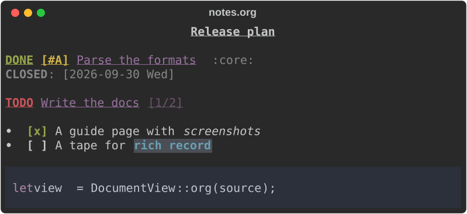
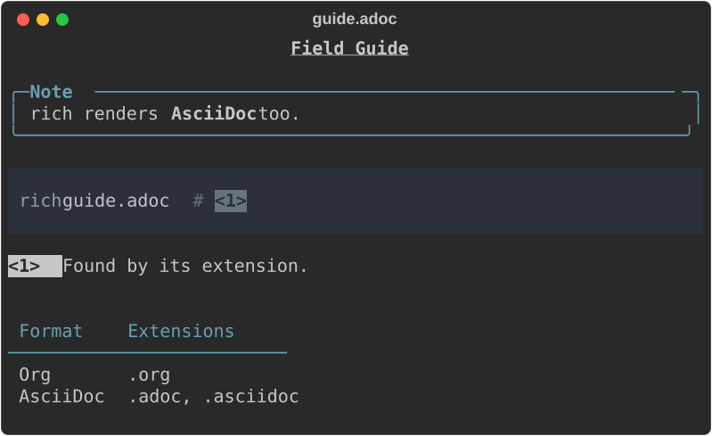
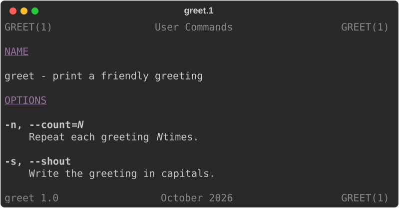
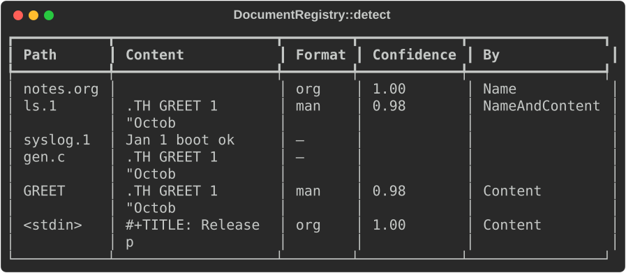
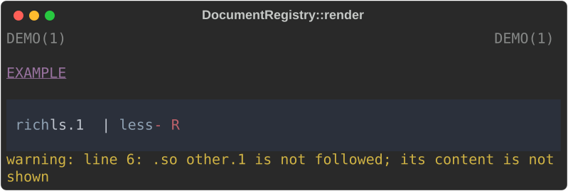
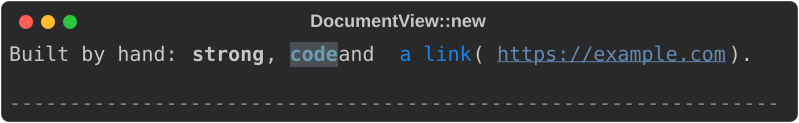

# Documents: Org, AsciiDoc and man pages

`rich_ext::document` draws documentation formats beside core's Markdown:
**Org**, **AsciiDoc** and **man pages** from their roff source, with
reStructuredText (`rich_ext::rst`, a port of rich-rst) and Markdown itself
behind the same interface. Upstream `rich` renders Markdown only; this
module is the port's own (behind the default `syntax` feature).

The three new formats parse into one small model, and `DocumentView` draws it
with core's renderables in Markdown's look: the same heading styles, bullets
and numbers, code panels, tables, block quotes and rules. Every snippet comes
from
[`guide_documents.rs`](https://github.com/buchochelliq-labs/rs-rich-cli/blob/main/crates/rich-ext/examples/guide_documents.rs):

```bash
cargo run -p rs-rich-ext --example guide_documents
```

## Render a document

```rust
--8<-- "crates/rich-ext/examples/guide_documents.rs:org"
```



Headlines keep their TODO keyword (`TODO`/`DONE`, or the ones a `#+TODO:`
line declares), priority and tags; drawers, planning lines and keywords such
as `#+OPTIONS` are shown dim and compact under what they belong to.

```rust
--8<-- "crates/rich-ext/examples/guide_documents.rs:asciidoc"
```



Attribute entries (`:product: rich`) fill `{product}` references; admonitions
are titled panels; callout markers (`<1>`) are drawn the same in the code and
in the list that explains them.

```rust
--8<-- "crates/rich-ext/examples/guide_documents.rs:man"
```



`.TH` becomes the page's running header and footer, `.SH`/`.SS` headings,
`.TP` and `.IP` tagged paragraphs a definition list (or a bullet or numbered
list when the tag is one), and the font escapes bold, italic and code spans.

`DocumentView` takes the same options as Markdown: `.hyperlinks(false)`
writes a link's target after its text (core's `Markdown::hyperlinks`), and
`.code_theme(…)`, `.default_language(…)` and `.fence_renderer(…)` reach the
code blocks.

## Detect the format

A `DocumentRegistry` holds the formats and finds one from a path and the
text:

```rust
--8<-- "crates/rich-ext/examples/guide_documents.rs:detect"
```



1. A format's own extension wins: `.org`, `.adoc`/`.asciidoc`, `.rst`, `.md`,
   `.man`/`.roff`/`.mdoc`.
2. An extension a format *may* use needs the content to agree, at `LIKELY`
   (0.6) or above: a manual section (`.1` to `.9`, with a suffix such as
   `.3pm`) may be a rotated log, and `.asc` an armoured PGP file.
3. Any other extension is never a document: `gen.c` stays C even when it
   quotes `.TH`.
4. With no extension (or no path), the content alone decides, when the most
   confident format reaches the threshold you pass and leads the next by 0.1.
   `CERTAIN` (0.9) is for input nobody asked about; Markdown and
   reStructuredText never reach it on content alone, as Markdown-like text is
   everywhere.

`registry.sniff(text)` lists every format's confidence, and each provider's
`sniff` reads at most the first 64 KiB.

## Render by name, with diagnostics

```rust
--8<-- "crates/rich-ext/examples/guide_documents.rs:registry"
```



`render` returns the renderable and the `Diagnostic`s: a `Warning` when
content is not shown as written (an `include::` or `.so` not followed, an
equation, a block that never closes), an `Info` for what a terminal has no
use for (an export-only block, an unknown macro whose arguments are shown as
text). Each has the source line when it is known.

## What each format covers

| Format | Drawn | Shown as text | Not shown |
|---|---|---|---|
| Org | headline tree with TODO keywords, priorities and tags; `#+TITLE`, `#+SUBTITLE`, `#+AUTHOR`, `#+DATE`; `*bold*`, `/italic/`, `_underline_`, `=verbatim=`, `~code~`, `+strike+`; plain, numbered and description lists, checkboxes, `[@N]`; `SRC`, `EXAMPLE`, `QUOTE`, `VERSE`, `CENTER` blocks and `NOTE`-style special blocks; `: ` fixed-width lines; tables with `\|---\|` rules and `<l>`/`<c>`/`<r>`; links and image links; drawers and planning lines; timestamps, footnotes, statistics cookies, entities | macros (`{{{name}}}`), radio targets | comments, `COMMENT` and `EXPORT` blocks, export snippets, `#+NAME`/`#+ATTR_*`, `#+TBLFM`; `#+INCLUDE` is not followed |
| AsciiDoc | header (title, author and revision lines, attributes), sections `=` to `======`; constrained and unconstrained `*strong*`, `_emphasis_`, `` `mono` ``, `#highlight#`; `{name}` references; unordered, ordered, checklist, description and callout lists with `+` continuations; listing, source (with callouts), literal, example, sidebar, quote, verse and open blocks; block titles; admonitions; `\|===` tables (implicit or `%header` header, `cols` alignment, cell styles) and `,===`/`:===` data tables; links, cross references, `image::`/`image:` placeholders, `kbd:`, `btn:`, `menu:`, footnotes, character references, typographic replacements | other block and inline macros, as written; `include::` (not followed, with a warning) | comments, passthrough blocks, `toc::[]`, page breaks; `ifdef`-style directives (their content is kept) |
| man | `.TH` header and footer; `.SH`, `.SS`; `.PP`/`.P`/`.LP`/`.HP`; `.TP`/`.TQ`, `.IP`; `.RS`/`.RE`; `.B`, `.I`, `.SM`, `.SB` and the alternating font macros; `.nf`/`.fi`, `.EX`/`.EE`; `.br`, `.sp`; `.UR`/`.UE`, `.MT`/`.ME`; `.SY`/`.OP`/`.YS`, `.MR`; font and special-character escapes, strings, `.if`/`.ie`/`.el` (as nroff evaluates them); tbl tables; the common mdoc macros (`.Sh`, `.Nm`, `.Fl`, `.Ar`, `.Op`, `.Xr`, `.Bl`/`.It`/`.El`, `.Bd`/`.Ed`, `.Ex`, `.Rv`, …) | unknown macros' arguments | size, colour, motion and drawing escapes; `.de`/`.ig` bodies; `eqn` and `pic` blocks and `.so` (with a warning) |

Every parser is total: arbitrary input never panics, nesting is capped (16
levels of lists, 8 of blocks in blocks), and a megabyte of ordinary prose,
lists and headings renders in well under a second in a release build. Code
blocks and tables cost what `Syntax` and `Table` cost, as they do in
`Markdown`: a document made of nothing but code blocks is slower.

## Build the model yourself

```rust
--8<-- "crates/rich-ext/examples/guide_documents.rs:model"
```



`document::model` holds `Block` (headings, paragraphs, lists, definitions,
code, tables, quotes, admonitions, asides, indents, rules, images, properties,
banners, captions) and `Inline` (text, emphasis, strong, underline, strike,
code, links, images, line breaks, and `Styled` for a theme key).

## Theme keys

The model reads the `markdown.*` keys for everything Markdown also draws, and
adds `document.*` keys (in `extended_theme`, and as fallbacks when a theme
lacks them): `document.todo`, `document.done`, `document.priority`,
`document.tag`, `document.byline`, `document.caption`, `document.properties`,
`document.term`, `document.callout`, `document.checkbox.checked`,
`document.timestamp`, `document.mark`, `document.banner` and the five
`document.admonition.*` kinds, among others (`document::STYLES` lists them).

## Add a format

```rust
--8<-- "crates/rich-ext/examples/guide_documents.rs:custom"
```


A format implements `DocumentFormat`: an id (a lowercase name, also usable as
a CLI value), aliases, extensions (or `match_name` for "maybe" extensions), a
`sniff`, and either `parse` (to draw through the shared model) or `render`.
A plugin cannot declare a document format through `PluginRegistrar` yet; it
can register a `SourceRenderer`, which a host wraps in a
`SourceRendererFormat` (adding the extensions it claims and a sniffer) to put
it in a registry. See [Extending](../../PLUGINS.md).

## In the shell

`rich notes.org`, `rich guide.adoc` and `rich ls.1` use this module, with
`--org`, `--asciidoc` and `--man` (and `--format org`, …) to choose a format
outright. The [command-line guide](../../cli.md#org-asciidoc-and-man-pages)
covers detection and the flags.

## From Python

`rs_rich.ext.document` has the same formats: `render(source, "org")`,
`detect`, `sniff` and `formats`. See
[Documents](https://buchochelliq-labs.github.io/rs-rich-cli/python/ext/documents/)
in the Python docs.
