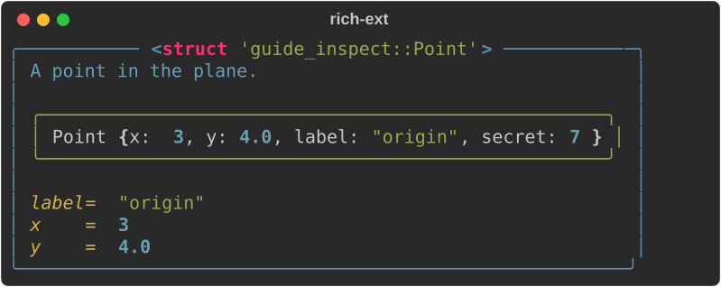
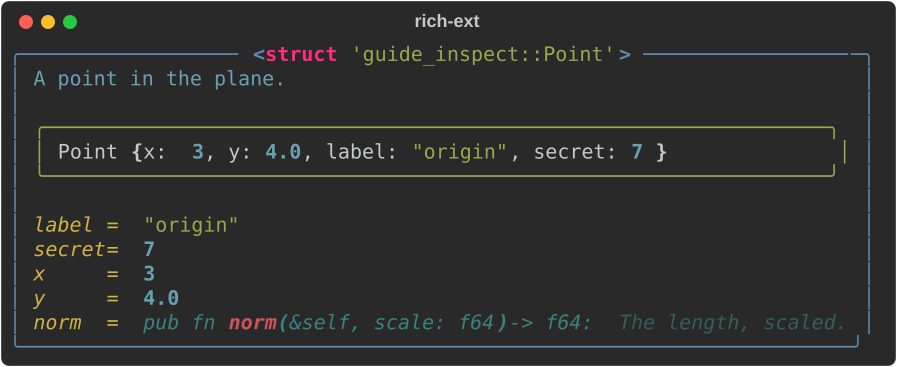
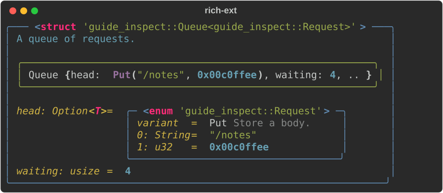

# Inspect

Python's [`rich.inspect`](https://rich.readthedocs.io/en/latest/reference/init.html#rich.inspect)
prints a report on any object: its type, docstring, value and attributes,
and with `methods=True` its methods. `rs-rich-ext` has the same report for
Rust values, laid out the same way.

Python finds what to show at run time, with `dir()` and `getattr()`. Rust
has no runtime reflection, so `#[derive(Inspect)]` collects it at compile
time instead: the type's name and doc comment, each field's name, type,
doc comment, visibility and value, and an enum's variants.
`#[inspect]` on an `impl` block records its methods.

```toml
rs-rich-ext = { version = "…", features = ["macros"] }
```

The report itself (`rich_ext::inspect`) needs no feature; only the derive
and `#[inspect]` do. A hand-written `Inspectable` impl works without them.

## Deriving it

```rust
--8<-- "crates/rich-ext/examples/guide_inspect.rs:point"
```

```rust
--8<-- "crates/rich-ext/examples/guide_inspect.rs:default"
```



The panel is upstream's: a blue `scope.border` panel fitted to its
contents, titled with the type; the doc comment's first paragraph in
`inspect.help`; the value in a green `inspect.value.border` panel; and a
grid of `name = value` rows with the names right-aligned. Values are their
`Debug` output, on one line where it fits and expanded (`{:#?}`) where it
does not. Private (non-`pub`) fields are hidden, as Python hides `_names`,
but the value panel shows every field, as Python's repr does.

## Options

`Inspect::new(&value)` takes upstream's options as builder methods;
`InspectOptions` holds the same ones for `inspect()` and `rich_inspect!`.

| option | default | what it does |
|--------|---------|--------------|
| `methods` | off | list the methods `#[inspect]` recorded |
| `docs` | on | show doc comments: the type's, each field's and each method's |
| `help` | off | full doc comments, not only their first paragraph |
| `private` | off | show non-`pub` fields and methods |
| `sort` | on | sort fields and methods by name; off keeps declaration order |
| `value` | on | show the value in a panel |
| `types` | off | show each field's type as written: `x: i32 = 3` |
| `variants` | off | for an enum, list every variant |
| `all` | — | turn on `methods`, `private`, `types` and `variants` |
| `title` | the type | the panel's title (console markup) |
| `label` | none | the expression's source text, before the type |
| `max_depth` | 3 | how deep `#[inspect(nested)]` reports go |

```rust
--8<-- "crates/rich-ext/examples/guide_inspect.rs:methods"
```



## Methods

Methods can't be found generically: a type's inherent methods are not
visible to a derive on the type. So a method list needs two marks: put
`#[inspect]` on the `impl` block, and `#[inspect(methods)]` on the type.
Each method's row is its signature as written (`pub fn`, `const`, `async`,
`unsafe` and `extern` included), then its doc comment. A non-`pub` method
shows only with `private`, and `#[inspect(skip)]` on a method leaves it
out. One `impl` block per type can carry `#[inspect]`; a trait impl cannot.

`#[inspect]` is `rich_ext::inspect`; write it with the path
(`#[rich_ext::inspect]`) if you don't import it.

## Fields that aren't `Debug`, enums, generics and nesting

```rust
--8<-- "crates/rich-ext/examples/guide_inspect.rs:fields"
```

```rust
--8<-- "crates/rich-ext/examples/guide_inspect.rs:nested"
```



- **Field attributes.** Every field needs `Debug`, unless it is marked:
  `#[inspect(skip)]` leaves it out (the value then reads `Name { a: 1, .. }`),
  and `#[inspect(with = path)]` formats it with a function that has
  `Debug::fmt`'s signature. A field that is neither is a compile error that
  names the field's type.
- **Nesting.** `#[inspect(nested)]` shows a field that is itself
  `Inspectable` (or an `Option`, `Box`, `Rc` or `Arc` of one) as its own
  panel. Past `max_depth` the value reads `Node { .. }`, so a recursive type
  stops.
- **Enums.** The row `variant = Get` comes first, with the variant's doc
  comment, then the variant's fields; `variants` lists all of them.
- **Generics.** The title is `std::any::type_name`, so it names the
  concrete type (`Queue<guide_inspect::Request>`); field types are as
  written (`Option<T>`). A type parameter used in a field gets a `Debug`
  bound on that field's type, as needed.
- **Unions** are refused: which field holds the value isn't known.

## Printing

```rust
--8<-- "crates/rich-ext/examples/guide_inspect.rs:print"
```

`inspect(&value, options)` prints to standard output, as Python's
`inspect(obj)` does. `rich_inspect!(value, name = option, …)` does the
same, with the expression's source text in the title (`point: <struct
'guide_inspect::Point'>`).

## Next to Python's

The same class in Python:

```python
from dataclasses import dataclass
from rich import inspect

@dataclass
class Point:
    """A point in the plane.

    Only `help` shows this paragraph."""
    x: int
    y: float
    label: str
    _secret: int

    def norm(self, scale: float) -> float:
        """The length, scaled."""
        return (self.x ** 2 + self.y ** 2) ** 0.5 * scale

inspect(Point(3, 4.0, "origin", 7), methods=True, private=True)
```

With rich 15.0.0, at 80 columns:

```text
╭─────────────────── <class '__main__.Point'> ───────────────────╮
│ A point in the plane.                                          │
│                                                                │
│ ╭────────────────────────────────────────────────────────────╮ │
│ │ Point(x=3, y=4.0, label='origin', _secret=7)               │ │
│ ╰────────────────────────────────────────────────────────────╯ │
│                                                                │
│   label = 'origin'                                             │
│ _secret = 7                                                    │
│       x = 3                                                    │
│       y = 4.0                                                  │
│    norm = def norm(scale: float) -> float: The length, scaled. │
╰────────────────────────────────────────────────────────────────╯
```

and the Rust struct above, with `.methods(true).private(true)`:

```text
╭────────────────── <struct 'guide_inspect::Point'> ──────────────────╮
│ A point in the plane.                                               │
│                                                                     │
│ ╭─────────────────────────────────────────────────────────────────╮ │
│ │ Point { x: 3, y: 4.0, label: "origin", secret: 7 }              │ │
│ ╰─────────────────────────────────────────────────────────────────╯ │
│                                                                     │
│  label = "origin"                                                   │
│ secret = 7                                                          │
│      x = 3                                                          │
│      y = 4.0                                                        │
│   norm = pub fn norm(&self, scale: f64) -> f64: The length, scaled. │
╰─────────────────────────────────────────────────────────────────────╯
```

What differs, and why ([DIVERGENCES §19](../../DIVERGENCES.md#19-python-object-modules-are-reimagined-for-rust)):

- **The data comes from the derive**, not from the live object; a type
  without `#[derive(Inspect)]` (or a hand-written `Inspectable`) can't be
  inspected.
- **Titles** read `<struct '…'>` or `<enum '…'>` with the full
  `type_name`, after Python's `<class '…'>`.
- **Values are `Debug` output** (`"origin"`, `4.0`), not Python reprs, and
  there are no `max_length`/`max_string` cuts.
- **Methods** are listed only from an `impl` block marked `#[inspect]`, with
  the receiver (`&self`) and visibility as written. Trait methods and
  associated constants are not listed.
- **No `dunder`**: Rust has no dunder names. `private` means non-`pub`, not
  a leading underscore. `all` turns on `methods`, `private`, `types` and
  `variants`, the Rust options it stands for.
- **Field doc comments** follow their values when `docs` is on (Python
  attributes have no docstrings). `types`, `variants` and `max_depth` are
  ours.
- **Inspecting a class, a function or a module** has no counterpart: a Rust
  type is not a value, so there is no `inspect(Point)` and no callable's
  own signature line.

## Run the example

```bash
cargo run -p rs-rich-ext --example guide_inspect --features macros
```

## See also

- [Macros](macros.md): `#[derive(Rich)]`, which renders a value as its own
  panel or table rather than reporting on it.
- [`Pretty`](../core/code-and-data.md#pretty): a value's `Debug` output, highlighted.
- API: [`rich_ext::inspect`](https://docs.rs/rs-rich-ext/latest/rich_ext/inspect/index.html),
  [`rs-rich-macros`](https://docs.rs/rs-rich-macros/latest/rich_macros/).
