# Dependency graphs and JSON Schemas

Two sources the terminal is often asked about, drawn as trees (0.0.15):
Cargo's resolved dependency graph and JSON Schemas (and, since 0.0.16, SQL
DDL and Arrow schemas through [the schema model](#the-schema-model)); beside the graph, the
[supply-chain reports](#supply-chain-reports) (0.0.16) read feature,
build-time, advisory and licence data Cargo and its tools already wrote
(and, since 0.0.19, [artifact sizes](#artifact-sizes),
[baselines](#comparing-with-a-baseline), a [licence policy](#licence-policy)
and [SBOMs](#sboms)). Both live in `rs-rich-ext`
behind its `data` feature, as `rich_ext::deps` and `rich_ext::schema`; the
`rich` CLI shows them with `rich deps` and `rich schema`. Neither reads
colour alone: markers and words carry the meaning, and colour repeats it.

The examples below use the fixtures in `crates/rich-ext/tests/fixtures/sources`,
which CI renders on every change; `fixture(name)` reads one of them. The
snippets and pictures come from
[`guide_sources.rs`](https://github.com/buchochelliq-labs/rs-rich-cli/blob/main/crates/rich-ext/examples/guide_sources.rs)
(and the SQL ones from `rs-rich-data`'s
[`guide_schemas.rs`](https://github.com/buchochelliq-labs/rs-rich-cli/blob/main/crates/rich-data/examples/guide_schemas.rs)):

```bash
cargo run -p rs-rich-ext --example guide_sources --features data,toml
```

[A recording](../../recordings.md#dependency-trees) shows `rich deps` on the
same fixture in a terminal.

## Cargo dependency graphs

`DepGraph::from_json` reads the output of `cargo metadata --format-version 1`:
every package, the workspace members, and which depend on which (normal,
build and dev). Running Cargo is the caller's business; the library only
reads its output.

```rust
--8<-- "crates/rich-ext/examples/guide_sources.rs:tree"
```

`DepTree` prints what `cargo tree` prints: each root (the package
`cargo metadata` ran in, else every workspace member) and what it depends on.
A package already shown is marked `(*)` instead of repeated, build and dev
dependencies sit under `[build-dependencies]` and `[dev-dependencies]`, and a
crate resolved at more than one version is marked `(duplicate)` and coloured.
Dev dependencies are a root's only, as Cargo resolves them; a root is
expanded in full at the top level (its dev dependencies included) even when
it was already shown as another root's dependency, so `demo-core` above is
listed again with what it uses. `max_depth`, `kinds` and `duplicates_only`
trim it; `summary(true)` lists the duplicates underneath, counting only the
versions reachable through the kinds followed. A branch deeper than 128
levels (`deps::MAX_TREE_DEPTH`, far past any real graph) ends in a
`… (deeper levels not shown …)` note.

```bash
rich deps                         # runs cargo metadata in the working directory
rich deps path/to/Cargo.toml      # ... or for that manifest (or its directory)
rich deps --metadata meta.json    # ... or reads saved output (`-` for stdin)
```

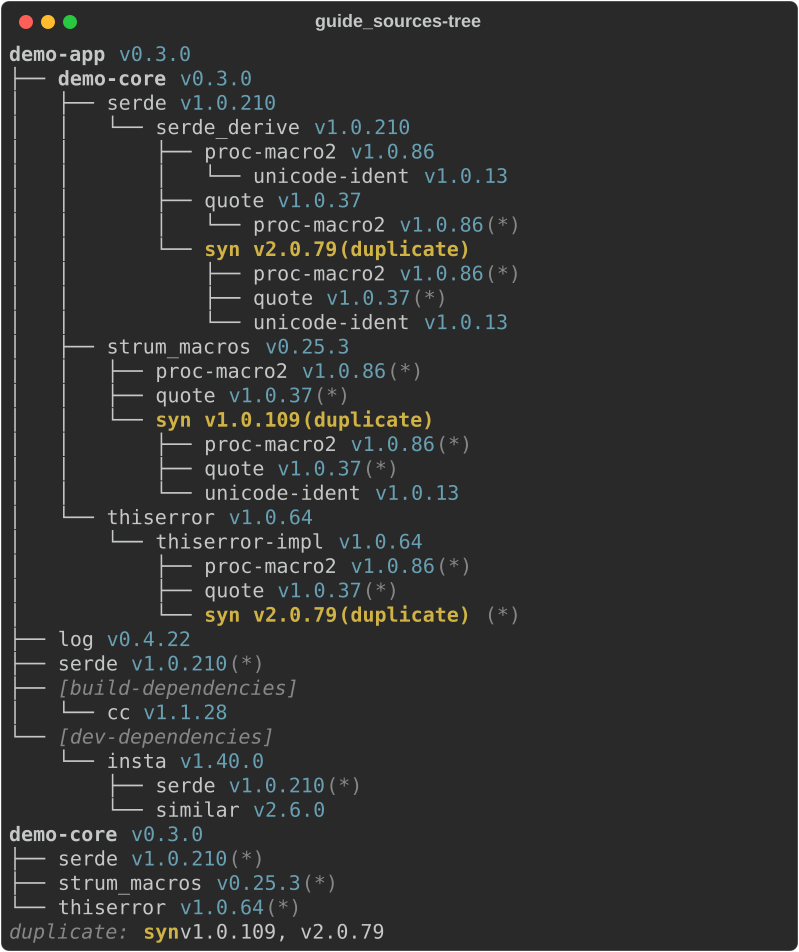

`--depth N` keeps N levels below each root, `--no-dev` leaves dev
dependencies out, and `--duplicates` keeps only the branches that lead to a
duplicated crate:

```rust
--8<-- "crates/rich-ext/examples/guide_sources.rs:duplicates"
```

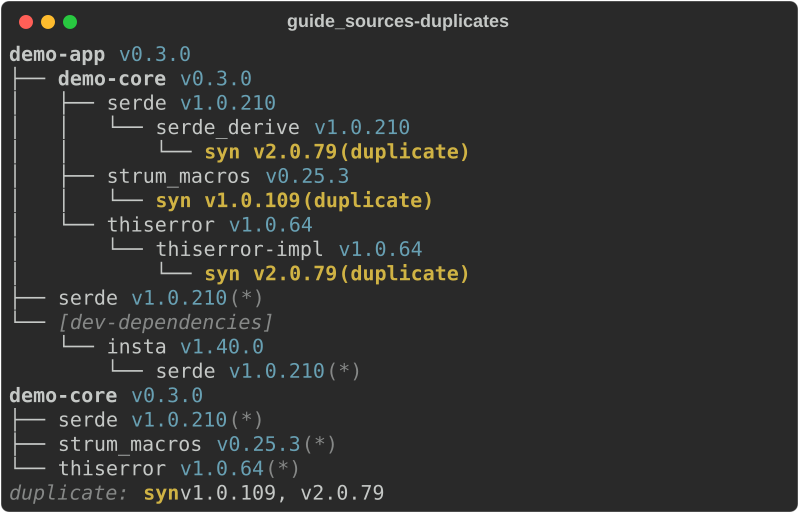

### Running Cargo

Without `--metadata`, `rich deps` runs `cargo metadata --format-version 1`
(`$CARGO`, else `cargo` on the `PATH`) in the working directory. Cargo runs
there with **that directory's Cargo configuration**: every
`.cargo/config.toml` from it up to the root, and the `rust-toolchain.toml`
rustup honours. `cargo metadata` compiles nothing, but it does run `rustc`
to learn the target, and it may fetch the registry index and git
dependencies as Cargo always does (`rich deps` does not pass `--offline` or
`--locked`; Cargo's own settings and `CARGO_NET_OFFLINE` apply).

A configuration can name programs. `rich deps` turns off the ones `cargo
metadata` would run without needing them: it sets `RUSTC_WRAPPER`,
`CARGO_BUILD_RUSTC_WRAPPER`, `RUSTC_WORKSPACE_WRAPPER` and
`CARGO_BUILD_RUSTC_WORKSPACE_WRAPPER` to empty for Cargo, which overrides a
`build.rustc-wrapper` or `build.rustc-workspace-wrapper` in the project's
configuration. What it cannot turn off is the rest of Cargo's behaviour: a
`build.rustc` naming another program still runs as the compiler, and a
`rust-toolchain.toml` still selects (and rustup may install) a toolchain.
Note that Cargo reads the configuration of the directory it is started in,
not the manifest's: `rich deps path/to/Cargo.toml` uses the working
directory's configuration (and that of the directories above it).

So in a checkout you do not trust, do not run `rich deps` there. Make the
metadata where running Cargo is safe (`cargo metadata --format-version 1 >
meta.json`, in a sandbox or a container) and read it with `rich deps
--metadata meta.json`, which runs nothing.

### What pulls a crate in

`--why CRATE` (`name`, or `name@version`) prints `WhyTree`: the crate and
everything that depends on it, up to the workspace, which is every path that
pulls it in (what `cargo tree -i` prints). A dependent that uses it only as a
build or dev dependency is marked `[build]` or `[dev]`. `DepGraph::paths_to`
lists the paths one by one, shortest first.

```bash
rich deps --why syn@1.0.109
```

```rust
--8<-- "crates/rich-ext/examples/guide_sources.rs:why"
```

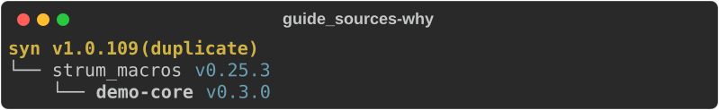

With `--no-dev`, a crate only dev dependencies pull in is not reached, and
`rich deps --why` says so and exits 4 rather than print nothing:

```text
rich: insta is reached only through dev-dependencies (drop --no-dev)
```

### As a diagram

`--graph` draws the same through the [diagram layout](../diagram/index.md)
instead: dependencies left to right, or for `--why` from the workspace down to
the crate. Workspace members are rounded, duplicated crates are hexagons, and
build and dev edges are dotted and labelled. A large graph is wider than the
terminal; `--depth` and `-w` help, and the drawing is cropped, never wrapped.

```bash
rich deps --why syn@1.0.109 --graph
```

```text
  ╭───────────────────╮
  │ demo-core v0.3.0  │
  ╰─────────┬─────────╯
            │
            ▼
┌───────────────────────┐
│ strum_macros v0.25.3  │
└───────────┬───────────┘
            │
            ▼
    ╱───────────────╲
    │ syn v1.0.109  │
    ╲───────────────╱
```

## Supply-chain reports

Five reports sit beside the tree (0.0.16), in `rich_ext::deps`'s submodules
`duplicates`, `features`, `timings`, `audit` and `licenses`. Each reads what
Cargo or its tools already wrote: `cargo metadata`, a `cargo build
--timings` report or `cargo audit --json` output. None runs a scanner or
reaches the network, and `--timings` and `--audit` do not run Cargo at all.
The examples use the fixtures in `crates/rich-ext/tests/fixtures/supply-chain`.

| Flag | Reads | Shows |
|---|---|---|
| `--duplicates` | `cargo metadata` | the duplicated branches, then a consolidation summary |
| `--features [--package CRATE]` | `cargo metadata` | each crate's enabled features, what they turn on, who asked |
| `--licenses` | `cargo metadata` | crates grouped by licence; copyleft, unknown and missing marked |
| `--timings FILE` | `cargo build --timings` | the slowest units as bars and a table |
| `--audit FILE` | `cargo audit --json` | advisories grouped by severity; exit 5 on a vulnerability |
| `--sizes [DIR\|FILE]` | a target directory, or `cargo bloat` JSON | artifact sizes per crate as bars and a table (0.0.19) |
| `--baseline FILE` | a saved report, or the original format | `--timings` or `--sizes` compared unit by unit; exit 5 on a regression (0.0.19) |
| `--policy FILE` | `cargo metadata`, or `--sbom FILE` | licences checked against an allow and deny list, and conflicts; exit 5 on a violation (0.0.19) |

Four more modules back the 0.0.19 reports: `sizes`, `compare`, `policy`
and `sbom`, described [below](#artifact-sizes).

Give one report at a time. An option that does not apply to it (`--graph`,
`--depth` or `--duplicates` with any of them, `--no-dev` with anything but
`--licenses`, `--metadata` or a manifest with `--timings` and `--audit`) is
refused with exit 2 rather than ignored.

The parsers are bounded: `--timings` and `--audit` read at most 64 MiB
(`deps::MAX_INPUT`), every reader takes at most 100,000 packages, units or
advisories (`deps::MAX_RECORDS`), JSON nests at most 128 levels (serde_json's
limit), and a licence expression is at most 1,024 bytes and 32 parentheses
deep. Past a limit, or on malformed input, the reader returns an error, and
`rich deps` exits 4 naming it.

### Consolidating duplicates

`--duplicates` keeps only the branches that lead to a duplicated crate, as
before, and now adds `Consolidation` under the tree: for each crate resolved
at more than one version, every version with what depends on it, and the
version most dependents already use (the newest by SemVer, on a tie). It does
not say the others could move onto it: that depends on their version
requirements, which the resolved graph does not record. `DepGraph::consolidation(kinds)` returns the same as data
(`Duplicate::shared_version`, `Duplicate::to_move`), and
`DepTree::consolidation(true)` adds it under a tree. Without `--duplicates`,
`rich deps` prints what it always did.

```rust
--8<-- "crates/rich-ext/examples/guide_sources.rs:consolidation"
```

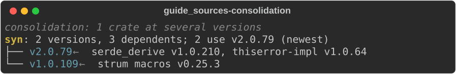

### Feature trees

`--features` reads the features Cargo resolved (`resolve.nodes[].features`,
unified across the build), each package's `[features]` table and the
features its dependents ask for. `FeatureTree` draws a crate: each enabled
feature with its definition underneath (another feature, an optional
dependency `dep:name` and the package it resolved to, or a dependency's
feature `name/feature`, with `name?/feature` applying only when that
dependency is on for another reason), and under "requested by" each
dependent with the features its manifest names and the features of its own
that turn on more. An entry Cargo did not act on is marked `(off)`.

Without `--package`, every crate with a feature enabled is shown, the
workspace members first, and the rest are counted.

```bash
rich deps --features --package syn@2.0.79
```

```rust
--8<-- "crates/rich-ext/examples/guide_sources.rs:features"
```

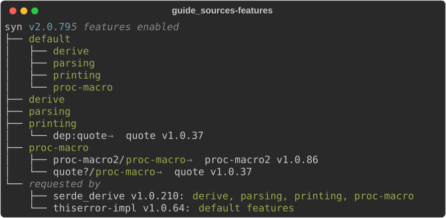

### Build times

`--timings FILE` reads the report `cargo build --timings` writes to
`target/cargo-timings/cargo-timing.html` (its script holds every unit as
JSON), that `UNIT_DATA` array on its own, or the `timing-info` JSON lines
older nightly toolchains wrote with `--timings=json -Zunstable-options`.
`TimingsReport` shows the totals, the 20 slowest units as bars
(`TimingsReport::limit` changes the number) and a table that splits each
unit's time into the frontend (until its `.rmeta` was ready, which lets
dependents start) and codegen. A crate built at two versions has the version
in its bar's label. Artifact sizes are not in the report: `--sizes` shows them
([below](#artifact-sizes)).

```bash
cargo build --timings
rich deps --timings target/cargo-timings/cargo-timing.html
```

```rust
--8<-- "crates/rich-ext/examples/guide_sources.rs:timings"
```

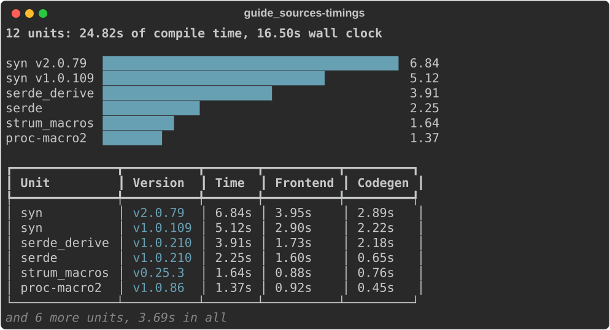

### Advisories

`audit::Advisory` is a generic model of one finding: id, kind
(vulnerability, unsound, unmaintained, yanked or notice), package and the
version in use, the patched and unaffected version requirements, severity
and CVSS score, title, link, aliases and date. `AdvisoryReport::from_cargo_audit`
reads `cargo audit --json`; a plugin reading another scanner builds the same
values and passes them to `AdvisoryReport::new`. `cargo audit` gives a CVSS
vector rather than a severity: a CVSS 3.x vector is scored with the
specification's formula (`audit::cvss3_score`) and banded as CVSS does; a
vulnerability without one (or with a CVSS 4 vector) is `unknown`, and a
warning without one is `informational`.

The report lists the counts, then a table grouped by severity, most severe
first. The ID links to the advisory in a terminal that shows links.

```bash
cargo audit --json > audit.json
rich deps --audit audit.json
```

```rust
--8<-- "crates/rich-ext/examples/guide_sources.rs:audit"
```

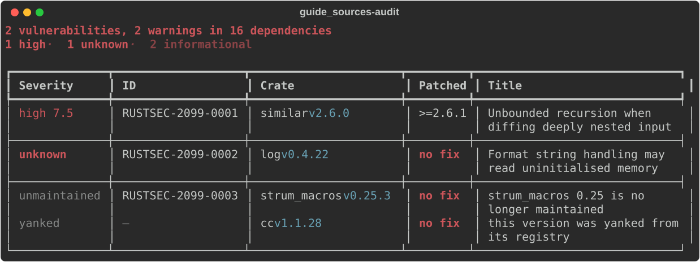

`rich deps --audit` then ends with `rich: 2 vulnerabilities found:
RUSTSEC-2099-0001, RUSTSEC-2099-0002` on stderr.

**Exit code.** Like `cargo audit` itself, and like the CLI's other gates
(`diff --threshold`, `bench compare`), `rich deps --audit` exits 5 when the
report lists a vulnerability, after showing it in full; with `--report json`
the one envelope on stderr has `"code": "gate"`. Warnings alone (unmaintained,
unsound, yanked) exit 0. A file that is not `cargo audit` JSON exits 4.

### Licences

`--licenses` groups the packages the tree reaches (`--no-dev` leaves out
those only dev dependencies pull in) by their `license` expression, or notes
a `license-file` or no licence at all. `licenses::classify` reads SPDX
expressions (`AND`, `OR`, `WITH`, parentheses, and the old `MIT/Apache-2.0`
form): an `OR` is as permissive as its most permissive choice, an `AND` as
strict as its strictest part. Weak copyleft (LGPL, MPL, EPL, CDDL, …),
copyleft (GPL, AGPL, EUPL, OSL, SSPL, CC-BY-SA), unknown identifiers,
unreadable expressions, licence files and missing licences are marked; the
operands of an expression are sorted, so `MIT OR Apache-2.0` and
`Apache-2.0 OR MIT` are one group. It is a reading aid, not legal advice.

```rust
--8<-- "crates/rich-ext/examples/guide_sources.rs:licenses"
```

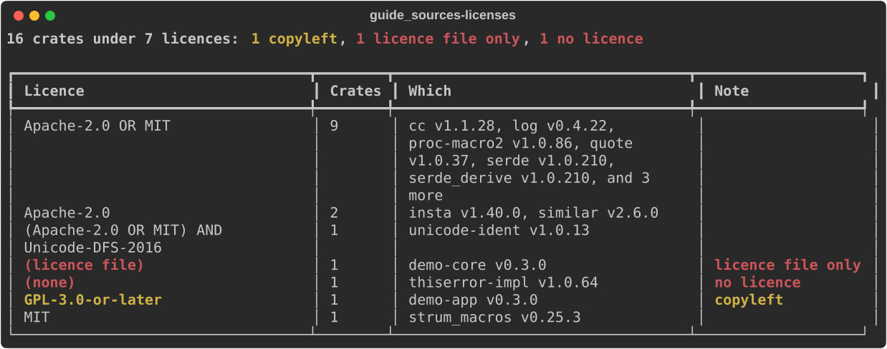

### Artifact sizes

`sizes::Sizes` measures what each crate adds to a build (0.0.19). Two
sources feed it:

- **A target directory.** `Sizes::from_target_dir(dir, metadata, options)`
  reads one profile's directory (`target/debug`, `target/release`, a cross
  build's `target/<triple>/<profile>`, or that directory itself) and
  matches each artifact to a package in `cargo metadata`: libraries in
  `deps/` (the `.rlib`, else the `.rmeta` a check build leaves),
  proc-macros and dylibs (`.so`, `.dylib`, `.dll`), static libraries, and
  the workspace's binaries. When a crate is resolved at two versions, its
  dep-info file says which package an artifact belongs to. Old builds
  leave artifacts behind, so of each package's artifacts of a kind the
  newest is taken; artifacts no package claims are counted, not shown.
  `SizeOptions::profile` picks the profile (`dev` and `test` build into
  `debug`, `bench` into `release`); `SizeOptions::sources` adds each
  package's source size (its manifest directory, without `target/`, `.git/`
  and nested packages, never following a symbolic link).
- **cargo-bloat.** `Sizes::parse` reads `cargo bloat --crates
  --message-format json` (or its per-function listing, added up by crate):
  each crate's share of one binary's code.

`SizeReport` draws the total, the largest entries as bars and a table with
each one's share; `SizeReport::limit` sets how many (20 by default).

```bash
rich deps --sizes                          # the target directory cargo metadata names
rich deps --sizes target --build-profile release --source-sizes
cargo bloat --release --crates --message-format json > bloat.json
rich deps --sizes bloat.json --top 6
```

```rust
--8<-- "crates/rich-ext/examples/guide_sources.rs:sizes"
```

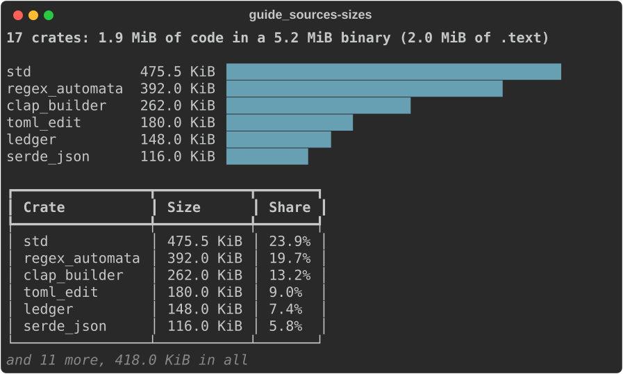

### Comparing with a baseline

`compare::Comparison` sets two timings or size reports side by side, unit
by unit: a timing unit by its label (`syn`, `app build-script (run)`), a
size entry by its crate (`app (bin)` for a binary). A name that appears
twice on one side, a crate built at two versions, is added up, so dropping
a duplicate reads as a smaller unit. Each unit gets a verdict:

- **regression**: it grew by more than the percentage *and* by more than
  the absolute floor. A new unit regresses when it is larger than the
  floor.
- **improvement**: it shrank by both.
- **new** (no larger than the floor), **removed**, or **unchanged**.

The floor keeps noise on small units from counting. `Thresholds::TIMINGS`
is 10% and 0.5 s, `Thresholds::SIZES` 10% and 64 KiB;
`Threshold::parse("100KiB")` and `Thresholds::with` change either. The
totals are compared the same way. `Comparison::regressions()` lists the
units that regressed, and `Comparison::failed()` adds the total, for a gate.

`Timings::to_json` and `Sizes::to_json` save a report as JSON, and
`Timings::parse` and `Sizes::parse` read it back, so CI can keep one build's
report and compare the next with it:

```bash
rich deps --sizes bloat.json --save sizes.json          # keep it
rich deps --sizes bloat.json --baseline sizes.json      # later: compare
rich deps --timings target/cargo-timings/cargo-timing.html \
  --baseline timings.json --threshold 15% --threshold 1s
```

```rust
--8<-- "crates/rich-ext/examples/guide_sources.rs:comparison"
```

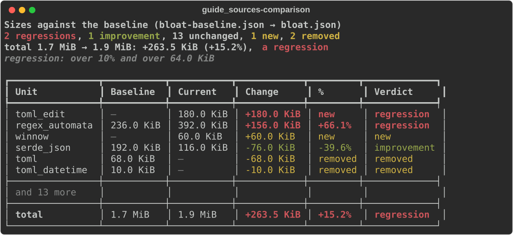

`rich deps --baseline` exits 5 when a unit or the total regressed, like
`--audit`, naming them on stderr: `rich: 3 regressions against the
baseline (over 10% and over 64.0 KiB): toml_edit, regex_automata, the
total`. `--threshold` takes a percentage (`10%`, or a bare `10`), a time
(`0.5s`, `500ms`) for `--timings` or a size (`100KiB`, `1MB`, `512B`) for
`--sizes`; give it twice to set both. `--threshold 0B` (or `0s`) drops the
floor.

### Licence policy

`policy::Policy` is an allow and deny list (0.0.19). `Policy::from_toml`
(with the `toml` feature) reads either shape, told apart by whether the
document has a `[licenses]` table:

```toml
--8<-- "crates/rich-ext/tests/fixtures/deps/policy.toml"
```

or cargo-deny's `deny.toml`, of which it reads `[licenses]`: `allow`,
`deny` (older releases), `exceptions` (`crate` or `name`, an optional
`version` requirement, `allow`) and `private.ignore` (with `cargo metadata`,
the workspace's unpublished crates are left out). It notes the keys it does
not apply, such as `confidence-threshold` and `clarify`: licence files are
not read. In cargo-deny's shape a licence not allowed is refused, as
cargo-deny refuses it; in rich's, a policy without `allow` allows whatever
it does not deny.

Each expression is evaluated, not matched as text. An `OR` passes when any
alternative is allowed (`MIT OR GPL-3.0-only` passes on MIT), an `AND` when
every part is, and a `WITH` exception belongs to the licence:
`Apache-2.0 WITH LLVM-exception` must be allowed as written. Identifiers
match without case, and `-only`, `-or-later` and `+` are read, so allowing
`GPL-3.0-only` satisfies `GPL-2.0-or-later`. A deny entry catches its
licence however it is suffixed (and with any exception, unless the entry
names one), and wins over the allow list; a crate's exception wins over
both. A crate with no licence, only a licence file, or an expression that
does not parse is a violation under an allow list and a warning without
one.

**Conflicts.** `policy::conflicts(root, packages)` sets each dependency's
licence against the root crate's on a small table. It is a heuristic, not
legal advice:

| Dependency | Root permissive, proprietary or unlicensed | Root weak copyleft | Root strong copyleft |
|---|---|---|---|
| Permissive | fine | fine | fine (but Apache-2.0 under `GPL-2.0-only` conflicts) |
| Weak copyleft (LGPL, MPL, EPL, …) | check | fine | fine (but EPL-1.0 and CDDL conflict with the GPL, and version 3 licences with `GPL-2.0-only`) |
| Strong copyleft (GPL, AGPL, EUPL, …) | conflict | conflict | fine within the GNU family (but version 3 under `GPL-2.0-only` conflicts, and AGPL under GPL is a check); another family is a check |
| Unknown identifier | check | check | check |

An `OR` takes its best alternative and an `AND` its worst part, on either
side. A linking exception (Classpath, the GCC runtime library, LLVM) makes
a copyleft licence count as weak. `rich deps --policy` checks each
workspace member against what it ships with: its normal dependencies, all
the way down (dev and build dependencies are not part of what it builds).
A policy's `conflicts = "warn"` (the default) shows them, `"deny"` makes a
conflict fail the check, and `"ignore"` leaves them out.

`PolicyReport` draws the violations (crate, version, expression, why), the
conflicts and the warnings; `PolicyReport::failed()` says whether the check
failed, which `rich deps --policy` turns into exit 5.

```rust
--8<-- "crates/rich-ext/examples/guide_sources.rs:policy"
```

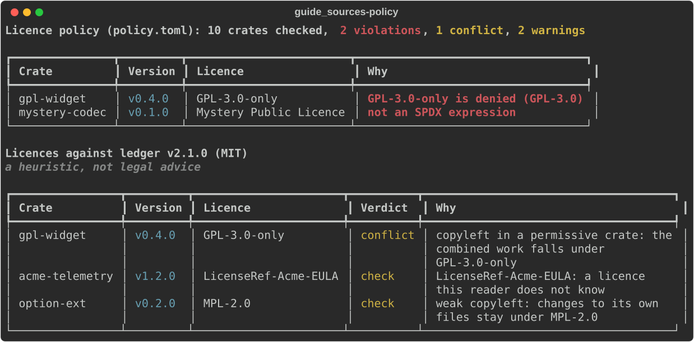

### SBOMs

`sbom::Sbom::parse` reads an SPDX (2.2, 2.3) or CycloneDX (1.4 to 1.6) JSON
document, told apart by content, into the same `LicenseReport`, so the
licence report and the policy work beyond Cargo. From SPDX it takes each
package's `licenseConcluded`, else `licenseDeclared` (`NOASSERTION` and
`NONE` read as no licence), and the package the document `DESCRIBES` as
the root; from CycloneDX each component's (nested ones too) `licenses`, an
`expression` or a `license` `id` or `name`, several of them read as all
applying (`AND`, the stricter reading), and `metadata.component` as the
root. SPDX tag-value, SPDX 3 and XML documents are refused with an error
that names them.

```bash
rich deps --licenses --sbom bom.cdx.json
rich deps --policy deny.toml --sbom bom.spdx.json
```

## JSON Schema

`SchemaTree` draws a schema as a tree of its properties: each with its type, a
`(required)` marker, its constraints (`minLength=1`, `format=email`,
`one of "a", "b"`, `no other properties`, …) and the first line of its
description. Array items (`[items]`, or `[0]`, `[1]` for tuples),
`patternProperties` (`/pattern/`), `additionalProperties`
(`[other properties]`), `oneOf` / `anyOf` / `allOf` branches, `not` and
`if` / `then` / `else` are branches of their own.

A `$ref` within the document (`#/$defs/…`, `#/definitions/…`, any JSON
pointer, or a `$anchor`) is resolved and drawn in place, marked `→ #/$defs/…`;
one that refers back to a schema it is already inside (however the reference
is spelled: `#/%24defs/x` is `#/$defs/x`) is marked `(recursive)` instead of
drawn again, and one to another document is shown, not fetched. A definition
shared through `$ref`s is drawn wherever it is used, which a small schema can
make exponentially many places: the tree stops at 10,000 entries
(`schema::MAX_ENTRIES`) and ends with a `… (the tree stops at 10000
entries)` note.

```rust
--8<-- "crates/rich-ext/examples/guide_sources.rs:schema"
```

```bash
rich schema order-v1.schema.json
```

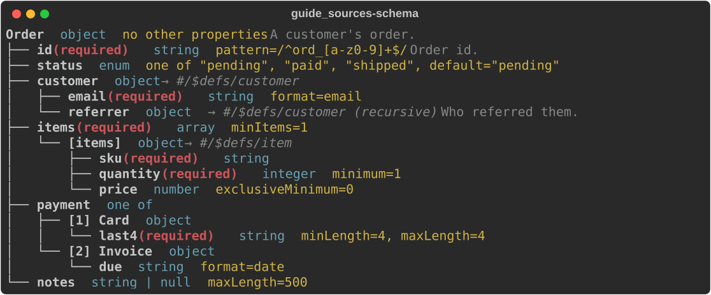

### What changed

`SchemaDiff::new(&old, &new)` compares two versions: properties added and
removed, type changes, properties that became (or stopped being) required,
enum values, constraints and branch counts, each marked `+`, `-` or `~`.
`breaking` marks a change that may refuse a document the old version
accepted: a new requirement, a removed enum value, a narrower type, a tighter
bound, or a removed property the new version may refuse (through
`additionalProperties: false` or a schema, or a `patternProperties` schema it
matches; `true`, `{}` or no `additionalProperties` still accepts it). Keywords
beside a local `$ref` are compared along with the schema it names. Shared
definitions are compared wherever they are used, so the diff has a budget
too: it stops after 10,000 changes (`schema::MAX_CHANGES`) or 100,000
comparisons of differing schemas (`MAX_COMPARISONS`), and then says so in its
summary (`(stopped after …: more may differ)`; `SchemaDiff::is_truncated`).
`rich schema OLD NEW` prints it:

```bash
rich schema order-v1.schema.json order-v2.schema.json
```

```rust
--8<-- "crates/rich-ext/examples/guide_sources.rs:schema-diff"
```

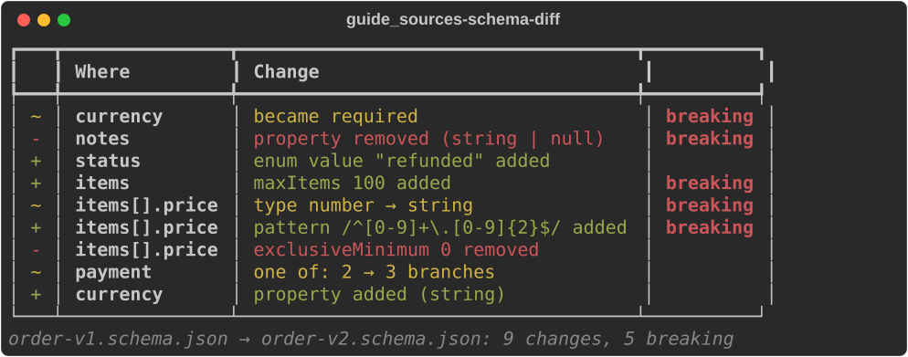

Both read a file, an http(s) URL or `-` (stdin, for one of the two); a file
that is not a JSON Schema (an object, `true` or `false`) is an error, exit 4.

## The schema model

`SchemaTree` and `SchemaDiff` read a format-neutral model,
`rich_ext::schema::{Schema, Field, DataType, Constraint}` (0.0.16), so JSON
Schema, SQL DDL and Arrow schemas draw and compare the same way. A `Schema`
is a list of `Field`s, optionally named, and (for a SQL file) further named
tables. A field has a model type (`integer`, `decimal(10,2)`,
`timestamp[UTC]`, `list<…>`, `struct`, `map<…, …>`), the source's own type
name as written (`VARCHAR(255)`, `Int32`, `string | null`), which the tree
shows, whether it may be null and whether a value must be present, and its
constraints: enum values, bounds, length, pattern, format, a default, primary
and unique keys and a `ForeignKey` to `table.column`. A key across several
columns is the table's own constraint.

`schema::json::to_model` maps a JSON Schema into the model; `SchemaTree::new`
draws a JSON Schema through the same mapping, and the output above is byte
for byte what it was before the model existed. JSON Schema's own structure
(pattern-named properties, tuple items, `oneOf` branches, `$ref`s) is kept
with each child's `FieldKind` and the reference its type came through.

### SQL DDL

`schema::sql::parse` reads a small `CREATE TABLE` subset: column names and
types (quoted or not, with parameters, several words such as
`DOUBLE PRECISION`, and arrays), `NOT NULL`, `DEFAULT`, `PRIMARY KEY`,
`UNIQUE` and `REFERENCES` on a column or for several columns on the table,
`CONSTRAINT name`, MySQL's `ENUM(…)` and `COMMENT`, `--` and `/* */`
comments, PostgreSQL's `$$ … $$` strings, and any number of statements.
`CHECK` constraints, indexes and every statement but `CREATE TABLE` are
skipped, each with a note giving its line; text it cannot read (an unclosed
string or parenthesis, a table with no column list) is an error with its
line. Input is bounded: 16 MiB, 100,000 statements, 1,000,000 tokens a
statement, 4,096 columns a table or a key and parentheses 64 deep;
statements are read one at a time.

```rust
--8<-- "crates/rich-data/examples/guide_schemas.rs:sql"
```

`V1` and `V2` are two versions of a shop's DDL:

??? example "The DDL"

    ```rust
    --8<-- "crates/rich-data/examples/guide_schemas.rs:ddl"
    ```

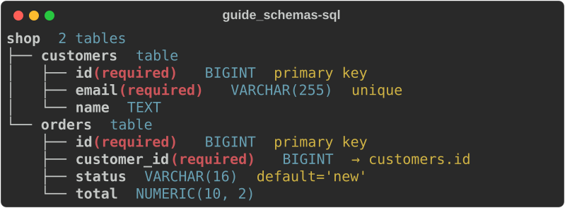

### Comparing any two schemas

`SchemaDiff::models(&old, &new)` compares two model schemas: fields by name
(nested ones by path, a list's items as `field[]`), then tables by name. It
reports the same kinds of change as the JSON Schema diff, plus keys and
metadata, with the same `breaking` rule: a new requirement (a `NOT NULL`, a
non-nullable Arrow field), a field no longer nullable, a changed type, a new key or reference, a tighter
bound, a removed enum value, and a removed field or table (rows that have it
no longer fit). A changed default or metadata entry is informational. Types
are compared by the source's own name, ignoring case, so `INT → BIGINT` and
`Int32 → Int64` are changes; comparing schemas from two formats works, but
reports every type whose names differ.

```rust
--8<-- "crates/rich-data/examples/guide_schemas.rs:diff"
```

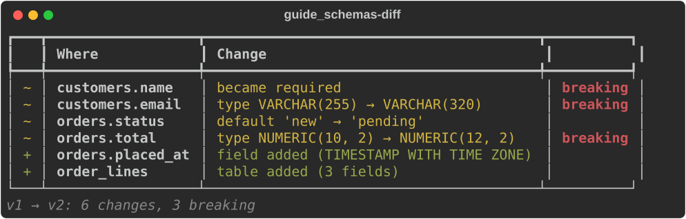

`SchemaDiff::new` stays the way to compare two JSON Schemas: it follows
`$ref`s as it goes, so shared definitions are compared only where they
differ.

### Arrow schemas

With `rs-rich-data`'s `arrow` feature, `rich_data::arrow::schema` maps an
Arrow schema into the model: nested structs, lists and maps, dictionaries
(as their value type), timestamps with their unit and time zone, decimals
with precision and scale, nullability, and field and schema metadata.
`arrow::tree` draws it and `arrow::diff` compares two (#342):

```text
events  8 fields  version=1
├── id (required)  Int32
├── at (required)  Timestamp(µs, "Europe/Paris")
├── kind  Dictionary(Int8, Utf8)  description=kind
├── amount  Decimal128(12, 2)
├── tags  List
│   └── item  Utf8
├── address  Struct
│   ├── city (required)  Utf8
│   └── zip  Utf8
├── scores  Map
│   ├── key (required)  Utf8
│   └── value  Float64
└── debug  Boolean
```

### Schema evolution

`SchemaTimeline` lays a series of versions on a `chart::Timeline` (#347): a
row per field (`table.column` for DDL) spanning the versions it is in, a
milestone per version with its counts (`v2: +2 ~4, 3 breaking`), and, unless
`details(false)`, every change listed under it. A span takes the added,
changed or breaking style in the version its field changed. Versions are at
their index unless placed with `at`; consecutive JSON Schemas compare as
JSON Schema, anything else through the model.

```rust
--8<-- "crates/rich-data/examples/guide_schemas.rs:timeline"
```

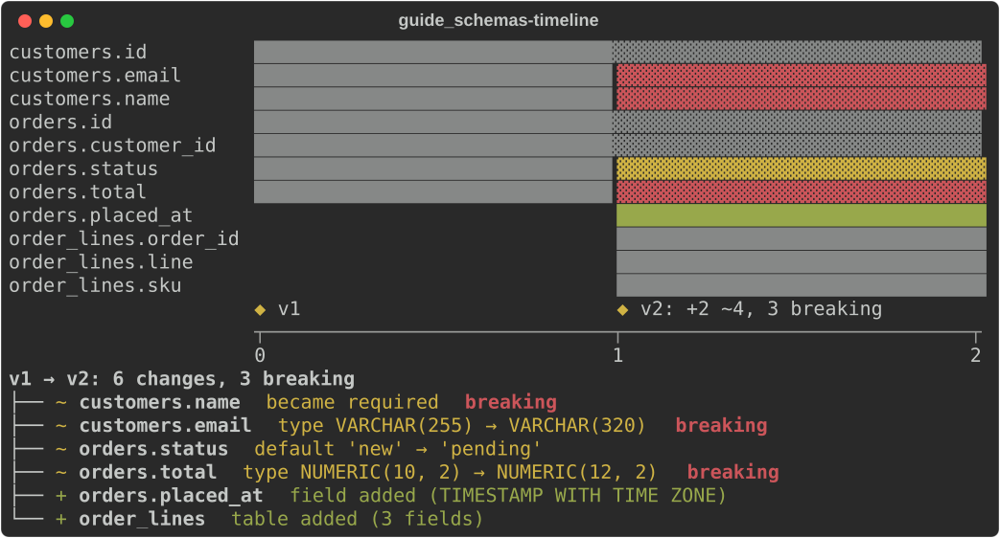

From the command line, `rich schema` reads JSON Schema, SQL DDL (`.sql`,
`.ddl`) and Arrow IPC files (with the CLI's `arrow` feature), compares any two,
and draws an ER diagram with `--er`; see [the CLI docs](../../cli.md).

### ER diagrams

`rs-rich-data`'s `er` module (behind its `er` feature) draws a schema as an
ER diagram through `rs-rich-diagram` (#247): a box per table with its
columns, types and keys (`PK`, `FK`, `UQ`, `?` for nullable), and an edge
per foreign key, `N:1`, or `1:1` when the key is the referring table's whole
primary key or a unique column. `er::model` turns any model schema into an
`ErModel`; `er::from_sql` reads DDL and returns the `ErDiagram` with the
reader's notes. A key naming `users` finds `public.users` when that is the
only table so named.

```rust
--8<-- "crates/rich-data/examples/guide_schemas.rs:er"
```

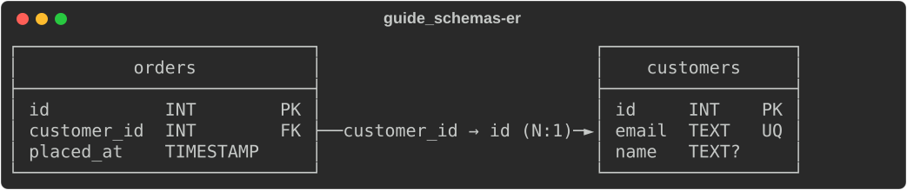
