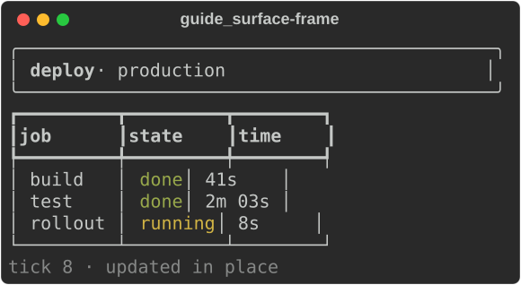
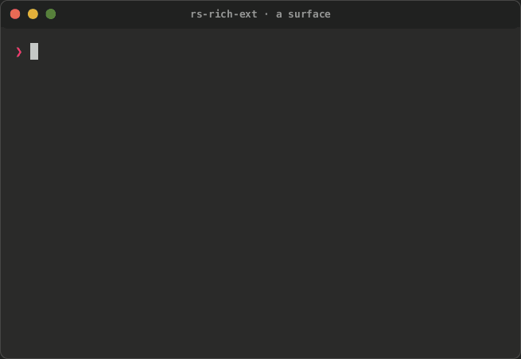
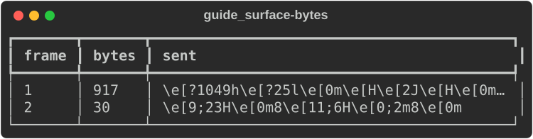

# Positioned drawing

`rich_ext::surface` draws rich renderables at fixed places on the terminal
and writes only what changed. A `Surface` keeps the terminal's cells
between frames. Each `draw` hands your closure a `Drawing`, and you render
any renderable into a rectangle of it: a `Panel`, a `Table`, a chart or
plain `Text`. When the closure returns, the surface compares the rectangles
you drew with what it sent last time and writes the difference. A clock
ticking in one corner costs a few bytes, not a screen.

It is the drawing half of [intuiTUIve](../intuituive/index.md) without the
widget tree or the event loop. intuiTUIve's `screen::Screen` and
`screen::Painter` are these types, so an app and a plain `Surface` draw with
the same code. Input stays yours: read keys with crossterm, or with
`rs-rich-interact`'s session.

The examples come from
[`guide_surface.rs`](https://github.com/buchochelliq-labs/rs-rich-cli/blob/main/crates/rich-ext/examples/guide_surface.rs).
The module needs no feature:

```bash
cargo run -p rs-rich-ext --example guide_surface   # ticks inline for a few seconds
```

## Drawing a frame

A frame renders each part into its own rectangle. `Rect::new(x, y, width,
height)` counts cells from the top left. A renderable is rendered as wide
as its rectangle and cut to its height, and the cells it does not reach
are cleared:

```rust
--8<-- "crates/rich-ext/examples/guide_surface.rs:frame"
```



Cells nothing drew in a frame keep what they showed, so a frame only needs
to render the parts that change. Drawing everything every time also works,
because unchanged cells are never written.

## On the terminal

`Surface::stdout(viewport)` takes the terminal's size and the colours
`Console::new()` detects:

- **`Viewport::Fullscreen`** draws on the alternate screen. What was on the
  terminal comes back when the surface finishes.
- **`Viewport::Inline(rows)`** takes that many rows from the cursor down
  and leaves the scrollback alone. When the surface finishes, the last
  frame stays on screen with the cursor below it, so the shell's prompt
  follows it.

```rust
--8<-- "crates/rich-ext/examples/guide_surface.rs:terminal"
```

<div class="tape-player" data-cast="../../media/tapes/surface/surface.cast" data-poster="npt:0:2">
  
</div>

| Ticking | Done |
|---|---|
|  |  |

`finish` gives the terminal back: it leaves the alternate screen (or moves
below the inline region), resets styles and shows the cursor. A surface
dropped without `finish` does the same.

Other settings:

- **`synchronized(true)`** writes each frame as one synchronized update
  (DEC mode 2026). A terminal that supports it shows the frame whole; one
  that does not ignores the markers.
- **`resize(width, height)`**: call it when the terminal changes size. The
  cells are kept, cut to the new size, and the next draw writes everything
  once.
- **`set_cursor(x, y)`** in a frame shows the cursor there, for a text
  field. Otherwise the cursor is hidden.
- **`graphics(source)`** draws micro assets and images with Kitty, iTerm2
  or Sixel graphics, from the same `PlacementSource` frames use. A graphic
  is redrawn when the cells under it are repainted.
- **`console(console)`** sets the colour system, theme and highlighting
  renderables are rendered with.
- **`paint_strategy(strategy)`** sets how changes become bytes. The
  default is `best`, as for an intuiTUIve app: rows that moved together
  (a log, a list scrolled by a line) move with the terminal's own
  scrolling, and anything else is painted cell by cell. `cells`, `rows`,
  `full` and `scroll` are the fixed choices, and the `RICH_PAINT_STRATEGY`
  environment variable names one when the program does not. Every
  strategy shows the same screen.
- **`terminal_scroll(on)`** says whether `best` and `scroll` may use the
  terminal's scrolling. Unset, they do, except on Windows and under tmux.
  An inline surface never scrolls, and no scroll moves rows through a
  graphic.

## What a frame sends

`Surface::new(writer, width, height)` writes to any `std::io::Write`. With a
`Vec<u8>` you can see what each frame sends, which is also how to test
drawing code:

```rust
--8<-- "crates/rich-ext/examples/guide_surface.rs:memory"
```



The first frame enters the alternate screen and writes every cell. The
second frame changed two cells, the rollout time and the tick, and sends
only those two cells and the moves to reach them.

## The fast path

`Drawing::render` renders with rich: a `Vec` of `Segment`s, each owning its
text and a `Style`, which the screen then takes apart into cells. That is
the faithful path, and works for every renderable. rs-rich-ext's own
charts also implement `surface::Draw`, which writes the same cells
straight into the screen, each style interned once:

```rust
use rich_ext::chart::{Chart, Dataset};
use rich_ext::surface::{Rect, Surface};

let mut surface = Surface::new(Vec::new(), 40, 10);
let chart = Chart::new([Dataset::new([(0.0, 0.0), (1.0, 1.0), (2.0, 0.5)])]);
surface
    .draw(|s| s.draw(Rect::new(0, 0, 40, 10), &chart))
    .unwrap();
```

The cells are the ones `render` gives; `rich_ext/tests/fast_path.rs` draws
every chart both ways and compares them. For drawing of your own,
`Screen::put_rgb` sets one cell in two true colours, `Screen::put` one
character in an interned style, and `Screen::write_runs` writes rows of
`TextRun`s (a borrowed text and an interned style id) as `write_lines`
writes segments. intuiTUIve draws through this path by default
(`Canvas::draw`, `drawn`).

## Compared with ratatui

ratatui's `Terminal::draw(|frame| …)` has the same shape, and the
difference is in what goes into the rectangles:

| | ratatui | `rich_ext::surface` |
|---|---|---|
| What you draw | ratatui widgets into a `Buffer` | any rich renderable: tables, panels, Markdown, syntax, charts |
| A cell's style | foreground, background and modifiers | a full rich `Style`, hyperlinks included |
| Between frames | the buffer is cleared, so you redraw every widget | cells are kept, so you redraw what changed |
| What is written | the cells that differ from the last buffer | the cells that differ, within the rectangles drawn |
| Inline | `Viewport::Inline(rows)` | `Viewport::Inline(rows)` |

The intuiTUIve benchmark gate measures this painter against ratatui on the
same dashboards; see [Against ratatui](../intuituive/index.md#against-ratatui).
To put rich renderables inside a ratatui app instead, use `rs-rich-ratatui`
([rich inside ratatui](../intuituive/porting.md#path-1-rich-inside-ratatui)).

## From Python

`rs_rich.ext.surface` has the same surface. The callback receives a
`Drawing`, and `render` takes anything `print` does:

```python
from rs_rich.ext.surface import Rect, Surface
from rs_rich.panel import Panel

with Surface(inline=4) as surface:
    for tick in range(5):
        surface.draw(lambda d: (
            d.render(Rect(0, 0, 40, 3), Panel("deploy")),
            d.render(Rect(0, 3, 40, 1), f"tick {tick}"),
        ))
```
