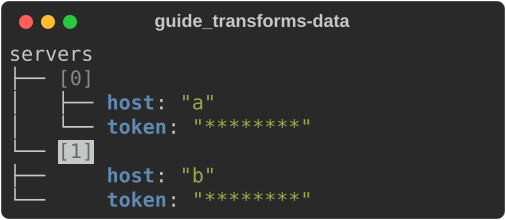
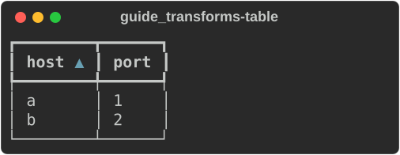

# Transforms

A transform rewrites what is about to be rendered: it drops lines, narrows a
data tree, masks secrets, or sorts rows. A `Pipeline` runs named transforms in
order, each stage getting the one before's output, and names the stage that
failed. The CLI's `--redact`, `--select`, `--filter` and `--highlight` are
built this way (see [Filter and highlight](../../cli.md#filter-and-highlight)
for the order they run in).

The examples come from
[`guide_transforms.rs`](https://github.com/buchochelliq-labs/rs-rich-cli/blob/main/crates/rich-ext/examples/guide_transforms.rs):

```bash
cargo run -p rs-rich-ext --example guide_transforms --features jsonpath
```

It also has the test that checks the pipelines produce what the pictures
show (`cargo test -p rs-rich-ext --example guide_transforms --features
jsonpath`).

| Module | Works on | Transforms |
|---|---|---|
| `rich_ext::transform` | `rich::Text` | `KeepLines`, `HighlightMatches`, any plugin `TextTransform` |
| `rich_ext::data::transform` (`jsonpath` feature) | a data `Document` | `Redact`, `Select`, `Filter`, `Highlight` |
| `rich_ext::table::transform` | `TableData` | `Sort`, `Group` |
| `rich_ext::diff::transform` | a parsed git `Patch` | `KeepFiles` |

Anything that implements `Transform<T>` can be a stage, and
`transform::from_fn` turns a closure into one. A pipeline is itself a
`Transform`, so pipelines nest.

## Text

`KeepLines` keeps the lines a regular expression matches (or, inverted, those
it does not), with their styles. `HighlightMatches` styles every match.

```rust
--8<-- "crates/rich-ext/examples/guide_transforms.rs:text"
```


## Data

A `Document` is a parsed data tree plus what the transforms decided about
showing it: its label and the paths to highlight. `document.explorer()` draws
it.

```rust
--8<-- "crates/rich-ext/examples/guide_transforms.rs:data"
```



- `Select` narrows to what a JSONPath selects. One hit becomes the root and
  labels it with its path; several become a map keyed by path.
- `Filter` keeps what a JSONPath selects and the containers above it, so the
  tree keeps its shape. Sequences are renumbered.
- `Highlight` styles the tree lines of what it selects (reverse video above).
- `Redact` masks values with any `Redactor`, such as `Redaction::secrets()`.

Order matters. Here `Redact` runs first, so later stages never see a secret,
and `Filter`'s path is relative to what `Select` chose.

## Tables and patches

`Sort` and `Group` set a `TableData`'s sort keys and grouping.
`KeepFiles` keeps the files of a patch whose path matches a pattern.

```rust
--8<-- "crates/rich-ext/examples/guide_transforms.rs:table"
```



## Contribute a transform from a plugin

Text transforms are part of the plugin contract. A plugin implements
`TextTransform` (from `rich_plugin_api`, or `rich_ext::plugin`) and registers it
by name:

```rust
--8<-- "crates/rich-ext/examples/guide_transforms.rs:plugin"
```

A host builds a pipeline of registered transforms by name:

```rust
--8<-- "crates/rich-ext/examples/guide_transforms.rs:registry"
```


`ExtensionRegistry::register_transform` adds one without a plugin, and
`transform_names()` lists them. `rich doctor` lists each plugin's transforms
with its other capabilities.

The text comes from the input, so treat it as untrusted: a transform may
change styles freely, but text it adds must not carry terminal control
sequences.
