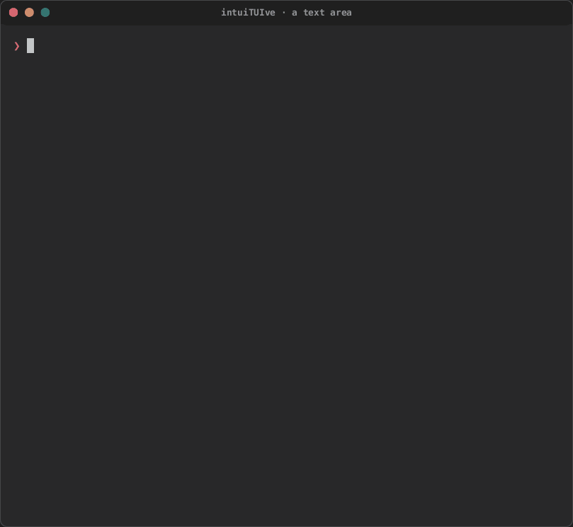
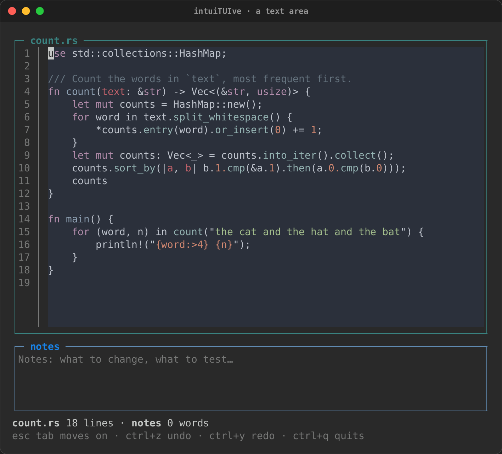
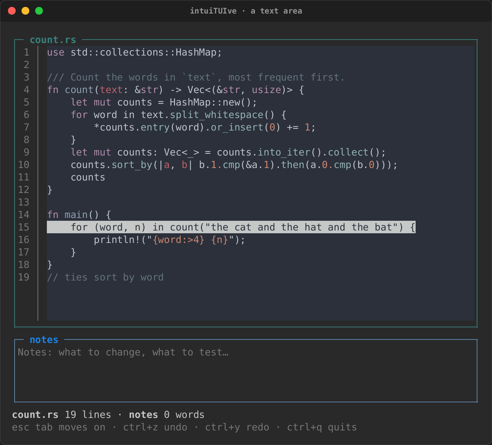
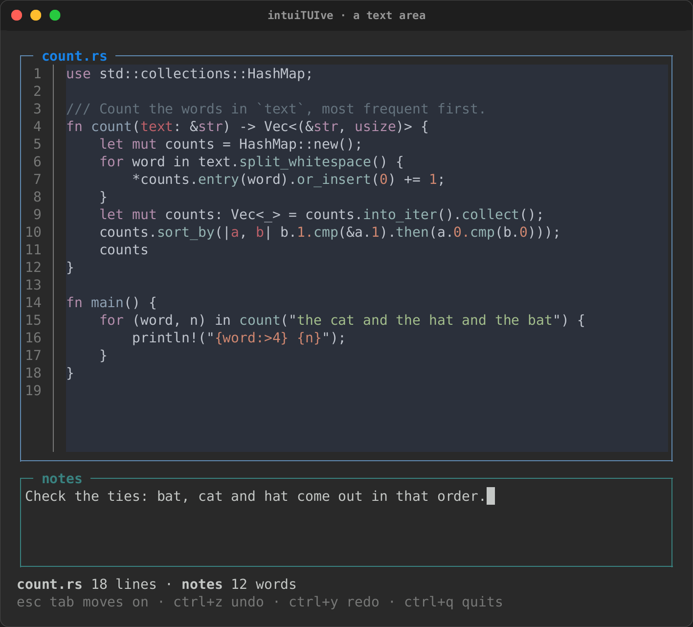
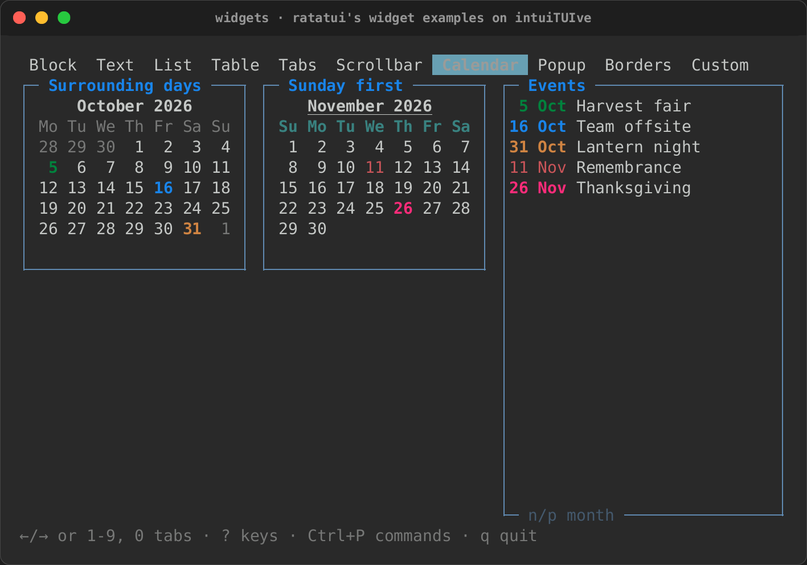

# Inputs, text and dates

The nodes that take what a user types: rs-rich-interact's components
hosted in an app, inputs bound to signals (with completion and a
history), a command line, text areas, calendars and date and time
pickers, and a query language for filtering records by what was typed.

## Components

```rust
use rich_interact::Input;

let name = signal(String::new());
column([
    component(Input::new("Name"), move |value, _| name.set(value)).fixed(1),
    text!("Hello, {name}"),
])
```

- A focused component takes keys first. Keys it does not use bubble on, and
  the terminal caret follows its cursor.
- Its answer (Enter in an `Input`, a pick in a `Select`) goes to the
  closure.
- `.on_cancel(|cx| …)` handles Esc. Without it, Esc bubbles to your own
  bindings.
- A component answers once and then shows its answer. For an entry box
  that takes one entry after another, use `repeating(make, on_done)`: it
  builds a fresh component after each answer.

### Inputs bound to signals

```rust
let first = signal(String::new());
let password = signal(String::new());
let age = signal(30i64);
column([
    input(first).placeholder("First name").fixed(1),
    input(password).mask('•').max_length(40).fixed(1),
    number_input(age, 0..=150).step(1).fixed(1),
])
.on_key("enter", move |cx| save(first.get(), age.get()))
```

- **`input(text)`** is a one-line text box on a `Signal<String>`, both
  ways: typing sets the signal, and setting the signal replaces the text.
  It is a `text_area` in a single-line mode, with the same editing keys,
  undo and mouse. Enter goes to `.on_submit(|value, cx| …)`, which uses it,
  or with none bubbles to your bindings (a form's own Enter). Tab moves the
  focus on, pasted line breaks become spaces, and a long line scrolls
  sideways to the caret.
- **`.placeholder("…")`** shows dimmed text while it is empty,
  **`.mask('•')`** shows each character as `•` while the signal holds the
  text (nothing is copied out of it), and **`.max_length(n)`** stops
  typing and pasting at `n` characters.
- **`number_input(value, range)`** is a whole number on a `Signal<i64>`,
  kept in `range`. ↑/↓ step it by `.step(n)`, PgUp/PgDn by ten steps,
  Home/End go to the ends, and the wheel steps it. Digits type a new number
  (a `-` first for a negative one), which is set on the signal at once,
  clamped, and shown as typed until Enter or the focus leaves.
- **The caret** goes to the end of an input's text when it is made and
  whenever the signal is set from elsewhere (a text area's goes to the
  start). `.caret(Caret::Start | Caret::End | Caret::At(n))` puts it
  elsewhere, and `.select(range)` selects characters (grapheme clusters, a
  line break counting one) with the caret at the end, so typing replaces
  them: a rename that selects the name before its extension is
  `input(name).select(0..stem)`.
- Both are text boxes for assistive technology, with their text as the
  value. Validate them with `.error_when(..)`, as any node, or with
  `.validate(|text| Option<String>)`, which shows the message too and gives
  it to assistive technology ([Editing text](text-editing.md#validating-an-input)).

### Completion, history and a command line

```rust
use intuituive::command_line::{command_line_with, CommandLine, CommandLineOptions, Mode};
use intuituive::{complete_words, history_in, Completion};

// An input that completes and remembers.
input(query)
    .complete(complete_words(["project:", "status:", "priority:"]))
    .history(history_in("tasks", "filter-history"));

// A command bar: modes, a title, an inline confirm, errors in red.
let cmd = CommandLine::new();
column([report, command_line_with(cmd, CommandLineOptions::new().two_rows())])
    .on_key("/", move |cx| {
        cmd.open(cx, Mode::new("").title("Filter Tasks")
            .on_change(move |text, _| filter.set(text.to_string())))
    })
    .on_key("x", move |cx| cmd.confirm_keys(cx, "Delete Task 1? (x)", "x", delete));
```

- **`input(..).complete(|text, caret| Vec<Completion>)`** gives an
  input candidates for its text and the caret's byte; each
  `Completion::new(range, text)` replaces a byte range (usually the word
  before the caret, `word_before(text, caret)`), with an optional
  `.detail(..)` shown dimmed beside it. Tab opens a pop-up of them under
  the input (above it where there is no room), drawn over its neighbours
  without taking the keys; one candidate is taken at once. Tab and ↓ or
  Shift+Tab and ↑ move through it, Enter takes one, Esc closes it, and
  typing narrows it. The top candidate's rest shows after the caret,
  dimmed (`input.ghost`), and → or End at the end takes it.
  `complete_with(f, CompleteOptions::new().auto().ghost(false).rows(5))`
  opens it as you type, drops the ghost, shows five rows.
  `complete_words(list)` completes the word before the caret from a list.
  The pop-up's styles are `completion`, `completion.selected` and
  `completion.detail`.
- **`input(..).history(h)`**: ↑ and ↓ go through the entries that start
  with what was typed before the first ↑ (newest first; ↓ past the newest
  puts the typing back), and Enter adds the text as the newest entry.
  `h` is an `InputHistory`: a name (`"find"`, the session's, shared by
  name), `history_session()`, `history_in(app, name)` in the app's
  [state directory](browsing.md#editing-text-state-files-and-process-jobs), or
  `history_file(path)`, written on each entry under a lock and merged
  with what another session wrote. `h.status()` is `Some((3, 7))` while
  an input browses it, for a `[3 / 7]` in a title.
- **`cx.prompt_with(.., PromptOptions::new().complete(f).history(h), ..)`**
  does the same in a prompt.
- **`command_line(state)`** is a bar of one row (or two:
  `command_line_with(state, CommandLineOptions::new().two_rows())`, the
  title above the line) driven by a `CommandLine`, which is `Copy`.
  `state.open(cx, Mode::new(":"))` opens it with that prefix and takes the
  focus; the mode sets `.title(markup)`, `.initial(text)`,
  `.complete(f)`, `.history(h)`, `.on_submit(|text, cx| Ok(()))` (an
  `Err(message)` keeps it open with the message in red), `.on_change(..)`
  (a filter as you type) and `.on_cancel(..)` (Esc). `state.confirm(cx,
  question, on_yes)` asks in place (`y`; `confirm_keys` takes other keys,
  and `n`, `q` and Esc say no), `state.error(text)` shows an error in red,
  `state.message(markup)` a message, and `state.close(cx)` closes it. On
  closing, the focus goes back where it was. Its styles are
  `command.title` (reversed) and `command.question` (bold).

## Text areas

`text_area(text)` edits the `String` in a signal: what is typed is set on
the signal, and a string set on it from elsewhere replaces what the area
holds. Its options are builders on the node, called before `.panel(..)`
and the like wrap it:

```rust
--8<-- "crates/rich-intuituive/examples/editor.rs:areas"
```

- **`.language("rust")`** highlights it through the console's
  [code highlighter](../ext/code-highlighters.md): syntect by default,
  lumis when it is registered. Every row is filled with the theme's
  background.
- **`.line_numbers()`** numbers the lines in a gutter.
- **`.soft_wrap(false)`** scrolls long lines sideways to the caret instead
  of wrapping them (wrapping is the default).
- **`.read_only()`** keeps the caret, selection and copying, and refuses
  edits.
- **`.placeholder("…")`** shows dimmed text while it is empty.

The editing is `rich_interact::edit::Buffer`, which the interact crate's
own `TextArea` uses too: the caret moves by grapheme cluster, so an emoji
or an accented letter is one step. The keys:

| Keys | What they do |
|---|---|
| arrows, Home/End, PageUp/PageDown | move; Ctrl+←/→ by word, Ctrl+Home/End to the start and end |
| Shift with any of them | select |
| Ctrl+A | select everything |
| Ctrl+C, Ctrl+X | copy and cut the selection (OSC 52); with nothing selected, Ctrl+C quits as anywhere |
| pasting | the terminal's bracketed paste, cleaned of control characters, as one undo step |
| Tab, Shift+Tab | indent and outdent the selected lines |
| Escape, then Tab | move the focus on (read-only, Tab always does) |
| Ctrl+Z, Ctrl+Y or Ctrl+Shift+Z | undo and redo; a typed run is one step. Ctrl+Z here never suspends the app |
| Ctrl+W, Ctrl+U, Ctrl+K | delete a word, to the line's start, to its end |

The mouse places the caret, drags a selection, and a double or triple click
selects a word or a line; the wheel scrolls.

The keys are a keymap of named actions: rebind them, take the Emacs or Vim
preset, search with a find bar, wrap at words, and more, in
[Editing text](text-editing.md).

Only the lines in view are wrapped, highlighted and drawn, so a file of a
hundred thousand lines pages as fast as a short one. Highlighting starts at
the first line in view: a construct that opened above it (a long comment, a
multi-line string) is not known to the lines it covers.

For assistive technology it is a text box whose value is the caret's line,
so linear mode reads the line the caret moves to.

<div class="tape-player" data-cast="../../media/tapes/editor/editor.cast" data-poster="npt:0:3">
  
</div>

| Highlighted, with line numbers | A line selected | Notes, after Escape and Tab |
|---|---|---|
|  |  |  |

`cargo run -p rs-rich-intuituive --example editor` runs it. In Python,
`text_area(text, language="rust", line_numbers=True)` takes the options as
keywords.

## Calendars and dates

```rust
use intuituive::widgets::{calendar_options, CalendarOptions, Date, Weekday};

let day = signal(Date::new(2026, 10, 7));
calendar_options(
    day,
    CalendarOptions::new()
        .today(Date::new(2026, 10, 7))
        .event(Date::new(2026, 10, 31), "red underline")
        .first_weekday(Weekday::Sunday),
)
.fixed(8)
```



- **`calendar(selected)`** is a month grid of a `Date` signal: the arrows
  move by day and week, PgUp/PgDn by month, a click picks a day and the
  wheel changes month. `Date` (rs-rich-interact's, shared with its date
  pickers) has the date arithmetic it needs (weekday, adding days and
  months, month lengths) and parses and prints `2026-10-07`.
  `calendar_options(selected, CalendarOptions::new().min(..).max(..))`
  keeps the selection in a range: days outside it are dimmed (the theme's
  `calendar.disabled` style), and the keys, the wheel and clicks stop at
  its ends. A range whose min is after its max is empty: the calendar
  says so where the weeks go ("the range is empty: min is after max", as
  rs-rich-interact's pickers say it), and nothing changes the day.
  The same options do what ratatui's `calendar::Monthly` does:
  `.event(date, "red underline")` styles a date, and `.events(|date| ..)`
  styles them by a function; `.surrounding("dim")` shows the days of the
  months either side, which a click selects; `.first_weekday(Weekday::Sunday)`
  starts the weeks on another day; and `.weekday_style(..)`,
  `.month_style(..)` and `.day_style(..)` style this calendar's headers and
  days. `CalendarOptions` is `Clone`.
- **`month(shown, options)`** is a month that only shows: no focus, no
  keys, no selection, and the month of the date `shown` returns, which may
  read a signal. Twelve in a `grid` make a year:

  ```rust
  use intuituive::widgets::{month, CalendarOptions, Date};

  let year = signal(2026);
  let months = (1..=12).map(move |m| {
      let options = CalendarOptions::new().event(Date::new(2026, 12, 25), "red");
      month(move || Date::new(year.get(), m, 1), options).padding(0, 1)
  });
  grid([Size::Fixed(22); 3], months)
  ```
- **Titles and options that follow state:** `CalendarOptions::title(
  MonthTitle::Name)` titles a month `October` (`NameYear`, the default,
  `October 2026`; `None`, no title), and `.month_style_with(|first| ..)`
  styles each month's title by the month (bold only for this one).
  `month_with(shown, || options)` and `calendar_options_with(selected, ||
  options)` read their options again whenever a signal those read
  changes.
- **`year_view(year, YearOptions::new())`** is the year as taskwarrior-tui
  draws it: as many months across as fit (`.across(n)` for a set number),
  centred, under the year, each titled by its name, with
  `.marks(|date| Some("red"))` styling dates, `.today(date)`,
  `.first_weekday(..)`, `.gap(columns, rows)` and `.calendar(options)`
  for each month's options. `year_view_with(year, || options)` reads its
  options from signals.
- **`agenda(from, days, |date| items)`** lists the days from `from` that
  have items, each under a bold heading (`Monday 19 October 2026`), and
  says "Nothing scheduled" when none has.

A year and an agenda beside it, as taskwarrior-tui and calcurse draw them:

```rust
use intuituive::widgets::{agenda, year_view, Date, YearOptions};

let today = Date::new(2026, 10, 19);
row([
    year_view(move || today.year, YearOptions::new().today(today).marks(move |date: Date| {
        due.with(|due| due.contains(&date)).then_some("red")
    })),
    agenda(move || today, 7, move |day: Date| tasks_due(day)).fixed(32),
])
```

`Weekday::name()` (`"Monday"`) and `short_name()` (`"Mo"`) name a day,
and `Weekday::of(date)` finds one.

### Times, and a date with a time

```rust
use intuituive::widgets::{datetime_picker, time_picker, DateTime, DateTimeOptions, Time};

let start = signal(Time::new(9, 0, 0));
let meeting = signal(DateTime::new(Date::new(2026, 10, 17), Time::new(9, 0, 0)));
let opens = DateTime::new(Date::new(2026, 10, 17), Time::new(9, 0, 0));
column([
    time_picker(start).fixed(1),
    datetime_picker(meeting, DateTimeOptions::new().min(opens)).fixed(11),
])
```

- **`time_picker(selected)`** picks the `Time` in a signal field by field:
  ←/→ move between the hour and the minute, ↑/↓ change the focused one,
  wrapping round, and digits type it, two to a field. `time_picker_with`
  takes `TimeOptions`: `.seconds()`, `.twelve_hour()` (AM and PM; `a` and
  `p` set them), and `.min(..)`/`.max(..)`, where a step stops. A field
  typed past them stops at the range's end for that field and keeps the
  others where it can: with 09:30 the earliest, `08` typed into 12:45
  makes 09:45. A first digit that would leave the range is not written
  until the field is complete or left. With its min after its max, the
  picker says the range is empty after its fields, and nothing changes the
  time.
- **`datetime_picker(selected, options)`** is a calendar over a time picker
  on one `DateTime` signal, Tab moving between them, and two rows under
  them for the range. `DateTimeOptions::min` is a moment: days before its
  day cannot be selected, and on its day an earlier time moves up to it,
  with a line saying why (`✗ the earliest is 2026-10-17 09:00`) until the
  next change that needs none. A field typed past the range moves alone,
  as in a time picker, and the line says why. An empty range (its min
  after its max) is said there too, and nothing changes the moment.
  Eleven rows, twenty cells wide.
- The focused day and field are reversed, which reads without colour.

## Queries over records

```rust
use intuituive::query::{self, Grammar, Kind, Record, TextMatch, Value};

let grammar = Grammar::new()
    .field("project", Kind::Text).matching(TextMatch::Prefix).alias("proj", "project")
    .field("due", Kind::Date)
    .field("urgency", Kind::Number)
    .dates(move |word| intuituive::dates::parse(word, now).ok());
let query = query::parse("proj:home +next (due.before:eow or urgency > 5)", &grammar)?;
let shown: Vec<&Task> = tasks.iter().filter(|t| query.matches(*t)).collect();
```

- **`query::parse(text, &grammar)`** reads a filter into a `Query`, and
  `query.matches(&record)` tests anything that implements `Record`:
  `field(name) -> Option<Value>`, `text()` for bare words, and `tags()`
  (or `has_tag`, for virtual tags). Bare and `"quoted words"` look in the
  text; `field:value` compares by the field's `Kind` (text by its
  `TextMatch`, numbers equal, dates on the same day), `field:` matches a
  record without it; modifiers `field.before:`/`.after:`/`.above:`/
  `.below:`, `.is:`/`.not:`, `.has:`/`.hasnt:`, `.startswith:`/
  `.endswith:`, `.none:`/`.any:`; comparisons `field > 5`, `<=`, `!=`;
  `+tag`/`-tag`; `and`, `or` (looser), `not` or `!`, and parentheses.
  Errors are `QueryError { message, at }`, `at` the byte range.
- **The grammar** names the fields, their aliases and kinds, reads
  values (`.read(|text| ..)` for one field's sizes or levels, `.dates(..)`
  for dates), gives some bare words a test of their own (`.words(..)`,
  Taskwarrior's ids), and says whether case counts, whether an unknown
  `name:value` is a word (`.lenient()`), and whether `+word` is a tag. A
  Taskwarrior or a process list's syntax is a grammar, not core code.
- **Dates as typed:** `intuituive::dates` (rs-rich-interact's) reads
  `now`, `today`, `tomorrow`, `eod`, `monday`, `eow`, `som`, `eoy`,
  `2026-11-01`, `14:30`, `3d`, `2w` and the rest relative to a given now
  (`dates::parse(word, now)`, `parse_with(.., DateOptions::new()
  .week_start(6))` for weeks from Sunday); `dates::NAMES` lists the words
  for completion. `DateTime::now_local()` and `Date::today_local()` read
  the clock in the local zone, which follows summer time (`Zone::Local`;
  `Zone::posix(rule)`, `Zone::named("Europe/London")` and `Zone::tzif`
  read others; `DateTime::now_in(&zone)` and `Date::today_in(&zone)` read
  the clock there), `DateTime::from_unix(secs, &zone)`/`to_unix(&zone)`
  convert, and `add_seconds(n)` moves a moment on.
