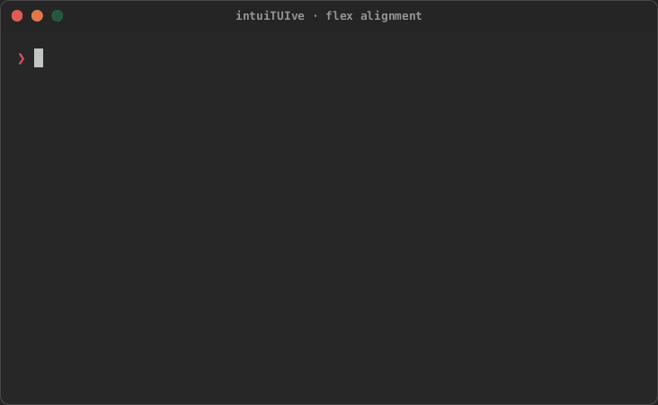
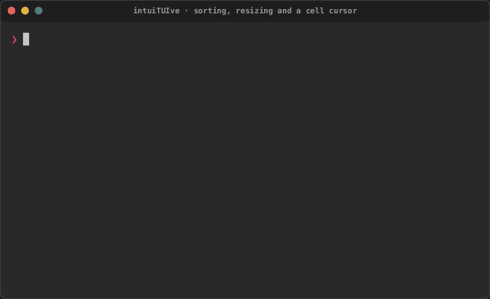
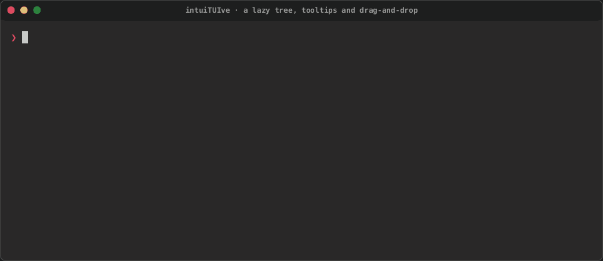
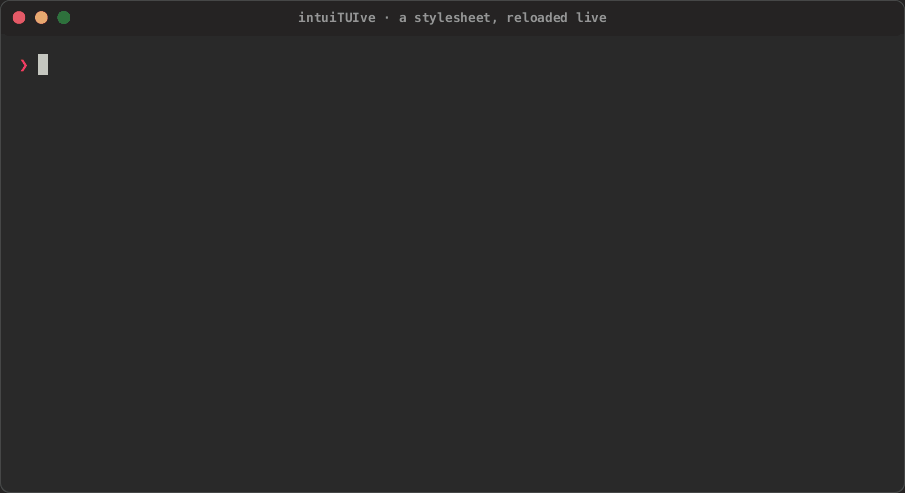
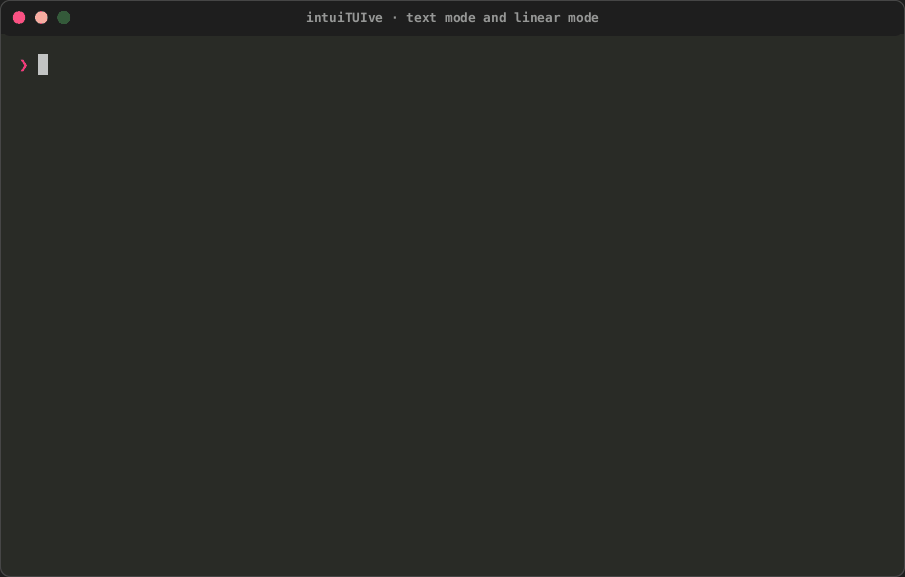

# Terminal apps (intuiTUIve)

`rs-rich-intuituive` (`intuituive`, new and early) is a framework for
terminal apps, full-screen or inline. You describe the screen once as a tree of nodes
and keep your state in **signals**. When a signal changes, the nodes that
read it draw again, and only the cells that changed are sent to the
terminal. You never write a draw loop, a layout pass, or "what changed"
bookkeeping.

It builds on `rs-rich-interact`, so its sessions, its headless test driver
and its components (inputs, selectors, forms, pagers) all work inside an
app. Any rich renderable (tables, Markdown, syntax, charts) is a node.

```toml
[dependencies]
rs-rich-intuituive = "0.0.2"
```

One dependency is enough: `intuituive::rich` is rs-rich and
`intuituive::interact` is rs-rich-interact. New here? The
[tutorial](tutorial.md) builds a to-do app step by step, and the template
starts a project with one command. Coming from ratatui?
[Porting a ratatui app](porting.md) maps every concept and walks through a
Yazi-style file manager rebuilt on intuiTUIve.

```bash
cargo generate --git https://github.com/buchochelliq-labs/rs-rich-cli templates/intuituive-app
```

## A first app

```rust
use intuituive::prelude::*;

fn main() -> std::io::Result<()> {
    App::new(|| {
        let count = signal(0);
        column([
            text!("[b]Count:[/] {count}").panel("Counter"),
            label("[dim]+ adds one · q quits"),
        ])
        .on_key("+", move |_| count.update(|c| *c += 1))
        .on_key("q", |cx| cx.quit())
    })
    .run()
}
```

The closure passed to `App::new` runs once. It creates the state (`count`)
and returns the root node. The rest happens on its own:

- `text!` reads `count`, so pressing `+` redraws that one line;
- the label and the panel's border are not touched;
- the terminal receives the one changed digit.

`App::run` takes the screen and restores the terminal on every way out,
including Ctrl+C and a panic.

## Nodes

| Builder | What it shows |
|---|---|
| `text!("…{signal}…")` | Console markup with `format!` arguments; signals format as their value and are read reactively |
| `text(move \|\| …)` | Markup from any closure; every signal it reads is tracked |
| `label("…")` | Markup that never changes |
| `renderable(move \|\| table)` | Any rich renderable, rebuilt when the signals it read change |
| `column([...])`, `row([...])` | Children laid out down or across |
| `grid([sizes], [...])` | Children in rows and columns (see [Grids](#grids)) |
| `each(move \|\| keys, \|key\| node)` | One child per key, kept by key across reorders |
| `switch(move \|\| key, \|key\| node)` | One child at a time, chosen by key; the others are kept (tabs, wizard steps) |
| `list(move \|\| rows, selected)` | A scrolling list with a selected row (`selected` is a `Signal<usize>`); ↑↓ jk, Home/End and PageUp/PageDown move it, a click selects a row and the wheel moves it |
| `log.view()` | A streaming [`Log`](#logs) |
| `component(Input::new("Name"), on_done)` | A `rich-interact` component (see [Components](#components)) |
| `repeating(\|\| Input::new("Add"), on_done)` | The same, built fresh after each answer (an entry box) |
| `layers([...])` | Children stacked on one rectangle, later ones on top (see [Layers](#layers)) |
| `effect(node, \|canvas, cx\| …)` | A node, with a closure drawing over what it drew (see [Effects](#effects)) |
| `fill("·", "bright_black")` | Its area filled with a glyph: ratatui's `Fill` |

`.panel("Title")` wraps a node in a rounded border that is highlighted
while the focus is inside it (see [Panels](#panels) for titles, kinds of
border, sides and shadows), and `.padding(1, 2)` leaves space round it
(rows above and below, columns either side).

### Text alignment, wrapping and overflow

A `text`, `label` or `text!` node wraps its lines at its width. Three
builders change that, as ratatui's `Paragraph` options do:

```rust
label("The quick brown\nfox jumps over\nthe lazy dog")
    .text_align(TextAlign::Center)     // Left (the default), Center, Right or Justify
    .panel("Centred")
label("a line too long for its node")
    .no_wrap()                         // cut at the edge, not wrapped
    .overflow(Overflow::Ellipsis)      // with `…`; Fold (the default) or Crop
```

```text
--8<-- "crates/rich-intuituive/tests/snapshots/text_centered.txt"
```

Alignment does not change a text's natural width: an `.auto()` node is
as wide as its longest line. A stylesheet sets the same with
`text-align`, `text-wrap: nowrap` and `text-overflow: ellipsis` (or `clip`,
or `fold`).

**`.truncate_start()`** cuts a line too long from its start instead, with
`…` where it was cut, and does not wrap: a path keeps where you are
(`…/rich/src`), as Yazi's header does. rich's `Overflow` is a mirror of
upstream's and cuts only at the end, so this is the node's own option.
For a trail of parts with each styled, see [`breadcrumb`](#bars-for-an-apps-chrome)
(a path's is `files::path_crumb`).

## Layout

A child's size along its parent's axis:

- `.fixed(3)`: exactly 3 cells;
- `.percent(40)`: 40% of the parent;
- `.ratio(1, 3)`: a third of the parent, ratatui's `Constraint::Ratio`.
  Each is rounded down, and the cells that leaves go to the last ratio, so
  three thirds fill the parent exactly;
- `.auto()`: as big as its content (the lines a text wraps to, a panel's
  content and border, a list's rows). When a signal the content reads
  changes, the parent lays out again, and the nodes after it move;
- `.flex(2)`: a weighted share of what is left. A node with no size is
  `flex(1)`.

Any of them can be clamped with `.min_size(n)` and `.max_size(n)`. A
flexible child that reaches a clamp keeps it, and the others share the rest,
as CSS flexbox does. When the children ask for more than there is, they
shrink from the last one, to their minimums first.

```rust
column([
    text!("{status}").auto(),                    // as tall as the status
    row([
        sidebar.percent(25).min_size(20),
        main.flex(1),
    ]),
    label("[muted]q quits").fixed(1),
])
.gap(1)
```

`.gap(1)` leaves a row (or, in a `row`, a column) between neighbours.

### Alignment and wrapping

Rows and columns place their children as CSS flexbox does, with CSS's
names:

- **Across the axis**, `.align_items(Align::Center)` sizes each child to
  its content (its width in a column, its height in a row) and places it at
  `Start`, `Center` or `End`. `Stretch`, the default, gives every child the
  whole width or height. A child's own `.align_self(..)` wins.
- **Along the axis**, `.justify(Justify::SpaceBetween)` shares out the room
  the children leave: `Start` (the default), `Center`, `End`,
  `SpaceBetween`, `SpaceAround` or `SpaceEvenly`. A flexible child takes the
  room itself, so a container with one has nothing left to justify. Docked
  children keep to their edges, and the others are justified between them.
- **`.wrap()`** moves children that do not fit to a new line (a new column,
  in a column), `gap` apart. Each child starts at its own size (a flexible
  one at its content's, within its clamps), each line is laid out on its
  own, and `.align_content(..)` places the lines: `Stretch` (the default)
  grows them to share the room. A wrapping row with `.auto()` is as tall as
  its lines.

The `align` example cycles through them with keys
(`cargo run -p rs-rich-intuituive --example align`):

```rust
--8<-- "crates/rich-intuituive/examples/align.rs:board"
```

<div class="tape-player" data-cast="../../media/tapes/align/align.cast" data-poster="npt:0:2">
  
</div>

| `Stretch`, the test card `align_self(End)` | `align_items(Align::Center)` |
|---|---|
|  |  |
| **`justify(Justify::SpaceBetween)`** | **`.wrap()`, two more cards** |
|  |  |

A stylesheet sets the same with `align-items`, `align-self`,
`justify-content`, `flex-wrap` and `align-content`; see
[Stylesheets](#stylesheets).

### Grids

```rust
grid(
    [Size::Fixed(12), Size::Flex(1), Size::Flex(1)],
    [
        label("logo").span(1, 2),     // one column, two rows
        label("title").span(2, 1),    // two columns
        cpu.panel("CPU"),
        memory.panel("Memory"),
    ],
)
.rows([Size::Auto])
.gap(1)
```

- Children fill the grid row by row; each takes the first place it fits.
- Columns are the sizes given. Rows share the height evenly unless
  `.rows([...])` sizes them, and rows past the last size given take that
  size, so `.rows([Size::Auto])` makes every row as tall as its content.

### Layers

`layers([...])` stacks its children on one rectangle, each later one over
the ones before: content over a background, a badge over a chart, a panel
over a board that ticks. A layer takes the whole rectangle, less
`.inset(top, right, bottom, left)` (CSS's `inset`), or, with
`.place(across, down)`, only its content's size, where the two `Align`s
put it.

```rust
layers([
    board,                                            // redraws every tick
    label("on top").panel("Badge").inset(1, 2, 1, 10),
    label("[b]3[/]").place(Align::End, Align::Start), // the top right corner
])
```

```text
--8<-- "crates/rich-intuituive/tests/snapshots/layers_badge.txt"
```

A layer draws again wherever one under it drew, so the board's ticks never
show through the panel. A click goes to the top layer under the pointer,
and the Tab order and the accessibility tree follow the children's order
(a lower layer's text, read from the screen, leaves out what is over it).

### Laying out by hand

A widget that places its own parts (a pop-up beside a cell, a gauge's
ticks) uses the same solver as columns and rows:
`intuituive::layout::split(rect, axis, &tracks, flow)`, ratatui's
`Layout::split`. Each `Track` is a `Size` with its clamps, and `flow` (a
`StackLayout`) gives the gap and the justification.
`split_with_spacers` returns the rooms between and around them too:

```rust
use intuituive::layout::{split_with_spacers, Track};

let tracks = [Track::new(Size::Fixed(4)), Track::new(Size::Fixed(4)).min(2)];
let flow = StackLayout { justify: Justify::Center, ..StackLayout::default() };
let (areas, spacers) = split_with_spacers(rect, Axis::Horizontal, &tracks, flow);
// spacers[0] and spacers[2] are the room left at the two ends.
```

`Rect` (`intuituive::screen::Rect`, rs-rich-ext's) has the helpers such a
widget needs: `centered(width, height)`, `inset(top, right, bottom, left)`,
`inner(n)`, `offset(dx, dy)`, `union`, `intersection`, `intersects`,
`contains`, and `rows()` and `columns()` to go through it a line at a time.

### Ratatui's solver

A column or row takes percentages of the room its gaps leave, rounded
down. Ratatui's `Layout` takes them of the whole length and lets a
constraint solver squeeze what does not fit, so a header ported from a
ratatui `Table` (scope-tui's) puts its cells a few columns off.
`.solver(Solver::Ratatui)` solves a column or row as ratatui does, with the
same constraints at the same strengths and the same solver (kasuari): a
`Size::Percent` is ratatui's `Percentage`, `Fixed` its `Length`, `Flex` its
`Fill`, the gap its `spacing`, and `.justify(..)` its `Flex` (`Start`, as a
`Table`'s columns, by default; `Solver::RatatuiLegacy` is `Flex::Legacy`,
a `Layout`'s default). It is off by default, so no existing layout
changes, and `layout::split` takes it too (`StackLayout::solver`).

```rust
row([label("scope").percent(35), label("1ms").percent(25), label("60fps").percent(40)])
    .gap(1)
    .solver(Solver::Ratatui)
```

### Responsive layout

A layout can follow the terminal's size. The size is the app's
**viewport**: the columns and rows it lays out in, which are the
terminal's, less the [inspector](#inspector)'s columns while it is shown
(an [inline](#inline-apps) app's rows are its region's). Every resize
measures it again, and what depends on it lays out again.

- `.hide_below(60)` hides a node while the viewport is narrower than 60
  columns, and `.show_below(60)` shows one only then. Hidden, a node is as
  if a stylesheet said `display: none`, in any container: it takes no room
  (a hidden pane of a `split` leaves the other the whole split, with no
  divider), it is not drawn and takes no clicks, and it and what is inside
  it leave the Tab order, the accessibility tree and linear mode's lines.
  A node that had the focus gives it to the next one.
  `.hide_below_height(rows)` and `.show_below_height(rows)` do the same
  for the height.
- A [stylesheet](#stylesheets)'s `@media` rules change sizes, grid tracks,
  padding, borders, `display` and the rest at a size, from outside the
  code.
- `viewport()` returns the size as a value that nodes read like a signal,
  for anything else: a `switch` that picks a `row` or a `column`, a
  shorter label.

```rust
column([
    label("[b]ops[/] · 3 hosts").fixed(1),
    row([
        hosts.panel("Hosts").fixed(12).hide_below(60),
        grid([], [cpu.panel("CPU"), memory.panel("Memory")]).name("meters"),
    ]),
    label("[dim]wider for hosts").show_below(60).fixed(1),
])
```

```css
#meters { grid-columns: 1fr 1fr; }
@media (max-width: 59) { #meters { grid-columns: 1fr; } }
```

At 64 columns, then at 40 (the snapshots of `tests/responsive.rs`, which
resizes it between the two):

```text
--8<-- "crates/rich-intuituive/tests/snapshots/dashboard_wide.txt"
```

```text
--8<-- "crates/rich-intuituive/tests/snapshots/dashboard_narrow.txt"
```

`hide_below(60)` and `@media (max-width: 59)` are the same breakpoint:
CSS's bounds are inclusive.

## Panels

`.panel(title)` wraps a node in a box: rounded, its title at the top left,
lit in the theme's `border.focused` while the focus is inside. Titles are
console markup. Builders after `.panel` change the rest, as ratatui's
`Block` options do (on any other node they do nothing):

```rust
label("3 open, 1 merged")
    .panel("[b]Pull requests[/]")
    .title_align(Align::Center)                    // where .panel's title sits
    .title_right("[dim]loading…")                  // another title on the top edge
    .title_bottom("[dim]q quits")                  // a title on the bottom edge
    .add_title(Edge::Bottom, Align::End, "1/20")   // the general form
    .border(Border::Thick)                         // or Plain, Double, Ascii, the dashed kinds, None…
    .borders(Sides::TOP | Sides::BOTTOM)           // Sides::ALL is the default
    .border_style("bright_black")                  // while the focus is elsewhere
    .title_style("bold white")
    .shadow(Shadow::MediumShade)                   // or LightShade, DarkShade, Block, Dim, Symbol('$')
```

- **Titles** keep the look of `.panel`'s: ` Title `, one glyph of line in
  from the corner. Several with the same alignment sit side by side, one
  cell apart. When they do not fit, the right-hand ones give way first,
  then the centred ones, and the left ones are cut with `…`. An edge with a
  title keeps its row even when its line is not drawn, so
  `.border(Border::None)` gives a heading above the content, as ratatui's
  `Block::new().title(..)` does. The first top title, as plain text, is the
  panel's accessible name.
- **Sides.** The inside grows into the sides that are not drawn.
- **Shadows** take a strip on the right and the bottom of the panel's own
  rectangle, in the theme's `shadow` style; the box is a cell narrower and
  shorter for it.

Titles at the left, the centre and the right, and two at the bottom:

```text
--8<-- "crates/rich-intuituive/tests/snapshots/panel_titles.txt"
```

Each kind of border, `Border::Custom(BorderSet { .. })` (glyphs of your
own) last, then three shadows:

```text
--8<-- "crates/rich-intuituive/tests/snapshots/panel_kinds.txt"
```

```text
--8<-- "crates/rich-intuituive/tests/snapshots/panel_shadow.txt"
```

A stylesheet sets the same: `border: thick` (and every kind by name),
`border-title`, `border-title-align`, `border-subtitle` (the bottom
title), `border-subtitle-align` and `border-sides: top bottom`. Code wins
over the sheet.

### Rules, and a border on any node

`rule()` is a line across, one row tall, in the theme's border style.
Directly inside a panel, from its left side to its right, it joins the
border, in the panel's kind and focus colour: the `├──┤` between the parts
of a help box. Padding between them does not keep it apart: a rule at the
inside edge of a padded column (`.padding(0, 1)`), or of a panel a
stylesheet pads, runs across the padding to the border, so the column is
padded once rather than each part. `.border(Border::Thick)`
picks the kind of a rule on its own, and it is left out of what assistive
technology reads.

```rust
column([label("Keys"), rule(), label("q quit")]).panel("Help")
```

`.borders(Sides::BOTTOM)` (or any sides) on a node that is not a panel
puts it in a panel without a title first: an underlined header, a status
line with a rule above it.

### Collapsed borders

`.collapse_borders()` on a `row`, `column` or `grid` of panels draws one
frame for them all: neighbours share their edges, joined where lines meet.
Each panel's titles sit on its own edges and its content between the
lines. The lines round the panel with the focus are lit in
`border.focused`, and `.focus_border(Border::Thick)` draws them thick, as
ratatui's `collapsed-borders` example does for the selected pane:

```rust
column([
    pane("Top"),
    row([pane("Left"), pane("Right")]).collapse_borders(),
    pane("Bottom"),
])
.collapse_borders()
.border(Border::Plain)
.focus_border(Border::Thick)
```

```text
--8<-- "crates/rich-intuituive/tests/snapshots/collapsed_focus_left.txt"
```

A collapsed container inside another shares its lines and takes its look;
a `grid` whose top and bottom panes `.span(2, 1)` draws the same.
`.border(..)` and `.border_style(..)` on the container set its lines, gaps
are ignored, and a hidden child gives its room to the others. In a
stylesheet: `border-collapse: collapse`, with the container's `border` for
its lines.

## State

```rust
let selected = signal(0usize);
let is_first = memo(move || selected.get() == 0);
```

- `get()` reads a value, and `set(v)` or `update(|v| …)` writes it. A node
  that reads a signal while drawing subscribes to it, and a write redraws
  exactly those nodes. `set` with an equal value does nothing. `set` needs
  `PartialEq`; `replace(v)` does not (it returns the old value, and every
  reader updates), for a value that cannot be compared: a closure, a
  handle. `RectHandle` and `PathWatch` compare as handles: equal when they
  are the same one.
- `watch(move || source, move |value, cx| …)` runs a callback when a value
  changes (and once at the start), between frames, with a `Ctx`: load a
  preview when the selection moves, save when a document changes. A watch
  made while a screen is built stops when the screen closes.
- `on_write(signal, move |value, cx| …)` runs a callback after every write
  to a signal, in turn, an equal value too: a watch sees two equal buffers
  as one, this sees two frames. Not called at the start. `rate(signal)` is
  a `Signal<u32>` of how many times a second it was written, counted over
  each second of the app's clock: a frame-rate meter. Call `rate` where
  you call `every`.
- A `memo` derives a value and notifies its readers only when the result
  changes. In a list where each row reads `memo(move || selected.get() == i)`,
  a move redraws two rows, not all of them.
- Signals are `Copy`: move them into as many closures as you need. Two
  apps in one program (two panes of a ratatui app, say) can share one: a
  write redraws the readers in both.

Writing signals, and the cycles the runtime stops:

- **Inside `update`**, the closure may read and write other signals.
  Readers see every change once the outermost update is done. Reading the
  signal being updated panics: use the value the closure is given.
- **A memo only computes.** Writing a signal while a memo (or a watch's
  source) computes panics with a message that says so: write in a handler,
  a watch's callback or a task.
- **A node that writes a signal it reads while it draws** draws again, once
  (a scroll moving to keep the focus in view does this). One that does it
  frame after frame would draw forever: after a few frames its own writes
  stop drawing it again, and a toast names it.
- **A watch whose callback changes its own source** runs at most 100 rounds
  in a row; then what is left is dropped and a toast says so.

## Input and focus

```rust
column([
    label("one").focusable().on_key("x", |_| { /* … */ }).panel("One"),
    label("two").focusable().panel("Two"),
])
.on_key("q", |cx| cx.quit())
```

- **Keys** go to the focused node first, then bubble up through its
  ancestors until a binding uses them.
- **Tab** and **Shift+Tab** move the focus through focusable nodes. A
  handler can move it too, with `cx.focus_next()` or `cx.focus(id)`.
- **Which node has the focus first:** the first focusable one, unless a
  node asks with `.autofocus()` (a search box, the list a screen is
  about).
- **Clicks:** `.on_click(|cx| …)` gets the clicks inside the node and
  focuses it. The app remembers where each node was drawn, so you never
  store rectangles yourself.
- **Key names** are the ones `rs-rich-interact` uses: `"q"`, `"ctrl+s"`,
  `"up k"` (either key). Spaces separate names, so the space key is
  `"space"`, and the comma `"comma"` (`"ctrl+comma"`); a binding with no keys, or a name that is not a key (`"f99"`,
  `"ctrl-s"`), panics when the binding is made. A name means the key:
  `"shift+a"` is `"A"`, and `"ctrl+i"` is Ctrl+I, not Tab. A terminal
  without the kitty keyboard protocol sends some keys alike (Tab and
  Ctrl+I, Enter and Ctrl+M, Esc and Ctrl+[), so its Tab fires a `"tab"` or
  a `"ctrl+i"` binding (on one node, `"tab"` wins). With the protocol,
  which the app turns on when the terminal has it (`.legacy_keys(true)`
  keeps it off), Tab fires only `"tab"` and Ctrl+I only `"ctrl+i"`.
- **Key releases** reach widgets as `WidgetEvent::KeyUp`, from a terminal
  with the kitty protocol; bindings fire on presses (and repeats) only.
  Typed text stays text, so a plain letter or digit (or Enter, Tab and
  Backspace) has no release: Escape, arrows, function keys and keys with
  Ctrl or Alt do.
- **Ctrl+C** quits, unless a node on the focused path binds it: then the
  binding runs, and quitting is up to you.
- **Ctrl+Z** suspends the app on Unix, as the shell expects, and `fg`
  draws it again (inline, in a new region below the shell's lines), unless
  a node on the focused path binds it: then the binding runs.
- **When the focused node goes** (a row deleted from an `each`), the focus
  moves to the next one in the Tab order, or the one before it if it was
  last.
- **Out of the Tab order:** `.no_focus()` keeps a list or component you only
  show from taking the focus.
- **Showing the focus:** panels highlight their border while the focus is
  inside them. Any node can show it too: `.focus_style("reverse")` (any
  style or theme name) restyles it, filled to its full width and over its
  children, while it has the focus, which is how a list shows its selected
  row.

### Key sequences, any key, and keys a container sees first

```rust
column([list(files, selected), status])
    .previews_keys()
    .bind_sequence("g g", "Go to the top", move |_| selected.set(0))
    .bind_sequence("g h", "Go home", go_home)
    .on_any_key(|cx, key| { log(key); false })
```

- **`.bind_sequence("g g", description, handler)`** (`.on_sequence` without
  a description) runs once the keys are pressed one after another. The
  first key starts the sequence where a binding of it would run (a deeper
  node's binding of the key wins, as for any key; on one node, a binding of
  the first key wins over the sequence). Esc cancels a sequence under way;
  any other key that goes on with none of the node's sequences cancels it
  and is then handled as usual, so `g` then `j` still moves down. The comma
  key is `comma`, as in any binding: `"comma s"` (or quoted, `"\",\" s"`).
  Spaces mean "then" here and "or" in `bind("k up", ..)`; a sequence is two
  keys or more, and one of one key panics: bind it with `bind`.
- **`App::which_key(true)`** shows what can follow while a sequence waits,
  Yazi's way: in up to three columns, in a box at the bottom of the screen,
  the keys left in the theme's `which_key.key` style (else `accent`), the
  two cells after them in `which_key.sep`, the descriptions in
  `which_key.desc`. A description too long for its column ends in `…`, two
  cells short of the next column's keys.
  `App::which_key_delay(d)` waits `d` first, so a sequence typed quickly
  shows nothing. The help and the command palette list sequences as `g g`.
- **`.on_any_key(|cx, key| -> bool)`** gets every key that reaches the node
  and none of its bindings or sequences took; it returns whether it used
  it, and one it did not use goes on to the ancestors.
- **`.previews_keys()`** lets a container's own bindings, sequences and
  `on_any_key` see keys before the focused node inside it does, outermost
  container first: an app-wide keymap that wins over a focused list's `j`,
  `k` and `g`, without making the container focusable.
- **With nothing focused** (a pop-up of plain text), keys go to the root
  and down through every node that holds a single child, so a binding on
  the content inside a pop-up's `.panel()` works.

## Components

```rust
use rich_interact::Input;

let name = signal(String::new());
column([
    component(Input::new("Name"), move |value, _| name.set(value)).fixed(1),
    text!("Hello, {name}"),
])
```

- A focused component takes keys first. Keys it does not use bubble on, and
  the terminal caret follows its cursor.
- Its answer (Enter in an `Input`, a pick in a `Select`) goes to the
  closure.
- `.on_cancel(|cx| …)` handles Esc. Without it, Esc bubbles to your own
  bindings.
- A component answers once and then shows its answer. For an entry box
  that takes one entry after another, use `repeating(make, on_done)`: it
  builds a fresh component after each answer.

### Inputs bound to signals

```rust
let first = signal(String::new());
let password = signal(String::new());
let age = signal(30i64);
column([
    input(first).placeholder("First name").fixed(1),
    input(password).mask('•').max_length(40).fixed(1),
    number_input(age, 0..=150).step(1).fixed(1),
])
.on_key("enter", move |cx| save(first.get(), age.get()))
```

- **`input(text)`** is a one-line text box on a `Signal<String>`, both
  ways: typing sets the signal, and setting the signal replaces the text.
  It is a `text_area` in a single-line mode, with the same editing keys,
  undo and mouse. Enter goes to `.on_submit(|value, cx| …)`, which uses it,
  or with none bubbles to your bindings (a form's own Enter). Tab moves the
  focus on, pasted line breaks become spaces, and a long line scrolls
  sideways to the caret.
- **`.placeholder("…")`** shows dimmed text while it is empty,
  **`.mask('•')`** shows each character as `•` while the signal holds the
  text (nothing is copied out of it), and **`.max_length(n)`** stops
  typing and pasting at `n` characters.
- **`number_input(value, range)`** is a whole number on a `Signal<i64>`,
  kept in `range`. ↑/↓ step it by `.step(n)`, PgUp/PgDn by ten steps,
  Home/End go to the ends, and the wheel steps it. Digits type a new number
  (a `-` first for a negative one), which is set on the signal at once,
  clamped, and shown as typed until Enter or the focus leaves.
- **The caret** goes to the end of an input's text when it is made and
  whenever the signal is set from elsewhere (a text area's goes to the
  start). `.caret(Caret::Start | Caret::End | Caret::At(n))` puts it
  elsewhere, and `.select(range)` selects characters (grapheme clusters, a
  line break counting one) with the caret at the end, so typing replaces
  them: a rename that selects the name before its extension is
  `input(name).select(0..stem)`.
- Both are text boxes for assistive technology, with their text as the
  value. Validate them with `.error_when(..)`, as any node.

## Logs

```rust
let log = Log::new(1_000);           // keeps the last 1,000 lines
log.push("[green]started[/]");
log.view().panel("Log")
```

A log renders each line once. On an append it moves the rows already on
screen up and renders only the new lines. That is why a log tail costs less
than redrawing every row, which is ratatui's approach.

## Tables, tabs and scrolling

```rust
use intuituive::widgets::{table, tabs, Column};

let selected = signal(0usize);
let tab = signal(0usize);
column([
    tabs(|| vec!["Files".into(), "Log".into()], tab).fixed(1),
    switch(move || tab.get(), move |tab| match tab {
        0 => table(
            vec![Column::new("Name", Size::Flex(1)), Column::new("Size", Size::Auto)],
            move || files.with(|f| f.iter().map(|f| vec![f.name.clone(), f.size()]).collect()),
            selected,
        ),
        _ => scroll(text(move || log.get())),
    }),
])
```

- **`table(columns, rows, selected)`**:
  - The header row stays in view, and each column is sized like a child
    in a row (cells, a percentage, a share, or `Size::Auto` to fit what
    is in view).
  - One row is selected. ↑/↓ (or k/j), PgUp/PgDn and Home/End move it, a
    click selects a row, and the wheel moves it.
  - `virtual_table(columns, len, row, selected)` asks only for the rows in
    view, so a million rows cost a screenful.
- **`tabs(titles, selected)`** is a strip of titles. ←/→ and 1–9 move the
  selection, and so does a click. Pair it with `switch` on the same
  signal for the content.
- **`scroll(child)`** is a viewport onto a child laid out at its full
  height (up to 4000 rows).
  - The arrow keys, PgUp/PgDn, Home/End and the wheel scroll it, and a
    scrollbar appears when the child does not fit.
  - The focus moving to a node inside scrolls that node into view.
  - The child draws into an offscreen screen with its own damage, so only
    what changed inside draws, and the rows in view are copied out.
  - `scroll_with(child, offset)` puts the first row in view in a signal
    you can read and set.
- **`scroll_x(child)`** scrolls across instead, for content wider than
  the view (up to 2000 columns), and **`scroll_both(child)`** both ways,
  with a bar along the bottom too. ←/→, Shift+wheel and Shift+PgUp/PgDn
  move across. `scroll_both_with(child, x, y, across, down)` puts both
  offsets in signals.

#### Sorting, resizing and a cell cursor

`table_with(columns, rows, selected, options)` takes the rest as
`TableOptions`:

```rust
use intuituive::widgets::{table_with, Order, TableOptions};

let sort = signal(Some((1, Order::Descending)));
let cell = signal(0usize);
table_with(
    columns,
    move || files.get(),
    selected,
    TableOptions::default().sort_rows(sort).cells(cell).resizable(),
)
```

- **`.sort(signal)`** puts the sort column and order in a signal. A click
  on a header sorts by it, a second click reverses the order, and `s`
  sorts by the cell cursor's column. The header shows ▲ or ▼. Your rows
  closure reads the signal and sorts, so `selected` stays an index into
  your own rows.
- **`.sort_rows(signal)`** sorts plain string rows for you instead.
  Numbers compare as numbers; everything else compares as lowercase text.
- **`.cells(signal)`** adds a cell cursor. ←/→ move it, a click puts it on
  the cell, and the theme's `selected.cell` style draws it.
- **`.resizable()`** lets the columns be resized by dragging the gap after
  a header.
- **`.scroll_x()`** keeps the columns at their natural widths when they do
  not fit, and scrolls the table across, a column at a time:
  - A `Size::Fixed` column keeps its cells; the others fit their title and
    the cells in view. A table that fits shares the width as before.
  - ←/→ (or h/l) scroll it, or Shift+←/→ with a cell cursor, since ←/→
    move the cursor. Shift+Home and Shift+End go to the ends, and Shift
    with the wheel scrolls too.
  - The header is cut where the rows are, so it stays over its columns.
    `‹` and `›` in it say that columns are out of view on that side.
  - The view follows the cell cursor.
- **`.freeze_columns(n)`** keeps the first `n` columns in place while the
  rest scroll, and turns `.scroll_x()` on.

`virtual_table_with(columns, len, row, selected, options)` takes the same
options, but sorts nothing itself: its rows are never all in hand.

#### How a table looks

```rust
use intuituive::widgets::{table_with, Column, HighlightSpacing, TableOptions};

let columns = vec![
    Column::new("Food", Size::Auto),
    Column::new("Qty", Size::Fixed(5)).align(Align::End),
    Column::new("Energy", Size::Auto).align(Align::End).min(8),
];
table_with(
    columns,
    move || meals.get(),
    selected,
    TableOptions::default()
        .footer(move || vec!["Total".into(), "".into(), total.get()])
        .header_gap(1)
        .column_spacing(2)
        .symbol("» ")
        .highlight_spacing(HighlightSpacing::Always)
        .row_style(|i| (i % 2 == 1).then(|| "on grey11".into()))
        .multiline()
        .scroll_padding(1),
)
```

- **`Column::align(Align::End)`** puts a column's cells and title at the
  end (numbers on the right), or `Align::Center`; **`.min(n)`** and
  **`.max(n)`** bound its width.
- **`.footer(cells)`** is a row under the rows that stays in view, in the
  theme's `table.footer` style; `cells` may read signals.
- **`.header_gap(n)`** leaves blank lines under the header and
  **`.row_gap(n)`** after each row (ratatui's `bottom_margin`);
  **`.column_spacing(n)`** puts `n` cells between columns (one by
  default).
- **`.symbol("» ")`** draws markup before the selected row, and the
  other rows (the header and footer too) get blank cells in its column.
  **`.highlight_spacing(..)`** says when the column is kept:
  `WhenSelected` (the default), `Always` or `Never`.
- **`.row_style(|i| …)`** styles row `i` whole, gaps included, under its
  cells' own markup and the selection: zebra stripes, a row's colour.
- **`.multiline()`** makes each row as tall as its tallest cell, the cells
  wrapping to their columns; ↓ still moves a row, and PgDn a screenful of
  rows. `.row_height(n)` makes every row `n` lines tall instead, which is
  what a `virtual_table` takes, as its rows are never all in hand.
- **`.column_highlight()`**, with a cell cursor, draws the cursor's column
  down the rows in the theme's `selected.column` style.
- **`.scroll_padding(n)`** keeps `n` rows in view either side of the
  selection, where they fit.
- **`.header(false)`** leaves the header out: the rows start at the top.
  Names with their sizes beside them are one table this way.
- **`.offset(signal)`** puts the first row in view in a signal you can
  read, or set to scroll, as a list's does.
- **`Column::overflow(Overflow::Crop)`** cuts the column's cells at its
  edge, as ratatui's table does, rather than with `…`.
- **`table_optional(columns, rows, selected, options)`** takes a
  `Signal<Option<usize>>`: `None` selects nothing and shows no highlight,
  and ↓ selects the first row.

#### How a list looks

```rust
use intuituive::widgets::{HighlightSpacing, ListDirection};

list(move || messages.get(), selected)
    .symbol("[red]>>[/] ")
    .repeat_symbol()
    .highlight_spacing(HighlightSpacing::Always)
    .direction(ListDirection::BottomToTop)
    .scroll_padding(1)
    .multiline()
    .row_style(|i| (i % 2 == 1).then(|| "on grey15".into()))
    .offset(first)
```

A `list`'s options are builders on the node, as a text area's are. Call
them on the list itself (or a reorderable one), before `.panel(..)`.

- **`.symbol(markup)`**, **`.highlight_spacing(..)`** and
  **`.repeat_symbol()`** (the symbol on every line of a multi-line item)
  are a table's, for a list.
- **`.direction(ListDirection::BottomToTop)`** puts the first item at the
  bottom, the rest above it, as a chat or a log does. ↑ and ↓ still move
  up and down the screen; Home and End go to the first and the last item.
- **`.multiline()`** keeps each item's lines and wraps them, rather than
  cutting the first with `…`.
- **`.row_style(|i| …)`** styles item `i`'s whole rows, and
  **`.scroll_padding(n)`** keeps items in view round the selection.
- **`.offset(signal)`** puts the first item in view in a signal you can
  read, or set to scroll; the selection is still kept in view.
- **`list_optional(items, selected)`** takes a `Signal<Option<usize>>`, as
  `table_optional` does.
- **`list_lazy(len, item, selected)`** asks only for the items it draws,
  where `list`'s closure builds every item on each draw: use it for a
  directory of a hundred thousand files. It takes every option below.
- A list sized `.auto()` is as wide as its widest item, with its symbol,
  marker and trailing columns (it looks at every item to know).

#### Rows as a file manager draws them

```rust
use intuituive::widgets::RowRects;

let rects = RowRects::new();
list(move || names.get(), cursor)
    .trailing(move |i| sizes.with(|s| s[i].clone()))
    .marker(move |i| marked.with(|m| m.contains(&i)).then(|| "on yellow".into()))
    .row_style(move |i| Some(colour(i).into()))
    .selected_style_for(move |i| Some(format!("reverse {}", colour(i))))
    .scroll_padding(5)
    .row_rects(&rects)
// later, in a handler: a popup under the selected row
// cx.popup(rects.get(cursor.get()).unwrap(), Placement::Below, ..)
```

- **`.trailing(|i| markup)`** draws markup at the right of item `i`'s
  row, right-aligned, and cuts the item short of it: Yazi's line mode
  (sizes, times) in the same list as the names. It is inside the row, so
  the row's style and the highlight cover it. Empty markup shows none.
- **`.marker(|i| Option<style>)`** keeps a one-cell column at the left of
  the rows, outside the row style and the highlight, and fills item `i`'s
  cell with the style it returns (or leaves it blank): selected, visual
  and yanked markers. The column is kept with nothing marked, so the text
  never moves when a mark comes or goes.
- **`.selected_style_for(|i| Option<style>)`** is the highlight's style
  when item `i` is selected, instead of the theme's `selected`: a
  different look per row (the preview's underline). A bar in each row's
  own colour needs none: `.row_style` of the colour and a `reverse`
  `selected` reverse it already.
- **`.highlight_layer(HighlightLayer::Under)`** puts the highlight under
  the item's markup rather than over it, so what the markup styles keeps
  its own style on the selected row: Yazi's rounded ends
  (`[not reverse blue]\u{e0b6}[/]`) outside the reversed name.
- **`.wheel_step(n)`** moves the selection `n` items a turn of the wheel
  (three by default); `0` leaves the wheel to the list's ancestors, whose
  `on_mouse` otherwise never sees it.
- **`.row_rects(&rects)`** records where each row in view was drawn on
  the screen, so a handler can open a popup at a row:
  `rects.get(i)` is item `i`'s rectangle, or `None` out of view. Tables
  and `virtual_list` take it too.

`list_lazy`'s closures, and those of `.trailing`, `.marker` and
`.row_style`, each read the app's data again for the same row.
**`list_rows(len, |i| ListRow, selected)`** asks one closure per row and
makes each row once a draw, its parts together:

```rust
use intuituive::widgets::{list_rows, ListRow};

list_rows(move || files.with(Vec::len), move |i| {
    files.with(|f| {
        let entry = &f[i];
        ListRow::new(entity(entry))
            .trailing(linemode(entry))
            .marker(marker_style(entry))
            .style(row_style(entry))
    })
}, cursor)
.marker_column()
```

`.marker_column()` keeps the marker column, filled from each row's
`marker`; every other list option still applies.

#### How a tab strip looks

```rust
tabs(|| vec!["Recipe".into(), "Email".into(), "Traceroute".into()], tab)
    .divider(" • ")
    .tab_padding("", "")
    .titles_align(Align::Center)
```

**`.divider(markup)`** goes between the titles instead of `│` (`""` for
none), in the theme's `tabs.divider` style; **`.tab_padding(left, right)`**
replaces the space either side of each title; and **`.titles_align(..)`**
puts the strip at the start, the centre or the end of its width. Clicks
find the right title whatever the divider and padding.
**`.auto_hide()`** hides the strip while it has fewer than two titles (it
takes no row then), and **`.on_select(|to, cx| ..)`** is told the title a
click, ←/→ or a number key picked, instead of the strip setting its
signal: the app moves there its own way and sets the signal itself, with
no click routing of its own.

#### Scrollbars

```rust
use intuituive::widgets::{scrollbar, Scrollbar, ScrollbarSymbols, Show, Side};

scroll(child).scrollbar(Scrollbar::new().thumb("▐"));
list(items, selected).scrollbar(
    Scrollbar::new()
        .side(Side::Left)
        .symbols(ScrollbarSymbols::VERTICAL)
        .track(None)
        .ends(Some("↑"), Some("↓"))
        .show(Show::Always),
);
// A bar of its own, for a view of your own.
row([my_view, scrollbar(top, move || lines.get().len(), || 0, Scrollbar::new())]);
```

- **`.scrollbar(bar)`** gives a `scroll`, a `list`, a table or
  `virtual_list`, a `tree`, a `text_area` or a log's view a bar. It keeps a
  column of the widget while it shows: by default (`Show::Auto`) only while
  the content does not fit; `Show::Always` keeps it with a full thumb, and
  `Show::Never` keeps no column. A `scroll` without one still draws today's
  bar.
- **`.side(..)`** puts it on the right (the default) or the left; on a
  `scroll_x` or `scroll_both`, a bar on the top or the bottom is the one
  across.
- **`.symbols(..)`** draws it in a set: `ScrollbarSymbols::THIN` (the
  default, `┃` on `│`, and `THIN_HORIZONTAL` across), `VERTICAL`,
  `DOUBLE_VERTICAL`, `HORIZONTAL` or `DOUBLE_HORIZONTAL` (ratatui's).
  **`.thumb(..)`**, **`.track(..)`** (`None` for a blank track) and
  **`.ends(begin, end)`** change single symbols.
- The theme's `scrollbar`, `scrollbar.thumb` and `scrollbar.arrow` styles
  draw it.
- With the mouse, a press on the track pages, a press on an arrow steps,
  and dragging the thumb scrolls. On a list, a table or a tree the
  selection comes along into the view.
- **`scrollbar(position, len, view, bar)`** is a bar on its own: it shows
  `view` of `len` from the `position` signal (a `view` of 0 is the bar's
  length), and the mouse and the wheel set `position`.
- In text mode a bar keeps its column, blank: it is nothing for a screen
  reader to read.

The `tables` example sorts a process table in its rows closure, so its
status line can name the selected process and the cell under the cursor
(`cargo run -p rs-rich-intuituive --example tables`):

```rust
--8<-- "crates/rich-intuituive/examples/tables.rs:table"
```

<div class="tape-player" data-cast="../../media/tapes/tables/tables.cast" data-poster="npt:0:3">
  
</div>

| Sorted by a click | The cell cursor, sorted with `s` | Resized |
|---|---|---|
|  |  |  |

### Trees, split panes, calendars and lists

```rust
use intuituive::widgets::{calendar, hsplit, tree, virtual_list, Date, TreeItem};

let path = signal(Vec::<usize>::new());
let ratio = signal(0.3);
let day = signal(Date::new(2026, 10, 7));
hsplit(
    tree(|| vec![TreeItem::new("src").children([TreeItem::new("main.rs")])], path),
    column([
        calendar(day).fixed(8),
        virtual_list(|| 100_000, |i| format!("line {i}"), signal(0usize)),
    ]),
    ratio,
)
```

- **`tree(items, selected)`** shows nested `TreeItem`s with the selection
  as a path of indices. ↑/↓ move, → expands, ← collapses or goes to the
  parent, Enter or Space toggles, and a click on an arrow toggles it. `tree_with` puts the
  expanded paths in a signal of your own. Keys a leaf does not use (Enter
  on it, ← at the top) bubble up to your bindings.
- **`hsplit(first, second, ratio)`** puts two panes side by side, and
  `vsplit` stacks them. Dragging the divider moves it, and so do Alt+←/→
  (Alt+↑/↓ when stacked) from inside either pane. `split_with` sets the
  smallest size of a pane (three cells by default). A hidden pane
  (`hide_below`, `display: none`) leaves the other the whole split, with
  no divider.
- **`calendar(selected)`** is a month grid of a `Date` signal: the arrows
  move by day and week, PgUp/PgDn by month, a click picks a day and the
  wheel changes month. `Date` (rs-rich-interact's, shared with its date
  pickers) has the date arithmetic it needs (weekday, adding days and
  months, month lengths) and parses and prints `2026-10-07`.
  `calendar_options(selected, CalendarOptions::new().min(..).max(..))`
  keeps the selection in a range: days outside it are dimmed (the theme's
  `calendar.disabled` style), and the keys, the wheel and clicks stop at
  its ends. A range whose min is after its max is empty: the calendar
  says so where the weeks go ("the range is empty: min is after max", as
  rs-rich-interact's pickers say it), and nothing changes the day.
  The same options do what ratatui's `calendar::Monthly` does:
  `.event(date, "red underline")` styles a date, and `.events(|date| ..)`
  styles them by a function; `.surrounding("dim")` shows the days of the
  months either side, which a click selects; `.first_weekday(Weekday::Sunday)`
  starts the weeks on another day; and `.weekday_style(..)`,
  `.month_style(..)` and `.day_style(..)` style this calendar's headers and
  days. `CalendarOptions` is `Clone`, no longer `Copy`.
- **`month(shown, options)`** is a month that only shows: no focus, no
  keys, no selection, and the month of the date `shown` returns, which may
  read a signal. Twelve in a `grid` make a year:

  ```rust
  use intuituive::widgets::{month, CalendarOptions, Date};

  let year = signal(2026);
  let months = (1..=12).map(move |m| {
      let options = CalendarOptions::new().event(Date::new(2026, 12, 25), "red");
      month(move || Date::new(year.get(), m, 1), options).padding(0, 1)
  });
  grid([Size::Fixed(22); 3], months)
  ```
- **`virtual_list(len, row, selected)`** is the list form of
  `virtual_table`: it asks only for the rows in view. `.scroll_padding(n)`,
  `.row_style(|i| …)`, `.offset(signal)` and `.row_rects(&rects)` work on
  it as on a list.
- **`cell(markup)`** is a table cell outside a table: one line, cut at its
  edge, never wrapped. A `row` of cells with `.percent(..)` widths and
  `.gap(1)` is a one-row table, each cell drawing only when what it reads
  changes, as scope-tui's header.
- **`tree_lazy(roots, children, selected)`** loads each level when it is
  opened. `children(key)` runs on another thread, so it can read a
  directory or ask a server, and returns the level's `LazyItem`s
  (`LazyItem::leaf` or `LazyItem::branch`). The tree shows
  "loading…" until they arrive, and shows an error in red if loading
  fails. `selected` holds the key of the selected item.

#### Times, and a date with a time

```rust
use intuituive::widgets::{datetime_picker, time_picker, DateTime, DateTimeOptions, Time};

let start = signal(Time::new(9, 0, 0));
let meeting = signal(DateTime::new(Date::new(2026, 10, 17), Time::new(9, 0, 0)));
let opens = DateTime::new(Date::new(2026, 10, 17), Time::new(9, 0, 0));
column([
    time_picker(start).fixed(1),
    datetime_picker(meeting, DateTimeOptions::new().min(opens)).fixed(11),
])
```

- **`time_picker(selected)`** picks the `Time` in a signal field by field:
  ←/→ move between the hour and the minute, ↑/↓ change the focused one,
  wrapping round, and digits type it, two to a field. `time_picker_with`
  takes `TimeOptions`: `.seconds()`, `.twelve_hour()` (AM and PM; `a` and
  `p` set them), and `.min(..)`/`.max(..)`, where a step stops. A field
  typed past them stops at the range's end for that field and keeps the
  others where it can: with 09:30 the earliest, `08` typed into 12:45
  makes 09:45. A first digit that would leave the range is not written
  until the field is complete or left. With its min after its max, the
  picker says the range is empty after its fields, and nothing changes the
  time.
- **`datetime_picker(selected, options)`** is a calendar over a time picker
  on one `DateTime` signal, Tab moving between them, and two rows under
  them for the range. `DateTimeOptions::min` is a moment: days before its
  day cannot be selected, and on its day an earlier time moves up to it,
  with a line saying why (`✗ the earliest is 2026-10-17 09:00`) until the
  next change that needs none. A field typed past the range moves alone,
  as in a time picker, and the line says why. An empty range (its min
  after its max) is said there too, and nothing changes the moment.
  Eleven rows, twenty cells wide.
- The focused day and field are reversed, which reads without colour.

#### Reorderable lists

```rust
use intuituive::widgets::Move;

let items = signal(vec!["build".to_string(), "test".into(), "deploy".into()]);
list(move || items.get(), signal(0usize))
    .reorderable(move |step: Move, _| items.update(|items| step.apply(items)))
```

`.reorderable(on_reorder)` on a `list` lets the user put its items in
order (#720). The app keeps the items, so each `Move { from, to }` comes to
`on_reorder` to make in them (`Move::apply` does it on a `Vec`), and the
selection follows the item.

- Alt+↑/↓ or Ctrl+↑/↓ move the selected item a place, and Alt or Ctrl
  with Home/End to the top or the bottom. These need a terminal that
  reports modifiers on those keys: most do, and any with the kitty keyboard
  protocol. `K` and `J` move it in any terminal.
- Space grabs it: the arrows (`k`/`j`), PgUp/PgDn and Home/End then carry
  it, Space drops it, Esc puts it back where it was, and any other key drops
  it and does what it does (Enter reaches your binding).
- A press selects a row and a drag carries it; below the last row shown,
  the list scrolls. The mouse is held for the drag, so letting go outside
  the list still ends it.
- The carried row is marked `↕`, so it shows without colour.

The keys are seen before the list's own (the reorder wraps the list and
previews its keys), so the plain arrows still only select. Call it on the
list itself, before `.panel(..)`: on a node that is not a `list` (a
`virtual_list`, a table, a panel), `.reorderable` does nothing.

The `planner` example puts them together under a menu bar: projects and
their tasks in a tree, the selected task's due date on a calendar, and a
log of a hundred thousand rows, in panes whose dividers drag
(`cargo run -p rs-rich-intuituive --example planner`).


### Text areas

`text_area(text)` edits the `String` in a signal: what is typed is set on
the signal, and a string set on it from elsewhere replaces what the area
holds. Its options are builders on the node, called before `.panel(..)`
and the like wrap it:

```rust
--8<-- "crates/rich-intuituive/examples/editor.rs:areas"
```

- **`.language("rust")`** highlights it through the console's
  [code highlighter](../ext/code-highlighters.md): syntect by default,
  lumis when it is registered. Every row is filled with the theme's
  background.
- **`.line_numbers()`** numbers the lines in a gutter.
- **`.soft_wrap(false)`** scrolls long lines sideways to the caret instead
  of wrapping them (wrapping is the default).
- **`.read_only()`** keeps the caret, selection and copying, and refuses
  edits.
- **`.placeholder("…")`** shows dimmed text while it is empty.

The editing is `rich_interact::edit::Buffer`, which the interact crate's
own `TextArea` uses too: the caret moves by grapheme cluster, so an emoji
or an accented letter is one step. The keys:

| Keys | What they do |
|---|---|
| arrows, Home/End, PageUp/PageDown | move; Ctrl+←/→ by word, Ctrl+Home/End to the start and end |
| Shift with any of them | select |
| Ctrl+A | select everything |
| Ctrl+C, Ctrl+X | copy and cut the selection (OSC 52); with nothing selected, Ctrl+C quits as anywhere |
| pasting | the terminal's bracketed paste, cleaned of control characters, as one undo step |
| Tab, Shift+Tab | indent and outdent the selected lines |
| Escape, then Tab | move the focus on (read-only, Tab always does) |
| Ctrl+Z, Ctrl+Y or Ctrl+Shift+Z | undo and redo; a typed run is one step. Ctrl+Z here never suspends the app |
| Ctrl+W, Ctrl+U, Ctrl+K | delete a word, to the line's start, to its end |

The mouse places the caret, drags a selection, and a double or triple click
selects a word or a line; the wheel scrolls.

Only the lines in view are wrapped, highlighted and drawn, so a file of a
hundred thousand lines pages as fast as a short one. Highlighting starts at
the first line in view: a construct that opened above it (a long comment, a
multi-line string) is not known to the lines it covers.

For assistive technology it is a text box whose value is the caret's line,
so linear mode reads the line the caret moves to.

<div class="tape-player" data-cast="../../media/tapes/editor/editor.cast" data-poster="npt:0:3">
  
</div>

| Highlighted, with line numbers | A line selected | Notes, after Escape and Tab |
|---|---|---|
|  |  |  |

`cargo run -p rs-rich-intuituive --example editor` runs it. In Python,
`text_area(text, language="rust", line_numbers=True)` takes the options as
keywords.

## The mouse

Every mouse event (press, release, drag, movement, the wheel) goes to the
deepest node under the pointer, in that node's own coordinates, and
bubbles up through its ancestors until one uses it.

- **A press** first focuses the deepest focusable node under the pointer.
- **`.on_click(handler)`** handles a left click.
- **`.on_mouse(|cx, mouse| …)`** handles every mouse event. It returns
  whether it used the event. On a table, list, tree or calendar, a right
  click selects what is under it and then reaches this handler, so a
  `context_menu` it opens is about the row it selected.
- **A drag** can be kept by the widget it started in, even when the
  pointer leaves it: call `capture_mouse()` from its handler.
- **Hover** is state. A widget that asks whether it is hovered draws again
  when the pointer enters or leaves it. The terminal's movement reports
  are turned on only once something asks.
- **`.hover_style(style)`** lays a style over a node while the pointer is
  over it, the way `.focus_style(style)` does for the focus. It works on
  containers too.

### Tooltips

`.tooltip(markup)` shows a small box by the pointer once the pointer has
rested on the node for 600 ms. F1 shows the focused node's tooltip below
the node at once, unless a binding takes F1. A key, a click or moving to
another node hides it.

The box draws over everything, in the theme's `tooltip` style (reverse
unless the theme sets it). It wraps to fit the screen and goes above the
pointer when there is no room below.

### Drag-and-drop

```rust
let done = signal(Vec::<Task>::new());
column([
    each(move || todo.get(), |task| label(task.title.clone()).draggable(task)),
    text(move || format!("{} done", done.with(Vec::len)))
        .on_drop(move |task: &Task, _| done.update(|d| d.push(task.clone()))),
])
```

- **`.draggable(value)`** lets a node be dragged with the left button,
  carrying `value`. A press still focuses and clicks as before; the drag
  starts once the pointer moves a cell.
- **`.on_drop(|value: &T, cx| …)`** takes values of type `T`. A drag
  carrying another type passes the node by: it is not highlighted, and
  nothing drops.
- While a drag lasts, its source is dimmed and the target under the
  pointer is lit in the theme's `drop.target` style (reverse unless set).
- Letting go over a target drops the value there; anywhere else, nothing
  happens. Esc cancels.

The `board` example puts a lazy tree, tooltips and drag-and-drop together
(`cargo run -p rs-rich-intuituive --example board`). Past sprints load
when they are opened, each after a pause, as from a tracker over the
network:

```rust
--8<-- "crates/rich-intuituive/examples/board.rs:lazy"
```

Each card carries its id and has its note as a tooltip, and each lane
takes the ids dropped on it:

```rust
--8<-- "crates/rich-intuituive/examples/board.rs:card"
```

```rust
--8<-- "crates/rich-intuituive/examples/board.rs:lanes"
```

<div class="tape-player" data-cast="../../media/tapes/board/board.cast" data-poster="npt:0:3">
  
</div>

| Loading | Loaded, and a failure |
|---|---|
|  |  |
| **A tooltip** | **Dropped** |
|  |  |

### Selecting and copying text

Turning on the mouse usually costs the terminal's own text selection. In
an intuiTUIve app, a drag that starts where nothing uses the press selects
the text under it, shown reversed, and copies it when the button is let
go, with OSC 52, so it works over SSH too, in terminals that allow it. A
toast says how much was copied. `App::selectable(false)` turns this off.
A handler puts text of its own on the clipboard with `cx.copy(text)` (the
`files` example copies a path with `c c`, as Yazi does), with the same toast.

## Your own widgets

Anything the built-in nodes do, a widget of yours can do too. It
implements `Widget`, and `widget(w)` makes a node of it, which takes every
builder (`.flex`, `.panel`, `.on_key`, `.name`):

```rust
use intuituive::widget::{widget, Canvas, DrawCx, EventCx, MouseExt, Used, Widget, WidgetEvent};

/// A counter that a click or `+` counts up.
struct Counter(u32);

impl Widget for Counter {
    fn name(&self) -> &'static str {
        "counter"
    }

    fn draw(&mut self, cx: &mut DrawCx, canvas: &mut Canvas) {
        let style = cx.style("accent", "bold");
        canvas.print(0, 0, &format!("count {}", self.0), Some(&style));
    }

    fn event(&mut self, cx: &mut EventCx, event: &WidgetEvent) -> Used {
        match event {
            WidgetEvent::Key(key) if *key == Key::char('+') => {}
            WidgetEvent::Mouse(mouse) if mouse.is_press() => {}
            _ => return Used::No,
        }
        self.0 += 1;
        cx.redraw();
        Used::Yes
    }

    fn focusable(&self) -> bool {
        true
    }
}
```

What a widget can do:

- **`draw`** writes cells on a `Canvas`, the widget's rectangle in its own
  coordinates. It writes with `print`, `set`, `set_cell`, `fill`,
  `fill_with` (a glyph), `clear`, `lines` (rendered rich segments) and
  `render` (any rich renderable). It can also write one row of markup with
  `markup`, draw a rounded edge with `border`, lay a style over cells with
  `restyle`, and move everything up with `scroll_up`. `cell(x, y)` reads
  what is there now (its `symbol()` and `style()`). Signals read here make
  it draw again.
- **`draw_over`** draws after its children, over what they drew, in every
  frame where the widget or a node inside it drew: a badge, a highlight,
  an effect. Its canvas is not cleared, and what it writes is sent. When
  only a child drew, the rest of the canvas still holds what `draw_over`
  wrote before, so an overlay should come out the same when it runs twice
  (restyling cells does), or the widget should not be `retained`.
- **`event`** gets these events:
  - keys while the focus is on it or inside it (with nothing focused,
    while the pointer is over it), and `KeyUp` when one is let go (from a
    terminal with the kitty keyboard protocol, for keys other than plain
    text, Enter, Tab and Backspace);
  - mouse events over it, and pasted text;
  - `Focus`, `Hover` and `Resize` when the focus or the pointer comes or
    goes, or its size: after the frame it is first laid out in, and
    whenever its size changes (a widget drawing that first frame reads its
    size from the canvas);
  - `Preview`: keys on their way to the focused node inside it, first,
    when its `previews_keys` is true (a container's shortcuts that win
    over its children's).

  Keys, releases, the mouse and paste it does not use bubble on. `cx.redraw()`
  draws it again after a change to its own state, and `cx.app()` can
  quit, open a screen or move the focus.
- **Hover and the pointer:**
  - `cx.hovered()` in `draw` redraws the widget only when the pointer
    enters or leaves it.
  - `cx.pointer()` gives the pointer's cell inside it, for hover effects
    on a part.
  - `cx.report_movement()` turns on movement events without redrawing on
    them.
- **`measure`** says how big it wants to be, for `Size::Auto` and for
  modals sized to their content. `MeasureCx::measure`, `extent` and
  `stack` measure and lay out children as the built-in nodes do.
- **`children` and `layout`** make it a container. Its children are
  ordinary nodes, drawn after it, so it can draw chrome round them (a
  header, a scrollbar). `layout` runs each time the widget draws, before
  `draw`, and the signals it reads lay it out again.
- **`retained`** keeps what it drew. When only its own state changed, the
  canvas is not cleared, only the cells it writes are sent, and its
  children redraw only where it drew over them. `cx.repaint()` says when
  it must draw everything. A border that changes colour on focus, or a
  log that scrolls, costs a few cells.
- **`viewport` and `scroll`** show its children through a window. They
  are laid out at their full size, drawn offscreen with their own damage,
  and copied out where the widget looks. Clicks and the caret are
  translated through it.
- **`overlapping`** lets its children overlap, later ones on top, as
  [`layers`](#layers) does: a child draws again wherever an earlier one
  drew in the same frame, and a click goes to the later one.
- **`caret`** places the text caret while it has the focus.
- **`access_text`** says what it shows to assistive technology (`Level
  42%` for a meter of block glyphs): the widget is read as text with that
  name, after a `.label` code gave it, in the accessibility tree, linear
  mode and to a screen reader, with no `described` child to wrap.
- **`cx.now()`** in `draw` is the app's clock, the time its loop (or a
  test's `update` and `advance`) gave it: a peak that holds for a second,
  a stall seen after five, tested frame by frame.

Every built-in node is a widget built on this trait: text, labels,
renderables, columns, rows, grids, panels, padding, `each`, `switch`,
logs, hosted components and `scroll`, as well as `table`, `tabs`, `tree`,
the split panes, the calendar and the menus. `leaf` is still the shortest
way to a node that only draws, and `component` hosts rs-rich-interact
components, which also run outside an app.

The `meters` example is a whole board of widgets of their own
(`cargo run -p rs-rich-intuituive --example meters`). Each meter keeps
what it drew and redraws only its inside rows on a new sample; it redraws
its border on `Focus`, sizes its sparkline on `Resize`, reads the sample
under the pointer, and eases its gauge with an animation. The board that
holds them sees keys first (`previews_keys`), and while it is paused it
keeps them from the meters.


### Bars for an app's chrome

Ready-made nodes cover the rows round an app's content (in
`intuituive::widgets`):

```rust
use intuituive::widgets::{breadcrumb, cells, key_hints, live, seg, status_bar, Caps};

column([
    breadcrumb(move || trail.get()).crumb_suffix(move || flags()),
    body.flex(1),
    status_bar(
        [
            seg(move || format!(" {} ", mode.get())).style_with(move || mode_style()),
            seg(move || format!(" {} ", size())).style("blue on white"),
            seg(move || format!(" {}", name())),
        ],
        [seg(move || format!(" {}/{} ", at(), len())).style("white on blue")],
    )
    .caps(Caps::Rounded),
    key_hints(),
])
```

- **`status_bar(left, right)`** is one row of segments, the left group
  from the left edge and the right against the right one. A segment is
  markup on a style (`seg(..).style(..)`, or `style_with` for one that
  changes); with `.caps(Caps::Powerline)` or `Caps::Rounded` (Yazi's;
  both need a Nerd Font) a glyph between two segments takes the colour of
  the one it ends on the background of the next, as lualine and
  vim-airline draw them. A segment with no background gets no cap, an
  empty one is left out, and the left group is cut with `…` when the two
  do not fit.
- **`breadcrumb(|| parts)`** is a trail header over any parts (a tree's
  ancestors, a wizard's steps, a path's directories): the parts joined by
  ` › ` (`.crumb_separator("/")` changes it), the last in the theme's
  `breadcrumb.last` style (bold by default), the rest in `breadcrumb` and
  the separators in `breadcrumb.separator`; an empty part shows nothing,
  so a leading one puts a separator first. Too long, it loses its start,
  `…` where it was cut. `.crumb_suffix(|| markup)` adds markup after it
  that is never cut. A file path, with the home directory as `~`, is the
  `files` plugin's `path_crumb(|| path)`, built on it.
- **`key_hints()`** is a footer of the keys that work now: the described
  bindings of the focused node and its ancestors (a pop-up's while one is
  open), innermost first, `key description` in `key_hints.key` and
  `key_hints.desc`, `·` apart; what does not fit is left out whole. Bubbles'
  `help` and Textual's `Footer`, from the same `.bind` descriptions the
  help uses.
- **`hex_view(|| bytes, top)`** is rs-rich-ext's `HexView` as a
  scrolling node: any bytes as `hexdump -C` lays them out.
- **`cells([(35, a), (25, b), ..])`** is ratatui's one-row `Table`: a row
  of nodes sized by percentages with `Solver::Ratatui` and a cell between
  (`.gap(n)` changes it), text cut at each cell's edge with no `…`.
- **`live(fps_cap, || renderable)`** draws a renderable at most `fps_cap`
  times a second of the app's clock: a plot fed by a fast source draws at
  the cap and drops the changes between, the next draw showing the newest,
  and a change within the cap waits its turn, so the last one is shown.

### Effects

`effect(node, |canvas, cx| …)` runs a closure over what a node drew, with
no widget to write: ratatui's post-processing of `frame.buffer_mut()`. The
closure reads cells with `canvas.cell(x, y)` and writes them back. It runs
whenever the node or anything inside it drew, always over what the node
drew afresh, so an effect that moves cells comes out the same each time.
The signals it reads draw it again, so a timer or an animation drives it:

```rust
let phase = signal(0u16);
every(Duration::from_millis(16), move |_| phase.update(|p| *p += 1));
effect(app_body, move |canvas, _cx| {
    // Each column drips a little further down every frame.
    let phase = phase.get();
    for x in 0..canvas.width() {
        let drop = (phase * (x % 3 + 1) / 2).min(canvas.height());
        let column: Vec<_> = (0..canvas.height())
            .map(|y| canvas.cell(x, y).map(|c| (c.symbol().to_string(), c.style().cloned())))
            .collect();
        for y in 0..canvas.height() {
            let (symbol, style) = match y.checked_sub(drop) {
                Some(from) => column[from as usize].clone().unwrap_or_default(),
                None => (" ".to_string(), None),
            };
            canvas.set_cell(x, y, &symbol, style.as_ref());
        }
    }
})
```

Three frames in (`tests/effects.rs`):

```text
--8<-- "crates/rich-intuituive/tests/snapshots/effect_drip.txt"
```

## Screens and modals


An app is a stack of screens. A handler opens one with `cx.push`, and
`cx.pop` goes back:

```rust
fn detail(id: u32) -> Node {
    let count = signal(0);
    text!("item {id}: {count}")
        .on_key("+", move |_| count.update(|c| *c += 1))
        .on_key("esc", |cx| cx.pop())
}

label("home").on_key("enter", |cx| cx.push(|| detail(7)))
```

- The screen below is kept, with its state and its focus, and comes back as
  it was.
- A screen's closure can create signals and call `every`; its timers stop
  when it closes.
- `cx.replace(build)` swaps the top screen, as a wizard's steps do.

A modal is a screen in a box over the one below, which keeps drawing:

```rust
.on_key("q", |cx| {
    cx.modal(Size::Auto, Size::Auto, || {
        label("Quit? [b]y[/] / [b]n[/]")
            .padding(0, 1)
            .panel("Quit")
            .on_key("y", |cx| cx.quit())
            .on_key("n esc", |cx| cx.pop())
    })
})
```

Its width and height are cells (`Size::Fixed`), a share of the screen
(`Size::Percent`), the content's size (`Size::Auto`), or the whole screen
(`Size::Flex`). Keys and clicks reach only the top screen.

`cx.modal_with(width, height, options, build)` takes `ModalOptions`: a
shadow, and a backdrop.

```rust
use intuituive::ModalOptions;

let look = ModalOptions::new().shadow("on grey11").backdrop("dim");
cx.modal_with(Size::Fixed(40), Size::Fixed(8), look, || confirm())
```

- **`.shadow(style)`** restyles a strip one cell right and down of the
  box, as ratatui's `Shadow::overlay().style(..)` does.
- **`.backdrop(style)`** restyles the whole screen below while the box is
  open, as it goes on drawing.
- Styles are console styles or theme names. `cx.popup_with(..)` takes the
  same options for a pop-up.

### Ending with a value, or an error

```rust
let picked: Option<usize> = App::new(|| {
    let selected = signal(0usize);
    list(colours, selected).on_key("enter", move |cx| cx.quit_with(selected.get()))
})
.run_for()?;
```

- **`cx.quit_with(value)`** ends the app with a value of any type, which
  **`App::run_for::<T>()`** returns (`None` when the app ended otherwise,
  or with another type). `App::run_on_for` does the same on any backend,
  and **`Driver::take_exit::<T>()`** gives it to a loop of your own.
- **`cx.fail(error)`** ends the app with an error, which `App::run` (and
  `run_on`) returns once the terminal is given back. An `io::Error` keeps
  its kind; anything else (a `String`, your own error) is `Other`.
  `Driver::take_error()` gives it to a loop of your own.
- **`App::try_new(|| -> Result<Node, E>)`** builds an app that can fail
  before it starts (a sound card that is not there): the error comes back
  from `try_new` itself, before the terminal is taken, so `main` reports it
  with `?` like any other. What the builder made is dropped, and its
  `latest` threads never start.

### Pop-ups

`cx.popup(anchor, placement, width, height, build)` opens a box like a
modal, but next to a node rather than in the middle of the screen: below,
above, right or left of `anchor` (a node's `id()`), flipped to the other
side when there is no room. Esc that nothing used, or a press outside it,
closes it. Dropdowns, menus and autocomplete lists start here.

```rust
let field = label("Colour: red").focusable();
let at = field.id();
field.on_key("enter", move |cx| {
    cx.popup(at, Placement::Below, Size::Fixed(12), Size::Auto, || {
        label("red\ngreen\nblue").panel("Pick").on_key("q", |cx| cx.pop())
    })
})
```

The anchor can also be a `Rect` of the screen, for a pop-up at a place
rather than a node: `EventCx::rect()` gives a widget its own, and
`Ctx::pointer()` gives where the mouse event being handled happened.

`cx.popup_at(origin, offset, build)` places a pop-up from a point of the
screen instead (Yazi's): an `Origin` (`TopLeft`, `TopCenter`, `TopRight`,
`Center`, `BottomLeft`, `BottomCenter`, `BottomRight`, or `At(rect)`,
below a rectangle or above it when there is no room), moved and sized by
an `Offset { x, y, w, h }` (cells, negative to go left or up; the sizes as
a modal's). However far the offset, the pop-up stays on the screen: it is
moved back inside, and made smaller if it is larger. Below a rectangle
(`Origin::At`), a box wider than the room right of the rectangle is made
narrower first, to stay under it (down to the rectangle's width), and is
only moved left when even that does not fit: Yazi's 80-wide rename box
at 80 columns stays under the row. It closes as any pop-up does. Its
panel's `.title_style(..)` styles that pop-up's title instead of the
theme's `popup.title` (Yazi's input titles are plain, `"default"`).

```rust
cx.popup_at(Origin::TopCenter, Offset::new(0, 2, 50, 3), move || {
    input(name).select(0..stem).panel("Rename:")
})
```

`node.rect_handle()`, taken while the tree is built, says where a node is
on the screen after each frame (`None` while hidden or scrolled out of
view); reading it with `get()` subscribes, so what reads it redraws when
the node moves. `Origin::At(handle.get_untracked()?)` puts a pop-up under
it. App state that wants the handle before the view is built makes one
with `RectHandle::new()` and gives it to the node later with
`.rect_into(&handle)`.

Two presets build the usual pop-ups:

```rust
// Yazi's input: top centre, two rows down, 50 wide; Enter submits, Esc cancels.
cx.prompt("Rename:", name.get_untracked(), move |text, cx| rename(text, cx));
cx.prompt_with("Find:", "", PromptOptions::new()
    .at(Origin::At(row), Offset::new(0, 1, 50, 3))
    .caret(Caret::At(stem))
    .title_style("default")
    .on_change(move |text, _| query.set(text.to_string()))
    .on_cancel(move |_| query.set(String::new())),
    |text, cx| find(text, cx));
// Yazi's "Open with:": a short list below the hovered row.
cx.pick("Open with:", Origin::At(row), openers, move |i, cx| open_with(i, cx));
```

- **`cx.prompt(title, initial, |text, cx| ..)`** is a one-line input in a
  box, the caret at the end. `prompt_with` takes `PromptOptions`: where it
  opens (`at(origin, offset)`, as `popup_at`), the caret, a title style,
  and handlers for each edit and for Esc.
- **`cx.pick(title, origin, items, |index, cx| ..)`** is a list of markup
  items in a box as wide as the widest item (or the title) and as tall as
  the items; Enter or a click picks, Esc or `q` closes it with nothing
  picked. `pick_with` takes `PickOptions`: an offset and size, a title
  style.

### Menus

```rust
use intuituive::menu::{context_menu, menu_bar, Menu, MenuItem};

column([
    menu_bar(vec![
        Menu::new("File", vec![
            MenuItem::new("Save", |cx| save(cx)).hint("ctrl+s"),
            MenuItem::separator(),
            MenuItem::new("Quit", |cx| cx.quit()),
        ]),
    ])
    .fixed(1),
    body.on_mouse(|cx, mouse| {
        if mouse.kind != MouseKind::Down(Button::Right) {
            return false;
        }
        context_menu(cx, vec![MenuItem::new("Copy", copy), MenuItem::new("Paste", paste)]);
        true
    }),
])
```

- **`menu_bar(menus)`**: ←/→ move between titles while it has the focus,
  and Enter, ↓ or a click opens a menu below its title.
- **A menu**: ↑/↓ move past separators, Enter or a click runs an item
  (the menu closes first, so the item may open a screen), the pointer
  moves the selection, and Esc or a press outside closes it.
- **`context_menu(cx, items)`** opens at the pointer from a mouse handler,
  and **`open_menu(cx, at, placement, items)`** next to a node or a `Rect`.

### The command palette and help

Every binding made with `.bind(keys, description, handler)` is a command.
`cx.palette()` lists the ones on the focused node and its
ancestors, searched as you type, and runs the one picked as its key would.
`cx.help()` lists the same bindings with their keys. Keys open either:

```rust
App::new(build).palette_key("ctrl+p").help_key("?")
```

Bindings made with `.on_key` have no description and stay out of both.
Name a node (`.name("Editor")`) to group its commands under that name, or
put one binding in a section of its own with `.bind_in(section, keys,
description, handler)`: an app with modes lists each mode's keys under the
mode, as scope-tui's help does.

```rust
label("scope")
    .bind_in("oscilloscope", "t", "Toggle the trigger", toggle_trigger)
    .bind_in("spectroscope", "l", "Logarithmic scale", toggle_log)
    .bind_scaled("up", &[("", 1.0), ("shift", 10.0), ("ctrl", 5.0)], "Scale up",
        move |_, by| scale.update(|s| *s *= 1.0 + 0.01 * by))
    .bind_cycle("tab", "Next mode", mode, &[Mode::Scope, Mode::Vector, Mode::Spectrum])
```

`.bind_scaled(keys, variants, description, |cx, value| …)` binds the keys
and the same keys with modifiers, each variant with its value (Shift ten
times, Ctrl five, Alt a fifth), and the help shows them as one row: the
plain keys, and `Scale up (shift ×10, ctrl ×5)`. `.bind_cycle(keys,
description, signal, &modes)` moves a signal on to the next of its modes,
round to the first after the last; `.bind_cycle_back(keys, ..)` moves it
back, round to the last (Shift+Tab to Tab's cycle).

Sequence bindings are listed too, with their keys as `g g`; a long
description is cut so its keys still show. `.bind_sequence_in(section,
keys, description, handler)` lists one under a section of its own, as
`bind_in` does a binding. The same descriptions make a footer of the keys
that work now: [`key_hints()`](#bars-for-an-apps-chrome).

### Confirming

```rust
cx.confirm("Trash 3 selected files?", "", names, move |cx| trash(cx, &paths))
```

`cx.confirm(title, body, items, on_yes)` asks in the framework's look,
Yazi's way: a modal centred over the screen, the title on its top edge, the
body under it, the items (ten at most, and a count of the rest) between two
rules, and `[Y]es` and `(N)o`. `y`, or Enter on Yes, closes it and runs
`on_yes`; `n`, Esc, or Enter on No closes it; Tab and the arrows move
between the two, and a click picks one. With no body, the items sit right
under the title; with neither, only the answers show.

`cx.confirm_with(title, body, items, ConfirmOptions::new().size(w, h)
.title_style("blue"), on_yes)` sizes the box (50 wide and as tall as its
content by default; Yazi's trash confirm is 70 x 20, the items taking
the room and the answers at the bottom) and styles its title.

## Toasts and animations

- **`cx.toast(markup)`** shows a message at the bottom right for three
  seconds, and `toast_for(markup, duration)` for as long as you say.
  Toasts stack and do not take the focus. On a screen too small for a
  toast's box, the newest shows reversed on the bottom row.
- **`cx.notify(level, title, body)`** (`notify_for` with a duration; five
  seconds by default) is a notification: a box with the title on its top
  edge and the body wrapped inside, its border and title in the level's
  style (`Level::Info`, `Warn` or `Error`: the theme's `notify.info`,
  `notify.warn` or `notify.error`, else `accent`, `warn` or `bad`). It is
  announced with its level (`Error: Copy failed: …`).
- **`App::toasts_at(corner)`** stacks toasts and notifications in another
  corner, newest nearest it: `Corner::TopRight` is Yazi's.
- **`App::notify_width(size)`**: a notification is as wide as its body's
  longest line (and its title), 48 cells at most by default, and wraps
  beyond. `Size::Fixed(n)` or `Size::Percent(p)` of the screen lets a
  one-line error stay on one line.
- **`cx.animate(signal, to, duration, easing)`** moves a `Signal<f64>` to
  `to` over `duration`, setting it every frame, so whatever reads it moves
  with it: a split's ratio, a gauge, a scroll offset. `Easing` is `Linear`,
  `EaseIn`, `EaseOut` or `EaseInOut`. A new animation of the same signal
  takes over from where it is. While one runs, the app draws at about 60
  frames a second, and it goes back to waiting for input when they end.

```rust
let ratio = signal(0.5);
hsplit(left, right, ratio).on_key("z", move |cx| {
    cx.animate(ratio, 0.8, Duration::from_millis(200), Easing::EaseOut)
})
```

## Timers and background work

```rust
App::new(|| {
    let seconds = signal(0);
    every(Duration::from_secs(1), move |_| seconds.update(|s| *s += 1));
    text!("up {seconds}s")
})
```

- **Timers:** `every` runs a handler on a schedule. Call it inside
  `App::new`'s closure (or a screen's), next to the signals it writes. A
  timer that fell behind (the clock jumped, the laptop slept) ticks once,
  not once for every tick it missed, and keeps to its step after that.
  `after(wait, |cx| ..)` runs a handler once, `wait` from now, on the
  app's clock: anywhere while the app is built or running (a handler, a
  watch), or `cx.after(..)` from a handler. A test steps through it with
  `Driver::advance`; `Resource::stale_after` waits this way.
- **Tasks:** `spawn(work, done)` runs `work` on its own thread and `done`
  with the result back on the app's thread, where it can write signals,
  open a screen or quit. `spawn_future` does the same for a future that does
  not need a particular async runtime. Both return a `Task`, which you can
  `cancel()` (its result is dropped). `done` must be `Send`;
  **`spawn_then(work, done)`** keeps `done` on the app's thread while the
  work runs, so it can hold an `Rc` or a node's handle. **`spawn_stream(
  |stream| ..)`** runs a thread that sends results as it goes through
  `stream.proxy()`, counted as a task until it returns (an app that waits
  for its tasks waits for the whole stream) and told of a `cancel()` by
  `stream.cancelled()`.
- **Cleaning up:** `node.on_unmount(|| ..)` runs once when the node leaves
  the tree: its screen or pop-up closes, its `each` row goes, or the app
  ends (a `switch` keeps the pages it built). Stop what the node started
  there: set the flag a background walk reads, drop a watcher. The app
  may be ending, so leave its signals alone. An app dropped without
  `Driver::finish` (a test that stops early) closes its runtime all the
  same, so `latest` threads asleep on its clock end.

```rust
.on_key("r", move |_| {
    spawn(fetch_report, move |report, cx| {
        cx.push(move || report_screen(report));
    });
})
```

- **Resources:** `resource(fetch)` loads a value in the background and
  holds `Load::Loading`, `Load::Ready(value)` or `Load::Failed(error)`. A
  node that reads it redraws when it arrives; `reload()` fetches again and
  drops any older result still on its way. `resource_for(move || key(),
  |key| fetch(key))` fetches again whenever the key changes (the hovered
  file, the pane's width), dropping results for keys left behind, and
  `.stale_after(Duration::from_millis(150))` keeps the last value on show
  while the next loads, for that long at most: a preview pane that neither
  blinks nor shows the last file for long.

```rust
let user = resource(|| api::user(42));
text(move || match user.get() {
    Load::Loading => "[muted]loading…".into(),
    Load::Ready(user) => format!("Hello, {}", user.name),
    Load::Failed(error) => format!("[bad]{error}"),
})
.on_key("r", move |_| user.reload())
```

- **Terminal graphics:** `App::graphics(source)` takes rs-rich-ext's
  `PlacementSource` and draws Kitty, iTerm2 or Sixel images beside the
  cells, as rs-rich-ext's `Surface` does: after each frame's cells,
  placements that are new, moved, on another animation frame or written
  over are drawn again, and an overlay that went away has its cells
  repainted. The cells under a placement are what a terminal without
  graphics shows. The `art` feature's `image` node still draws half
  blocks; giving it a placement is to come.
- **Other threads:** signals live on the app's thread. Work you start
  yourself (a tokio runtime, a file watcher) sends closures through a
  `Proxy` from `cx.proxy()` or `app.proxy()`: `proxy.run(move ||
  status.set(body))`, or `proxy.run_with(|cx| …)` for a `Ctx` too.
- **The newest value from a thread:** `latest(|tx| loop { if !tx.send(read()) { break } })`
  runs the closure on a thread of its own and returns a
  `Signal<Option<T>>`: `None` until the first value, then the newest.
  Nothing queues: values the app had no time for are skipped (an audio
  buffer, a sensor, scope-tui's reader). `send` returns `false` once the
  app has finished. A thread that keeps a beat sleeps with
  `tx.sleep(period)`, which keeps to its step as a timer does, and
  `latest_every(period, || value)` is a thread that makes a value every
  `period`. Both keep to the app's clock in a test (see
  [Testing](#testing)). The thread starts when the app starts running.
- **Another program:** `cx.handoff(command)` gives the terminal to a
  program once the handler returns (an editor, a pager, a shell): the app
  leaves the alternate screen and raw mode, runs it and waits, then takes
  the terminal back and draws everything again. `cx.handoff_then(command,
  |result, cx| …)` hears how it ended. Under the headless driver the
  program is recorded, not run; a loop of your own takes it with
  `Driver::take_handoff` and gives it back with `Driver::handed_back`.

## Browsing, jobs, finding and previewing

Four components that apps of many kinds rebuild by hand are in the core,
generic over what they show: none knows about files, so a file manager, a
menu, a package browser or a database client builds on the same pieces.
The `files` plugin (below) is each of them with a file system plugged in.

- **Miller columns over any tree:** `miller_of(source, start)` takes a
  `MillerSource` (the items of a level by key, the level an item opens,
  the level above; `arrive` runs when the columns get to a level) and is
  the level above, the current level and a preview of the hovered item,
  in panes whose rails the mouse drags, as signals (`at`, `items`,
  `cursor`, `hovered`) in a `Copy` struct. Each level remembers the item
  last hovered in it; a click in the parent column goes there
  (`click_parent`), one in the preview enters it (`enter_at`).
  `columns.navigation(node)` binds `j`/`k`, `h`/`l`, `g g`/`G`, Ctrl+D/U
  and PgDn/PgUp; `cd`, `enter`, `leave`, `arrow`, `page` and `keep` are
  there for your own. `view()` draws names in lists; `layout(parent,
  current, preview)` takes columns of your own (`track_current` marks the
  current one), and `miller_in(source, at)` takes a current-level signal
  made first, so the source can follow it.

```rust
struct Menu;
impl MillerSource for Menu {
    type Key = String;
    fn items(&self, at: &String) -> Vec<String> { /* the level's names */ }
    fn child(&self, at: &String, name: &str) -> Option<String> { /* a submenu */ }
    fn parent(&self, at: &String) -> Option<(String, String)> { /* up, and our name there */ }
}
let columns = miller_of(Menu, String::new());
columns.navigation(columns.view())
```

- **Jobs with progress:** `jobs::<P>()` runs any work as a cancellable
  job: `list.run(title, |cancel, progress| { ..; outcome }, |outcome, cx|
  ..)` on a thread of its own, its progress (`P: JobProgress`: a share
  done and a detail; plain `f64` is one) reaching a signal at most every
  50 ms. The outcome (`JobOutcome`: `()`, `Result<T, String>`, or your
  own) says what failed: a clean or cancelled job leaves the list, a
  failed one stays until `clear_finished`. `jobs_panel(list)` lists them
  with progress bars (`x` cancels the hovered job, `X` all, `c` clears the
  failed).
- **A streaming fuzzy finder:** `finder_of(items, |item| text, |item, cx|
  ..)` is a fuzzy finder over any iterator, read on its own thread:
  results show while it goes on (`12/3400 (loading…)`), a new batch is
  matched alone, Enter picks the hovered item (the item, not its text),
  and the stream stops when the finder's screen closes.
- **A preview pane:** `preview_of(|width| key, |key| value, |state| node)`
  loads a value off the app's thread whenever the key changes (it may
  read signals, and gets the pane's width), drops results for keys left
  behind, and draws the value from a signal. `preview_of_with(..,
  PreviewOfOptions::new().state(sig).clear_after(d).on_change(..)
  .on_loaded(..))` shares the value, clears a slow one, resets a scroll
  when the key changes and acts on a value as it arrives.

## Files, sound and images

Off-by-default features bring the outside world in, each working on its
own thread and delivering on the app's thread, between frames. They are
plugins: the core stays generic, and what only one domain uses (files,
sound, images) lives behind a feature, built on generic core pieces.

```toml
rs-rich-intuituive = { version = "0.0.4", features = ["watch", "audio", "art", "files"] }
# PulseAudio and PipeWire sources, and WAV files:
# features = ["pulse", "wav"]
# Raw PCM only, with no dependency:
# features = ["pcm"]
```

- **`watch`: files that change.** `watch_path(path, |event, cx| …)` wakes
  the app when a file, or a directory's entries, change, through notify
  (inotify, FSEvents, ReadDirectoryChangesW, kqueue), with no polling.
  Changes less than 100 ms apart are one `PathEvent`: each path once, with
  what last happened to it (`Created`, `Modified`, `Removed`, `Renamed`).
  `watch_path_with(path, WatchOptions::new().recursive().debounce(d), …)`
  watches a whole tree. The watcher runs as long as the app, or until its
  `PathWatch` is `stop()`ped.

```rust
let entries = signal(list_dir(&dir));
watch_path(&dir, move |_event, _cx| entries.set(list_dir(&dir)))?;
```

- **`audio`: a sound card.** `audio::input(device, rate, channels,
  buffer)` returns a `Signal<Option<Frame>>`, the shape of `latest`'s:
  `None` until the first buffer, then the newest `Frame`, numbered, with
  `samples` one row a channel of `buffer` samples from -1 to 1 (through
  cpal: ALSA, CoreAudio, WASAPI). Watch the number to see every buffer,
  silence included. The newest buffer wins: one that arrives while the
  app is busy replaces the one still waiting, so a slow frame drops
  buffers rather than falling behind. A device with fewer channels than
  asked for is spread over the rows. On Linux the feature needs ALSA's
  headers to build (`libasound2-dev`).
  - `audio::open(AudioOptions::new().device(id).rate(r).latency(frames)
    .stall_after(d))` opens one before the app, so a missing device fails
    before the terminal is taken; inside the app, `capture.samples()` is
    the signal and `capture.status()` an `AudioStatus` (`Running`,
    `Stalled(since)`, `Failed(why)`) to end the app on, scope-tui's
    `--timeout`.
  - `audio::devices()` lists the inputs as `Device { id, name, default,
    host }` (none, not a panic, on a machine without sound): the id is
    what `input` takes (ALSA's `null`, `pulse`, `hw:CARD=…`), the name
    what to show. `device.configs()` lists what each can capture
    (channels, rates, buffer sizes, sample format), and `audio::picker(|
    device, cx| …)` is a list to choose one in the app.
  - ALSA's `ALSA lib …` complaints are kept off the screen while devices
    are listed and opened; `audio::messages()` has them, and
    `capture.log(log)` sends them to a `Log`.
  - **`pulse`** (on top of `audio`) adds `Host::Pulse`: PulseAudio's and
    PipeWire's sources, a sink's monitor among them, through cpal's own
    client (no system library), with `.latency(frames)` as the server's
    buffer.
  - With the light **`pcm`** feature (no dependency; `audio` and `wav`
    turn it on), `audio::pcm(reader, Format::S16Le, channels, buffer)`
    reads raw PCM (`parec`'s, `arecord`'s) as buffers, and `Frame`,
    `Matrix` and `deinterleave` are there; with
    **`wav`**, `audio::wav(path, buffer)` reads WAV files the same way,
    `audio::wav_writer` writes one, and `audio::record(samples, path,
    rate, channels)` records a frame signal while the app runs (hound).

  For a spectrum, rs-rich-ext's `rich_ext::dsp` has `fft` (any length),
  `hann`, `spectrum(samples, rate)` and `spectrum_full`, and a test signal
  without a sound card: `tone`, `partials`, `noise` and `mix`.

```rust
let samples = audio::input(None, 48_000, 2, 1024)?;
renderable(move || samples.with(|f| oscilloscope(f.as_ref())))
```

- **`art`: images.** `image(path)` is a node that draws an image file in
  half blocks, sized to its rectangle and kept to its aspect ratio, decoded
  on a worker thread (`loading…` until then). `image_with(path,
  ImageView::new().fit(ImageFit::Cover))` fills the rectangle instead
  (`Contain` centres, `Stretch` ignores the aspect), `.mode(ImageMode::
  Quadrants)` (or `Braille`, `Ascii`) draws with other cells, and
  `image_of(move || selected.get(), view)` follows a path that changes, as
  a preview pane does. Kitty and Sixel pixels are not drawn yet: they need
  escapes outside the cells, which the screen does not pass through.

A file manager's other parts are in rs-rich-ext: `rich_ext::filetype`
(Yazi's icons and type colours, MIME types, a Nerd Font check) and
`rich_ext::fs` (local times, owner and group names); see
[Files, spectra and warm-ups](../ext/files-and-signals.md). rs-rich-ext's
`palette::style_from_color_name("DarkGray")` (re-exported by
rs-rich-ratatui) reads a ratatui colour name, as a ported app's options
take them, as a rich style.

### A file manager's components

The off-by-default `files` feature (`archive` adds archive previews and
extraction) has the parts of a file manager such as Yazi as components, in
`intuituive::files`: the core's generic pieces (see [Browsing, jobs,
finding and previewing](#browsing-jobs-finding-and-previewing)) with a
file system plugged in, on rs-rich-ext's `listing`, `open`, `file_ops`,
`trash` and `git`:

```toml
rs-rich-intuituive = { version = "0.0.4", features = ["files", "watch", "art"] }
```

```rust
use intuituive::files::{miller, MillerOptions, Marker};

App::new(|| {
    let columns = miller(start.clone()).icons(true).ratios(1, 4, 3);
    let selected = signal(BTreeSet::<PathBuf>::new());
    let view = columns.view_with(MillerOptions::new().markers(move |_, path| {
        if selected.with(|s| s.contains(path)) { Marker::Selected } else { Marker::None }
    }));
    columns.navigation(column([view.flex(1), status(columns)]))
})
```

- **Miller columns:** `miller(start)` is the core's `miller_of` over the
  directory tree: the parent directory, the current one and a preview of
  the hovered entry, in panes whose rails the
  mouse drags, as signals (`cwd`, `cursor`, `hovered`, `hidden`, `sort`,
  `linemode`, `find`) in a `Copy` struct. Each directory remembers the
  entry last hovered in it; a click in the parent column goes there, one
  in a directory's preview enters it. `columns.navigation(node)` binds
  Yazi's movement keys (`j`/`k`, `h`/`l`, `g g`/`G`, Ctrl+D/U, `J`/`K` for
  the preview); `cd`, `enter`, `leave`, `arrow` and `refresh` are there
  for your own. With `watch` both directories follow the disk.
- **A directory model:** `dir_model(|| Some(dir))` holds a directory's
  entries as memos, sorted (`model.sort`), hidden files shown or not
  (`model.hidden`), filtered (`model.filter`, smart case), read again on
  `refresh()`. `.watch()` follows the disk (`watch` feature); `.sniff()`
  types each file by its first bytes on a worker thread, so a PNG named
  `.txt` still gets the image colour. `git_status(model)` loads `git
  status` beside it.
- **A file list:** `file_list(model, cursor, FileListOptions::new()
  .icons(true).linemode(mode).find(query).git(status).markers(..))` is a
  lazy list of rows as Yazi draws them: the type's colour across the row
  (so the hovered bar takes it), a marker column, find matches picked
  out with the hovered one's place (`[2/5]`), a git sign and the line mode
  (`Linemode::Size`, `Permissions`, `Mtime`, `Btime`, `Owner`) at the
  right. `entry_markup` and `linemode_cell` are the pieces on their own.
- **A preview pane:** `preview(move || hovered_path(), PreviewOptions::new())`
  is the core's `preview_of` keyed by the path: it loads off the app's
  thread whenever the path or the pane's width
  changes and picks a renderer by type: a directory's entries, text
  highlighted, an image (`art`; described without it), an archive's
  entries (`archive`), a hex dump of anything else. A result for a path
  no longer shown is dropped, and a slow one clears the pane after 150 ms.
  `.previewer(|path, mime, settings| ..)` adds your own.
- **Opening:** `open_with(cx, &opener, paths, |cx| ..)` runs one of
  `rich_ext::open`'s openers (`opener_rules()` is Yazi's defaults): a
  blocking one (the editor) gets the terminal through `cx.handoff_then`,
  the others run in the background; `Launch::Extract` extracts beside the
  archive.
- **Background jobs:** `tasks()` is the core's `jobs` with file
  operations as the work: it runs copies, moves, deletes, trashing
  (`jobs.run(Op::Copy { .. }, |report, cx| ..)`) and extraction
  (`jobs.extract(..)`) each on a thread, with progress a few times a
  second and a cancel token; `tasks_panel(jobs)` lists them with progress
  bars (`x` cancels, Yazi's `w`). A job with errors stays listed.
- **A streaming finder:** `finder(walk(root), |path, cx| ..)` is the
  core's `finder_of` over a directory walk that runs on its own thread:
  results show while it goes on (`12/3400 (loading…)`), and the walk
  stops when the finder's screen closes.
- **A path header:** `path_crumb(|| cwd)` is the core's `breadcrumb` over
  a path's parts (`path_parts`), `/` between them and the home directory
  as `~` (`path_crumb_at(.., Some(home))` names it).
- **A hex view:** `hex_view` is the core's (`widgets::hex_view`),
  re-exported.

Kitty and Sixel images are not drawn yet: rs-rich-ext's `Surface` has a
graphics side channel (`Surface::graphics`, `frame::graphics::plan`) and
rs-rich-art encodes both protocols, but intuiTUIve's paint step does not
use it.

## Levels, sparklines and big text

Three nodes for a dashboard or an audio app, drawn by rs-rich-ext's charts
from closures that read signals:

```rust
use intuituive::{big_text, meter_with, sparkline};
use rich_ext::chart::MeterScale;

row([
    meter_with(move || rms.get(), move || peak.get(), |m| {
        m.label("L").readout(true).scale(MeterScale::Decibels { floor: -60.0 })
    })
    .hold(Duration::from_secs(1))
    .flex(1),
    sparkline(move || history.get()).fixed(20),
])
big_text(move || format!("[accent]{:02}[/]:{:02}", minutes.get(), seconds.get()))
```

- **`meter(level, peak)`** is a `LevelMeter`: a bar green to red with a
  mark at the peak; `.hold(duration)` adds a mark that keeps the highest
  peak for that long, as a DAW's meter does. `meter_with(level, peak,
  configure)` sets up its label, readout, decibel scale or orientation.
- **`sparkline(values)`** is a `Sparkline` of what the closure returns,
  one cell a value (resampled when there are more): keep a history the
  node's width long. `sparkline_with` configures it.
- **`big_text(markup)`** (the `art` feature) draws markup in FIGlet
  letters with rs-rich-art's bundled font, each run in its style: a
  clock, a readout, a title.

Each says what it shows to a screen reader: the meter its level, peaks and
band, the sparkline its range and trend, big text its text. A
`Spectrogram` (a waterfall of spectra) goes in a `renderable`.

## Themes

A `Theme` styles what the framework draws (borders, the focused border,
panel titles) and names styles for markup. The presets, `Theme::dark()` (the
default), `Theme::light()` and `Theme::mono()`, each define `accent`,
`muted`, `good`, `warn` and `bad`:

```rust
label("[accent]ops[/] · [good]12 up[/] · [bad]1 down[/]")
```

Add your own with `Theme::dark().style("brand", Style::parse("bold magenta")?)`,
set it with `App::theme`, and switch at run time with `cx.set_theme(theme)`;
everything is drawn again in the new theme.

The framework's own parts look for names of their own and fall back to
these: a modal's or pop-up's panel title (the palette's, the help's, a
confirm's) is drawn in `popup.title`, else `title`; the which-key keys in
`which_key.key`, else `accent`, its separators in `which_key.sep` and its
descriptions in `which_key.desc`; notifications in `notify.info`,
`notify.warn` and `notify.error`, else `accent`, `warn` and `bad`.

### Theme files, reloaded live

```rust
app.theme_file("theme.ini").run()
```

```ini
[styles]
accent = bold magenta
border.focused = bright_green
```

The file is rich's theme format: a `[styles]` section of `name = style`
lines. `border`, `border.focused` and `title` restyle the framework's parts,
and every name works in markup. The app reads the file again whenever it
changes, so you can tune colours while it runs. A file that does not parse
leaves the last good styles in place, and the [inspector](#inspector) shows
the error. `Theme::load(path)` and `theme.with_config(text)` read the same
format without watching.

### A style on a node

`.style("white on #101830")` draws any node in a style, ratatui's
`Block::style`; `.bg(colour)` and `.fg(colour)` set one colour. Each takes
a theme style's name too (`.style("accent")`, `.bg("bad")`), looked up
again when the theme changes. The style goes under what the node and its
children draw, as a stylesheet's `color` and `background` do, and fills the
rest of the node's rectangle, gaps and borders included. Code wins over a
stylesheet, and markup inside wins over both:

```rust
column([label("one"), label("[yellow]two[/] and more"), row([..]).gap(2)])
    .gap(1)
    .bg("blue")
```

```text
--8<-- "crates/rich-intuituive/tests/snapshots/node_style_fill.styled.txt"
```

Only what drew is restyled: a tick that redraws one child sends its cells,
not the whole fill.

### Theme styles for a subtree

`.theme_styles([(name, style), ..])` gives a node and everything inside it
theme styles of its own, over the app's, as CSS custom properties do. They
hold for markup (`[selected]…[/]`) and for the widgets inside, which look
their styles up by name: a list's `selected`, a table's `table.header`, a
tab strip's `tabs.selected`, a panel's `border` and `title`. It is the
per-instance answer to ratatui's `highlight_style` and the like, with no
style option on each widget:

```rust
row([
    list(items, a),
    list(items, b).theme_styles([("selected", "underline")]),
])
```

```text
--8<-- "crates/rich-intuituive/tests/snapshots/theme_styles_list.styled.txt"
```

A style may name another theme style (`("selected", "accent")`), which
follows a theme switch. The node keeps one copy of the console and theme
with its styles, made again only when the theme changes; a node without
theme styles makes none.

## Stylesheets

A stylesheet styles and lays out nodes from outside the code, in a subset
of CSS:

```rust
App::new(build).stylesheet_file("app.tcss").run()
```

```css
/* app.tcss */
#status { dock: bottom; size: 1; background: $accent; color: black; }
#preview { size: 3fr; padding: 0 1; border: round $accent; border-title: Preview; }
.danger:focus { background: red; text-style: bold; }
panel table:hover { text-style: underline; }
```

**Selectors** match a node's kind (`label`, `text`, `table`, `panel`,
`column`, `row`, `grid`: what the [inspector](#inspector) shows), its
`.name("…")` as `#name`, its classes as `.class`, and its states:

- `:focus` and `:focus-within`;
- `:hover`, for the node under the pointer and its ancestors;
- `:selected` and `:disabled`, while `.selected_when(…)` or
  `.disabled_when(…)` holds;
- `:error` (or CSS's `:invalid`), while `.error_when(…)` holds (see
  [Errors](#errors)).

Spaces separate a node from its ancestors (`panel label`). Sibling
selectors and `!important` are not supported. The more specific rule wins,
then the later one.

`.class("warn big")` gives a node fixed classes, and
`.class_when("danger", move || load.get() > 90)` gives it a class while a
condition holds, following the signals the condition reads.

**`@media`** rules hold at some sizes of the
[viewport](#responsive-layout) only:

```css
@media (max-width: 80) {
    #sidebar { display: none; }
    #main { grid-columns: 1fr; }
}
@media (min-width: 120) and (max-height: 30) { #log { size: 50%; } }
```

The conditions are `min-width`, `max-width`, `min-height` and
`max-height`, in cells, inclusive as in CSS, joined with `and`; the space
after `@media` may be left out, as in CSS (`@media(max-width: 80)`). Inside,
rules are written as anywhere else, and the more specific rule still wins,
then the later one, whether it is in a block or not. Blocks do not nest,
and other `@` rules are an error.

**Properties:**

| | |
|---|---|
| `color`, `background` | a colour (`red`, `#ff8800`, `grey23`) or a theme style's colour (`$accent`) |
| `text-style` | `bold`, `dim`, `italic`, `underline`, `reverse`, `strike`, `blink`, `none` (every one off); a later rule's replaces an earlier one's |
| `border`, `border-title` | `round`, `square` (or `plain`), `heavy` (or `thick`), `double`, `ascii`, `dashed` and the other dashed kinds (`light-triple-dashed`, `heavy-quadruple-dashed`, …), `quadrant-inside`, `quadrant-outside`, or `none` (which takes a panel's own border, its titles and their cells away), then a colour; a title (markup) |
| `border-title-align`, `border-subtitle`, `border-subtitle-align` | `left`, `center` or `right`; a title on the bottom edge, and where it sits |
| `border-sides` | the sides drawn: `top`, `right`, `bottom`, `left` (several), `all` or `none` |
| `border-collapse` | `collapse` draws one frame for a row's, column's or grid's panels (see [Collapsed borders](#collapsed-borders)), or `separate` |
| `text-align`, `text-wrap`, `text-overflow` | a text's `left`, `center`, `right` or `justify`; `wrap` or `nowrap`; `fold`, `clip` or `ellipsis` |
| `size`, `min-size`, `max-size` | `3`, `50%`, `1/3`, `2fr`, `auto`, along the parent's axis |
| `padding` | one to four numbers, as in CSS |
| `gap`, `grid-columns`, `grid-rows` | a stack's or grid's spacing; a grid's tracks |
| `display` | `none` hides the node and what is inside, in any container (a split's pane, a scroll's or a switch's child), takes it out of the Tab order, and out of a grid's cells |
| `dock` | `top` or `bottom` in a column, `left` or `right` in a row: kept at that edge |
| `align-items`, `align-self` | `flex-start`, `center`, `flex-end` or `stretch` (`align-self` also `auto`): where a stack's children sit across its axis |
| `justify-content` | `flex-start`, `center`, `flex-end`, `space-between`, `space-around` or `space-evenly`: what a stack does with the room its children leave |
| `flex-wrap`, `align-content` | `nowrap` or `wrap`; where a wrapping stack's lines sit (the `justify-content` values, or `stretch`) |

**How it applies:**

- **Colours inherit, as in CSS.** They go under what a node draws, so a
  widget's own colours and markup's `[green]` stay, and they fill in the
  rest of the node's area, gaps included.
- **Code wins.** `.fixed(3)` beats `size: 5`, `.style()` and `.bg()` beat
  `background`, and `.focus_style()` and `.hover_style()` go over the
  sheet's colours. A node whose code sets no size takes the sheet's.
- **What follows states.** States and `class_when` change colours and text
  styles. Layout is decided by a node's kind, name and fixed classes, and
  decided again when a resize crosses an `@media` rule's bounds (then
  everything draws once). A resize that crosses none matches nothing again.
- **Borders.** A `border` on a panel restyles the panel's own box. On
  another node it draws a box round it, inside its area, with its
  `border-title`, `border-subtitle` and `border-sides`. On a container
  with `border-collapse: collapse` it is the kind and colour of the shared
  lines.
- **Live.** A sheet file is read again whenever it changes. One that does
  not parse is reported in a toast with its line and column, and the last
  good sheet stays. `App::stylesheet(css)` takes a string.
  `Stylesheet::parse` checks one in a test.
- **Cost.** Rules are matched once per node and sheet, and a node's style
  is worked out only when it draws. An app without a sheet does none of
  it.

The `styled` example is a status page whose look is all in its sheet.
Given the sheet's path, it reads the file again whenever it changes:

```bash
cargo run -p rs-rich-intuituive --example styled -- crates/rich-intuituive/examples/styled.tcss
```

```css
--8<-- "crates/rich-intuituive/examples/styled.tcss"
```

The code names the nodes and gives them classes:

```rust
--8<-- "crates/rich-intuituive/examples/styled.rs:card"
```

```rust
--8<-- "crates/rich-intuituive/examples/styled.rs:sheet"
```

The recording edits the sheet while the app runs: the borders and the
title change, then a misspelt property is reported and the last good
sheet stays.

<div class="tape-player" data-cast="../../media/tapes/stylesheet/stylesheet.cast" data-poster="npt:0:3">
  
</div>

| Styled | `:focus` and `:hover` |
|---|---|
|  |  |
| **Reloaded** | **A mistake** |
|  |  |

### Errors

`.error_when(condition)` puts a node in error while the condition holds: a
field whose value is wrong, a form that cannot be sent. Three things
follow, alongside the focus and `:disabled`:

- **The theme** gives it a look of its own, for every app: a panel draws
  its border in the theme's `border.error` style, and another node's text
  takes the theme's `error` style, under the text's own colours as a
  stylesheet's go. Both are the theme's `bad` style unless the theme (or a
  [theme file](#theme-files-reloaded-live)) names them.
- **The stylesheet** matches it with `:error`, or CSS's `:invalid`.
- **Assistive technology** is told it is invalid: `AccessState::invalid`,
  `invalid` in [linear mode](#linear-mode)'s line, `aria-invalid` in a
  browser.

```rust
let age = signal(String::new());
column([
    component(Input::new("Age"), move |answer, _| age.set(answer)),
    text!("Age: {age}")
        .label("Age")
        .error_when(move || age.with(|a| a.parse::<u8>().is_err())),
])
```

```css
:error { background: $bad; color: white; }
```

## Accessibility

There are two modes for assistive technology:

- `App::accessible(true)` draws the screen as text, with the cursor on the
  focus. It is on by default when `INTUITUIVE_ACCESSIBLE` is set (to
  anything but `0` or `linear`), or when rs-rich's `RICH_A11Y` names
  `screen-reader`.
- `App::linear(true)` draws no screen: it writes lines of text (see
  [Linear mode](#linear-mode)). It is on by default when
  `INTUITUIVE_ACCESSIBLE=linear`.

How to try both with Orca, NVDA and VoiceOver, and what each should say,
is in [Testing with screen readers](screen-readers.md).

- **The cursor is on what has the focus.** The terminal's real cursor sits
  on the focused item: an input's caret, a list's or table's selected row,
  a table's cell, a tree's item, the selected tab, the menu entry, the
  calendar's day. NVDA, VoiceOver and Orca read the line the cursor is on,
  so they follow the app with no bridge. The cursor is hidden while a frame
  is written, so a screen reader does not read the cells it passes. It is
  shown again once it is back on the focus. A frame that changes nothing on
  the screen does not move it.
- **Text mode:**
  - Boxes are drawn as blanks (titles stay), so no line characters are
    read out.
  - There is no colour, so no meaning rests on it.
  - The selected item in a list, table, tree or tab strip is marked with
    `>`.
  - Menu separators and a split's divider are blank.
  - Animations jump to their end.
- **Roles and names.** Every node has a role (`Widget::role`, set by every
  built-in: `list`, `table`, `tree`, `tablist`, `menu`, `region` for a
  panel, `button` for a clickable label, `textbox` for an `Input` or a
  `TextArea`, …) and a name: `.label("Save")`, else the text it shows,
  else a panel's title. `.role(Role::MenuBar)` sets a role in code. A node
  named by the text it shows (a live row, a button) speaks for what is
  inside it, so its children are not listed again. A chart (or any
  renderable with rich-ext's `AccessibleText`) drawn with
  `described(move || ..)` instead of `renderable(..)` is named by what it
  shows in words (`Line chart, 2 series, x from 0 to 23, …`; see
  [accessible text](../ext/charts.md#accessible-text)), after its
  `.label(..)` if it has one.
  `Driver::accessibility()` returns the tree: depth, role, name, what is
  selected in it, focus, states and place. rs-rich-web's
  [DOM renderer](web.md#the-dom-renderer) carries it to a browser's screen
  reader; a screen reader bridge could render it too.
- **States.** Each node in the tree has an `AccessState`: `expanded`,
  `checked`, `selected`, `busy`, and `position`, the selected item's place
  (`3 of 10`). In a widget of items, the states are those of its selected
  item.

    | Widget | States it sets |
    |---|---|
    | `list`, `table`, `virtual_list`, `tabs`, menus, the menu bar | `selected`, `position` |
    | `tree`, `tree_with` | the same, and `expanded` for an item with children |
    | `tree_lazy` | the same, and `busy` while a level loads |
    | `calendar` | `selected` |
    | `text_area` | none: its value is the caret's line |

    Code sets them with `.selected_when(…)`, `.expanded_when(…)`,
    `.checked_when(…)` (which makes the role `checkbox` unless one is set;
    use `Role::Switch` for a toggle), `.busy_when(…)` and
    `.error_when(…)` (`invalid`; see [Errors](#errors)), each taking a
    condition that may read signals. `Widget::access_state` is the hook
    for a widget of your own. `AccessNode::aria_attributes()` maps them to
    ARIA (`aria-expanded`, `aria-checked`, `aria-selected`, `aria-busy`,
    `aria-disabled`, `aria-invalid`, `aria-posinset`, `aria-setsize`) for
    a browser.
- **Hidden from assistive technology.** `.access_hidden(true)` (ARIA's
  `aria-hidden`) leaves a node, and everything inside it, out of the tree,
  linear mode's lines, announcements and the names of what holds it, and
  out of the Tab order and the focus a screen gives when it opens (a click
  still reaches it). It is still drawn. Use it for decoration: a divider, a
  spinner's glyph, a logo.
- **Announcements.** Toasts, a screen or dialog opening, `.live()` nodes
  whose text changes (a status line), and `cx.announce(text, urgent)` go to
  the app's `App::announcer(…)` as they happen, and wait in
  `Driver::take_announcements()` for a loop that reads them (the
  [DOM renderer](web.md#the-dom-renderer) puts them in an ARIA live
  region).

```rust
App::new(|| {
    column([
        text!("{done} of {total} done").live(),
        list(move || tasks.get(), selected).label("Tasks"),
    ])
})
.announcer(|a: &Announcement| eprintln!("say: {}", a.text))
```

### Linear mode

In linear mode the app draws no screen. It writes the accessibility tree
as plain lines of text, in reading order: no cursor addressing, no
alternate screen, no mouse, no colour and no synchronized output. After each event it writes only
the lines of the nodes that changed, like a transcript, and a screen reader
reads new output as it arrives. Keys work as usual.

- Each line is `AccessNode::describe()`: the name, the role (left out for
  text and a status), the selected item's place, the value after a colon,
  then the states.
- The focus moving is written as `→` and the focused node's line.
- Toasts and `cx.announce(…)` are written as their text. A live node's
  change and a dialog opening are written as their lines only.
- Closing a dialog writes only what changed on the screen below, and where
  the focus is.

Here is the `access` example
(`cargo run -p rs-rich-intuituive --example access -- --linear`), with the
keys pressed in brackets, shortened (the whole run is pinned by a test in
`tests/linear.rs`):

```text
[start]
Notes
→ Sections, tab list, 1 of 2: Files, selected
Folders, region
Folders, tree, 1 of 3: src, selected, collapsed
Files, region
Files, list, 1 of 10: notes-1.md, selected
10 files, loaded once
Save, button
Delete, button
Reload, button
tab moves · space ticks · s saves · d deletes · r reloads · q quits
[tab]
→ Folders, tree, 1 of 3: src, selected, collapsed
[right]
Folders, tree, 1 of 5: src, selected, expanded
[down]
Folders, tree, 2 of 5: main.rs, selected
[s]
Saved
[right on the tab strip]
Sections, tab list, 2 of 2: Settings, selected
Settings, region
Wrap lines, check box, checked
Dark theme, switch, not checked
[space on Wrap lines]
Wrap lines, check box, not checked
[d]
Delete, dialog
Delete notes-1.md? y / n
[n]
→ Wrap lines, check box, not checked
```

`Driver::render()` returns the lines in linear mode (each ends with
`\r\n`, as the terminal is in raw mode), so a test or a bridge can read
them.

The same example recorded in text mode (`--accessible`), then in linear
mode:

<div class="tape-player" data-cast="../../media/tapes/access/access.cast" data-poster="npt:0:3">
  
</div>

| Text mode | Linear mode |
|---|---|
|  |  |

## Inline apps


```rust
App::new(|| progress_view()).inline(3).run()
```

`App::inline(rows)` runs in a few rows under the prompt instead of the
alternate screen, like a command's progress output. Only those rows are
drawn, with cursor moves relative to them, so the scrollback above is left
alone. When the app ends, its last frame stays, and the prompt continues
below it. The mouse is left to the terminal.

```rust
every(Duration::from_millis(200), move |cx| {
    if let Some(name) = finished.take() {
        cx.print_above(format!("[green]✓[/] downloaded {name}"));
    }
});
```

- **`cx.print_above(markup)`** prints lines into the scrollback above the
  region, which moves down under them, as ratatui's `insert_before`
  does: a download's done line over its progress bars.
  `Proxy::print_above` does it from another thread.
- Full-screen, the lines print once the app ends and the terminal is
  back. A loop of your own takes them with `Driver::take_printed()`, to
  print when it gives the terminal back.
- **`App::mouse(Some(true))`** captures the mouse inline too (clicks, the
  wheel and hover reach the app); **`App::mouse(Some(false))`** leaves it to
  the terminal full-screen. `None`, the default, is the rule above.
  `App::session_options(backend)` shows what `run` asks the terminal for.

## Backends

`App::run` drives the terminal with crossterm. `App::run_with` picks the
library instead: termion (Unix) or termwiz, each behind this crate's
feature of the same name, off by default.

```toml
rs-rich-intuituive = { version = "0.0.3", features = ["termion"] }
```

```rust
use intuituive::interact::BackendKind;

app.run_with(BackendKind::Termion)?;
```

The app behaves the same on each: the alternate screen or the inline
region, the mouse, pastes, Ctrl+Z, and the terminal given back on every way
out. What differs is what the library reads: termion reads keys as a
legacy terminal sends them, even in a terminal with the kitty keyboard
protocol (so `"tab"` and `"ctrl+i"` both fire for Tab), and reports no
modifiers with the mouse and no movement without a button, so hover does
not show; termwiz reads the kitty protocol's keys but not their releases,
so widgets get no `WidgetEvent::KeyUp`. [The interact
guide](../interact/index.md#backends-crossterm-termion-termwiz) compares
them.

`BackendKind::from_name("termwiz")` finds a backend by its name (in any
case), for a flag or a setting, and `BackendKind::ALL` lists the ones the
build has. The `files` and `scope` examples take `--backend NAME`, or
`INTUITUIVE_BACKEND=NAME` (only these examples read it), and say which
backends the build has when the name is not one of them:

```bash
cargo run -p rs-rich-intuituive --example files --features files,termwiz -- --backend termwiz
INTUITUIVE_BACKEND=termion cargo run -p rs-rich-intuituive --example scope --features termion,pcm
```

termwiz runs on Windows too. CI builds both crates, and every target,
with it on Linux, macOS and Windows; it runs the PTY conformance suites on
Linux and macOS, and the headless suites on Windows, where the PTY suites
do not run. A pass in real terminals of the mouse, resizes and Ctrl+Z on
the termion and termwiz backends, and on termwiz in Windows Terminal, has
not been made yet (see the [release
notes](../../releases/0.0.19.md#not-yet-done-and-by-whom)).

## Synchronized output

Where the terminal has synchronized output (DEC private mode 2026: kitty,
WezTerm, iTerm2, foot, Alacritty, Ghostty, Windows Terminal and others),
`App::run` sends each frame as one synchronized update: the terminal holds
the screen until the whole frame, cursor and all, has arrived, then shows
it at once. Nothing tears, and a screen reader following the cursor sees
it move once, to the focus, instead of across every cell that changed. A
frame that changes nothing sends nothing.

The terminal is asked at start-up, in the same round trip as the kitty
keyboard query, so detecting it costs no wait. With
[`legacy_keys(true)`](#input-and-focus) there is no such query, and none is
sent: synchronized output stays off unless forced. `RICH_SYNC_OUTPUT=1`
forces it on (for a terminal that has it but does not answer the
question), `RICH_SYNC_OUTPUT=0` off, and `App::synchronized_output(Some(true))`
or `Some(false)` does the same from code, over the environment. With the
termion backend, which asks nothing, it is on only when forced. The
terminal is never left inside an update: quitting, a panic, Ctrl+Z and a
signal all end it. Headless, `Headless::synchronized_output` wraps the
recorded writes, so a test can assert them. [The interact
guide](../interact/index.md#synchronized-output) has the details.

## Owning the loop

`App::run` owns the loop: it reads the terminal, runs timers and draws.
To keep a loop of your own (an existing crossterm or termion loop, a game
loop, a socket, another framework), use `App::driver`. Each turn:

```rust
use std::time::Instant;
use intuituive::interact::event::from_crossterm;

let mut driver = app.driver(width, height);
let start = Instant::now();
loop {
    driver.update(start.elapsed()); // timers, animations, task results
    if driver.is_done() {
        break;
    }
    if let Some(bytes) = driver.render() {
        out.write_all(bytes.as_bytes())?; // only what changed
    }
    if crossterm::event::poll(driver.timeout(start.elapsed()))? {
        if let Some(event) = from_crossterm(crossterm::event::read()?) {
            driver.event(event);
        }
    }
    for text in driver.take_copies() {
        // put text selected with the mouse on the clipboard; when that
        // worked, `driver.copied(&text)` shows a toast saying so
    }
}
out.write_all(driver.finish().as_bytes())?;
```

- **`update(now)`** brings the app up to `now`: the timers that are due,
  animations, results from other threads, the watches they set off, and
  toasts that are over. Time is yours, so a test or a replay can run it
  faster than the clock.
- **`render()`** draws what changed and returns the escape sequences that
  show it, or `None` when nothing did.
- **`timeout(now)`** is how long you may wait for an event: until the next
  timer or `after`, a frame while something animates, at most 50 ms.
- **`event(e)`** takes a key, mouse event, paste or resize;
  `resize(w, h)` sets the size directly.
- **`screen()`** is the frame as cells, and `screen().lines()` as styled
  rich segments, to draw it somewhere else.
- **`suspend()`** returns the bytes to write before you give the terminal
  away for a while (Ctrl+Z, a command run in it); once it is back, call
  `resize(w, h)` and the next `render` draws everything again.
- **`stats()`** is the last frame's numbers: the nodes that drew, the
  bytes, and `frames`, how many frames have been drawn (ratatui's
  `Frame::count`).
- **`take_exit::<T>()`**, **`take_error()`** and **`take_printed()`** give
  you what the app ended with, and the lines it printed above itself.

Reading termion or termwiz instead of crossterm, translate with
`event::from_termion` or `event::from_termwiz`, which take a `HeldButton`
to remember the mouse button between events.

`run` and `run_on` are this loop, written for you, so an app behaves the
same either way.

### Inside a ratatui app

A ratatui program can host an intuiTUIve app in part of its frame. Give
the app the pane's size, call `render` for its frame, and copy its lines
into the ratatui buffer with rs-rich-ratatui's `lines_to_buffer`.
`examples/in_ratatui.rs` does this, with ratatui drawing the left half and
owning the loop:

```rust
terminal.draw(|frame| {
    let [left, right] = Layout::horizontal([Constraint::Fill(1), Constraint::Percentage(50)])
        .areas(frame.area());
    frame.render_widget(Paragraph::new("ratatui").block(Block::bordered()), left);
    rich_ratatui::lines_to_buffer(&driver.screen().lines(), right, frame.buffer_mut());
})?;
```

## Testing

`render_with` runs an app headless, pressing keys, and returns the last
screen. The app need not quit: once the keys are pressed it settles
(watches the first frames set off run, so what loads from a
`rect_handle`'s width is there) and the screen is read. An error the app
failed with comes back as the `Err`.

```rust
let screen = app.render_with(&["+", "+"], 30, 2)?;
assert_eq!(screen[0].trim_end(), "Count: 2");
```

`App::driver(width, height)` steps an app one event at a time, with no
terminal and no clock of its own. For a test it has:

- `press("tab tab enter")`: keys by name, each followed by `settle()`,
  which draws until nothing is left to draw;
- `type_text("Ada")`: a key a character, as a person types;
- `resize(columns, rows)`, `event(…)` for the mouse and pastes, and
  `update(now)` to move the clock; `advance(d)` moves it on by `d` a step
  at a time, to each timer, `after`, animation or toast due (50 ms at
  most), drawing after each, so what is timed runs at its own time;
- `assert_focused("save")`: the focus is on the node with that
  `.name("…")`, or that accessible name (its `.label("…")`, the text it
  shows, a panel's title). When it is not, the message says where the
  focus is. `focused()` and `focused_name()` return it;
- `screen()` (the cells), `accessibility()` and `take_announcements()`.

**Snapshots.** `assert_screen!(driver, "name")` compares the screen with
`tests/snapshots/name.txt`: plain text, one line a row, trailing spaces
trimmed, so a review reads it as the screen. A file saved with Windows
line endings, trimmed lines or a byte-order mark still matches. When the
screen differs, the test fails with a unified diff:

```text
snapshot tests/snapshots/counter_two.txt differs; run with UPDATE_SNAPSHOTS=1 to accept the change
--- expected
+++ actual
@@ -1 +1 @@
-Count: 2
+Count: 3
```

Run the tests with `UPDATE_SNAPSHOTS=1` to write the files instead (a new
snapshot is written the same way), then review them with `git diff`.
`assert_screen_styled!(driver, "name")` also keeps `name.styled.txt`, each
row as console markup (`[bold red]Age: forty[/]`), for a test about
colours. Both take a `Driver`, a `Screen`, or the rows `render_with`
returns; `intuituive::testing::assert_snapshot(path, text)` compares any
text with any file.

A component test builds the component in an app of its own:

```rust
--8<-- "crates/rich-intuituive/tests/testing.rs:component"
```

An end-to-end test drives the whole app, here the [tutorial](tutorial.md)'s
to-do list:

```rust
--8<-- "crates/rich-intuituive/tests/testing.rs:app"
```

```text
--8<-- "crates/rich-intuituive/tests/snapshots/todo_added.txt"
```

For the exact bytes sent, or a script of clicks and waits, use
`App::run_on` with `rs-rich-interact`'s `Headless` backend; its `Record`
keeps the programs handed the terminal (`handoffs`) and each with its
arguments (`handoff_commands`), so a test sees that `$EDITOR` got the
right file. `App::wait_for_tasks(true)` waits for background tasks before
each step, so a test sees a task's result however fast the machine is.
It also puts `latest` threads that keep a beat (`tx.sleep(period)`,
`latest_every`) on the app's clock: each step lets the threads that are
due run until they sleep again, so a thread-fed app shows the same thing
frame by frame on every run, and a script's `wait(..)` moves the threads
on as far as the app. (A `latest` thread that waits on something else, a
pipe, holds each step up to 5 seconds.)

## Inspector


```bash
INTUITUIVE_INSPECT=1 cargo run      # any app, no code change
```

or `App::inspector(true)` in code. The inspector docks on the right, and
the app is laid out in the space to its left. F12 shows and hides it.
While it is shown the app keeps the keys, so you use the app and watch the
inspector. Shift+F12, or a click on the panel, gives the inspector the
keys; Esc, Shift+F12 again or a click on the app gives them back. Ctrl+C
still quits.

The top of the panel is always the last frame the app drew: its number,
the nodes that drew of those made dirty, the damaged rectangles and cells,
the bytes sent, and the theme file's state (and its error, if the last edit
did not parse). A frame the inspector draws for itself, its selection
moving, leaves it as it was. Below it is one of four panes, named on the
line under the title:

- **tree**: the node tree as it is, each node's builder (or its
  `.name("…")`), what it holds (a panel's title, a list's length, a grid's
  shape) and its size, or `hidden`. In yellow, the nodes that drew in the
  last frame; reversed, the focused node; marked `›`, the selected one.
- **node**: the selected node. Where it is on the screen (`at 0,2 ·
  60x17`), and where its widget draws inside a stylesheet's border and
  padding; its size and who set it (code, the stylesheet or the default),
  its minimum and maximum; a column's or row's gap, alignment,
  justification and wrapping where they differ from the defaults; a grid's
  tracks, or a grid child's cell and span; `align-self` and `dock`; its
  padding and border; whether it takes the focus and has it; whether it is
  shown, or the rule that hides it (`hidden by hide_below 70 (app 60x20)`,
  or a stylesheet's `display: none`); its classes, the conditional ones
  that hold now and those that do not, and its states (`:focus`, `:hover`,
  `:disabled`, `:error`, `:selected`); whether it was dirty and drew in the
  last frame; its draws and times; its role, key bindings and handlers.
- **timings**: the last frame's time and how many nodes drew, the average
  and slowest of the last 120 frames, and each node's draws, its time in
  all and the last time it drew, slowest first. A node's time is its own
  layout and drawing: its children's are theirs.
- **trace**: what happened, newest last, each line after the number of the
  frame that drew next. Keys with their modifiers and what took them
  (`key ctrl+s → editor on_key`, or `(unused)`); presses, releases, drags
  and the wheel, with the node under the pointer and what took them
  (`press left 12,3 on save → save on_click`); resizes and pastes; the
  focus moving; screens, modals and pop-ups opening and closing; signal
  writes, named by where the signal was made and where it was written, with
  the nodes they made dirty (`signal main.rs:8 → count (i32, by
  main.rs:14)`); timers, watches, tasks done and jobs from other threads,
  each by where it was made. It keeps the last 1,000 events.

While the inspector has the keys, its keys are these, and none reaches the
app (the two help lines at the bottom of the panel list them):

| Key | What it does |
|---|---|
| F12 | Show or hide the inspector (hidden, it gives the keys back) |
| Shift+F12, Esc | Give the keys back (Esc while picking puts the selection back) |
| Tab, Shift+Tab, `1` to `4` | The next pane, the one before, or that pane (a click on its name too) |
| ↑ ↓, `k` `j`, PgUp PgDn, Home End, `g` `G` | Tree and node panes: select a node (a click on its line too); timings and trace: scroll |
| ← →, `h` `l` | Select the node's parent, or its first child |
| Enter | The node pane for the selected node, or back to the tree |
| `p` | Pick: the pointer, or a cursor the arrows move (with Shift, five cells), selects the node under it; a click or Enter keeps it |
| `f` | The redraw flash, on or off |
| `s` | Timings: sort by time in all, the last time, or draws |
| `c` | Timings: start again; trace: clear it |
| Space | Trace: pause it, or take events in again |

While the inspector has the keys, the selected node is outlined on the
app: the cells of its edges are restyled in the theme's `inspector.selected`
style (reverse magenta unless the theme names it), so nothing moves. The
picking cursor is `inspector.cursor` (reverse yellow). The redraw flash
marks what each frame drew, in `inspector.flash` (on dark green), for
300 ms, so redraws show as they happen, keys given back or not; the flash
is sent to the terminal like anything else, so the bytes count it. Each
comes off at the next frame, and the app's cells are as they were.

Nothing is measured or traced while the inspector is closed: each place
that would note something checks a flag first, and the app sends the same
bytes, frame for frame, as one without an inspector. A terminal narrower
than 40 columns has no room for the panel: the app keeps the whole width
and the keys, the trace goes on, and the panel is back when there is room.
In linear mode, which draws nothing, the inspector is off: it takes no
columns, and F12 is the app's.

A test or a loop of your own reads the same with `Driver::inspector_trace()`
(each entry's frame, time, kind and text), `inspector_timings()` and
`inspector_selected()`:

```rust
--8<-- "crates/rich-intuituive/tests/inspector.rs:trace"
```

It is the quickest way to see that a change redraws what it should and
nothing more, and why.

## Against ratatui

`tests/versus_ratatui.rs` draws the same ops dashboard with ratatui 0.30 and
with intuiTUIve, and asserts that intuiTUIve is no slower and sends no more
bytes.

| 80x24, release | ratatui | intuiTUIve |
|---|---:|---:|
| status tick | 95 µs, 37 B | **15 µs, 18 B** |
| selection move | 97 µs, 184 B | **39 µs, 118 B** |
| log append | 94 µs, 443 B | **47 µs, 428 B** |

Two more scenes are reported, not gated: a frame where every cell changes
(an RGB swatch, as ratatui's `colors-rgb`), and a braille chart redrawn each
tick. There ratatui is ahead, as drawing only what changed saves nothing
when everything does:

| 80x24, release | ratatui | intuiTUIve |
|---|---:|---:|
| churn, every cell | **326 µs**, 62 kB | 3,042 µs, 66 kB |
| a chart redrawn | **81 µs**, 4.2 kB | 463 µs, **3.1 kB** |

[The design note](../../design/intuituive.md) explains why. It also lists
the architectural problems in ratatui that intuiTUIve is built to avoid:
redraw-everything frames, state kept apart from widgets, hand-written event
routing and hit-testing, and per-widget styling.

Coming from ratatui? [Using rich with ratatui](../ratatui.md) covers
`rs-rich-ratatui`, the interop crate: rich renderables drawn as ratatui
widgets in an existing app, and ratatui widgets run inside rs-rich-interact.

## Status

This is an early slice (0.0.x), so the API will change. An app can be
[served to a browser](web.md) with rs-rich-web, drawn by xterm.js or by a DOM
renderer that carries its accessibility tree as ARIA, and so can any terminal
program (`rich serve -- htop`). It can also be written [in Python](python.md),
with `rs_rich.tui` in the `rs-rich` wheel.
