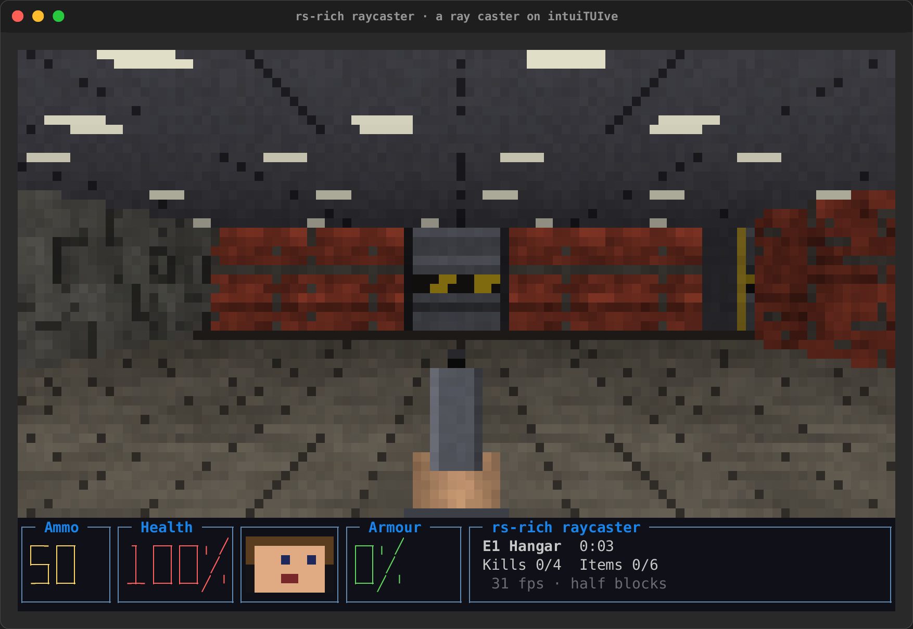

# Timers, frames and games

Time in an app: timers on the app's clock, with handles that pause,
change and cancel them; a fixed timestep for a game; frame pacing and
the frame counters; then sprites that move over a backdrop and
framebuffers drawn a pixel at a time. Background threads and feeds are
on [Tasks, feeds and other threads](background.md).

## Timers

```rust
App::new(|| {
    let seconds = signal(0);
    every(Duration::from_secs(1), move |_| seconds.update(|s| *s += 1));
    text!("up {seconds}s")
})
```

- **`every`** runs a handler on a schedule. Call it inside
  `App::new`'s closure (or a screen's), next to the signals it writes. A
  timer that fell behind (the clock jumped, the laptop slept) ticks once,
  not once for every tick it missed, and keeps to its step after that.
  `after(wait, |cx| ..)` runs a handler once, `wait` from now, on the
  app's clock: anywhere while the app is built or running (a handler, a
  watch), or `cx.after(..)` from a handler. A test steps through it with
  `Driver::advance`; `Resource::stale_after` waits this way.
- **A timer's handle:** `every`, `after` and their `cx` forms return a
  `Timer` (`Copy`, like a signal) that `pause()`s (keeping the time it
  had left), `resume()`s, `set_period(d)` (the next tick `d` after the
  last), `reset()`s and `cancel()`s; a cancelled or fired timer's handle
  does nothing. `cx.every(d, ..)` starts one from a handler, on the screen
  the handler runs on, so a game's tick starts with play and stops when its
  screen closes. In a timer's function `cx.now()` is the app's clock and
  `cx.missed_ticks()` the ticks it fell behind.
- **A fixed timestep:** `fixed_step(period, |cx, steps| ..)` (and
  `cx.fixed_step`) is told how many steps are due, all of them after a
  stall, so a game keeps to the clock rather than to the frame rate;
  `.max_catch_up(n)` caps them. Under a `Driver`, `advance` calls it once a
  period with 1, so a test steps the game exactly.

A game's tick, kept to the clock, paused with the game and quickened on a
level up:

```rust
use std::time::Duration;
use intuituive::fixed_step;

App::new(|| {
    let world = signal(World::new());
    let paused = signal(false);
    let tick = fixed_step(Duration::from_millis(16), move |_, steps| {
        world.update(|w| (0..steps).for_each(|_| w.step()));
    })
    .max_catch_up(5);                     // after a stall, at most 5 steps at once
    view(world)
        .on_key("p", move |_| {
            if paused.get() { tick.resume() } else { tick.pause() }
            paused.update(|p| *p = !*p);
        })
        .on_key("n", move |_| tick.set_period(Duration::from_millis(12)))
})
```

The keys of a game (keys held down, their releases, a repeat the app
times itself) are on [State, keys and the mouse](input.md#held-keys-releases-and-key-repeat).

## Frames

```rust
let app = App::new(build).max_fps(60);
let stats = app.stats_handle();           // a `StatsHandle`: `run` takes the app, so take this first
app.run()?;
let s = stats.get();
eprintln!("{} frames, {} held back", s.frames, s.skipped);
```

`App::max_fps(n)` draws at most `n` frames a second when the app runs its
own loop: what changes in between is drawn by the next frame, so an app
fed faster than it can draw shows the newest state at a steady rate.
Input and timers are still handled as they come. `App::stats_handle()`
keeps the `FrameStats` readable after `run`: `frames` drawn, `skipped`
(held back by `max_fps`), and the last frame's `drawn` nodes and `bytes`.

A full screen of pixels whose every colour changes each frame is cheap
enough for a game: a widget writes cells with
[`canvas.put_rgb(..)`](widgets.md#your-own-widgets), building no styles,
and styles no cell uses any more are dropped between frames.

## Sprites, stages and pixel buffers

A game, a map or an animation draws things that move over a background.
`intuituive::sprite` has the pieces, all generic:

- A **`Sprite`** is cell art: one or more frames of styled cells, some of
  them transparent. `Sprite::from_markup(&lines, '.')` reads console markup
  lines, every `.` a hole; `Sprite::from_cells(rows)` takes `SpriteCell`s;
  `Sprite::from_pixels(&pixel_sprite)` draws pixel art in half blocks.
  `Sprite::from_frames([..]).period(Duration::from_millis(120))` animates
  on the app's clock (`.once()` stops on the last frame); `.anchor(x, y)` or `.centered()`
  says which cell goes at the sprite's position.
- A **`stage`** draws `Placed` sprites from a closure that may read
  signals: `Placed::new(id, sprite).at(x, y).z(1).flip(true)`. Sprites are
  clipped to the stage and drawn in z order over its backdrop
  (`StageOptions::backdrop(node)`, any node) or its background
  (`.bg(..)`); a cell that sets no background takes the colour beneath it,
  so a red `@` on a blue backdrop is red on blue. The stage draws again
  when the signals change, and on the app's clock while a sprite animates
  or moves.
- **Clicks and hovers** find the topmost sprite with an opaque cell under
  the pointer: `StageOptions::on_sprite_click(|id, cx| ..)` and
  `on_sprite_hover(|id, cx| ..)` (`None` off every sprite). A click on no
  sprite goes on to the stage's own `on_click`.
- **Movement:** `Placed::tween(tween(from, to, duration, easing))` moves a
  sprite on the app's clock, a frame every 16 ms until it arrives; a
  position in a signal moved by `cx.animate` works too.
  `StageOptions::half_cells(true)` moves pixel-art sprites a pixel (half a
  cell) at a time up and down.
- **Collisions:** `overlaps(a, b)` is true when two placed sprites share an
  opaque cell (`overlaps_at(a, b, now)` at a time), `bounds_overlap(a, b)`
  when their rectangles meet.

```rust
use intuituive::sprite::{stage_with, Placed, Sprite, StageOptions};

let ship = Sprite::from_frames([
    Sprite::from_markup(&[".[cyan]/\\.[/]", "[cyan]<[b red]##[/]>", ".[yellow]''[/]."], '.'),
    Sprite::from_markup(&[".[cyan]/\\.[/]", "[cyan]<[b red]##[/]>", ".[red]\"\"[/]."], '.'),
])
.period(Duration::from_millis(120));
let (x, selected) = (signal(4.0), signal(None::<usize>));
stage_with(
    move || vec![Placed::new(0, ship.clone()).at(x.get(), 3.0)],
    StageOptions::new()
        .backdrop(fill("·", "grey30 on #0b1020"))
        .on_sprite_click(move |id, _| selected.set(Some(id))),
)
.on_key("right", move |_| x.update(|x| *x += 1.0))
```

`intuituive::pixels` is a framebuffer for what is drawn a pixel at a time
(a raycaster's view, a plot, pixel art): `pixels(width, height, |buf| ..)`
hands its closure a `PixelBuf` (RGBA, kept between draws) and shows it in
half blocks, two pixels a cell in true colour; `pixels_fit(|buf| ..)`
sizes the buffer to the node. `PixelBuf` has `set`, `plot` (blended),
`fill_rect`, `line` and `blit(&sprite, x, y, scale, flip)`, which draws a
`PixelSprite` scaled (nearest neighbour) and mirrored, by each pixel's
alpha; `pixels_mut()` writes the pixels directly. `.pixel_mode(PixelMode::
Quadrants)` (2x2 a cell) and `PixelMode::Braille` (2x4) trade colour for
detail. `PixelSprite::from_art(&rows, &palette)` draws pixel art in
characters, `.with_frame(..)` adds frames and `frame_at(elapsed)` picks
one by the clock.

```rust
use intuituive::pixels::{pixels_fit, PixelMode, PixelSprite};

let ball = PixelSprite::from_art(&[".rr.", "rrrr", ".rr."], &[('r', [220, 40, 40, 255])]);
let x = signal(0i32);
every(Duration::from_millis(16), move |_| x.update(|x| *x = (*x + 1) % 160));
pixels_fit(move |buf| {
    buf.clear([10, 16, 48, 255]);
    let h = buf.height() as i32;
    buf.line(0, h - 1, buf.width() as i32 - 1, h - 1, [255, 255, 255, 255]);
    buf.blit(&ball, x.get(), h - 4, 1.0, false);
})
.pixel_mode(PixelMode::HalfBlocks)
```

Behind features, two plugins: `sprite_sheet(path, tile_width,
tile_height)` (and `sprite_sheet_bytes`) cuts an image into `PixelSprite`
tiles, `.animation(&[0, 1, 2])` and `.sprite(i)` (`art`); and
`micro_sprite(&asset)` makes an rs-rich-micro micro asset a sprite, its
images fitted in half blocks, its fallback where it has none (`micro`;
`micro_pixels(&asset, &limits)` gives its images as a `PixelSprite` for a
pixel buffer).

A stage of 300 moving sprites with a full-screen backdrop draws a 200x60
frame in about 6 ms in a release build, painting included; a 200x120
pixel buffer whose every pixel changes, about 12 to 17 ms
(`tests/sprites.rs` measures both). `examples/sprites.rs` puts it
together: animated sprites drifting over a backdrop, a click to select
one, the arrows to steer it, and a pixel buffer beside them.

The raycaster (`crates/rich-intuituive/examples/raycast`, `cargo run -p
rs-rich-intuituive --example raycast --features art`) is a first-person
game on these pieces: `fixed_step` for its tics, a `pixels_fit` view in
half blocks, quadrants or Braille (or real pixels through
`App::graphics`), and held keys from `App::all_keys(true)`:

| The start | The map (Tab) |
|---|---|
|  |  |
