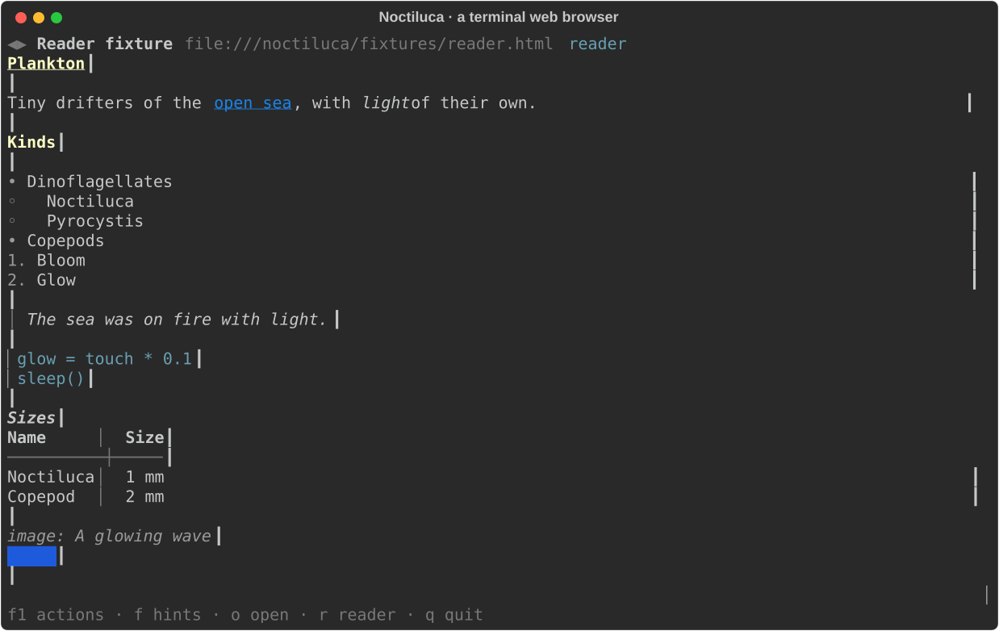
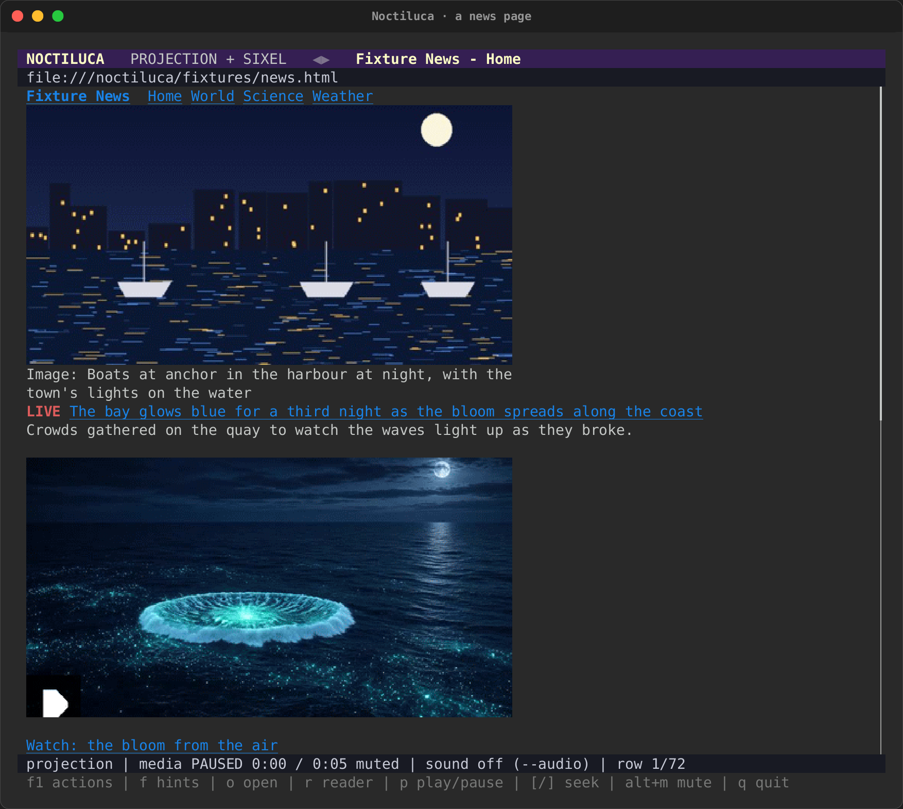
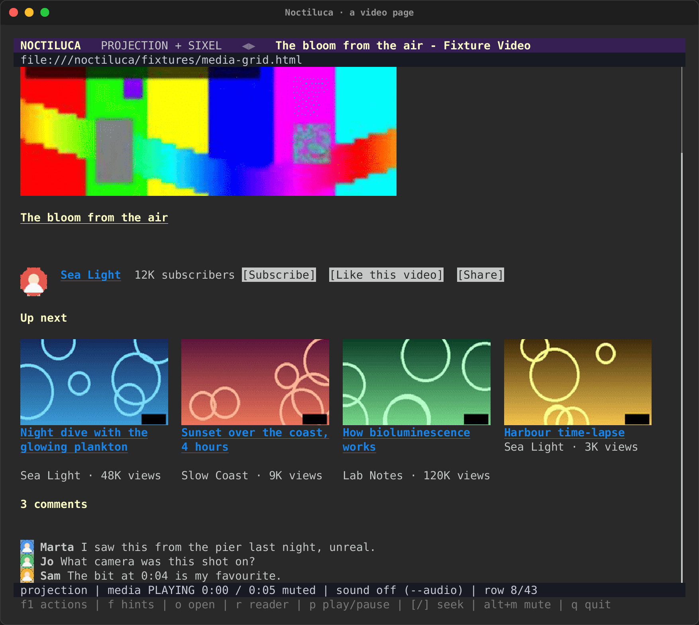
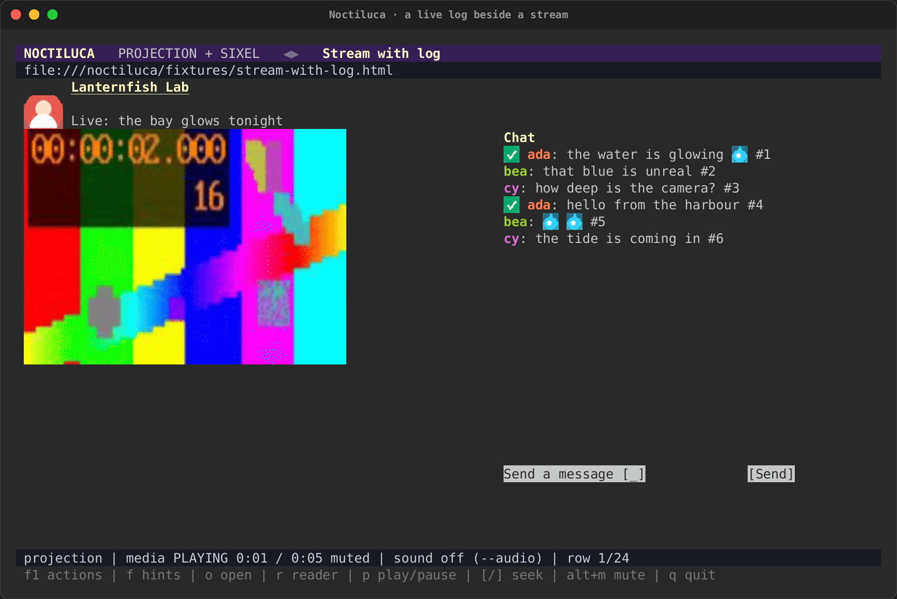
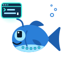
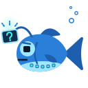

# Noctiluca: a terminal web browser

{ .tui-mascot width="112" }
Noctiluca is a web browser for the terminal. Chrome loads and runs the
page. Noctiluca reads what Chrome laid out and draws it in cells: text as
terminal text you can select and copy, controls as
[intuiTUIve](intuituive/index.md) widgets, and images as media regions. It
is a crate of its own, [`noctiluca`](https://crates.io/crates/noctiluca),
built on intuiTUIve and rs-rich-embed.

Its name is the "sea sparkle" plankton that makes waves glow at night. Its
logo is a bloom of small terminals, and its mascot is a lanternfish whose
lamp is a terminal window.

{ .noct-art width="384" }

*intuiTUIve's Memo, seeing the web in her terminal.*

!!! note "Where it stands"
    Noctiluca 0.0.1 is the **reader phase**: reading pages, following
    links, history, first forms, images, sound, keywords and per-site keys.
    Tables, a faithful layout, video and an automation API come in later
    phases (see [What works today](#what-works-today)). The design and its
    phases are in [the design note](../design/browser.md).

## Install

Noctiluca needs a Chrome or Chromium that you install. A system Chrome is
preferred, for its codecs. Chrome runs with its sandbox on, so run
Noctiluca as a normal user, never as root.

```sh
cargo install noctiluca
```

From a checkout of the repository: `cargo install --path crates/noctiluca`.

Noctiluca looks for Google Chrome in its usual places, then for Chrome or
Chromium on your `PATH`. To run another, pass `--chrome PATH`.

## Opening a page

```sh
noctiluca https://docs.rs/serde        # an address
noctiluca ./page.html                  # a local file
noctiluca gh rs-rich                   # a keyword and its words
noctiluca --dump text page.html        # the page's text, for scripts
```

With no page, it opens the home page from the config. Press `o` to open
another, or `Ctrl+L` to edit this page's address. The address bar decides
in this order:

1. **An address**: a scheme, a path to a local file, or something that
   looks like a host (`localhost:8080`, `example.com/x`).
2. **A keyword**: `gh rs-rich` expands `gh`'s template with the words,
   escaped. A keyword alone opens its site's home. `rs` (docs.rs), `mdn`,
   `crates` (crates.io) and `gh` (GitHub) are built in.
3. **A search**, with the configured engine. The default is DuckDuckGo's
   HTML search, with no tracking parameters added.



## Views

- **The projection** (the default, `--projection`): boxes at Chrome's
  positions, snapped to cells and rewrapped. Two-column and flex layouts
  stay side by side.
- **Reader mode** (`r`, or `--reader`): one readable column, in reading
  order.
- **The raster view** (`--raster`): the page as Chrome paints it, in half
  blocks. It is for debugging.

Both text views build only the rows near the screen, so a long page
scrolls as fast as a short one, with no row limit. Chrome's own scroll
follows yours: a few rows move it by a turn of the wheel, a jump (`G`,
`g g`, find) by a scroll to the place. So a page's lazy images load and
an infinite feed keeps loading. Near the end of what was read, Noctiluca
scrolls Chrome to its bottom and reads the page again once it changes.
When the page grows above what you are reading, your place stays put.

Pictures load as you reach them, as in a browser, and a picture partly
on screen shows the part in view (Sixel and iTerm2 included).

A page too long to read whole (more than 20,000 blocks) says
"page cut" in the status line.

## Pictures and video

Pages read as terminal text, with their real pictures where the page puts
them. Noctiluca draws them itself, with rs-rich-art and intuiTUIve: Kitty,
Sixel or iTerm2 pixels when the terminal has them (`--images`, or `auto`),
half blocks anywhere else. Chrome only lays the page out and hands over
the files it loaded.

- **Pictures** come from the page's own files (an ``, a `<picture>`,
  a CSS background on a box with no text), at their own quality, else
  from Chrome's pixels (an SVG). Each fills the box Chrome gave it. A
  picture with alt text and no caption of the page's gets an
  `Image: …` line under it.
- **Small pictures in a line** (a chat's badges and emotes, an icon) are
  drawn in their line.
- **Animated GIFs** move. Kitty plays them itself, for no further bytes;
  elsewhere each frame is sent only when the terminal has room for it,
  at most eight a second. `F4` freezes every moving picture, and their
  bytes stop.
- **Video** shows its poster with a play mark. `p` plays it in its region,
  from frames Chrome paints, only while it plays; `[` and `]` seek five
  seconds; `Alt+M` mutes. The status line says `media PLAYING 0:03 / 0:05`.
- **Within the terminal's bandwidth.** Moving pictures share a byte budget
  (`[media] bandwidth`, else 4 MB a second here and 256 kB over SSH), at
  most `[media] fps` frames a second. Short of it, a picture steps down:
  Kitty, then iTerm2, then Sixel, then half blocks. Over SSH, video starts
  as half blocks unless `--images` names a protocol.





Both are local test pages (`news.html`, `media-grid.html`), drawn as the
proof of concept drew real sites: page text as terminal text, pictures
inline with their captions, a video's poster with a play mark, the mode
and address in the header, the media's state, the row and the keys in
the status line. See [the recordings](../recordings.md#a-news-page).

## Live logs

A chat beside a stream, a build log, a feed of events: any box the page
marks `role=log` or `aria-live`, or any scroll box the page keeps
appending rows to, is a **live log**. Noctiluca knows it from those
constructs alone, never from the site. New rows arrive within a fraction
of a second, and only they are read: the rest of the page is not read
again.

- The log shows its **newest entries**, in its own box, and follows them.
- `{` scrolls it up. It then holds still while new entries come. `}`
  scrolls it down, and at its end it follows again.
- Each entry keeps its colours (an author's name) and its small pictures
  (badges, emotes).
- A chat's input is an ordinary field: `f` and its hint, type, Enter, then
  its Send button.



## Terminal adaptations

A page is drawn as Chrome lays it out, with a few named rules that make
it read better in cells. Each rule is about constructs, never about a
site, and each can be switched off.

| Rule | What it does | Default |
|---|---|---|
| `decorative-images` | Drops spacers, tracking pixels, and icon-sized pictures marked decorative (`alt=""`, `aria-hidden`) | on |
| `inline-pictures` | Keeps small pictures (emotes, badges) in their line | on |
| `cap-pictures` | Caps a picture's height; what is under it moves up | on |
| `captions` | An `Image: …` line under a picture with alt text and no caption | on |
| `icon-buttons` | Shows every button, icon-only ones too, as `[ label ]` from its name | on |
| `snap-grids` | Snaps a grid's columns to the cells, with fewer columns when they would be too narrow | on |
| `collapse-nav` | On a narrow terminal (under 100 columns), a navigation or sidebar becomes one row of its links | on |
| `text-over-pictures` | Draws a picture of text (a heading or button image, a banner) as its text | off: it changes meaning |
| `live-tail` | A live log shows its newest entries unless you scrolled it up | on |
| `page-colors` | Keeps the page's saturated text colours (a red label, a chat name), readable on your terminal; greys follow your terminal's own colour. Off, the page's own colours: on a light terminal as the page wrote them, on white; on a dark one with their lightness turned over (dark text reads light, a red stays red), on black | on |
| `bandwidth` | Lowers a video's frame rate and picture tier when the terminal is short of bandwidth | on |

- `a` (`Alt+A` in the plain keys) toggles between the adapted and the
  **faithful** projection, with no rule at all.
- `?` (`Alt+I`), or going to `about:noctiluca`, opens the about page:
  the version, the browser, the rules and which are on, and the codecs
  the browser says it plays.
- `--adapt=-decorative-images,-collapse-nav` switches rules off for one
  run, and `--adapt=+text-over-pictures` switches one on. `--no-adapt`
  switches every rule off.
- In the config, `[adapt]` sets each rule by its name:

  ```toml
  [adapt]
  collapse-nav = false
  text-over-pictures = true
  ```

## Keys

Every action has a key, and **F1 lists them all**, with the key that runs
each one. The list is live: an action that cannot run now (there is no
media on the page, say) is shown with the reason. A key rebound in the
config shows there at once, and a site's own keys are marked with the
site table they came from.

| Action | `vim` (the default) | `plain` |
|---|---|---|
| Open an address, a keyword or a search | `o` | `Ctrl+O` |
| Edit this page's address | `Ctrl+L` | `Ctrl+L`, `F6` |
| Link hints | `f` | `Alt+H` |
| Back, forward | `H`, `L` | `Alt+Left`, `Alt+Right` |
| Reload | `R` | `Ctrl+R`, `F5` |
| Find in page, next, previous | `/`, `n`, `N` | `Ctrl+F`, `F3`, `Shift+F3` |
| Scroll | `j`, `k`, arrows | arrows |
| Page down, up | `Space`, `Ctrl+D`, `Ctrl+U` | `PageDown`, `PageUp` |
| Top, bottom | `g g`, `G` | `Home`, `End` |
| Reader mode on or off | `r` | `Alt+R` |
| Adapted or faithful projection | `a` | `Alt+A` |
| Scroll a live log up, down | `{`, `}` | `Alt+PageUp`, `Alt+PageDown` |
| Play or pause, mute | `p`, `Alt+M` | `Alt+P`, `Alt+M` |
| Seek back, on five seconds | `[`, `]` | `Ctrl+Left`, `Ctrl+Right` |
| Volume up, down | `+`, `-` | `Alt+Up`, `Alt+Down` |
| Bookmark this page, bookmarks | `m`, `M` | `Ctrl+D`, `Ctrl+B` |
| Bind a key on this site | `Ctrl+K` | `Ctrl+K` |
| This site's shortcuts | `K` | `Ctrl+Shift+K` |
| Every action (the overlay) | `F1` | `F1` |
| About: version, adaptations and codecs | `?` | `Alt+I` |
| Quit | `q` | `Ctrl+Q` |

`[keys] preset` in the config chooses the column. Any action can be
rebound by its id: `noctiluca keys` lists the ids and their keys.

**Video.** A playing video plays in its region, from Chrome's own
frames, only while it is on screen, and at most eight frames a second:
fewer, and in a cheaper protocol (Kitty, then iTerm2, Sixel, character
art), when the terminal cannot take more. Over SSH it starts as character
art unless `--images` names a protocol. A paused video shows its poster
with a play mark. The status bar shows its state
(`media PLAYING 0:03 / 0:05`), the row and the keys. The about page
(`?`, or `about:noctiluca`) lists the codecs your Chrome says it plays.

**Link hints.** `f` puts a short label on every link and control in view.
Type a label to follow the link, or to use the control: type into a field,
tick a check box, choose an option.

**Forms.** Fields, check boxes, radios, selects and sliders are
intuiTUIve widgets. A field's edit is a draft until Enter. If the page
changed the value meanwhile, that is a conflict, and the page's value is
never overwritten. A password field's value never reaches the screen.

## Per-site keys

A key can do something on one site only. `Ctrl+K` ("Bind a key on this
site…") lists the page's named controls, by role and accessible name, and
every action. Choose one, press the key, and confirm: Enter binds it on
this host, `w` on `*.host`. If the key already does something here, you
are told, and Enter replaces it. The binding is written to your config
file, keeping its comments and layout, and works at once.

`K` lists this site's keys: Enter tests one, `d` removes it, `e` binds it
to another key, `s` moves it between the host and `*.host`. From the
shell, `noctiluca keys --site github.com` lists them.

A site key binds to an action, to "the element with this role and name"
(looked up when the key is pressed), or to a list of those. Never to a
script or a CSS selector: a role and a name survive a redesign, and a
shared config cannot use them to read a page's data.

## Sound

Sound is off by default. `--audio`, or `audio = true` under `[media]`,
lets pages play sound, with Play/Pause, Mute/Unmute and volume controls
for each video and audio on the page.

Sound plays on the machine Chrome runs on. Run over SSH, it plays on the
server, never on your machine.

## Config

The config is a TOML file, `noctiluca/config.toml` in your config
directory (`~/.config` on Linux, Application Support on macOS, `%APPDATA%`
on Windows). `--config PATH` reads another. A key Noctiluca does not know
is a warning, never an error, so an old config still opens.

```toml
[startup]
home = "https://docs.rs"
view = "projection"        # or reader, raster

[shortcuts]
gh = "https://github.com/search?q={}"
wiki = { search = "https://en.wikipedia.org/w/index.php?search={}", home = "https://en.wikipedia.org" }

[keys]
preset = "vim"             # or plain
# hints = "f ctrl+g"

[media]
audio = false
images = "auto"            # ansi, kitty, sixel, iterm2 or none

[adapt]
collapse-nav = false       # each terminal adaptation, by name

[site."github.com"]
view = "reader"
keyword = "s"              # `s WORDS` searches this site

[site."github.com".keys]
n = "scroll.down"
"]" = { role = "link", name = "Next" }
```

Every table is in the crate's documented sample,
[`config.sample.toml`](https://github.com/buchochelliq-labs/rs-rich-cli/blob/main/crates/noctiluca/config.sample.toml).
A site table matches a host (`github.com`), a wildcard (`*.example.com`)
or a URL prefix (`"https://example.com/docs/"`). The most specific match
wins: a prefix, then a host, then a wildcard.

## Switches

```text
noctiluca [OPTIONS] [URL | FILE | KEYWORD WORDS…]
noctiluca keys [--site HOST] [--config PATH]

  --reader | --projection | --raster   the first view (default: projection)
  --audio                              let pages play sound
  --profile NAME                       keep a profile between runs (opt-in)
  --chrome PATH                        the browser to run
  --images ansi|kitty|sixel|iterm2|none
                                       how images reach the terminal
  --fps N                              the media frame cap
  --dump text|ax|json                  print the page's model and exit
  --no-js                              turn the page's script off
  --adapt -RULE,+RULE,…                switch terminal adaptations off or on
  --no-adapt                           every adaptation off: the faithful view
  --config PATH                        another config file
```

By default each run has a temporary, private profile. `--profile NAME`
keeps one, with its cookies and storage, between runs. `--dump` prints the
page's text, its accessibility tree or its model as JSON, for scripts and
CI.

## Tips

{ .tui-mascot width="112" }

- **Lost? Press F1.** Everything Noctiluca can do is in that list, with
  its key.
- **A feed that stops loading?** Keep going down: each time you near the
  end, Noctiluca asks the page for more. A feed that loads only on a
  button needs the button pressed (`f` and its hint).
- **A busy page?** Press `r`. Reader mode drops the layout and keeps the
  words.
- **Blocky pictures?** By default Noctiluca picks what your terminal
  can show. If it falls back to half blocks in a terminal with Kitty
  graphics, Sixel or iTerm2 images, set `--images` (or `[media] images`).
- **A keyword for each site you search.** Add it under `[shortcuts]`, or
  set `keyword` in the site's table to search the site you are on.

## Troubleshooting

{ .tui-mascot width="112" }

- **"Chrome cannot run its sandbox as root."** Run Noctiluca as a normal
  user. It never turns Chrome's sandbox off.
- **No browser found.** Install Chrome or Chromium, or name one with
  `--chrome PATH`.
- **A site shows a bot check.** Noctiluca drives Chrome over DevTools, and
  some bot checks notice that. Noctiluca does not try to hide it, or to
  get past bot checks, CAPTCHAs or sign-in walls.
- **No sound.** Sound needs `--audio`, and it plays where Chrome runs: over
  SSH, that is the server.
- **`O` or `g t` says tabs are not ready.** Tabs need several pages in
  rs-rich-embed, which is still to come.
- **A download did nothing.** Downloads are refused for now.

## What works today

| Phase | What it brings | State |
|---|---|---|
| 0.1, reader | Text, links, history, first forms, images, keywords, site keys, the F1 overlay, sound, `--dump` | Done, in 0.0.1 |
| 0.2, forms and tables | Every widget through the guarded commit, wide tables that scroll with their headers, signing in to a form | Next |
| 0.3, layout and GIFs | Pictures in the projection, animated GIFs within a byte budget, grids side by side (0.0.23); sticky headers, the layout fixtures | Partly, in 0.0.23 |
| 0.4, video and audio | Play, pause, seek and mute video in its region, frames under a byte cap, stepping down to character art on a slow terminal, the codec table (0.0.23) | Done in 0.0.23 |
| 0.5, automation | Scripts that drive a page through the same actions a person runs | Later |

Never: DRM playback, extensions, getting past bot checks, CAPTCHAs or
sign-in walls, or sending messages for you.

The projection is still rough in places: no fixed or sticky layer and no
paint order yet. Reader mode is one key away. Watch
[the recording](../recordings.md#a-terminal-web-browser) for a page read,
a link followed by its hint, and the F1 overlay.

## The bloom and the lanternfish

Noctiluca's logo, its lanternfish in several poses, a favicon, and a
32x32 pixel lanternfish for a terminal sprite are in
[`docs/assets/noctiluca/`](https://github.com/buchochelliq-labs/rs-rich-cli/tree/main/docs/assets/noctiluca).
Its `ICONOGRAPHY.md` has the palette and the drawing rules.
