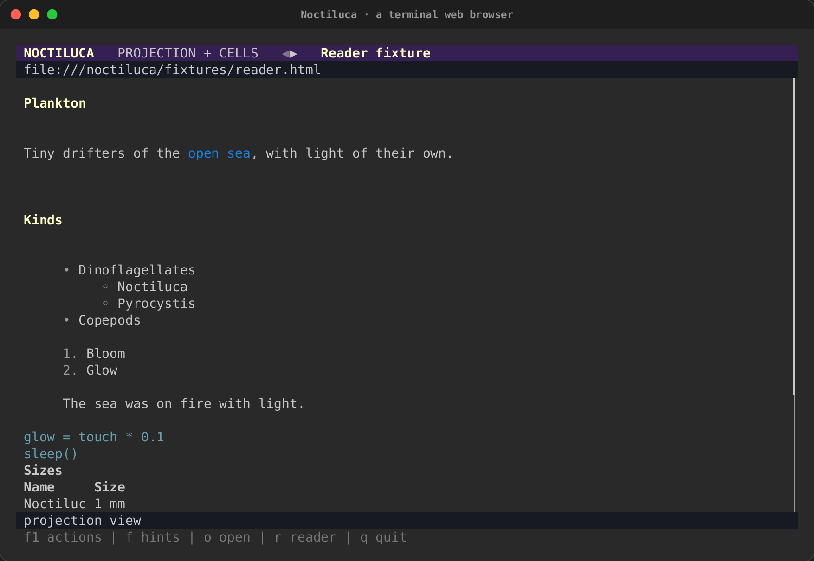

# Noctiluca: a terminal web browser

{ .tui-mascot width="112" }
Noctiluca is a web browser for the terminal. Chrome loads and runs the
page. Noctiluca reads what Chrome laid out and draws it in cells: text as
terminal text you can select and copy, controls as
[intuiTUIve](intuituive/index.md) widgets, and images as media regions. It
is a crate of its own, [`noctiluca`](https://crates.io/crates/noctiluca),
built on intuiTUIve and rs-rich-embed.

Here it runs a real Chrome on the crate's local test pages: a two-column
page in the projection, a link followed by its hint, a form filled in and
sent, and an article in reader mode with its small picture drawn as Kitty
graphics.

<div class="tape-player" data-cast="../../media/tapes/noctiluca-chrome/noctiluca-chrome.cast" data-poster="npt:0:3">
  
</div>

Its name is the "sea sparkle" plankton that makes waves glow at night. Its
logo is a bloom of small terminals, and its mascot is a lanternfish whose
lamp is a terminal window.

{ .noct-art width="384" }

*intuiTUIve's Memo, seeing the web in her terminal.*

!!! note "Where it stands"
    Noctiluca 0.0.1, in the 0.0.22 release, is the **reader phase**:
    reading pages, following links, history, first forms, still images in
    reader mode, sound, keywords and per-site keys. Pictures in the
    projection, animated GIFs and infinite scroll are planned for 0.0.23,
    and video for 0.0.24. See
    [what works today and what's next](noctiluca/status.md).

## Try it

```sh
cargo install noctiluca                # needs a Chrome or Chromium you install
noctiluca https://docs.rs/serde        # an address
noctiluca ./page.html                  # a local file
noctiluca gh rs-rich                   # a keyword and its words
noctiluca --dump text page.html        # the page's text, for scripts
```

Press **F1** for every action and its key, **f** for link hints, **r**
for reader mode and **q** to quit.

## The guide

| Page | What it covers |
|---|---|
| [Getting started](noctiluca/getting-started.md) | Installing it, the Chrome it needs and how it is found, a first run, the address bar, quitting |
| [Reading and moving around](noctiluca/reading.md) | The projection and reader mode, scrolling, link hints, find, history, bookmarks, the F1 overlay |
| [Forms and controls](noctiluca/forms.md) | How a page's controls become widgets, typing, selects, check boxes, buttons, and what is not supported yet |
| [Going places and keys](noctiluca/keys.md) | Keywords, the command line, the key presets, per-site keys, and every action with its keys |
| [Pictures, video and sound](noctiluca/media.md) | Pictures where the page puts them, animated GIFs, video in its region, the byte budget, `--audio` and the media controls |
| [Live logs and adaptations](noctiluca/adaptations.md) | Chats and logs that follow their newest entries, and the terminal adaptations, each of which can be switched off |
| [Configuration](noctiluca/config.md) | Every key of `config.toml`, with its type, default and meaning |
| [Privacy and security](noctiluca/privacy.md) | The browser profile, downloads, the sandbox, cleaned page text, bot checks, and what is sent where |
| [Using it as a library](noctiluca/library.md) | The engine trait, the tab, the page model, and a fake engine for tests |
| [Troubleshooting and FAQ](noctiluca/troubleshooting.md) | What to do when something does not work |
| [What works today and what's next](noctiluca/status.md) | The phases, and what each release brings |
| [Noctiluca on real sites](noctiluca/real-sites.md) | Wikipedia, Hacker News, MDN, The Guardian, GitHub, YouTube and Twitch, recorded live, and what broke |

## Views

- **The projection** (the default, `--projection`): boxes at Chrome's
  positions, snapped to cells and rewrapped. Two-column and flex layouts
  stay side by side.
- **Reader mode** (`r`, or `--reader`): one readable column, in reading
  order, with controls as live widgets and still images as pictures.
- **The raster view** (`--raster`): the page as Chrome paints it, in half
  blocks. It is for debugging.

| Reader mode | The projection |
|---|---|
|  |  |

More in [Reading and moving around](noctiluca/reading.md).

## Tips

{ .tui-mascot width="112" }

- **Lost? Press F1.** Everything Noctiluca can do is in that list, with
  its key, and the reason when it cannot run now.
- **A feed that stops loading?** Keep going down: each time you near the
  end, Noctiluca asks the page for more. A feed that loads only on a
  button needs the button pressed (`f` and its hint).
- **A busy page?** Press `r`. Reader mode drops the layout and keeps the
  words.
- **Blocky pictures?** By default Noctiluca picks what your terminal
  can show. If it falls back to half blocks in a terminal with Kitty
  graphics, Sixel or iTerm2 images, set `--images` (or `[media] images`).
- **A keyword for each site you search.** Add it under `[shortcuts]`, or
  set `keyword` in the site's table to search the site you are on.
- **Something wrong?** See [Troubleshooting and FAQ](noctiluca/troubleshooting.md).

## The bloom and the lanternfish

Noctiluca's logo, its lanternfish in several poses, a favicon, and a
32x32 pixel lanternfish for a terminal sprite are in
[`docs/assets/noctiluca/`](https://github.com/buchochelliq-labs/rs-rich-cli/tree/main/docs/assets/noctiluca).
Its `ICONOGRAPHY.md` has the palette and the drawing rules. The design,
its decisions and its phases are in [the design note](../design/browser.md).
