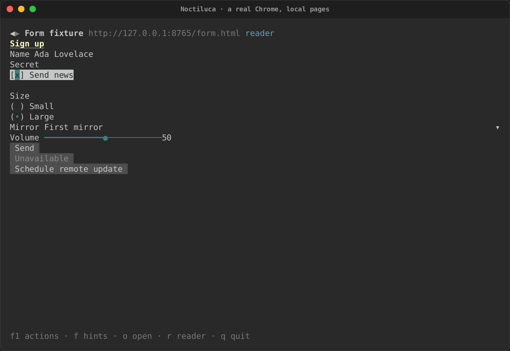
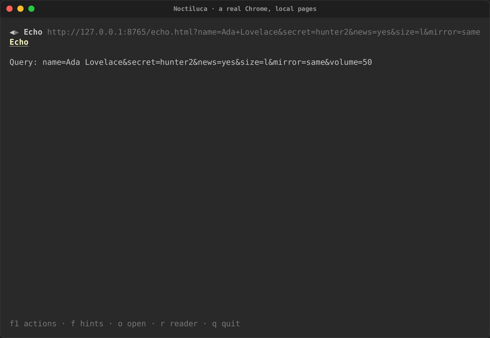
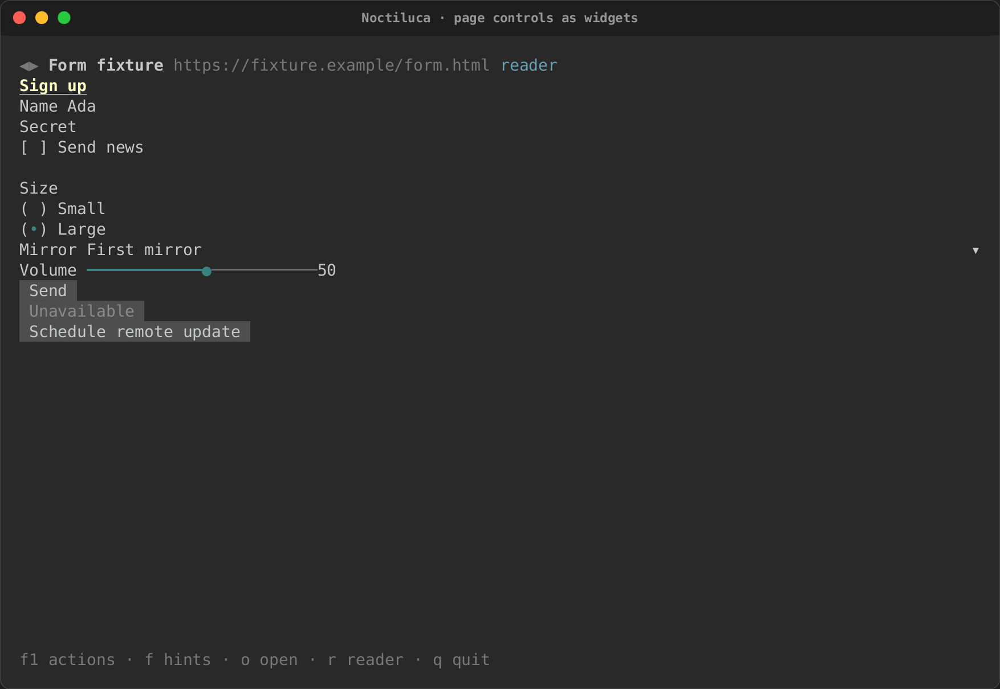
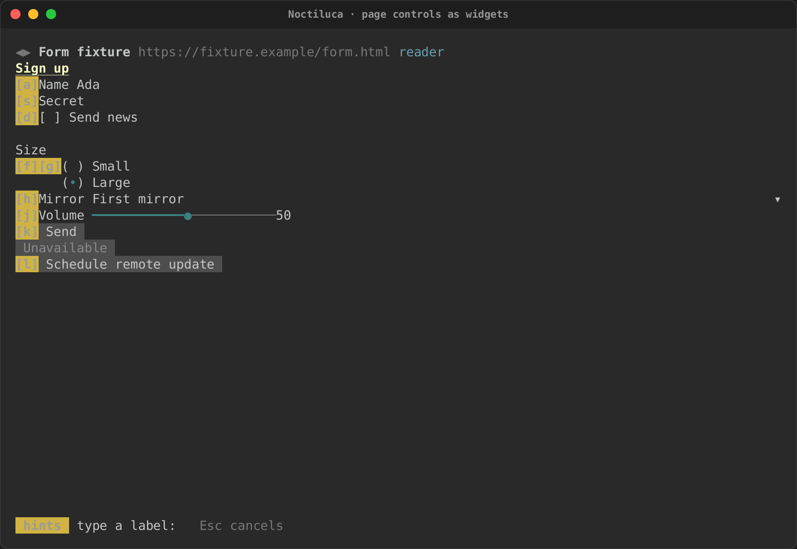
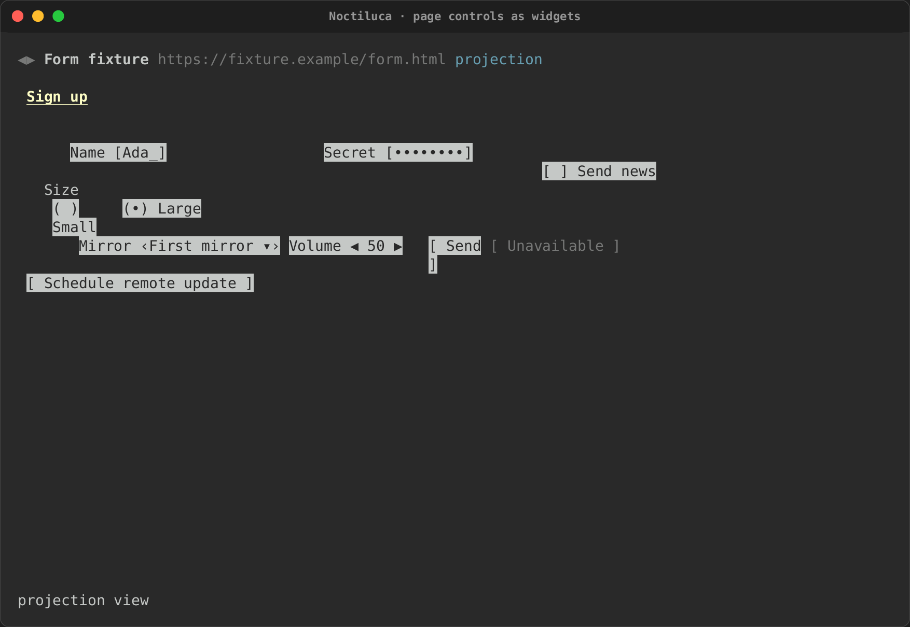
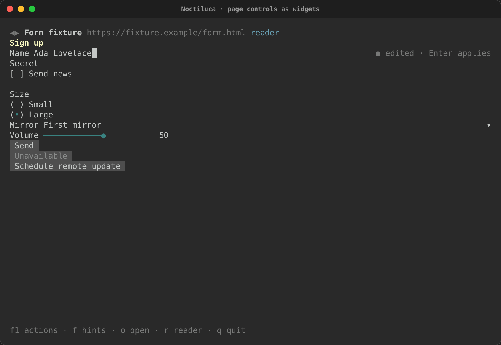
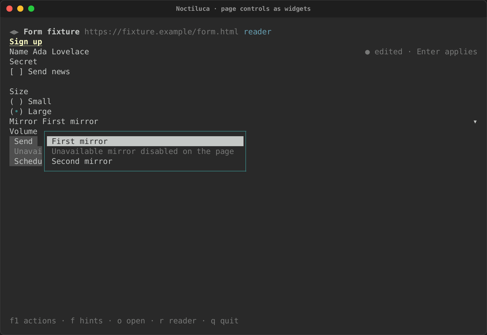

# Forms and controls

A page's controls become [intuiTUIve](../intuituive/index.md) widgets:
fields, check boxes, radios, selects, sliders and buttons. What you do to
a widget becomes an action on the real page in Chrome, checked first so
it never lands on the wrong thing.

Here, against a real Chrome, a field is typed into and applied, a check
box ticked, and the form sent to a page that reads the query back:

| Filled in | Sent |
|---|---|
|  |  |

## From control to widget

Noctiluca finds controls in Chrome's accessibility tree, by their role,
and gives each the stock widget for it:

| On the page (role) | Widget |
|---|---|
| A link, a button, a tab, a menu item | A button whose label follows the page's name for it |
| A check box | A check box with the page's three states: off, on and mixed |
| A switch | A switch |
| Radio buttons of one group | One radio widget, its choices kept apart by their own element |
| A select, a combo box, a list box | A select whose choices are the page's options |
| A slider (a range input) | A slider with the page's minimum, maximum and step, and its number |
| A text field, a search box, a password field, a number field | A one-line text field |

Disabled controls and disabled options stay in view, marked, and cannot be
used. A control's label is its accessible name: what a screen reader
would say.

## Getting to a control

**In reader mode**, the widgets sit in the page's column, where the page
has them.

  

Press `f` for [link hints](reading.md#link-hints): every control that is
not disabled gets a label. Typing a field's label focuses its field;
typing a button's, a check box's or a radio's label clicks it. `Tab` and
`Shift+Tab` move from widget to widget.

| The form in reader mode | Its hint labels |
|---|---|
|  |  |

**In the projection**, controls show as faces where Chrome put them
(`[Ada_]`, `‹First mirror ▾›`, `[ Send ]`). A hint on a field, a select
or a slider opens its widget in a box over the page. Esc closes the box.

| The form in the projection | A select's widget in a box |
|---|---|
|  |  |

## Typing in a field

What you type into a field is a **draft**, kept in Noctiluca until you
press Enter. The line beside the field says where it is:

| Beside the field | Meaning |
|---|---|
| `● edited · Enter applies` | You changed it; the page does not have it yet |
| `… applying` | Sent; waiting for the page |
| `⚠ the page changed it to "…" · Ctrl+R takes it` | A conflict: the page changed the value while you were editing |
| `✗ …` | The page refused it, and why |

Enter applies the draft: Noctiluca focuses the field in Chrome, selects
what it holds and types the new value, so the page sees real input and its
`input` and `change` events fire. First it checks that the page still
holds the value your edit started from. If the page changed it meanwhile,
nothing is sent, and the field shows the conflict. **What you typed is
never overwritten, and the page's value is never overwritten either.**
`Ctrl+R` in the field drops your draft and takes the page's value.

Keys you type in a focused field go to the field, even the ones that are
actions elsewhere. Esc does not leave a field: `Tab` moves on to the next
widget, and the page's keys work again from there.

**Password fields.** A password field's value is never read from the page,
so it never reaches the screen, the model or `--dump`. What you type shows
as `•`. Since its value cannot be read, it has no conflict check: Enter
replaces it with what you typed.

## Check boxes, radios, switches and buttons

Ticking a check box, choosing a radio, flipping a switch or pressing a
button is a real mouse click in Chrome, at the middle of the element. The
widget then follows what the page says. If the page does not change (a
script refused it, say), the widget goes back to the page's state.

Clicking a mixed check box ticks it, on the page as here.

## Selects and sliders

A select lists the page's options. Enter opens it. Choosing an
option sets it on the page's own element and fires `input` and `change`.
Two options with the same value stay apart, since each is the page's own
element. A disabled option is shown as one ("disabled on the page") and
cannot be chosen.

A slider moves by the page's step, between its minimum and maximum, and
sets the page's value as it moves.

## Every action is checked first

Before any action reaches the page, Noctiluca reads the page again and
checks that the control is still there, still the same document, and still
means the same thing. A disabled or read-only control, a stale target or a
changed value refuses the action with a reason ("The "Send" button is
disabled."), and nothing is sent.

## Not supported yet

- **Multi-line text.** A text area is edited in a one-line field.
- **Choosing a file** to upload.
- **Custom widgets** that do not say what they are in the accessibility
  tree read as text, not as controls.
- **Clicking the page with the mouse.** A link or a control in the
  projection is used by its link hint.
- **Signing in** is not tested yet: a login form, and every widget through
  the same guarded commit as text fields, come in the forms and tables
  phase. See [what's next](status.md).

Noctiluca never fills in CAPTCHAs or bot checks for you. See
[Privacy and security](privacy.md#bot-checks).
