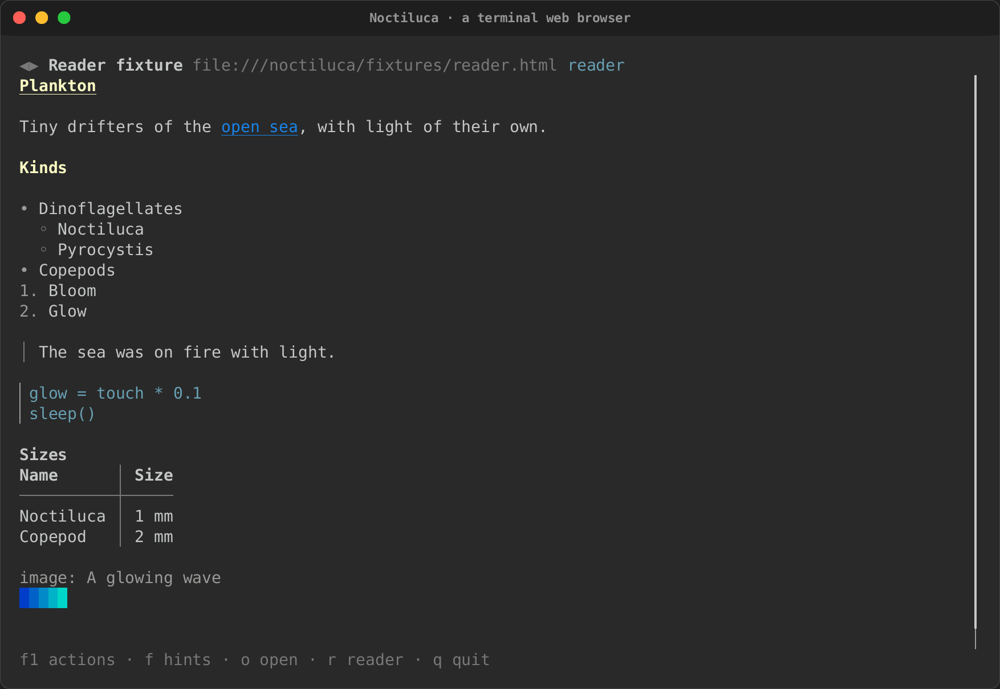
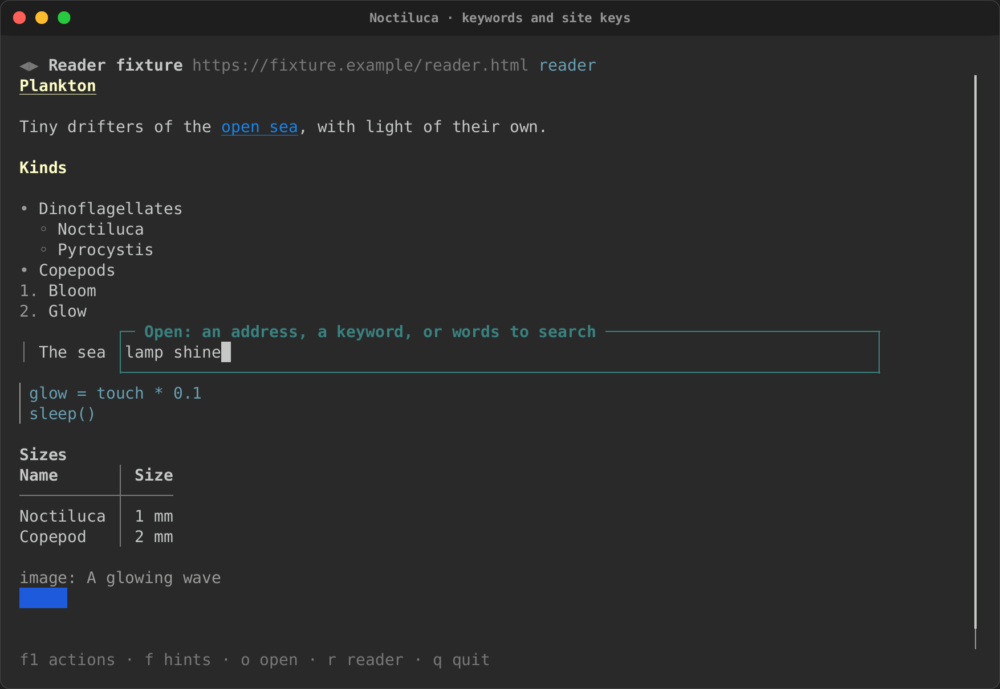

# Getting started

This page installs Noctiluca, finds it a browser, and opens a first page.
For what Noctiluca is, see [the overview](../noctiluca.md).

## Install

Noctiluca is a Rust crate with one binary:

```sh
cargo install noctiluca
```

From a checkout of the repository:

```sh
cargo install --path crates/noctiluca
```

## The Chrome it needs

Noctiluca does not download a browser. It needs a Chrome or Chromium that
you install. A system Google Chrome is best, since it has the codecs for
more audio and video.

It uses the first browser it finds, in this order:

1. The one `--chrome PATH` names.
2. The one the `RICH_EMBED_CHROME` environment variable names.
3. A system Google Chrome in its usual place:
   `/usr/bin/google-chrome-stable`, `/usr/bin/google-chrome` or
   `/opt/google/chrome/chrome` on Linux,
   `/Applications/Google Chrome.app` on macOS, and
   `C:\Program Files\Google\Chrome\Application\chrome.exe` (or its
   `Program Files (x86)` twin) on Windows.
4. A browser on your `PATH`, by these names in turn: `google-chrome`,
   `google-chrome-stable`, `chromium`, `chromium-browser`, `chrome`,
   `headless_shell` and `microsoft-edge`.
5. Chromium in `/Applications/Chromium.app` on macOS.

Chrome runs headless, as a separate process, with its sandbox on.
Noctiluca never turns the sandbox off, and Chrome's sandbox does not run
as root. So **run Noctiluca as a normal user**. As root, starting the
browser fails, and Noctiluca says why.

## A first run

```sh
noctiluca https://docs.rs/serde
```

The screen has three parts:

- **The address line** at the top: back and forward arrows (dim when there
  is nowhere to go), `…` while the page loads, the page's title, its
  address, and the view (`projection` or `reader`).
- **The page**, in the projection by default. Press `r` for reader mode.
- **The status line** at the bottom: the main keys, or what Noctiluca has
  to say (a config warning, "opening …", a find's "match 2 of 5").



With no page on the command line, Noctiluca opens the home page from the
config (`[startup] home`), or an empty page if there is none.

## Opening pages

On the command line, Noctiluca takes an address, a file, or a keyword and
its words:

```sh
noctiluca https://docs.rs/serde        # an address
noctiluca ./page.html                  # a local file
noctiluca gh rs-rich                   # the gh keyword, searching for rs-rich
noctiluca rust error handling          # words to search for
```

One word that names a file that exists opens that file. Anything else is
read the way the address bar reads it, below.

## The address bar

Press `o` to open something new, or `Ctrl+L` to edit this page's address.
A box opens. Type, then press Enter to go, or Esc to close it.



What you type is read in this order:

1. **An address.** Something with a scheme (`https://…`, `file:…`,
   `about:…`, `data:…`, `mailto:…`), a path (it starts with `/`, `.` or
   `~`), `localhost`, an IPv4 address, or a host name with a dot and a
   real-looking ending (`example.com/x`, `docs.rs/serde`). An address
   with no scheme gets one: a path becomes a `file://` address,
   `localhost` and IP addresses get `http://`, and anything else
   `https://`.
2. **This site's keyword.** If the site you are on has a `keyword` in its
   config table, that keyword and some words search this site.
3. **A bookmark's keyword**, then **a keyword** from `[shortcuts]`. The
   words after the keyword fill in its template, escaped. A keyword
   alone opens its site's home. `rs` (docs.rs), `crates` (crates.io),
   `mdn` and `gh` (GitHub) are built in.
4. **A search**, with the configured engine. The default is DuckDuckGo's
   HTML search, with no tracking parameters added.

An empty address bar opens the home page. More on keywords in
[Going places and keys](keys.md#keywords).

## Quitting

Press `q` (or `Ctrl+Q` with the `plain` keys), or `Ctrl+C`. Chrome stops
with Noctiluca, and the run's temporary profile is removed, so nothing of
the session is left on disk unless you asked for a
[kept profile](privacy.md#the-browser-profile).

## Next

- [Reading and moving around](reading.md): views, scrolling, link hints
  and find.
- [Going places and keys](keys.md): every key, and how to change them.
- [Configuration](config.md): the config file.
