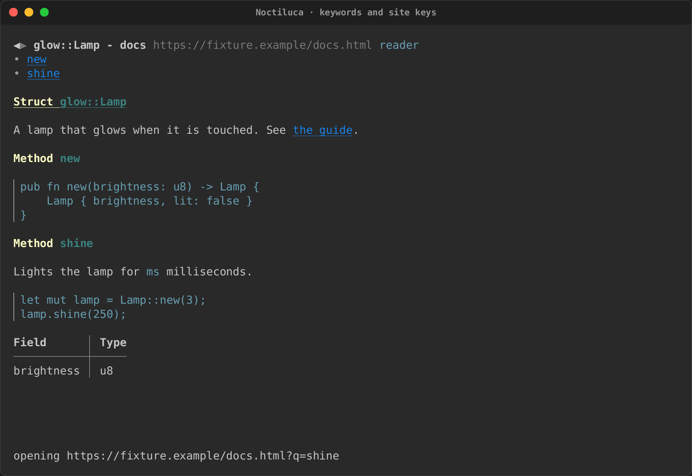
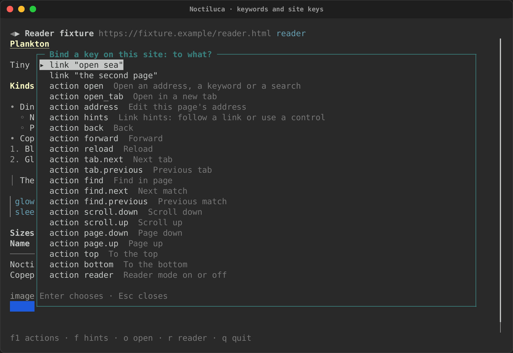
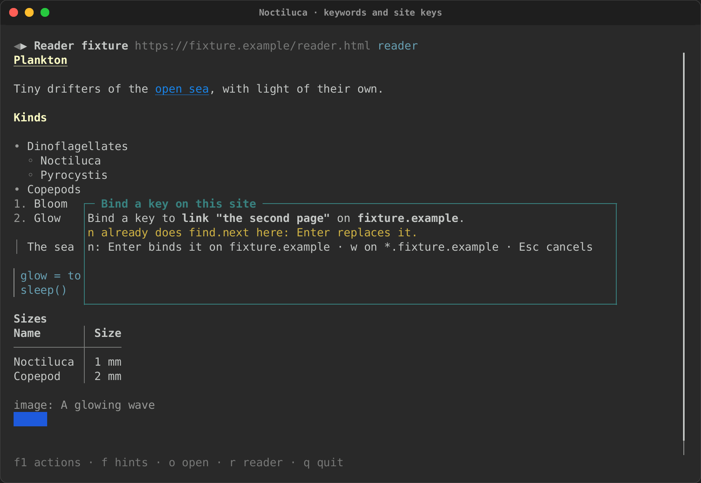
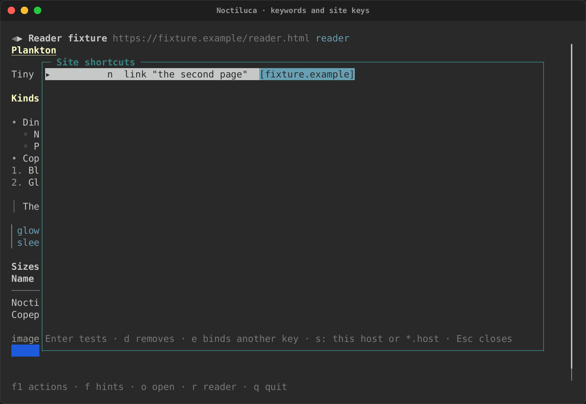
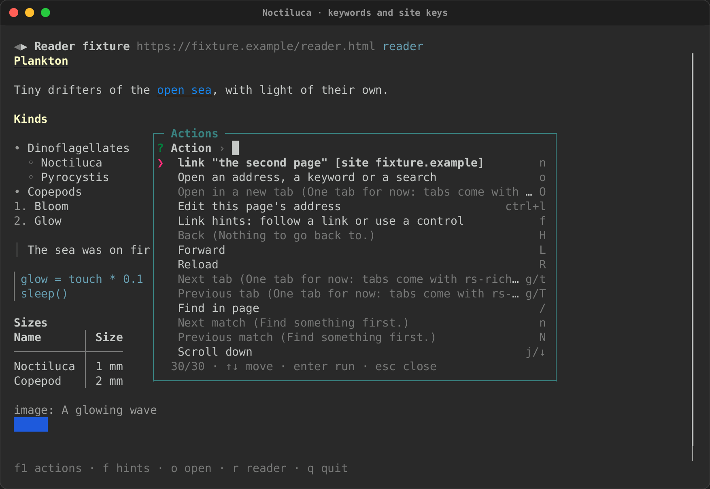

# Going places and keys

This page covers keywords, the command line, the two key presets, keys of
your own, and keys that work on one site only. It ends with every action
and its keys.

<div class="tape-player" data-cast="../../../media/tapes/noctiluca-keys/noctiluca-keys.cast" data-poster="npt:0:3">
  
</div>

## Keywords

A keyword is a short word for a site: `gh rs-rich` in the address bar, or
`noctiluca gh rs-rich` on the command line, searches GitHub for
`rs-rich`. The words after the keyword fill in the keyword's template,
escaped. A keyword alone opens its site's home.

| Typed | Keyword result |
|---|---|
|  |  |

Four are built in:

| Keyword | Searches | Alone, opens |
|---|---|---|
| `rs` | `https://docs.rs/releases/search?query={}` | `https://docs.rs` |
| `crates` | `https://crates.io/search?q={}` | `https://crates.io` |
| `mdn` | `https://developer.mozilla.org/en-US/search?q={}` | `https://developer.mozilla.org` |
| `gh` | `https://github.com/search?q={}` | `https://github.com` |

Add your own, or change or remove a built-in, under `[shortcuts]`:

```toml
[shortcuts]
# {} takes the words after the keyword; the home is the template's site.
so = "https://stackoverflow.com/search?q={}"
# A table sets the search and the home apart.
wiki = { search = "https://en.wikipedia.org/w/index.php?search={}", home = "https://en.wikipedia.org" }
# No {}: the keyword opens this address, words or not.
news = "https://lobste.rs"
# false removes a built-in.
mdn = false
```

**A site's own keyword.** In a site's table, `keyword = "s"` makes
`s WORDS` search the site you are on: the words go to your search engine
with `site:HOST` in front. **A bookmark's keyword** works like a
shortcut too (see [Bookmarks](reading.md#bookmarks)).

When several could match, the address bar tries an address first, then
this site's keyword, then a bookmark's, then `[shortcuts]`, and searches
last. See [the address bar](getting-started.md#the-address-bar).

## The command line

```text
noctiluca [OPTIONS] [URL | FILE | KEYWORD WORDS…]
noctiluca keys [--site HOST] [--config PATH]
```

| Switch | What it does |
|---|---|
| `--reader`, `--projection`, `--raster` | The first view (default: the config's `[startup] view`, else the projection). Choose one |
| `--audio` | Let pages play sound. Off by default. It plays where Chrome runs, never over SSH |
| `--profile NAME` | Keep a profile, with its cookies and storage, between runs (opt-in). A name of letters, digits, `-` and `_` |
| `--chrome PATH` | The browser to run (default: [the one found](getting-started.md#the-chrome-it-needs)) |
| `--images MODE` | How images reach the terminal: `ansi`, `kitty`, `sixel`, `iterm2` or `none` (default: the config's, else detected). See [images](media.md#images) |
| `--fps N` | The most frames a second a moving picture (a GIF, a video) shows, 1 to 60: a ceiling, not a target; video never goes above 8 |
| `--adapt LIST` | Switch [terminal adaptations](adaptations.md#terminal-adaptations) off (`-name`) or on (`+name`) for this run: `--adapt=-collapse-nav,+text-over-pictures` |
| `--no-adapt` | Every adaptation off: the faithful projection |
| `--dump HOW` | Print the page's model and exit: `text`, `ax` (its controls) or `json` (all of it). Needs a page |
| `--no-js` | Turn the page's script off |
| `--config PATH` | Read another config file |
| `-h`, `--help` | The usage |
| `-V`, `--version` | The version |
| `--` | Everything after it is the page or the words, even if it starts with `-` |

A switch that takes a value takes it as the next word or after `=`
(`--images=kitty`). An unknown switch is an error, with the usage.

`--dump` is for scripts and CI. It opens the page, waits until it has
loaded and stayed still for a moment (up to a minute), prints, and exits:

- `text`: the page's text, block by block;
- `ax`: one line per control, tab-separated: its role, its name, then
  `value=…`, `checked`, `unchecked` or `mixed`, `disabled` and its
  link, where they apply;
- `json`: the address, the title, the blocks, the controls and the media,
  with their positions.

**`noctiluca keys`** prints every action with its keys, after your
config, and then your site keys. `noctiluca keys --site github.com` prints
only the keys of the site tables that match that host.

## The key presets

Two sets of keys come with Noctiluca. `[keys] preset` in the config
chooses one:

- `vim` (the default): the keys of vim-like browsers. `o` opens, `f`
  shows hints, `/` finds, `H` and `L` go back and forward.
- `plain`: arrows and modifiers. `Ctrl+O` opens, `Alt+H` shows hints,
  `Ctrl+F` finds, `Alt+Left` and `Alt+Right` go back and forward.

Both are in [the table below](#every-action-and-its-keys).

## Your own keys

Rebind any action by its id under `[keys]`. Keys separated by spaces (or
commas) are alternatives:

```toml
[keys]
preset = "vim"
hints = "f ctrl+g"        # f or Ctrl+G shows hints
reader = "ctrl+r"
quit = "none"             # none (or "") unbinds an action
```

Key names are like `ctrl+g`, `alt+left`, `shift+f3`, `f6`, `pagedown`,
`space`, and a letter by itself (`G` is Shift+G). A rebound key leaves
the action it used to run. The F1 overlay and `noctiluca keys` show the
keys in effect.

A line that names no action, or has a key name Noctiluca does not know,
is a warning: that line is skipped, its action keeps the preset's keys,
and every other line still applies. The warnings show on the status line
when Noctiluca starts, and `noctiluca keys` prints them all.

## Keys on one site

A key can do something on one site only, and there it wins over the same
key's action everywhere else. A site key runs one of three things:

1. an action, by its id: `n = "scroll.down"`;
2. an element of the page, by its accessible role and name:
   `"]" = { role = "link", name = "Next" }`, looked up when you press the
   key. When several elements share the name, `nth = 2` picks the second;
3. a list of those, run in turn: `x = ["top", { role = "link", name = "Home" }]`.

A site key is one key, not a sequence. Never a script, and never a CSS
selector. A role and a name are what a
screen reader would say. They survive a redesign, and a config you share
cannot use them to read a page's data. Running one is the same checked
action a link hint runs.

```toml
[site."github.com".keys]
n = "scroll.down"
"]" = { role = "link", name = "Next" }
```

A site table matches a host (`github.com`), a wildcard (`*.example.com`,
which takes the domain and every host under it) or an address prefix
(`"https://example.com/docs/"`). When several match, the most specific
wins: a prefix, then a host, then a wildcard, and a longer one over a
shorter. See [Configuration](config.md#site-per-site-settings).

### Binding a key from inside Noctiluca

You do not have to edit the file. On the page, press `Ctrl+K` ("Bind a
key on this site…"). It lists the page's named controls, by role and name,
then every action. Choose one with Enter, then press the key.

| Choose what the key does | Press the key, and confirm |
|---|---|
|  |  |

Enter binds it on this host, `w` on `*.host` (the host and every host
under it), Esc cancels. If the key already does something here, you are
told, and Enter replaces it on this site only. When more than one element
has the name, you are told which match the key binds.

The binding is written to `[site."HOST".keys]` in your config file,
keeping the file's comments and layout, and works at once. It needs a
config file to write to and a page with a host: a local file has none.

### This site's keys

Press `K` (`Ctrl+Shift+K` with the `plain` keys) for this site's keys.
Enter tests one, `d` removes it, `e` binds it to another key, and `s`
moves it between the host and `*.host`. A key whose element is not on
this page is listed with the reason.

| This site's keys | In the F1 overlay |
|---|---|
|  |  |

## Every action and its keys

Each action's id is what `[keys]` and site keys use. A key written as two
keys with a space (`g g`) is a sequence: press one, then the other.

| Id | Action | `vim` (the default) | `plain` |
|---|---|---|---|
| `open` | Open an address, a keyword or a search | `o` | `ctrl+o` |
| `open_tab` | Open in a new tab | `O` | `ctrl+t` |
| `address` | Edit this page's address | `ctrl+l` | `ctrl+l`, `f6` |
| `hints` | Link hints: follow a link or use a control | `f` | `alt+h` |
| `back` | Back | `H` | `alt+left` |
| `forward` | Forward | `L` | `alt+right` |
| `reload` | Reload | `R` | `ctrl+r`, `f5` |
| `tab.next` | Next tab | `g t` | `ctrl+pagedown` |
| `tab.previous` | Previous tab | `g T` | `ctrl+pageup` |
| `find` | Find in page | `/` | `ctrl+f` |
| `find.next` | Next match | `n` | `f3` |
| `find.previous` | Previous match | `N` | `shift+f3` |
| `scroll.down` | Scroll down | `j`, `down` | `down` |
| `scroll.up` | Scroll up | `k`, `up` | `up` |
| `page.down` | Page down | `space`, `pagedown`, `ctrl+d` | `pagedown`, `space` |
| `page.up` | Page up | `pageup`, `ctrl+u` | `pageup` |
| `top` | To the top | `g g` | `home` |
| `bottom` | To the bottom | `G` | `end` |
| `reader` | Reader mode on or off | `r` | `alt+r` |
| `adapt` | Adapted or faithful projection (terminal adaptations on or off) | `a` | `alt+a` |
| `log.older` | Scroll the live log up (it holds still) | `{` | `alt+pageup` |
| `log.newer` | Scroll the live log down (at its end it follows again) | `}` | `alt+pagedown` |
| `media.play_pause` | Play or pause the media | `p` | `alt+p` |
| `media.mute` | Mute or unmute the media | `alt+m` | `alt+m` |
| `media.volume_up` | Volume up | `+` | `alt+up` |
| `media.seek_back` | Back five seconds in the media | `[` | `ctrl+left` |
| `media.seek_forward` | On five seconds in the media | `]` | `ctrl+right` |
| `media.volume_down` | Volume down | `-` | `alt+down` |
| `media.freeze` | Freeze or resume moving pictures | `f4` | `f4` |
| `bookmark` | Bookmark this page | `m` | `ctrl+d` |
| `bookmarks` | Bookmarks | `M` | `ctrl+b` |
| `site.bind` | Bind a key on this site… | `ctrl+k` | `ctrl+k` |
| `site.keys` | Site shortcuts… | `K` | `ctrl+shift+k` |
| `actions` | Actions (this list) | `f1` | `f1` |
| `about` | About: the version, the adaptations and which are on, and the codecs (`about:noctiluca`) | `?` | `alt+i` |
| `quit` | Quit | `q` | `ctrl+q` |

The tab actions are listed, and say "One tab for now" when you run them.
Inside a list (bookmarks, site keys, the bind picker), `↑` and `↓` (or
`k` and `j`) move, Enter chooses and Esc closes.
