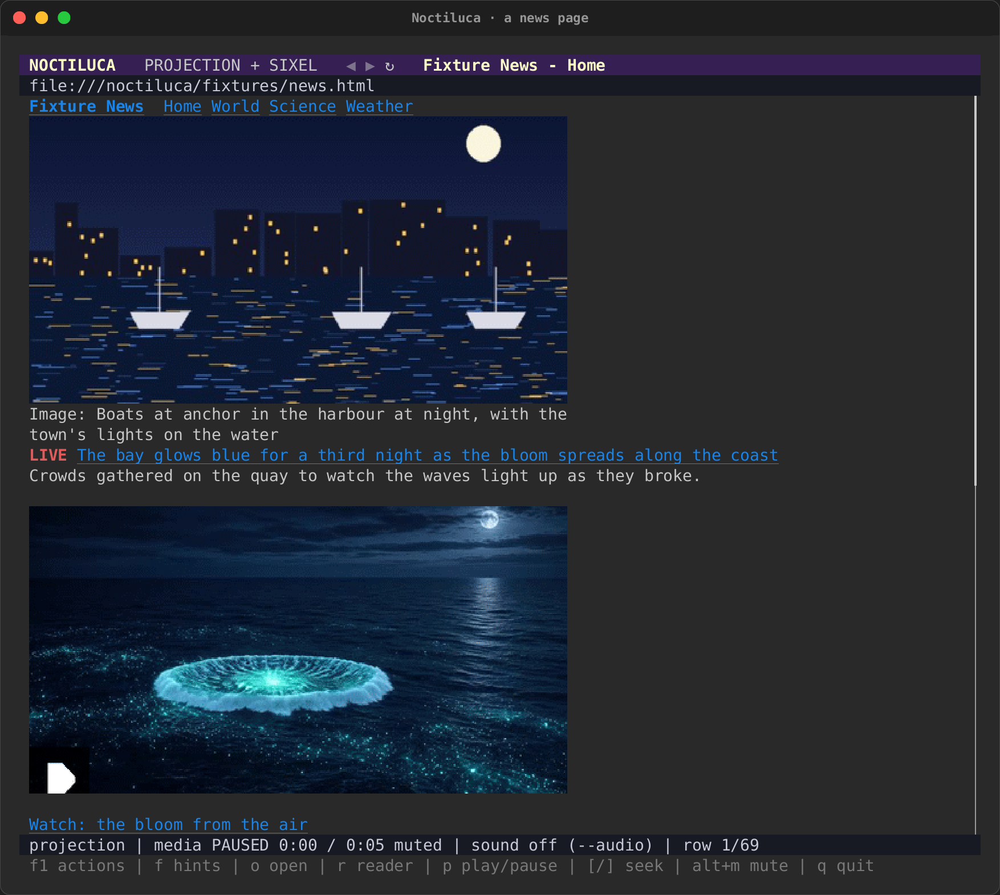
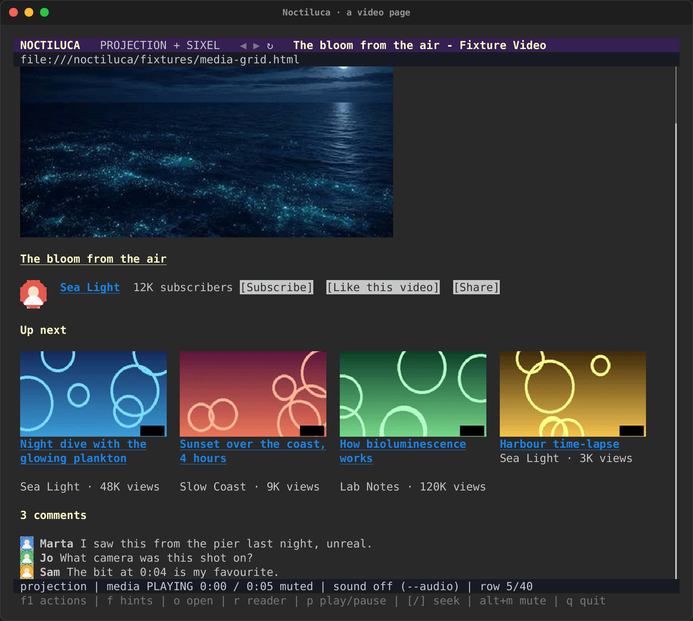
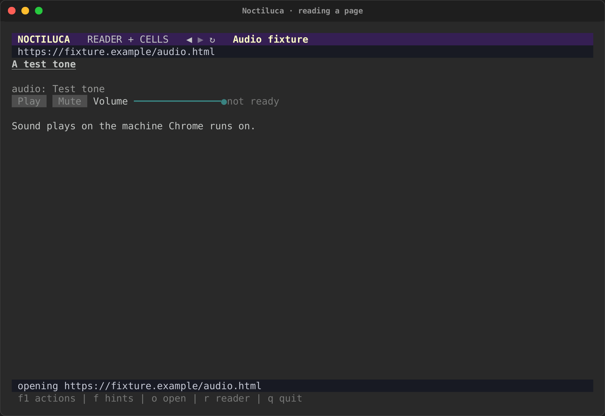
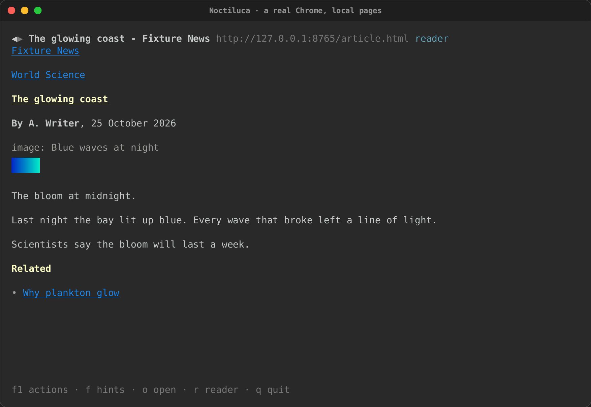
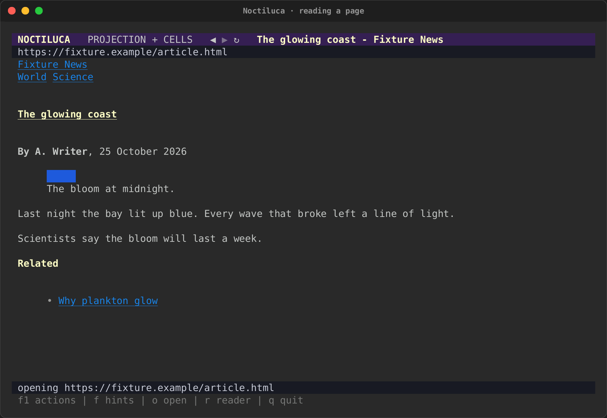

# Pictures, video and sound

Noctiluca 0.0.23 draws a page's pictures where the page puts them, moves
its animated GIFs, and plays its videos in their regions. Sound plays with
`--audio`.

## Pictures and video

Pages read as terminal text, with their real pictures where the page puts
them. Noctiluca draws them itself, with rs-rich-art and intuiTUIve: Kitty,
Sixel or iTerm2 pixels when the terminal has them (`--images`, or `auto`),
half blocks anywhere else. Chrome only lays the page out and hands over
the files it loaded.

- **Pictures** come from the page's own files (an ``, a `<picture>`,
  a CSS background on a box with no text), at their own quality, when
  they are PNG, JPEG, GIF or WebP; else from Chrome's pixels (an SVG, an
  inline `<svg>` drawing, an AVIF). Each fills the box Chrome gave it. A
  build with the `avif` feature (`cargo install noctiluca --features avif`)
  decodes AVIF from the page's own files too; it links the C library
  libdav1d, which must be installed first (`apt install libdav1d-dev`,
  `brew install dav1d`, vcpkg's `dav1d` on Windows). A
  picture with alt text and no caption of the page's gets an
  `Image: …` line under it.
- **Small pictures in a line** (a chat's badges and emotes, an icon) are
  drawn in their line.
- **Animated GIFs and WebPs** move. Kitty plays them itself, for no further bytes;
  elsewhere each frame is sent only when the terminal has room for it,
  at most `[media] fps` a second (30 unless you set it). `F4` freezes every moving picture, and their
  bytes stop.
- **Video** shows its poster with a play mark. `p` plays it in its region,
  from frames Chrome paints, only while it plays: up to 30 frames a
  second, evenly spaced, as many as your terminal can take; `[` and `]`
  seek five seconds; `Alt+M` mutes. The status line says
  `media PLAYING 0:03 / 0:05`. Any `<video>` plays the same way, whatever
  the site.
- **Within the terminal's bandwidth.** Moving pictures share a byte budget
  (`[media] bandwidth`, else 4 MB a second here and 256 kB over SSH to
  start, then the rate your terminal is measured taking output at: here
  up to 32 MB a second, so a fast terminal gets the full frame rate; over
  SSH only ever lower), at most `[media] fps` frames a second. Short of it, a picture steps down:
  Kitty, then iTerm2, then Sixel, then half blocks. Over SSH, video starts
  as half blocks unless `--images` names a protocol.





Both are local test pages (`news.html`, `media-grid.html`), drawn as the
proof of concept drew real sites: page text as terminal text, pictures
inline with their captions, a video's poster with a play mark, the mode
and address in the header, the media's state, the row and the keys in
the status line. See [the recordings](../../recordings.md#a-news-page).

## Sound

Sound is **off by default**: Chrome starts muted. Turn it on for a run
with `--audio`, or for every run with the config:

```toml
[media]
audio = true
```

**Sound plays on the machine Chrome runs on.** No terminal can carry
sound. Run Noctiluca over SSH, and the sound plays on the server, never on
your machine.

Sound is a switch of the browser's launch, so it is on or off for the
whole run. A site's table can keep that site quiet with `audio = false`:
its media are kept muted. A site cannot turn sound on in a run that
started without it.

## Media controls

In reader mode, each video and audio on the page gets a row of controls
under its alt text, read from the element itself: Play or Pause, Mute or
Unmute, a volume slider, and its time (`0:12 / 2:00`, or `live` for a
stream). While something plays, its state is read again every half
second.



The controls say when the media is not ready yet, and, when sound is off,
"sound is off: start with --audio". (This screenshot replays a saved
page, which never plays, so its controls stay "not ready".)

The media keys work from anywhere on the page:

| Action | `vim` | `plain` |
|---|---|---|
| Play or pause | `p` | `Alt+P` |
| Mute or unmute | `Alt+M` | `Alt+M` |
| Volume up | `+` | `Alt+Up` |
| Volume down | `-` | `Alt+Down` |

They work on the video or audio that is playing, or else the first that is
ready. Volume moves ten points at a time, between 0 and 100%, and never
unmutes. A play you ask for runs as your own gesture, so the page does not
refuse it as autoplay. The F1 overlay says what each would do now ("Pause
the media"), and why it cannot run ("No video or audio on this page.").

In the projection, a video is its poster, or its frames while it plays,
and a page's own player controls are buttons like any other. `[` and `]`
(`Ctrl+Left`, `Ctrl+Right` in the plain keys) seek five seconds, and `F4`
freezes every moving picture.

## Images

In **reader mode**, still images are drawn as pictures. Noctiluca takes
each picture from Chrome's own pixels, after the page's text is shown, so
text never waits for pictures. A picture keeps about its size on the page
(8 by 18 CSS pixels a cell), under its alt text.

In **the projection**, an image is drawn over the box Chrome gave it (see
[Pictures and video](#pictures-and-video)). Images that load lazily load
as you scroll, as in a browser, and a picture partly in view shows the
part on screen.

A frame (an `iframe`, an `embed`) shows as its alt text in both views. A
canvas and an inline SVG drawing are drawn from Chrome's pixels in the
projection, and stay live (below); in reader mode they show as their alt
text, and a drawing's own words under it.

### Live drawings: canvases and SVG

A dial, a chart or a game drawn by a script is drawn again as it changes
(0.0.25), so a speed test's gauge moves rather than showing a grey box or
its first frame.

- **An inline `<svg>`** changes the page, so each reading sees it: when
  its content changed (an arc's dash, a needle's turn, a number), its
  picture is taken again from Chrome's pixels. The old picture stays on
  screen until the new one comes. Its own words (its `<text>`, the dial's
  `287.40 Mbps`) are read as its text: in reader mode under its name, in
  `--dump json` as `"text"`, and as its alt text when it has no other name
  (its `<title>` first).
- **A `<canvas>`** changes nothing a reading sees, so while it is on
  screen Noctiluca looks at its pixels: twice a second, then every two
  seconds once it has held still for ten looks. Only a look that changed
  sends the terminal a new picture, within the same byte budget as GIFs and
  video, starting in half blocks over SSH. A large canvas that changes at
  every look for two seconds is cut from Chrome's screencast, as a playing
  video is.
- **At most four canvases** are live at once, the ones on screen nearest
  the view; off screen, or frozen (`F4`), none is looked at. A canvas has
  no words of its own: its alt text is its `aria-label`.

| An image in reader mode, against a real Chrome | The same article in the projection (0.0.22) |
|---|---|
|  |  |

The recordings made over saved pages (every recording on these pages but
the real-Chrome one) draw each picture as a flat blue box: the replay
has no real pixels to show.

### How pictures reach your terminal

`--images MODE`, or `[media] images` in the config, chooses how:

| Mode | What you get |
|---|---|
| `auto` (the default; config only) | What your terminal likely speaks: Kitty graphics in Kitty and Ghostty, iTerm2's images in iTerm2 and WezTerm, Sixel where it looks supported, and half blocks anywhere else |
| `kitty` | The Kitty graphics protocol |
| `sixel` | Sixel |
| `iterm2` | iTerm2's inline images |
| `ansi` | Half blocks: two pixels a cell, in colour, in any terminal |
| `none` | No pictures: alt text only |

Kitty image placement requires Unicode placeholders as well as the graphics protocol.
WezTerm defaults to iTerm2 inline images; forcing Kitty requires placeholder support.
Multiplexers may block or alter graphics transport, so use half blocks when
passthrough is unavailable. A forced mode cannot add a missing terminal feature.

If pictures come out as half blocks in a terminal that can do better,
name its protocol. A site's table can turn pictures off there with
`images = false`.

## The pixel view

In a terminal with Kitty graphics and Unicode placeholders, `Alt+X`
(`view.pixels`), `--pixels` or `--view pixels` shows the page as Chrome
paints it, pixel for pixel, instead of the projection: a canvas, a map, a
page whose layout the projection gets wrong. `Alt+X` again goes back. The
projection stays the default, as it works in every terminal and a screen
reader can read it.

- **Only what changed is sent.** Chrome's screencast sends whole frames;
  Noctiluca cuts each into tiles of 8 by 4 cells and sends the terminal
  only the tiles whose pixels changed. A blinking caret or a spinner is
  one tile.
- **Within the byte budget.** A frame the [budget](#images) has no room
  for is dropped, never queued, so the view stays current rather than
  falling behind.
- **Input goes to the page.** A click lands at its point of the page (to
  the pixel where the terminal reports pixels), the wheel scrolls it, and
  keys go to it as typed. Keys with Ctrl or Alt, and the F keys, stay
  Noctiluca's: `Alt+X` to leave, `F1` for the actions. A key the page
  takes (`q` in the vim preset) reaches the page, so leave first to use
  it.
- **Without Kitty graphics** the view says so and the projection shows:
  Sixel or half blocks of a whole page would be too slow to follow it.

What it costs, measured by the crate's benchmark
(`cargo test -p noctiluca --test pixels benchmark -- --nocapture`) on a
synthetic text page in 100 by 36 cells, through Kitty, against a budget
of 4 MB a second:

| Case | Whole frames: bytes a frame | Frames a second | Tiles: bytes a frame | Frames a second |
|---|---|---|---|---|
| Scrolling, three rows a frame | 2.46 MB | 1.7 | 1.85 MB | 2.3 |
| A caret blinking on a still page | 2.46 MB | 1.7 | 16 kB | 30 (the cap) |

Scrolling moves every row, so nearly every tile changes and tiles save
only a quarter; a page that holds still while something small moves costs
next to nothing. Scrolling in the projection, which sends text, stays far
cheaper.

Terminal cell dimensions are measured at session startup and on resize when
reported by the terminal. If they are unavailable, picture rendering uses
8×16 pixels per cell. Physical cell dimensions affect raster fitting, while
Noctiluca's separate CSS-to-cell projection calibration remains 8×18.

Framework users can run the independent `metric_pictures` example with
`cargo run -p rs-rich-intuituive --features art --example metric_pictures --
kitty 8x16 cover left change`. It changes metrics with the same picture and
cell grid; `clip` shows a scrolled portion, and `cells`, `iterm`, and `sixel`
select the fallback or another protocol. For programmatic use,
`Driver::set_cell_pixels` updates metrics and `intuituive::cell_pixels()`
provides the reactive value. Existing placement sources can ignore metrics;
`PlacementSource::placements_with_metrics` lets sources use them.

`overlay` covers the left half of the framework example with a dialog; `restore`
dismisses it. Stock `Picture::lines` / `picture_of` now preserve rectangular
native image fragments around covered cells. Fitting and anchoring happen before
cropping, using the measured physical cell size. Older hand-written `PictureTag`
styles without source-column metadata retain conservative whole-width clipping.

Sixel/iTerm overlays clear the accepted rectangle to `ImageView.background`
(or the terminal default) before drawing transparent native pixels. This avoids
half-block fallback colors showing through alpha; cells rejected by the encoder
or fragment budget keep their fallback. This does not reconstruct arbitrary
previous layers. Sixel has binary alpha and a limited palette; iTerm preserves
PNG alpha. Encoder/recorder tests are separate from native-terminal verification.

Overlay work is bounded to 32 rectangles per image instance and 128 per frame;
over-budget shapes retain cells. The encoding cache keeps at most 128 entries
and 16 MiB of escape data. Kitty placeholders crop in cells and reuse an unchanged
retained upload when moved. Removal followed by reappearance uploads again.
Simultaneous different fits of one Kitty picture still share an upload id; data
reuse is conservatively disabled for observed conflicting variants. Use distinct
`Picture`s for simultaneous independently fitted Kitty views.
