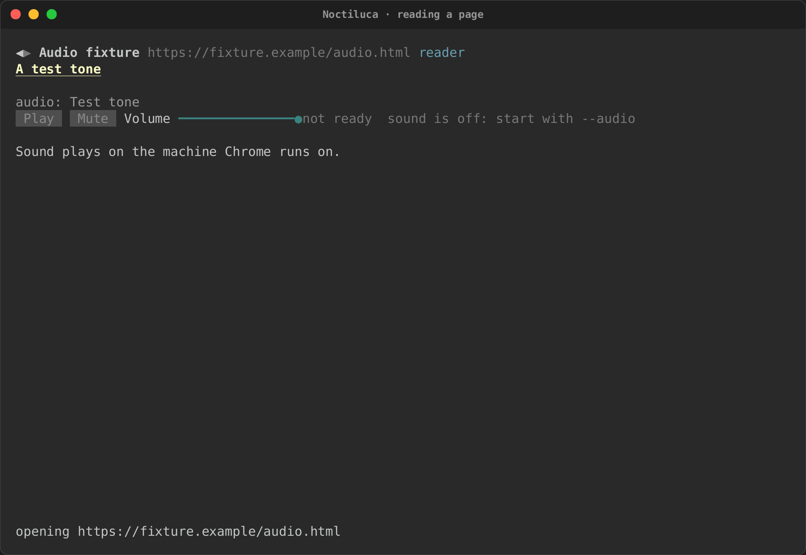
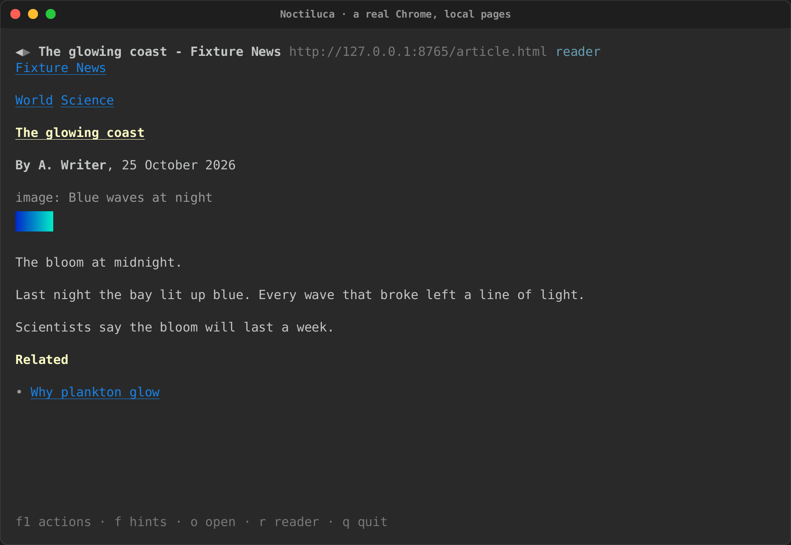
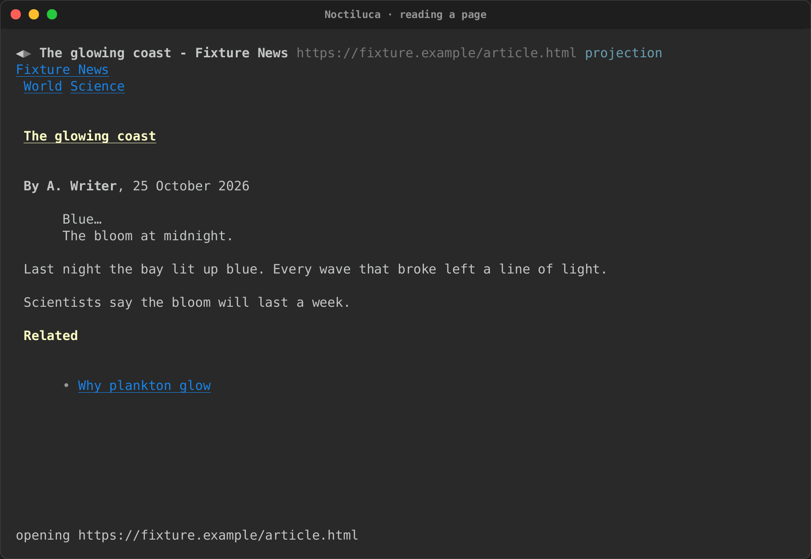

# Sound and media

Noctiluca 0.0.22 plays sound, gives each video and audio its controls,
and draws still images as pictures in reader mode. Pictures in the
projection, animated GIFs and video frames come later; see
[what's next](status.md).

## Sound

Sound is **off by default**: Chrome starts muted. Turn it on for a run
with `--audio`, or for every run with the config:

```toml
[media]
audio = true
```

**Sound plays on the machine Chrome runs on.** No terminal can carry
sound. Run Noctiluca over SSH, and the sound plays on the server, never on
your machine.

Sound is a switch of the browser's launch, so it is on or off for the
whole run. A site's table can keep that site quiet with `audio = false`:
its media are kept muted. A site cannot turn sound on in a run that
started without it.

## Media controls

In reader mode, each video and audio on the page gets a row of controls
under its alt text, read from the element itself: Play or Pause, Mute or
Unmute, a volume slider, and its time (`0:12 / 2:00`, or `live` for a
stream). While something plays, its state is read again every half
second.



The controls say when the media is not ready yet, and, when sound is off,
"sound is off: start with --audio". (This screenshot replays a saved
page, which never plays, so its controls stay "not ready".)

The media keys work from anywhere on the page:

| Action | `vim` | `plain` |
|---|---|---|
| Play or pause | `p` | `Alt+P` |
| Mute or unmute | `Alt+M` | `Alt+M` |
| Volume up | `+` | `Alt+Up` |
| Volume down | `-` | `Alt+Down` |

They work on the video or audio that is playing, or else the first that is
ready. Volume moves ten points at a time, between 0 and 100%, and never
unmutes. A play you ask for runs as your own gesture, so the page does not
refuse it as autoplay. The F1 overlay says what each would do now ("Pause
the media"), and why it cannot run ("No video or audio on this page.").

In the projection, a video or an audio is a placeholder with its alt
text. Its controls are in reader mode.

**Video.** A video's sound plays, but its picture is not drawn in 0.0.22:
it shows as its alt text. Video in its region (play, pause, seek and mute,
frames under a budget, stepping down on a slow terminal) is planned for
0.0.24.

## Images

In **reader mode**, still images are drawn as pictures. Noctiluca takes
each picture from Chrome's own pixels, after the page's text is shown, so
text never waits for pictures. A picture keeps about its size on the page
(8 by 18 CSS pixels a cell), under its alt text.

In **the projection**, an image is a placeholder box with its alt text.
Pictures in the projection, pictures partly in view, animated GIFs and
images that load as you scroll are planned for 0.0.23. Until then, an
animated GIF shows as one still frame in reader mode.

A canvas, an SVG drawing and a frame (an `iframe`, an `embed`) show as
their alt text in both views.

| An image in reader mode, against a real Chrome | The same article in the projection |
|---|---|
|  |  |

The recordings made over saved pages (every recording on these pages but
the real-Chrome one) draw each picture as a flat blue box: the replay
has no real pixels to show.

### How pictures reach your terminal

`--images MODE`, or `[media] images` in the config, chooses how:

| Mode | What you get |
|---|---|
| `auto` (the default; config only) | What your terminal likely speaks: Kitty graphics in Kitty and Ghostty, iTerm2's images in iTerm2 and WezTerm, Sixel where it looks supported, and half blocks anywhere else |
| `kitty` | The Kitty graphics protocol |
| `sixel` | Sixel |
| `iterm2` | iTerm2's inline images |
| `ansi` | Half blocks: two pixels a cell, in colour, in any terminal |
| `none` | No pictures: alt text only |

If pictures come out as half blocks in a terminal that can do better,
name its protocol. A site's table can turn pictures off there with
`images = false`.
