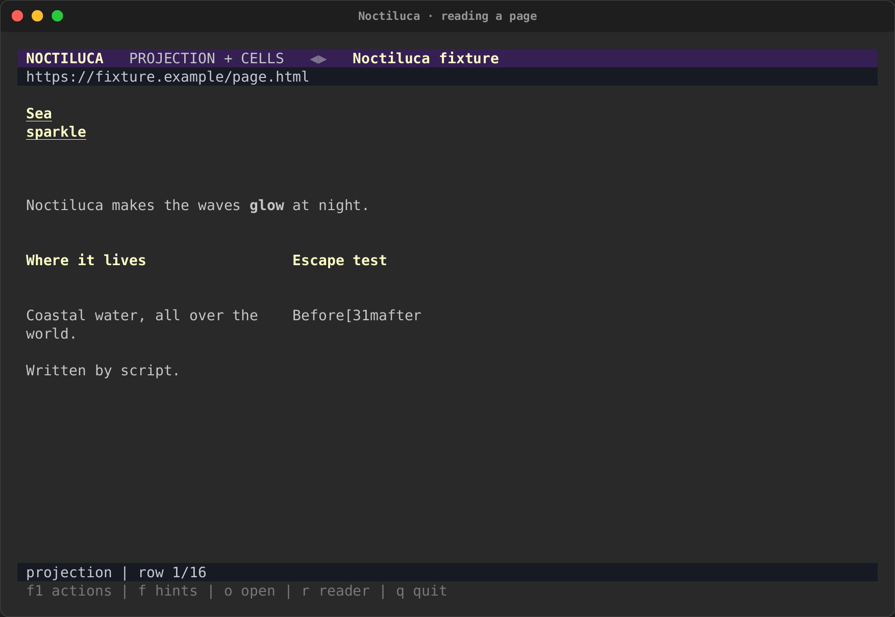
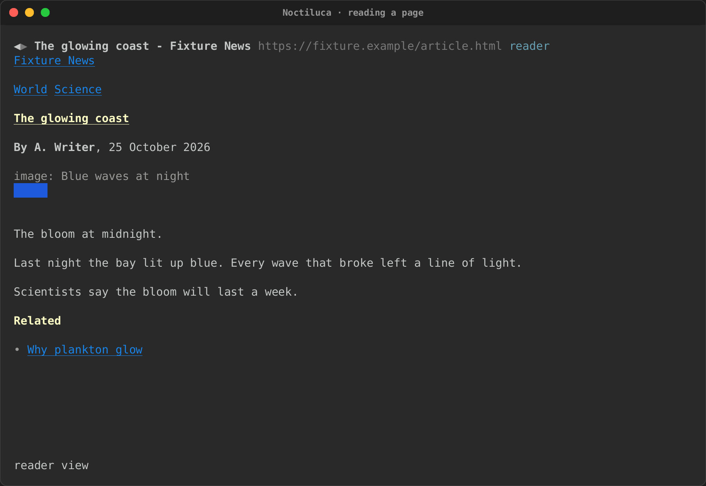
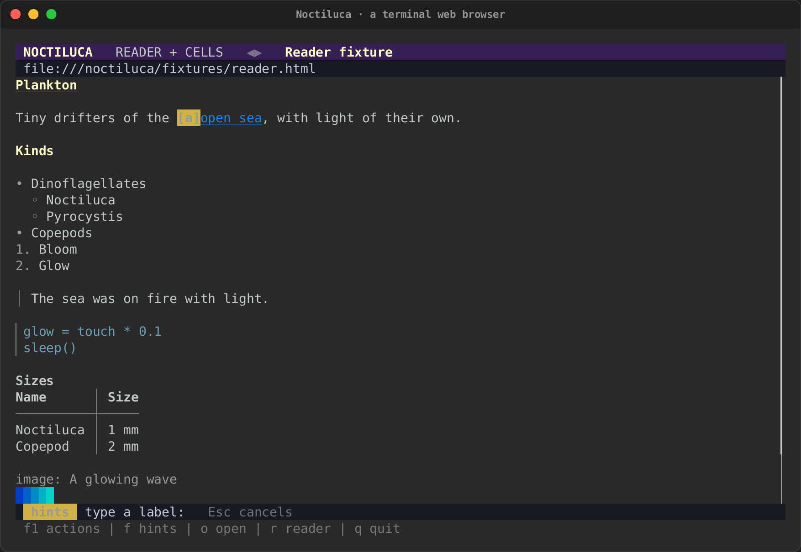
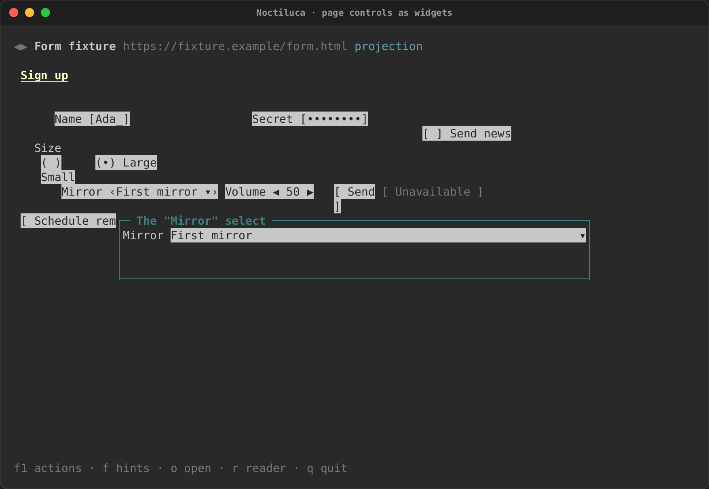
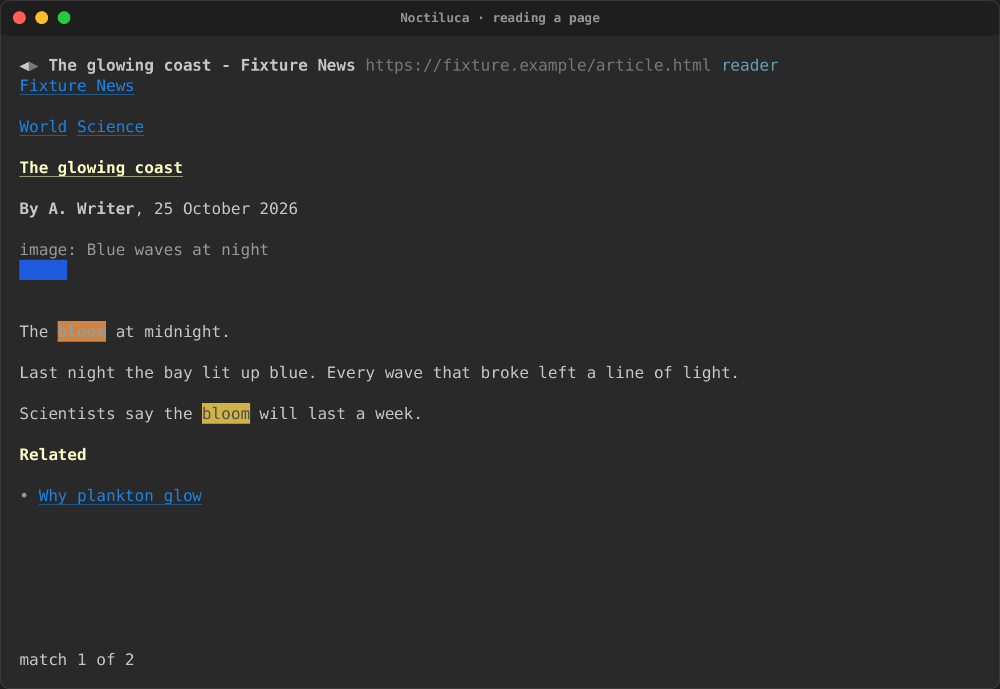
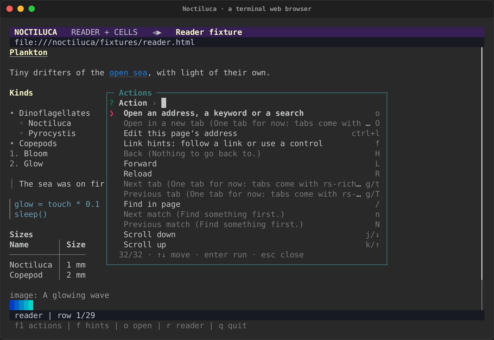

# Reading and moving around

Noctiluca shows a page in one of two views, and you move through it with
keys. This page covers the views, scrolling, link hints, find, history,
bookmarks and the F1 overlay. The keys here are the default `vim` set;
[Going places and keys](keys.md#every-action-and-its-keys) has the
`plain` set too.

<div class="tape-player" data-cast="../../../media/tapes/noctiluca-reading/noctiluca-reading.cast" data-poster="npt:0:3">
  
</div>

## The projection

The projection is the default view. Chrome lays the page out at your
terminal's size (each cell stands for 8 by 18 CSS pixels), and Noctiluca
puts each box of text at Chrome's place for it, snapped to cells, with its
text rewrapped to its width. A column that grows pushes down what is
under it, never what is beside it, so two-column and flex layouts stay
side by side.

| A two-column page | An article with a header, a figure and an aside |
|---|---|
|  |  |

In the projection, controls show as faces: `[Ada_]` for a field,
`[ ] Send news` for a check box, `‹First mirror ▾›` for a select,
`[ Send ]` for a button. Use one with its [link hint](#link-hints).
Images, videos, canvases and frames show as a placeholder box with their
alt text.

This first projection is rough. It has no fixed or sticky layer and no
paint order, so a page with a sticky header or overlapping boxes can read
oddly. Reader mode is one key away.

## Reader mode

Press `r` to switch between the projection and reader mode, or start in
it with `--reader`. Reader mode drops the layout and keeps the content,
in reading order, in one column: headings, paragraphs, nested lists,
quotes, code, tables, images and the page's controls. Text the page hides
is left out.



In reader mode, a page's controls are live intuiTUIve widgets in the
column (see [Forms and controls](forms.md)), still images are drawn as
pictures (see [Sound and media](media.md#images)), and each video and
audio gets play, mute and volume controls.

A site's config table can choose its view (`view = "reader"`), so a site
you always read opens in reader mode. See
[Configuration](config.md#site-per-site-settings).

There is a third view, `--raster`: the page as Chrome paints it, in half
blocks. It is for debugging, has its own address bar, and quits with
`Ctrl+Q`. `r` does not switch to it.

## Scrolling

| Keys | Moves |
|---|---|
| `j`, `↓` | One row down |
| `k`, `↑` | One row up |
| `Space`, `PageDown`, `Ctrl+D` | A page down |
| `PageUp`, `Ctrl+U` | A page up |
| `g g` | To the top |
| `G` | To the bottom |

Both text views build only the rows near the screen, so a long page
scrolls as fast as a short one, with no row limit. Chrome's own scroll
follows yours: a few rows move it by a turn of the wheel, a jump (`G`,
`g g`, find) by a scroll to the place. So a page's lazy images load and
an infinite feed keeps loading. Near the end of what was read, Noctiluca
scrolls Chrome to its bottom and reads the page again once it changes.
When the page grows above what you are reading, your place stays put.

Pictures load as you reach them, as in a browser, and a picture partly
on screen shows the part in view (Sixel and iTerm2 included).

A page too long to read whole (more than 20,000 blocks) says
"page cut" in the status line.

## Link hints

Press `f`. Every link and every control on the page that is not disabled
gets a short label of home-row letters. Type a label to use it:

- a link, a button, a check box, a switch, a radio, a tab or a menu item
  is clicked, with a real mouse click in Chrome;
- a field, a select or a slider gets its widget: focused in reader mode,
  or in a box over the page in the projection (Esc closes the box).

Backspace takes back a letter, and Esc puts the hints away. A letter that
starts no label puts them away too, and says so.

| Labels on the page | A control used from the projection |
|---|---|
|  |  |

## Find

Press `/`, type, and press Enter. Find looks in the text Noctiluca shows
in the current view, without regard to case. It highlights every match,
scrolls to the first, and the status line says "match 1 of 3". `n` goes
to the next match and `N` to the previous one, round and round. `/` opens
with your last search, so Enter on it searches again. An empty search
clears it.



## History

`H` goes back and `L` goes forward. The arrows at the left of the address
line are dim when there is nowhere to go. `R` reloads the page.

## Bookmarks

`m` bookmarks this page: its address and title. `M` lists your bookmarks:
`↑` and `↓` (or `k` and `j`) move, Enter opens one, `d` removes it, Esc
closes the list.

Bookmarks live in `bookmarks.toml` in Noctiluca's data directory
(`~/.local/share/noctiluca` on Linux, or `$XDG_DATA_HOME/noctiluca`;
`~/Library/Application Support/noctiluca` on macOS; `%LOCALAPPDATA%\noctiluca`
on Windows). Each is a `[[bookmark]]` with a `url`, a `title` and, if you
add one by hand, a `keyword`:

```toml
[[bookmark]]
url = "https://docs.rs/serde"
title = "serde - Rust"
keyword = "sd"            # `sd` in the address bar opens it
```

A bookmark keyword works like a [shortcut](keys.md#keywords): with `{}`
in its address, the words after it fill it in.

## Tabs

There is one tab for now. The tab actions (`O`, `g t`, `g T`) are in the
list, but say "One tab for now" when you run them. Tabs need several pages
in rs-rich-embed, which is still to come.

## The F1 overlay

Press `F1` for every action, with the keys that run it. Type to narrow the
list, `↑` and `↓` to move, Enter to run one, Esc to close it.



The list is live. An action that cannot run now shows why: "Nothing to go
back to.", "Find something first.", "No video or audio on this page.".
The media actions say what they would do now ("Pause the media"). A key
rebound in the config shows here at once, and this site's own keys come
first, marked with the site table they came from.
