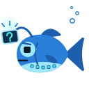

# Troubleshooting and FAQ

{ .tui-mascot width="112" }

First, press **F1**. Every action is there with its key, and an action
that cannot run now says why.

## Starting

**"Chrome cannot run its sandbox as root."** Run Noctiluca as a normal
user. It never turns Chrome's sandbox off.

**No browser found, or the wrong one.** Install Chrome or Chromium, or
name one with `--chrome PATH` or the `RICH_EMBED_CHROME` environment
variable. The order Noctiluca looks in is in
[Getting started](getting-started.md#the-chrome-it-needs).

**A config warning on the status line.** Noctiluca read your config, but
not all of it. `noctiluca keys` prints every warning in full. An unknown
key is only a warning, so the rest of the file still applies; a TOML
syntax error stops Noctiluca with the line.

**A `[keys]` line does nothing.** A line with an unknown action or key
name is skipped, with a warning; the other lines still apply.
`noctiluca keys` prints the warning and the keys in effect. To unbind an
action, give it `"none"`.

## Reading

**A site shows a bot check, or refuses me.** Noctiluca drives Chrome over
DevTools, and some bot checks notice that. Noctiluca does not try to hide
it, or to get past bot checks, CAPTCHAs or sign-in walls. See
[Bot checks](privacy.md#bot-checks).

**The projection looks wrong.** The first projection has no fixed or
sticky layer and no paint order, so sticky headers and overlapping boxes
can read oddly. Press `r` for reader mode.

**The page stops where it should load more.** Keep going down: each time
you near the end, Noctiluca asks the page for more. A feed that loads
only on a button needs the button pressed (`f` and its hint).

**Keys type into a field.** A focused text field takes every key you
type. Esc does not leave it: press `Tab` to move to the next widget.

**"Edit conflict: the page changed this value."** The page changed a
field while you were editing it. Your text is kept. `Ctrl+R` in the field
takes the page's value; then edit and press Enter again. See
[Typing in a field](forms.md#typing-in-a-field).

**`O` or `g t` says "One tab for now".** Tabs need several pages in
rs-rich-embed, which is still to come.

## Pictures and sound

**A picture shows as its alt text.** A frame shows as its alt text, and
so does a canvas or an inline SVG drawing in reader mode. A site table
with `images = false`, or `--images none`, turns pictures off.

**A canvas stops moving.** Only four canvases are live at once (those on
screen nearest the view), none while `F4` freezes moving pictures, and a
canvas that has held still is looked at every two seconds, not twice a
second.

**Moving pictures stutter, or turn to half blocks.** GIFs and video
share a byte budget, and step down when the terminal is short of it. Over
SSH the budget is small. Raise it with `[media] bandwidth`, or press `F4`
to freeze them.

**Blocky pictures.** By default Noctiluca picks what your terminal can
show, and falls back to half blocks. In a terminal with Kitty graphics,
Sixel or iTerm2 images, name it with `--images` (or `[media] images`).

**No sound.** Sound needs `--audio` (or `[media] audio = true`). It plays
where Chrome runs: over SSH, that is the server. A site table with
`audio = false` keeps that site muted.

**A video stays on its poster.** Press `p` to play it. Its frames are
drawn only while it is on screen.

## Saving and leaving

**A download did nothing.** Downloads are refused for now. See
[Downloads](privacy.md#downloads).

**"No config file to keep site keys in."** Binding a key on a site writes
to your config file, and Noctiluca found no config directory (no `HOME`,
say). Name a file with `--config PATH`.

**"This page has no site (a local file): site keys need a host."** Site
keys belong to a host. Serve the page from a local server to bind keys on
it.

**`rich-embed-chrome-…` folders in my temporary directory.** Each run's
temporary profile is removed when Noctiluca ends, however it ends, except
when it is killed with SIGKILL or the machine stops. Such a folder is
readable only by you, and safe to delete once no Noctiluca runs. See
[the browser profile](privacy.md#the-browser-profile).

**`--dump` says the page "did not load in time".** `--dump` waits up to a
minute for the page to load and stay still. A page that never stops
changing (a ticking clock, an animation in the DOM) does not finish.

## Over SSH

**"no ssh found (install OpenSSH's client)".** `--ssh` runs the `ssh`
on your `PATH`. Install OpenSSH's client.

**"SSH refused the login to HOST".** ssh said `Permission denied`: the
user, the key or the password was refused. Try `ssh HOST` on its own;
whatever makes that work (`~/.ssh/config`, an agent, `--ssh-arg=-i
--ssh-arg=KEY`) makes `--ssh` work.

**"the tunnel's port was taken" or "port … is another user's".** Another
program took the port Noctiluca chose before ssh could. Noctiluca tries
two more ports by itself; the second message means another user's program
holds it, and Chrome is not started. Run again.

**"ssh to HOST dropped" on the status bar.** The tunnel ended. Noctiluca
reconnects by itself, without prompting; reload reconnects at once. If the
login needs a password, quit and run again.

**`localhost` opens my own machine's server, not the remote's.** Check
the status bar says `via ssh HOST`: without `--ssh`, `localhost` is this
machine.

## Scripts and the pixel view

**`noctiluca ls` says no Noctiluca is listening.** Only a session started
with `--control`, `--read-only` or `[agent] control = true` listens, and
only to scripts with the same `XDG_RUNTIME_DIR` (a script under `sudo`, or
in another login, looks elsewhere).

**"--control: … is open to other users" or "… is another user's".** The
socket's directory (`$XDG_RUNTIME_DIR/noctiluca`, else
`/tmp/noctiluca-UID`) must be yours with mode 700. Noctiluca does not
change it for you: remove it, or fix its owner and mode, and run again.

**"N sessions are listening".** Name one: `noctiluca action --session PID
…`, with a pid from `noctiluca ls`.

**"read-only session".** That session runs with `--read-only` (or
`[agent] read_only = true`): it answers `info`, `snapshot` and `find`
only.

**The control commands say "Unix only for now".** On Windows there is no
control socket yet.

**"The pixel view needs Kitty graphics".** It draws through Kitty's
protocol only. In kitty, WezTerm or Ghostty, name it if it was not
detected: `--images kitty --pixels`.

**The pixel view lags while scrolling.** Scrolling changes every tile, so
each frame costs nearly a whole frame of pixels; frames the byte budget
cannot carry are dropped. Raise `[media] bandwidth` if your terminal takes
more, or scroll in the projection and switch back.

## FAQ

**Is it a real browser?** Yes: Chrome loads and runs every page, with its
scripts. Noctiluca is the screen and the keyboard.

**Can I sign in to sites?** Fields, check boxes and buttons work, and
`--profile NAME` keeps you signed in between runs. Sign-in forms are not
tested yet; they come in the forms and tables phase.

**Does it work over SSH?** Yes, two ways. Run it on the server, and the
page, its text and its pictures reach your terminal like any other
program's (sound plays on the server). Or run it here with `--ssh HOST`,
and Chrome makes its requests through the server. See [Over SSH](ssh.md).

**Can I use the mouse?** Yes: click a link or a control, turn the wheel
to scroll, and click the header's `◀ ▶ ↻`, the address, the keys in the
status bar and the rows of a list. See [the mouse](keys.md#the-mouse).
A drag over text still selects and copies it; `--no-mouse` leaves the
mouse to your terminal instead.

**Why does it need Chrome?** A modern page needs a modern engine to run
its scripts and lay it out. Noctiluca reads Chrome's layout instead of
laying pages out itself. See [the design note](../../design/browser.md).

**Will it play DRM video, run extensions, or solve CAPTCHAs?** No, never.
See [what's next](status.md#never).
