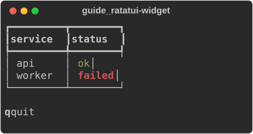
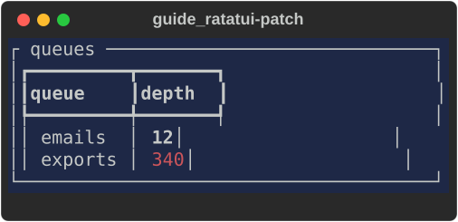
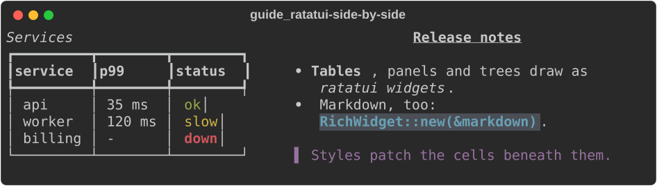
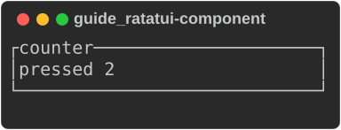

# Using rich with ratatui

`rs-rich-ratatui` (`rich_ratatui`) connects rs-rich and
[ratatui](https://ratatui.rs), both ways. A ratatui app can draw rich
renderables (tables, panels, Markdown, syntax, trees, markup) as ordinary
ratatui widgets today, without changing anything else about the app. And an
existing ratatui widget can run inside an [rs-rich-interact](interact/index.md)
event loop, so moving the other way does not mean rewriting widgets that
already work.

The crate is an rs-rich addition, not a port: Python `rich` has no ratatui.
It is built on core `rs-rich` and on
[`ratatui-core`](https://crates.io/crates/ratatui-core), the crate ratatui's
own `Buffer`, `Rect`, `Style` and `Widget` live in. ratatui 0.30 re-exports
those types, so the buffer a `ratatui` app draws into is the one this crate
takes, and no other rs-rich crate depends on ratatui.

This crate is the interop layer. For writing a new full-screen app,
rs-rich has its own framework, [intuiTUIve](intuituive/index.md): a
retained tree with signals, where only what changed is redrawn and sent.
[The design note](../design/intuituive.md) records why both exist, the
benchmarks against ratatui, and the decisions behind this crate. To move an
app across, see [Porting a ratatui app](intuituive/porting.md).

```toml
[dependencies]
rs-rich = "0.0.9"
rs-rich-ratatui = "0.0.2"
# For RatatuiComponent, ratatui widgets inside rich-interact:
# rs-rich-ratatui = { version = "0.0.1", features = ["interact"] }
```

## Draw rich renderables in a ratatui app

`RichWidget` is a ratatui `Widget`. Hand it any rich `Renderable`, by
reference (`RichWidget::new(&table)`) or by value (`RichWidget::owned(…)`,
`RichWidget::markup("[b]q[/] quit")`), and render it like any other widget:

```rust
--8<-- "crates/rich-ratatui/examples/guide_ratatui.rs:widget"
```

(The same code is `RichWidget`'s doc test; in an app the terminal has a
crossterm backend instead of `TestBackend`.) The pictures on this page are
the backend's buffer, read back with `buffer_to_lines` and exported through
a rich console (the example's `Lines` is a renderable of rich lines), so
each is the ratatui frame cell for cell:



The examples come from
[`guide_ratatui.rs`](https://github.com/buchochelliq-labs/rs-rich-cli/blob/main/crates/rich-ratatui/examples/guide_ratatui.rs):

```bash
cargo run -p rs-rich-ratatui --example guide_ratatui --features interact
```

The renderable is rendered at the area's width, and its first
`area.height` lines are drawn; the rest are cut off, as ratatui's
`Paragraph` cuts off text. A few options:

- `.console(&console)` renders with your own `Console`: its theme, emoji,
  highlighting and box settings. Without one, a per-thread default console is
  used, built without reading the environment, so `NO_COLOR` and terminal
  detection never reach into the app: colour is the backend's business.
- `.fill_height(true)` also passes the area's height, for renderables that
  use it (a `Layout`, a `Panel` with a height) instead of taking their
  natural height.
- `.lines(area)` returns the rich lines without drawing them.

Styles *patch* the cells beneath, as ratatui's own widgets do: an unstyled
part of a table keeps the background a `Block` painted under it.

```rust
--8<-- "crates/rich-ratatui/examples/guide_ratatui.rs:patch"
```



The crate's example draws a rich table and rich Markdown side by side in one
ratatui frame and prints the frame, with no terminal needed:

```bash
cargo run -p rs-rich-ratatui --example rich_in_ratatui
```

The same frame, drawn by the guide's example:

```rust
--8<-- "crates/rich-ratatui/examples/guide_ratatui.rs:side-by-side"
```



## Run ratatui widgets in rich-interact

With the `interact` feature, `RatatuiComponent` is a
`rich_interact::Component` whose view a ratatui drawing closure draws. It
owns its state and an optional event handler, so the state lives in the
component rather than behind an `Rc<RefCell>`, and it runs under every
rich-interact driver, the headless one included:

```rust
--8<-- "crates/rich-ratatui/examples/guide_ratatui.rs:component"
```



Each render draws into a fresh ratatui `Buffer` the size of the context (or
`.height(rows)` rows) and converts it into the component's view. Without a
handler, every event is ignored, so a container can route it elsewhere.

## The conversions underneath

Both directions are built on public functions you can use directly:

| Function | Converts |
|---|---|
| `to_ratatui_style`, `to_rich_style` | a rich `Style` ⇄ a ratatui `Style` |
| `to_ratatui_color`, `to_rich_color` | a rich `Color` ⇄ a ratatui `Color` |
| `style_from_color_name` | a colour name as ratatui reads one (`DarkGray`, `light red`, `#ff8800`, `208`) into a rich style (`bright_black`, `bright_red`, `#ff8800`, `color(208)`) |
| `lines_to_buffer` | rich lines (`Console::render_lines`) into a rectangle of a buffer |
| `buffer_to_lines`, `buffer_area_to_lines` | a buffer, or a rectangle of one, into rich lines |
| `buffer::cells` | a rectangle of a buffer, cell by cell, without allocating |

`cells` is for a consumer with its own cell screen. It yields each leading
cell of a rectangle with its column, row, symbol, width and a small `Copy`
style key, skipping wide characters' trailing cells, and a `StyleCache`
turns each distinct key into a rich `Style` once:

```rust
use ratatui_core::buffer::Buffer;
use ratatui_core::layout::Rect;
use ratatui_core::style::{Color, Style};
use rich_ratatui::buffer::{cells, StyleCache};

let mut buffer = Buffer::empty(Rect::new(0, 0, 10, 2));
buffer.set_string(0, 0, "日本 ok", Style::default().fg(Color::Red));

let mut styles = StyleCache::new();
let mut row = String::new();
for cell in cells(&buffer, Rect::new(0, 0, 6, 1)) {
    // Hand cell.x, cell.y, cell.symbol, cell.width and the style to
    // your own screen; here, just collect the text.
    let _style: Option<&rich::Style> = styles.get(cell.style);
    row.push_str(cell.symbol);
}
assert_eq!(row, "日本 o");
```

A ported app whose options take ratatui's colour names (`--axis-color
DarkGray`) reads them with `style_from_color_name`, which accepts what
ratatui's `Color::from_str` does (the 16 names in any case and spacing,
`grey` and `silver`, `reset`, `#rrggbb` and an index) and answers rich's
name for the same terminal colour, or `None`:

```rust
use rich_ratatui::style_from_color_name;

assert_eq!(style_from_color_name("DarkGray").as_deref(), Some("bright_black"));
assert_eq!(style_from_color_name("Gray").as_deref(), Some("white"));
assert_eq!(style_from_color_name("nope"), None);
```

## What converts losslessly, and what is lost

**Lossless:** no colour; the terminal default (rich's `default` ⇄ ratatui's
`Reset`); the 16 named colours; the 256-colour palette; 24-bit RGB; and nine
attributes (bold, dim, italic, underline, blink, `blink2` as rapid blink,
reverse, `conceal` as hidden, strike), each on, explicitly off (`not bold`)
or unset. A rich `Panel` drawn into a buffer and read back has the same text
and the same SGR codes as rich's own rendering; the crate's tests check it.

**Lost or changed:**

| What | Direction | What happens |
|---|---|---|
| Colour names | ratatui → rich | the colour is kept, the name is rich's canonical one: `grey0` comes back as `color(16)`, `#FF0000` as `#ff0000` |
| Legacy Windows colours | rich → ratatui | become the standard colour with the same number |
| `underline2`, `frame`, `encircle`, `overline` | rich → ratatui | dropped: ratatui has no modifier for them |
| Hyperlinks and meta | rich → ratatui | dropped, the text kept: a ratatui cell holds a symbol and a style |
| Underline colour | ratatui → rich | dropped: rich has no underline colour |
| An explicit `default` colour | through a buffer | read back as unset, since every fresh cell is `Reset` |
| Forced-width cells (`CellDiffOption::ForcedWidth`) | buffer → rich lines | become spaces of their width: the symbol may hold escape sequences rich cannot measure (`cells` reports them as they are) |

**Widths.** rich and ratatui measure some characters (some emoji)
differently. When drawing, each segment is placed at the column rich measured
for it, so a disagreement cannot shift the rest of the line; a wide character
that would straddle the right edge becomes a space, as rich's own cropping
does. When reading a buffer, a wide character's trailing cells are found by
its width, as ratatui's own diff finds them.
