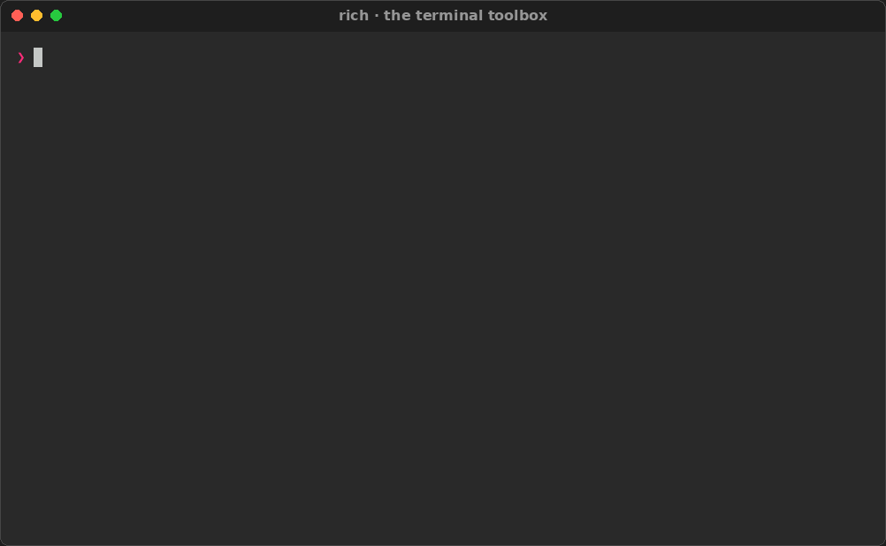

# rs-rich

{ .rs-hero }
{ .rs-hero }

<div class="project-badges" markdown="1">

[](https://github.com/buchochelliq-labs/rs-rich-cli/actions/workflows/ci.yml)
[](https://crates.io/crates/rs-rich)
[](https://docs.rs/rs-rich)
[](https://github.com/buchochelliq-labs/rs-rich-cli#develop)
[](https://github.com/buchochelliq-labs/rs-rich-cli/blob/main/LICENSE)
[](https://github.com/buchochelliq-labs/rs-rich-cli)

</div>

Python's [`rich`](https://github.com/Textualize/rich), ported to Rust and
held to it byte for byte: rich text, colour, tables, Markdown and progress
bars in the terminal, with the [`rich-cli`](https://github.com/Textualize/rich-cli)
tool. On top of it: charts and diagrams, pickers and forms, intuiTUIve (a
reactive framework for terminal apps), a terminal recorder, and images in
the terminal.



**[Play the terminal recordings](recordings.md)** · [Browse the gallery](gallery.md) ·
[Start with the CLI](cli.md) · [Learn the library](tutorial/index.md) · [Read the full guide](guide/index.md)

```bash
cargo install rs-rich-cli
rich --print '[bold magenta]Hello[/] [green]World[/]'
```

For Rust applications: `cargo add rs-rich`. Read [Getting started](getting-started.md)
for a complete library example.

<div class="rs-subsite" markdown>

{ .rs-mark width="64" }

<div markdown>

**[intuiTUIve](guide/intuituive/index.md): full terminal apps, built on rs-rich.**
Describe the screen once as a tree of nodes and keep your state in
signals; when a signal changes, only the cells that changed are redrawn.
It has a section of its own on this site, with a tutorial, a page per
topic and a widget index.

</div>

</div>

## New in 0.0.21

{ .tui-mascot width="128" }
0.0.21, published on 2026-10-21 ([release notes](releases/0.0.21.md)),
fixes what the demo loop's seventh round found and adds what the clones and
a consumer asked for.

- **Widgets:** [form controls](guide/intuituive/controls.md) (buttons,
  check boxes, switches, radios, sliders, select fields), a log pane fed by
  `tracing`, [text editing](guide/intuituive/text-editing.md) with Emacs
  and Vim keys, effect presets, pie and stacked [charts](guide/ext/charts.md),
  QR codes, Huh-style forms and `rich spin`.
- **Diagrams:** Mermaid sequence and ER diagrams drawn as text.
- **Leaner builds:** `Syntax` and `Markdown` without syntect (core's `code`
  feature), a SQL highlighter with no syntect, and
  [Markdown for GitHub](guide/ext/markdown-export.md) from any renderable.
- **A [playground](playground.md):** **Try it** on guide blocks, `rich` on
  WASI for CLI examples, and whole apps in the page.
- **Fixes:** round 7's four intuiTUIve bugs, csv's million-row filter fast
  again, and no DevTools port on Linux and macOS.

Earlier releases are under [Releases](releases/0.0.21.md) in the
navigation; the [roadmap](ROADMAP.md) says what comes next.

### Which version are these docs for?

The version menu in the header picks the docs of a release. A release is
named by `rs-rich-cli`'s version, and its docs match the crates of that
release: the other crates' versions are in that release's
[version table](#versions-in-this-checkout). A release's docs keep the fixes
made to them after it shipped, until main moves on to the next release's
crates. **dev (main)** documents what
is on `main` and not released yet. The site's root and `/latest/` show the
newest release, and every other version says so in a banner with a link to
it. The site keeps the newest releases that fit GitHub Pages' 1 GB, up to
six; older releases' docs stay in the repository, under `docs/` at their
`rs-rich-cli-vX.Y.Z` tags.

## What it does

<div class="grid cards" markdown>

- **Console markup**

    `[bold red]text[/]` — nested tags, themes, emoji shortcodes, and automatic
    highlighting of numbers, paths, URLs and booleans.

- **Layout**

    Tables, panels, trees, columns, rules, alignment and padding, all of which
    measure and wrap correctly against terminal cell widths.

- **Documents**

    Markdown, JSON and syntax-highlighted source, rendered to the terminal.

- **Live output**

    Progress bars, spinners and status displays that refresh in place.

- **The `rich` command**

    Render files from the shell, plus tools: `inspect` structured data, `diff`
    text and patches, `view`, `hex`, `unicode`, `env`, `capture` and `doctor`;
    `chart`, `dot`, `mermaid`, `deps` and `schema` to draw data and structure;
    `choose`, `input`, `pager` and `explore` for scripts.
    See the [CLI guide](guide/cli/walkthrough.md).

- **Charts**

    Sparklines, bars, histograms, Braille line and scatter charts, gauges,
    heatmaps, status matrices, KPI cards and timelines, each with an ASCII
    form and a reading that does not depend on colour. See
    [Charts](guide/ext/charts.md).

- **Diagrams**

    Graphs drawn with box-drawing characters through one layered layout, from
    code, Mermaid flowcharts or DOT (Graphviz) sources; Cargo dependency
    graphs and JSON Schemas. See [Diagrams](guide/diagram/index.md) and
    [Dependency graphs and JSON Schemas](guide/ext/sources.md).

- **Interactive components**

    Fuzzy pickers, input, forms, pagers and explorers, composable into your
    own views. See [Interactive](guide/interact/index.md).

- **Terminal apps**

    intuiTUIve: signals, a retained tree, layout, focus, tables, trees,
    a command line, sprites and pixel buffers, tested headless and served
    to a browser. See [Terminal apps](guide/intuituive/index.md).

- **Terminal recordings**

    `rich record` runs a tape in a real terminal and writes screenshots,
    a cast, a GIF, an animated PNG and an MP4, images and held keys
    included. See [Terminal recordings](recordings.md).

- **Micro assets**

    Emoji-sized inline images written `:micro:name:`, drawn with Kitty,
    iTerm2 or Sixel graphics, with a text fallback everywhere else. See
    [Micro assets](guide/micro/index.md).

- **Python**

    `rs_rich`, Rich's API over the Rust core, with the port's extensions,
    charts and diagrams. See the
    [Python documentation](https://buchochelliq-labs.github.io/rs-rich-cli/python/).

- **Rust ergonomics**

    Diagnostics and stack traces, checked-markup macros, `clap` help, `tracing`
    and `log` handlers, and serde-driven structured data, in `rs-rich-ext`.

- **Workflow renderables**

    Command steps, task trees, transfers, countdowns, badges, size bars and
    formatters for build and deploy tools. See [Workflows](guide/ext/workflows.md).

- **Art**

    FIGlet banners, images and GIFs as ASCII, Braille, blocks, quadrants or
    Sixel, with dithering and alpha backgrounds. See [Art](guide/art/index.md).

- **Accessibility and capabilities**

    Detect what the terminal supports, degrade to a fidelity level, render
    decoration-free text for screen readers and check theme contrast. See
    [Capabilities](guide/ext/capabilities.md) and
    [Accessibility](guide/ext/accessibility.md).

</div>

## Byte-parity with Python rich

Golden fixtures compare covered output against Python `rich` 15.0.0 in CI.
Coverage and known differences are documented in [Module status](PORTING.md)
and [Divergences](DIVERGENCES.md); not every implemented feature is byte-identical.

That promise is why the honest bits matter:

!!! warning "Early releases with independent crate versions"

    The API takes breaking changes regularly, and the port is deliberately
    incomplete. What is implemented is parity-tested; what isn't is listed
    plainly in [Module status](PORTING.md), and what deliberately differs is in
    [Divergences](DIVERGENCES.md) — most notably syntax highlighting, which uses
    `syntect` rather than Pygments and is therefore *not* byte-identical.

## Released crates

The badges below show the versions currently available on crates.io. The
packages carry an `rs-` prefix because `rich` was taken on crates.io; the
library targets keep the short names, so you write `use rich::Console`.

| crate | version | docs | what it is |
|---|---|---|---|
| [`rs-rich`](https://crates.io/crates/rs-rich) | [](https://crates.io/crates/rs-rich) | [docs.rs](https://docs.rs/rs-rich) | the library — `use rich::…` |
| [`rs-rich-cli`](https://crates.io/crates/rs-rich-cli) | [](https://crates.io/crates/rs-rich-cli) | — | the `rich` command |
| [`rs-rich-ext`](https://crates.io/crates/rs-rich-ext) | [](https://crates.io/crates/rs-rich-ext) | [docs.rs](https://docs.rs/rs-rich-ext) | extensions + plugin registry |
| [`rs-rich-macros`](https://crates.io/crates/rs-rich-macros) | [](https://crates.io/crates/rs-rich-macros) | [docs.rs](https://docs.rs/rs-rich-macros) | checked markup and derive macros, used through `rs-rich-ext` |
| [`rs-rich-art`](https://crates.io/crates/rs-rich-art) | [](https://crates.io/crates/rs-rich-art) | [docs.rs](https://docs.rs/rs-rich-art) | FIGlet text, image→ASCII, GIFs |
| [`rs-rich-plugin-api`](https://crates.io/crates/rs-rich-plugin-api) | [](https://crates.io/crates/rs-rich-plugin-api) | [docs.rs](https://docs.rs/rs-rich-plugin-api) | the plugin contract |
| [`rs-rich-mermaid`](https://crates.io/crates/rs-rich-mermaid) | [](https://crates.io/crates/rs-rich-mermaid) | [docs.rs](https://docs.rs/rs-rich-mermaid) | Mermaid flowcharts as text |
| [`rs-rich-lumis`](https://crates.io/crates/rs-rich-lumis) | [](https://crates.io/crates/rs-rich-lumis) | [docs.rs](https://docs.rs/rs-rich-lumis) | the lumis (tree-sitter) highlighter |
| [`rs-rich-record`](https://crates.io/crates/rs-rich-record) | [](https://crates.io/crates/rs-rich-record) | [docs.rs](https://docs.rs/rs-rich-record) | scripted terminal recordings |
| [`rs-rich-interact`](https://crates.io/crates/rs-rich-interact) | [](https://crates.io/crates/rs-rich-interact) | [docs.rs](https://docs.rs/rs-rich-interact) | interactive components |
| [`rs-rich-micro`](https://crates.io/crates/rs-rich-micro) | [](https://crates.io/crates/rs-rich-micro) | [docs.rs](https://docs.rs/rs-rich-micro) | micro assets |
| [`rs-rich-diagram`](https://crates.io/crates/rs-rich-diagram) | [](https://crates.io/crates/rs-rich-diagram) | [docs.rs](https://docs.rs/rs-rich-diagram) | graph diagrams and DOT (new in 0.0.15; published with the cohort) |
| [`rs-rich-data`](https://crates.io/crates/rs-rich-data) | [](https://crates.io/crates/rs-rich-data) | [docs.rs](https://docs.rs/rs-rich-data) | tabular data: row sources, inference and statistics (new in 0.0.16) |
| [`rs-rich-ratatui`](https://crates.io/crates/rs-rich-ratatui) | [](https://crates.io/crates/rs-rich-ratatui) | [docs.rs](https://docs.rs/rs-rich-ratatui) | ratatui interop: rich renderables as ratatui widgets (new in 0.0.17) |
| [`rs-rich-intuituive`](https://crates.io/crates/rs-rich-intuituive) | [](https://crates.io/crates/rs-rich-intuituive) | [docs.rs](https://docs.rs/rs-rich-intuituive) | intuiTUIve: a reactive, retained TUI framework (new in 0.0.17) |
| [`rs-rich-web`](https://crates.io/crates/rs-rich-web) | [](https://crates.io/crates/rs-rich-web) | [docs.rs](https://docs.rs/rs-rich-web) | serving intuiTUIve apps and terminal programs to a browser (new in 0.0.18) |
| [`rs-rich-embed`](https://crates.io/crates/rs-rich-embed) | [](https://crates.io/crates/rs-rich-embed) | [docs.rs](https://docs.rs/rs-rich-embed) | a terminal pane and a web view for intuiTUIve apps (new in 0.0.18) |

<a id="versions-prepared-in-this-checkout"></a>
<a id="versions-in-this-checkout"></a>

### Versions these docs describe

The crates' versions in the source these docs were built from: a release's
docs list that release's crates, and dev (main)'s the versions on `main`,
published or not. Each crate versions independently; see
[Branching and releases](BRANCHING.md).

<!-- BEGIN MANIFEST VERSIONS -->
| Package | Manifest version |
|---|---|
| [`rs-rich`](https://crates.io/crates/rs-rich) | `0.0.12` |
| [`rs-rich-plugin-api`](https://crates.io/crates/rs-rich-plugin-api) | `0.0.6` |
| [`rs-rich-macros`](https://crates.io/crates/rs-rich-macros) | `0.0.6` |
| [`rs-rich-ext`](https://crates.io/crates/rs-rich-ext) | `0.0.19` |
| [`rs-rich-cli`](https://crates.io/crates/rs-rich-cli) | `0.0.22` |
| [`rs-rich-art`](https://crates.io/crates/rs-rich-art) | `0.0.15` |
| [`rs-rich-mermaid`](https://crates.io/crates/rs-rich-mermaid) | `0.0.8` |
| [`rs-rich-lumis`](https://crates.io/crates/rs-rich-lumis) | `0.0.6` |
| [`rs-rich-record`](https://crates.io/crates/rs-rich-record) | `0.0.10` |
| [`rs-rich-interact`](https://crates.io/crates/rs-rich-interact) | `0.0.10` |
| [`rs-rich-micro`](https://crates.io/crates/rs-rich-micro) | `0.0.8` |
| [`rs-rich-diagram`](https://crates.io/crates/rs-rich-diagram) | `0.0.5` |
| [`rs-rich-data`](https://crates.io/crates/rs-rich-data) | `0.0.6` |
| [`rs-rich-ratatui`](https://crates.io/crates/rs-rich-ratatui) | `0.0.7` |
| [`rs-rich-intuituive`](https://crates.io/crates/rs-rich-intuituive) | `0.0.7` |
| [`rs-rich-web`](https://crates.io/crates/rs-rich-web) | `0.0.5` |
| [`rs-rich-embed`](https://crates.io/crates/rs-rich-embed) | `0.0.5` |
| [`rs-rich-marketplace`](https://crates.io/crates/rs-rich-marketplace) | `0.0.1` |
| [`noctiluca`](https://crates.io/crates/noctiluca) | `0.0.1` |
<!-- END MANIFEST VERSIONS -->

## Where next

| Section | What it is |
|---|---|
| { .rs-icon width="20" } [Getting started](getting-started.md) | Install, check it worked, and a first program |
| { .rs-icon width="20" } [Tutorial](tutorial/index.md) | From a line of text to a live progress display |
| { .rs-icon width="20" } [Guide](guide/index.md) | Every crate, with examples CI compiles |
| { .rs-mark width="20" } [intuiTUIve](guide/intuituive/index.md) | The framework for full terminal apps, built on rs-rich |
| { .rs-mark width="20" } [Noctiluca](guide/noctiluca.md) | A web browser for the terminal, built on intuiTUIve |
| { .rs-icon width="20" } [Gallery](gallery.md) | What each renderable looks like |
| { .rs-icon width="20" } [Terminal recordings](recordings.md) | Tapes of the CLI and the apps, played in the page |
| { .rs-icon width="20" } [CLI and art videos](demos.md) | The CLI and the art crate, on video |
| { .rs-icon width="20" } [Using the CLI](cli.md) | The `rich` command, task by task |
| { .rs-icon width="20" } [CLI reference](cli-reference.md) | Every command and flag |
| { .rs-icon width="20" } [Python](https://buchochelliq-labs.github.io/rs-rich-cli/python/) | `rs_rich`, Rich's API over the Rust core |
| { .rs-icon width="20" } [Workflow recipes](recipes.md) | The CLI in scripts and CI |
| { .rs-icon width="20" } [Comparing images](image-diff.md) | Perceptual image diffs |
| { .rs-icon width="20" } [Troubleshooting](troubleshooting.md) | When the output is not what you expected |
| { .rs-icon width="20" } [Known issues](known-issues.md) | What is known not to work yet |
| { .rs-icon width="20" } [Development plans](plans/1.0.0.md) | What each release sets out to do |
| { .rs-icon width="20" } [Releases](releases/0.0.21.md) | What each release shipped |
| { .rs-icon width="20" } [Parity with Python rich](parity.md) | What matches upstream, and how it is proven |
| { .rs-icon width="20" } [Contributing](BRANCHING.md) | Branches, architecture and design notes |
