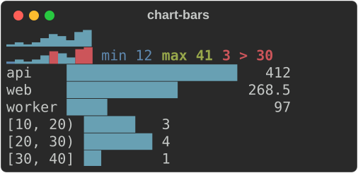
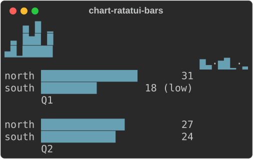
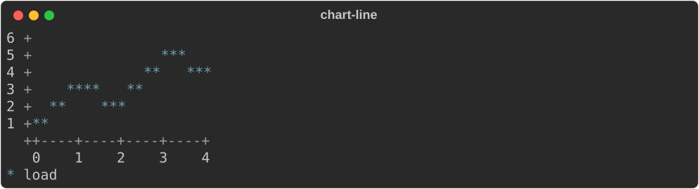
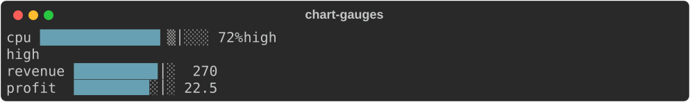
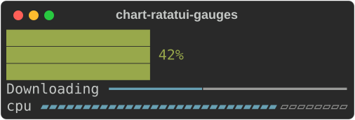
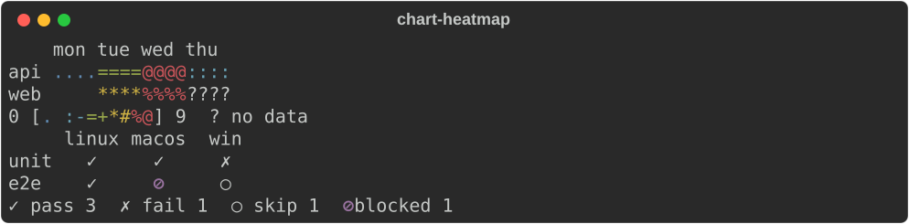
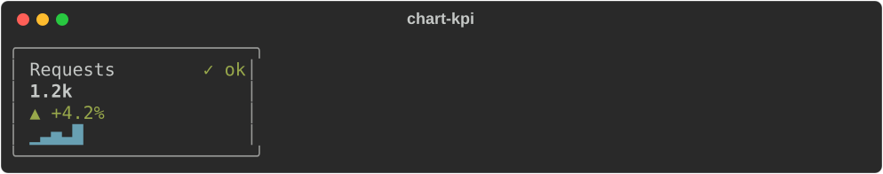
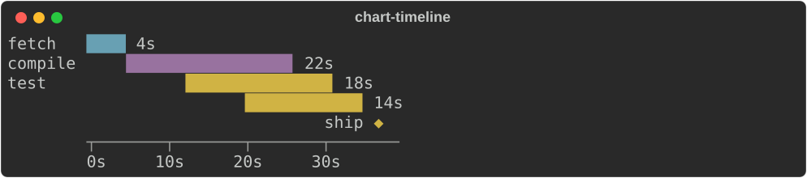
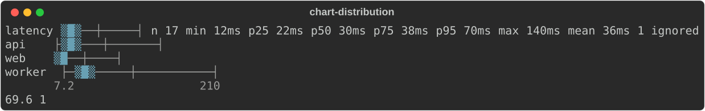
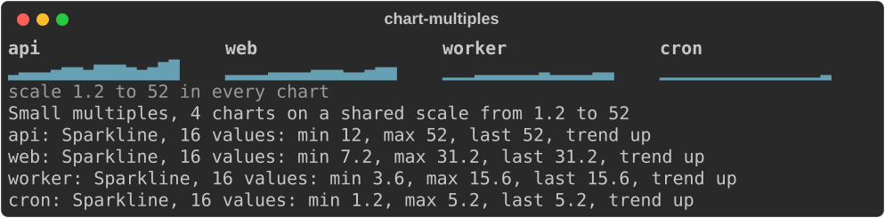

# Charts

```python
from rs_rich import chart
```

`rs_rich.chart` is `rich_ext::chart` from Python: charts drawn with text.
Rich has no counterpart. Every chart is a renderable, so it prints, sits in a
`Table` cell or a `Panel`, and updates in a `Live` display. None writes a line
wider than the width it gets: at small widths it drops labels, values and
axes before it drops data. None needs colour to be read: lengths and heights
carry the values, numbers are written out, and series have their own
markers.

| Class | Draws |
|---|---|
| `Sparkline` | one cell per value (two in Braille), on one row or several |
| `BarChart`, `ChartBar`, `BarGroup` | a label, a bar and a value per row, or columns side by side; bars in labelled groups |
| `Histogram` | raw values counted into bins, drawn as bars |
| `LineChart`, `Series` | one or more series as lines or points, with axes and a legend |
| `Gauge`, `Band`, `BulletChart` | a value against a range, with a target and threshold bands; several aligned |
| `FillGauge`, `LineGauge` | ratatui's two gauges: a bar that fills its area, and a label with a line |
| `Heatmap` | a labelled grid of values as shades, with a legend |
| `StatusMatrix`, `ChartState` | rows and columns of states (pass, fail, skip, flaky, your own) |
| `KpiCard` | a label, a value, a delta, a sparkline and a status |
| `Timeline`, `TimelineSpan` | labelled ranges on a scale, overlaps stacked, milestones |
| `Distribution`, `DistributionSet` | the count, quantiles and mean of values, with a box-and-whisker strip; several on one scale |
| `SmallMultiples` | a grid of titled sparklines, bar charts or line charts on one value scale |

Every chart also says what it shows in words: `describe(chart)` gives its
accessible text ([below](#accessible-text)).

Settings are keyword arguments. Three are shared:

- `charset`: `"auto"` (the chart's natural glyphs: blocks, or Braille for
  line charts), `"blocks"`, `"braille"` or `"ascii"`. A console that is not
  UTF-8 always gets ASCII.
- `format`: how values are written: `"compact"` (`1.2k`, `3.4M`; the
  default) or a number of decimals from 0 to 17 (another number raises
  `ValueError`). `chart_format(value, format)` writes one.
- `None` in a list of values is a gap: it is skipped, never drawn as zero.
- Arguments that take several items (`gauges`, `bands`, `columns`,
  `states`, `milestones`, a matrix row's state names) take any iterable,
  such as a list, a tuple or a generator, but not a string.

`ChartBar`, `ChartState` and `TimelineSpan` are also exported as `Bar`,
`State` and `Span`, their Rust names. Styles come from the theme keys in
`chart.STYLES` (`chart.bar`, `chart.series.1`, ...).

From the shell, `rich chart` draws the same charts from CSV, JSON or stdin
([`rich chart`](https://buchochelliq-labs.github.io/rs-rich-cli/guide/ext/charts/#from-the-shell-rich-chart)).
The [Rust charts guide](https://buchochelliq-labs.github.io/rs-rich-cli/guide/ext/charts/)
has a screenshot of each chart.

## Sparklines, bars and histograms

```text
Sparkline(values, *, range=None, min=None, max=None, charset="auto", style=None,
          min_max=False, threshold=None, format=None, rows=None,
          direction="left_to_right", absent=None, styles=None, levels="nine")
ChartBar(label, value, *, style=None, text=None, value_style=None, label_style=None)
BarGroup(label, bars=None)
BarChart(bars=None, *, groups=None, range=None, max=None, charset="auto",
         orientation="horizontal", bar_width=None, show_values=True, format=None,
         style=None, thickness=None, bar_gap=None, group_gap=None, label_style=None,
         value_style=None, values_inside=False)
Histogram(values, *, bins=None, range=None, charset="auto", orientation="horizontal",
          bar_width=None, show_values=True, style=None)
```

`bars` is `(label, value)` pairs, a `{label: value}` mapping, or `ChartBar`s
(`ChartBar(label, value, *, style=None)`, to style one bar). `min_max` names
a sparkline's extremes after it, and `threshold` counts the values above
it. `Histogram.counts()` and `Histogram.edges()` give the bins.

```python
from rs_rich.console import Console
from rs_rich import chart

console = Console(width=40)
console.print(chart.Sparkline([12, 15, 14, 18, 25, 31, 28, 22, 35, 41]))
console.print(chart.Sparkline([12, 15, 14, 18, 25, 31, 28, 22, 35, 41], min_max=True, threshold=30))
console.print(chart.BarChart({"api": 412, "web": 268.5, "worker": 97}, bar_width=20))
console.print(chart.Histogram([12, 14, 15, 21, 22, 23, 24, 38], bins=3, range=(10, 40), bar_width=8))
```



### Taller sparklines and grouped bars

These options follow ratatui's `Sparkline` and `BarChart`.

- `rows` stacks a sparkline over that many rows. Without it, a sparkline
  fills the height it is given (a `Layout` region, say), or one row.
- `direction="right_to_left"` puts the newest value on the left.
- `absent` draws the gaps (`None`): a symbol, or a `(symbol, style)` pair.
- `styles` styles each value; `None` in it keeps the sparkline's style.
- `levels="three"` draws empty, half and full cells only.
- `groups` takes `BarGroup`s, each a label over its bars; `bars` and
  `groups` can be given together, the plain bars first.
- `thickness` is how many cells across a bar is, `bar_gap` the cells
  between bars and `group_gap` the cells between groups.
- A bar's `text` is written in place of its value. `value_style` and
  `label_style` style the values and labels, on a bar or on the whole
  chart; a bar's own wins.
- `values_inside=True` writes each value on its bar, as ratatui does.

```python
console.print(chart.Sparkline([3, 5, 2, 8, 6, 9, 4, 7], rows=3))
console.print(chart.Sparkline([3, None, 2, 8, 6, None, 4, 7], direction="right_to_left", absent="·"))
console.print(chart.BarChart(groups=[
    chart.BarGroup("Q1", [("north", 31), chart.ChartBar("south", 18, text="18 (low)")]),
    chart.BarGroup("Q2", [("north", 27), ("south", 24)]),
], bar_width=16))
```



## Line and scatter charts

```text
Series(name, points, *, kind="line", style=None, marker=None)
LineChart(series=None, *, height=None, width=None, x_range=None, y_range=None,
          charset="auto", legend=True, x_format=None, y_format=None)
```

`points` is `(x, y)` pairs (tuples, lists or any other sequence of two), or
plain numbers at x = 0, 1, 2, ... `kind` is
`"line"` or `"scatter"`. In Braille each cell holds 2×4 points; in ASCII the
chart plots with markers at cell resolution.

```python
load = chart.Series("load", [1, 3, 2, 5, 4])
console.print(chart.LineChart([load], height=6, charset="ascii"), width=24)
```



## Gauges and bullet charts

```text
Band(upto, label, *, style=None)
Gauge(label, value, *, range=None, target=None, bands=None, charset="auto",
      bar_width=None, full_width=False, format=None, unit=None, style=None)
BulletChart(gauges=None, *, bar_width=None, full_width=False, charset="auto")
```

A band covers the values up to `upto`; the gauge names the one its value is
in (`Gauge.band`).

```python
bands = [chart.Band(60, "ok"), chart.Band(85, "high"), chart.Band(100, "critical")]
cpu = chart.Gauge("cpu", 72, range=(0, 100), target=80, bands=bands, unit="%", bar_width=20)
console.print(cpu)
print(cpu.band)
console.print(chart.BulletChart([
    chart.Gauge("revenue", 270, range=(0, 300), target=250),
    chart.Gauge("profit", 22.5, range=(0, 30), target=26),
], bar_width=12))
```



### Fill and line gauges

```text
FillGauge(ratio, *, label=None, label_style=None, style=None, unicode=False,
          width=None, height=None)
LineGauge(ratio, *, label=None, label_style=None, filled_style=None,
          unfilled_style=None, line="thin", symbols=None, width=None)
```

These are ratatui's `Gauge` and `LineGauge`. The ratio is clamped to 0 to 1
(`NaN` raises `ValueError`). A `FillGauge` fills whole cells, or eighths of
one with `unicode=True`. Its label (the percentage by default) sits on the
middle row, and its colours swap where the bar runs under it. Without a
`height`, it fills the height it is given, or one row. A `LineGauge` draws
its label, then a line: `"thin"`, `"thick"` or `"double"`, or `symbols`, a
`(filled, unfilled)` pair of one-character strings.

```python
console.print(chart.FillGauge(0.42, height=3, style="green"))
console.print(chart.LineGauge(0.42, label="Downloading", line="thick", filled_style="cyan"))
console.print(chart.LineGauge(0.8, label="cpu", symbols=("▰", "▱")))
```



## Heatmaps and status matrices

```text
Heatmap(rows=None, *, columns=None, range=None, charset="auto", cell_width=None,
        legend=True, format=None)
ChartState(name, symbol, ascii, style)
StatusMatrix(rows=None, *, columns=None, states=None, legend=True, charset="auto")
```

Rows are `(label, values)` pairs or a `{label: values}` mapping. A matrix's
values are state names: `pass`, `fail`, `skip`, `flaky`, or a `ChartState`
you add with `states=`. `StatusMatrix.counts()` counts each state.

```python
console.print(chart.Heatmap(
    {"api": [1, 4, 9, 2], "web": [0, 6, 8, None]},
    columns=["mon", "tue", "wed", "thu"],
    cell_width=4,
    charset="ascii",
))
blocked = chart.ChartState("blocked", "⊘", "#", "bold magenta")
console.print(chart.StatusMatrix(
    {"unit": ["pass", "pass", "fail"], "e2e": ["pass", "blocked", "skip"]},
    columns=["linux", "macos", "win"],
    states=[blocked],
))
```



## KPI cards

```text
KpiCard(label, value, *, format=None, unit=None, delta=None, delta_percent=None,
        previous=None, caption=None, higher_is_better=True, trend=None, status=None,
        width=None, expand=False, border=True, charset="auto")
```

Give at most one of `delta`, `delta_percent` and `previous` (the delta is
then worked out). `trend` is the card's sparkline; `status` is `"ok"`,
`"warning"`, `"critical"` or `"unknown"`, drawn as a symbol and a word.

```python
console.print(chart.KpiCard("Requests", 1234, delta_percent=4.2, trend=[1, 2, 3, 2, 5], status="ok", width=24))
```



## Timelines

```text
TimelineSpan(row, start, end, *, style=None)
Timeline(spans=None, *, milestones=None, range=None, charset="auto", format=None,
         unit=None, compress=True, durations=True, width=None)
```

Spans are `TimelineSpan`s or `(row, start, end)` triples; spans on one row
that overlap stack. Milestones are `(label, at)` pairs. `None` as a start,
an end or a milestone's `at` is a gap, as in a list of values: the span's
row is kept, but nothing is drawn for it.

```python
console.print(chart.Timeline(
    [("fetch", 0, 4), ("compile", 4, 26), ("test", 12, 30), ("test", 20, 34)],
    milestones=[("ship", 36)],
    unit="s",
    width=40,
))
```



## Distributions

```text
Distribution(values, *, label=None, range=None, strip_width=None, format=None,
             unit=None, charset="auto", style=None, numbers=True)
DistributionSet(distributions=None, *, range=None, strip_width=None, numbers=True,
                charset="auto", shared_scale=True)
quantile(values, q) -> float | None
summary(values) -> dict
```

A `Distribution` is a box-and-whisker strip on one line (`├` and `┤` at
the smallest and largest value, a shaded box from the first quartile to the
third, the median `█`, the 95th percentile a `┼`), then the count, `min`,
`p25`, `p50`, `p75`, `p95`, `max` and `mean`. `None`, NaN and infinities are
left out and counted (`1 ignored`). Quantiles are interpolated linearly,
numpy's default, so `quantile(values, q)` matches `numpy.quantile`.
`summary` (and a distribution's `.summary`) is a dict of the numbers, with
`None` for each when there are no values.

A `DistributionSet` stacks distributions on one scale: `Distribution`s,
`(label, values)` pairs, or a dict of label to values. `shared_scale=False`
gives each row its own.

```python
latency = [12, 15, 14, 18, 25, 31, 28, 22, 35, 41, 38, 30, 26, 33, 47, 52, 140, None]
console.print(chart.Distribution(latency, label="latency", unit="ms", format=0))
console.print(chart.DistributionSet(
    {"api": latency, "web": [v * 0.6 for v in latency[:-1]], "worker": [v * 1.5 for v in latency[:-1]]},
    strip_width=24,
    numbers=False,
))
print(round(chart.quantile(latency, 0.95), 2), chart.summary(latency)["ignored"])
```



## Small multiples

```text
SmallMultiples(items, *, columns=None, min_cell_width=24, gap=2, shared_scale=True,
               range=None, height=None, note=True, charset="auto")
```

`items` are `(title, chart)` pairs or a dict of title to chart, each a
`Sparkline`, `BarChart` or `LineChart`. The grid has `columns` columns, or as
many cells of at least `min_cell_width` as fit the width (one at 40 cells,
three at 80, four at 120). Every chart is put on one value scale, the range
of them all (or `range`), so a taller bar is a larger value in any chart;
`shared_scale=False` leaves each its own. A note under the grid says the
scale and holds the line charts' one legend. `columns_at(width)` and
`scale` say how it is laid out.

```python
requests = [12, 15, 14, 18, 25, 31, 28, 22, 35, 41, 38, 30, 26, 33, 47, 52]
services = {"api": 1.0, "web": 0.6, "worker": 0.3, "cron": 0.1}
grid = chart.SmallMultiples(
    {name: chart.Sparkline([v * share for v in requests]) for name, share in services.items()},
    min_cell_width=18,
)
console.print(grid)
print(chart.describe(grid))
```



## Accessible text

```text
describe(chart, width=80) -> str
```

`describe` gives what a chart says to a screen reader: a few lines of plain
words, no glyphs. The first line says what it is, how much it holds and the
ranges of its axes (`Line chart, 2 series, x from 0 to 23, y from 12 to
52`); the next lines its key values: a series' `min`, `max`, `last` and
trend, the largest bars, a gauge's place on its scale (`Gauge cpu: 72%, 72
percent of 0% to 100%, band high, target 80%`). A trend is the
least-squares line through the values: `up` or `down` when it rises or
falls by a tenth of their range or more, else `flat`.
`rs_rich.ext.a11y.accessible_text(chart)` gives the same. The
[Rust guide](https://buchochelliq-labs.github.io/rs-rich-cli/guide/ext/charts/#accessible-text)
lists what each chart says.
