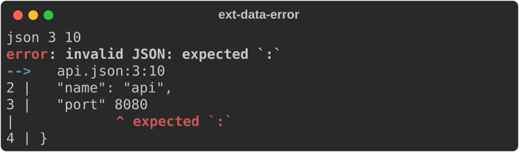
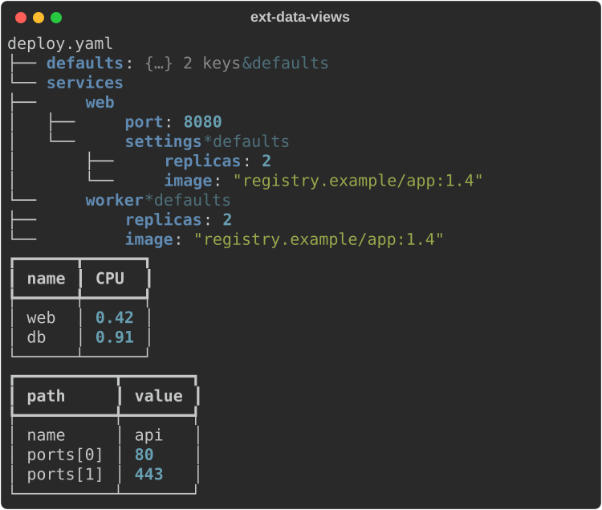
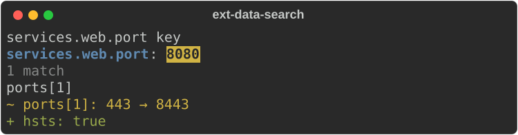
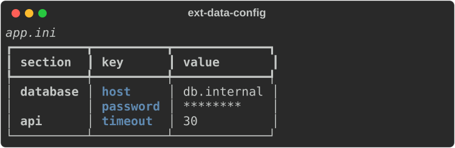
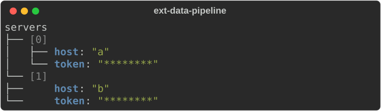

# Structured data

Module: `rs_rich.ext.data` (Rust: `rich_ext::data`). It parses JSON, YAML,
TOML, XML, INI and dotenv into one tree, `DataNode`, and renders that tree as
an explorer, a table, flat paths, search results or a diff.

## Parsing

`parse_data(text, format=None, name=None)` (also `data.parse`) detects the
format when you do not give one; `name` is used for error messages and as a
format hint (`Cargo.toml`). `DataNode.from_python` converts Python values,
dataclasses included, and `to_python`/`to_json` convert back.

```python
from rs_rich.console import Console
from rs_rich.ext import data

console = Console(width=60)
deploy = data.parse("""\
defaults: &defaults
  replicas: 2
  image: registry.example/app:1.4
services:
  web:
    port: 8080
    settings: *defaults
  worker: *defaults
""", "yaml")
print(deploy.keys(), deploy.at("services.web.port").value, deploy["services"].position)
print(data.detect_format('{"a": 1}'), data.parse('{"a": [1, true]}').to_python())
```

```text
['defaults', 'services'] 8080 (4, 1)
json {'a': [1, True]}
```

A parse error is a `DataError` that knows the format, line and column, and
carries a `Diagnostic` pointing at the problem:

```python
try:
    data.parse('{\n  "name": "api",\n  "port" 8080\n}\n', "json", name="api.json")
except data.DataError as error:
    print(error.format, error.line, error.column)
    console.print(error.diagnostic)
```



## Views

`Explorer` draws the tree (YAML anchors and aliases, XML attributes and TOML
dates are marked); `view="table"` shows a list of maps as a table.
`TableView` takes rows directly; `FlatView` lists every leaf by path.

```python
console.print(data.Explorer(deploy, root_label="deploy.yaml", fold=["defaults"]))
console.print(data.TableView(
    [{"name": "web", "cpu": 0.42}, {"name": "db", "cpu": 0.91}],
    headers={"cpu": "CPU"},
))
console.print(data.FlatView(data.parse('{"name": "api", "ports": [80, 443]}')))
```



## Search, select and diff

`search` matches paths (globs like `services.**`), keys and values;
`SearchResults` renders the matches in context. `select` takes a JSONPath
expression. `diff_data` (also `data.diff`) compares two trees, and
`DataDiffView` renders the changes.

```python
for hit in data.search(deploy, key="port"):
    print(hit.path, hit.matched_on)
console.print(data.SearchResults(deploy, path="services.**", value="8080"))

api = data.parse('{"name": "api", "ports": [80, 443], "tls": true}')
print(data.select(api, "$.ports[?(@ > 100)]")[0][0])
new = data.parse('{"name": "api", "ports": [80, 8443], "tls": true, "hsts": true}')
console.print(data.DataDiffView(api, new))
```



## Secrets and config files

`Redaction` says which keys to mask (`Redaction.secrets()` masks passwords,
tokens and keys); `ConfigFileView` shows an INI, dotenv or TOML file as a
table with those values masked.

```python
ini = data.parse(
    "; production\n[database]\nhost = db.internal\npassword = hunter2\n[api]\ntimeout = 30\n",
    "ini",
)
console.print(data.ConfigFileView(ini, title="app.ini", redaction=data.Redaction.secrets()))
```



## As transforms

`Document` wraps a tree for a `Pipeline` (see [Transforms](transforms.md)):
`Select`, `Filter`, `Highlight` and `Redact` are its stages.

```python
from rs_rich.ext.transform import Pipeline

doc = data.parse('{"servers": [{"host": "a", "token": "t1"}, {"host": "b", "token": "t2"}]}')
document = (
    Pipeline()
    .then("redact", data.Redact(data.Redaction.secrets()))
    .then("select", data.Select("$.servers"))
    .apply(data.Document(doc))
)
console.print(document)
```


