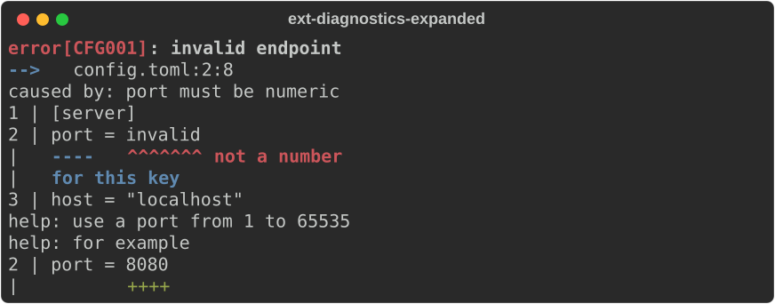
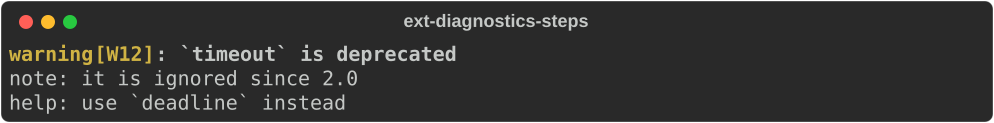
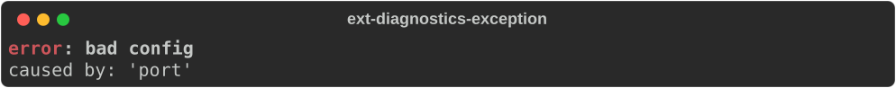
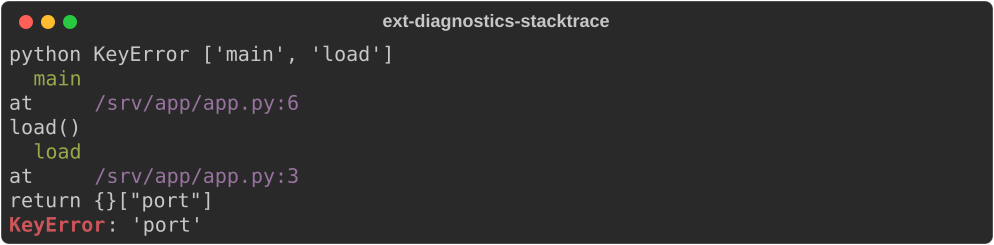
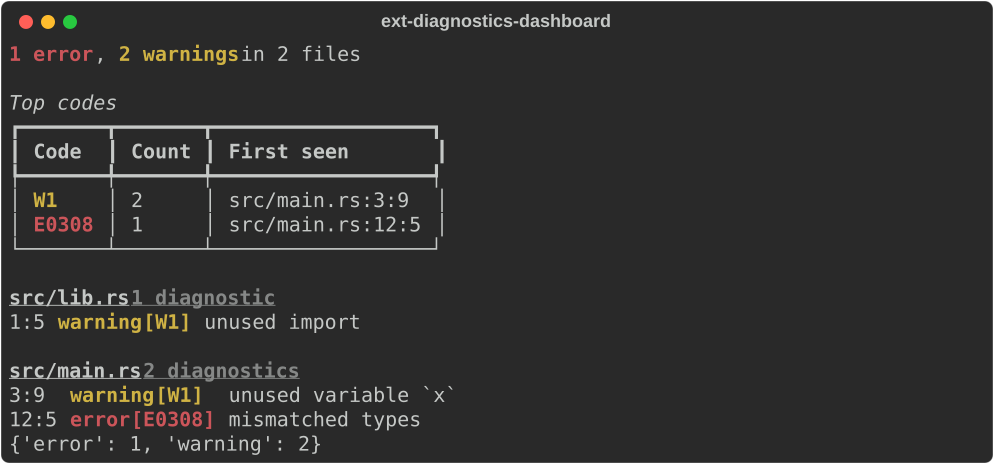
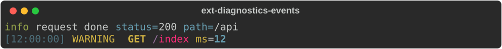

# Diagnostics and logs

Modules: `rs_rich.ext.diagnostic`, `stacktrace`, `dashboard`, `hyperlink`,
`highlighter`, `event`, `log_handler`. The Rust side is `rich_ext::diagnostic`
and friends.

## Diagnostic

A compiler-style report: a level, a message, an optional code, location,
causes, source snippets with labelled spans, notes, help and suggestions.
`view="compact"` (the default) prints the headline and causes;
`view="expanded"` adds snippets, notes and help.

```python
from rs_rich.console import Console
from rs_rich.ext.diagnostic import Diagnostic, SourceSnippet, Suggestion

console = Console(width=70)
CONFIG = '[server]\nport = invalid\nhost = "localhost"\n'
start = CONFIG.find("invalid")
snippet = SourceSnippet("config.toml", CONFIG, start, start + 7, label="not a number")
snippet.secondary(CONFIG.find("port"), CONFIG.find("port") + 4, "for this key")

console.print(Diagnostic.error(
    "invalid endpoint",
    code="CFG001",
    location=snippet.location,
    causes=["port must be numeric"],
    snippets=[snippet],
    help=["use a port from 1 to 65535"],
    suggestions=[Suggestion.replace("for example", CONFIG, start, start + 7, "8080")],
    view="expanded",
))
```



Span offsets are string indices (`str.find` works); a span that does not fit
the source raises `DiagnosticSpanError`. Levels are `"error"`, `"warning"`,
`"info"`, `"note"`, `"help"` or `None`.

The same diagnostic can be built step by step: the `add_cause`, `add_note`,
`add_help`, `add_snippet` and `add_suggestion` methods return the diagnostic,
and every keyword is also a settable attribute.

```python
diagnostic = Diagnostic.warning("`timeout` is deprecated", code="W12")
diagnostic.add_note("it is ignored since 2.0").add_help("use `deadline` instead")
diagnostic.view = "expanded"
console.print(diagnostic)
```



`Diagnostic.from_exception(error)` turns a Python exception and its
`__cause__`/`__context__` chain into a diagnostic:

```python
try:
    try:
        {}["port"]
    except KeyError as error:
        raise ValueError("bad config") from error
except ValueError as error:
    console.print(Diagnostic.from_exception(error))
```



## Stack traces

`stacktrace.parse` recognizes Python, Rust, Node, Java, Go and other trace
formats and returns a `StackTrace` (or `None`); `StackTrace.from_exception`
builds one from a live exception. Pass your own parsers, objects with
`detect(text)` and `parse(text)`, as `parsers=[...]`.

```python
from rs_rich.ext.stacktrace import parse

trace = parse('''Traceback (most recent call last):
  File "/srv/app/app.py", line 6, in main
    load()
  File "/srv/app/app.py", line 3, in load
    return {}["port"]
KeyError: 'port'
''')
print(trace.language, trace.kind, [frame.function for frame in trace.frames])
console.print(trace)
```



## Dashboard

`DiagnosticsDashboard` collects diagnostics and summarizes them by level,
code and file.

```python
from rs_rich.ext.dashboard import DiagnosticsDashboard
from rs_rich.ext.diagnostic import Location

dashboard = DiagnosticsDashboard(top_codes=3)
dashboard.push(Diagnostic.error("mismatched types", code="E0308", location=Location("src/main.rs", 12, 5)))
dashboard.push(Diagnostic.warning("unused variable `x`", code="W1", location=Location("src/main.rs", 3, 9)))
dashboard.push(Diagnostic.warning("unused import", code="W1", location=Location("src/lib.rs", 1, 5)))
console.print(dashboard)
print(dashboard.counts())
```



## Hyperlinks and highlighters

`Hyperlinker` finds file locations, URLs and issue references in text and
turns them into terminal hyperlinks. Calling it on a string returns a `Text`.
`NumberHighlighter` is a highlighter for numbers.

```python
from rs_rich.ext.hyperlink import Hyperlinker

linker = Hyperlinker(repository="https://github.com/octo/app")
for link in linker.find("see src/a.rs:3:4 and #12"):
    print(link.start, link.end, link.url.split("/")[-1])
```

```text
4 16 a.rs#3
21 24 12
```

## Structured events and the log handler

`StructuredEvent` is a message with fields; `EventHandler` renders events the
way `rs_rich.logging.RichHandler` renders log records, with fields and spans.

```python
from rs_rich.ext.event import StructuredEvent
from rs_rich.ext.log_handler import EventHandler

event = StructuredEvent("request done", fields={"status": 200, "path": "/api"}, severity="info")
console.print(event)
handler = EventHandler(time="[12:00:00]", show_path=False)
handler.emit(console, StructuredEvent("GET /index", severity="warning", fields={"ms": 12}))
```


