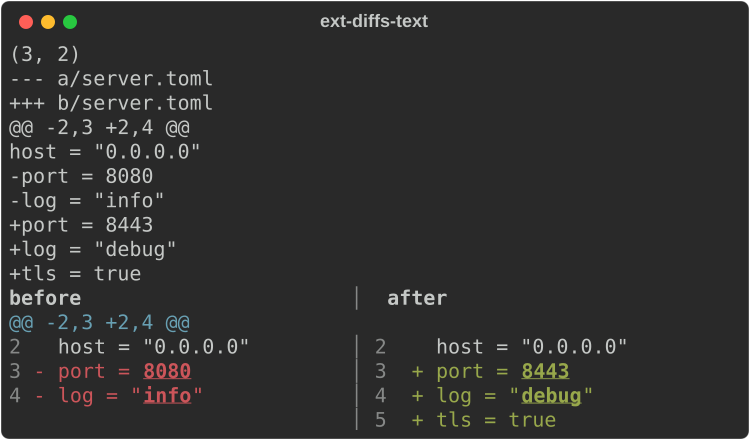
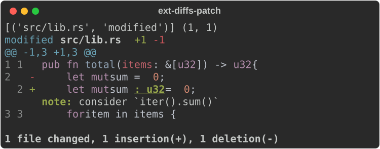
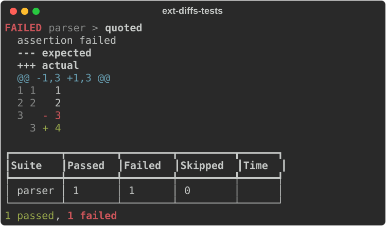

# Diffs and test reports

Module: `rs_rich.ext.diff` (Rust: `rich_ext::diff`): a diff engine, text and
source diff views, git patches, and test-run reports.

## The engine

`diff_lines`, `diff_words`, `diff_chars` and `diff_sequences` return
`(tag, (old_start, old_end), (new_start, new_end))` operations, tags being
`"equal"`, `"delete"`, `"insert"`. Ranges are indices into your lists or
strings. `group_hunks` groups them into hunks with context.

```python
from rs_rich.console import Console
from rs_rich.ext import diff

console = Console(width=60)
print(diff.diff_words("café au lait", "café noir"))
print([hunk.header for hunk in diff.group_hunks(diff.diff_lines(list("abcdefgh"), list("abcXefgh")), context=1)])
```

```text
[('equal', (0, 5), (0, 5)), ('delete', (5, 12), (5, 5)), ('insert', (12, 12), (5, 9))]
['@@ -3,3 +3,3 @@']
```

## Text diffs

`TextDiff` compares two texts line by line; `unified()` is the classic
`diff -u` text. `DiffView` renders it, unified or `layout="side_by_side"`,
with word-level highlights; `ansi=True` compares text that contains ANSI
styles and reports lines whose only change is their style.

```python
OLD = '[server]\nhost = "0.0.0.0"\nport = 8080\nlog = "info"\n'
NEW = '[server]\nhost = "0.0.0.0"\nport = 8443\nlog = "debug"\ntls = true\n'
text_diff = diff.TextDiff(OLD, NEW, context=1)
print(text_diff.stats())
print(text_diff.unified("a/server.toml", "b/server.toml"), end="")
console.print(diff.DiffView(OLD, NEW, layout="side_by_side", titles=("before", "after"), context=1))
```



`SourceDiff` is the same for code, syntax-highlighted, with an optional link
template for line numbers.

## Git patches

`parse_patch` reads `git diff` output into a `Patch` of `FilePatch`es;
`PatchView` renders it with a file tree, and can carry annotations (review
comments, lints) on lines.

```python
PATCH = """\
diff --git a/src/lib.rs b/src/lib.rs
--- a/src/lib.rs
+++ b/src/lib.rs
@@ -1,3 +1,3 @@
 pub fn total(items: &[u32]) -> u32 {
-    let mut sum = 0;
+    let mut sum: u32 = 0;
     for item in items {
"""
patch = diff.parse_patch(PATCH)
print([(f.path, f.status) for f in patch.files], patch.stats())
console.print(diff.PatchView(
    patch,
    tree=False,
    annotations=[diff.Annotation("src/lib.rs", 2, "consider `iter().sum()`", level="note")],
))
```



`KeepFiles(["*.md"])` is a transform stage that keeps matching files of a
patch; `TemplateLinks` makes file and line links from URL templates.

## Test reports

`TestRun.from_libtest` (cargo's JSON test output) and `TestRun.from_junit`
parse test results; `TestReport` renders a run, or JUnit XML text directly,
with the failures' expected and actual values diffed. Runs can also be built
from `TestSuite` and `TestCase`.

```python
run = diff.TestRun([diff.TestSuite("parser", [
    diff.TestCase("empty"),
    diff.TestCase("quoted", status="failed", message="assertion failed", expected="1\n2\n3", actual="1\n2\n4"),
])])
print(run.totals())
```

```text
{'errored': 0, 'failed': 1, 'passed': 1, 'skipped': 0, 'total': 2}
```

```python
console.print(diff.TestReport(run))
```


