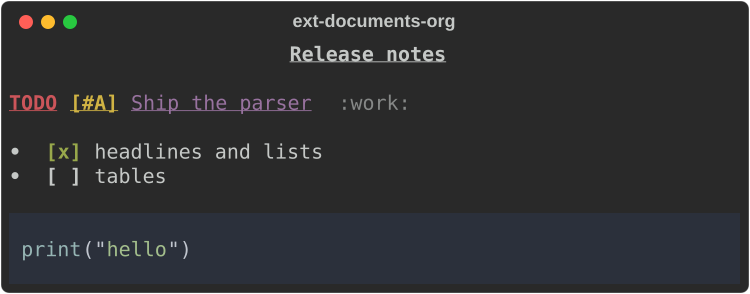
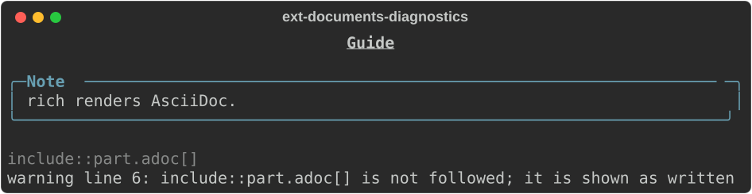
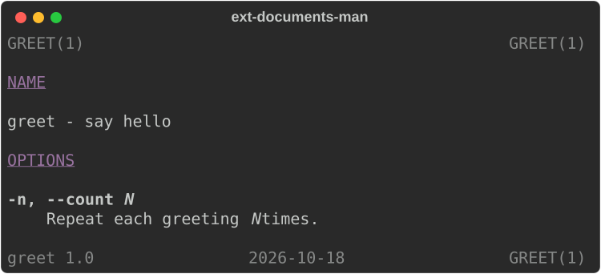
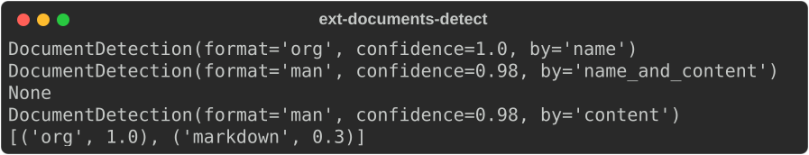

# Documents

Module: `rs_rich.ext.document` (Rust: `rich_ext::document`). Rich renders
Markdown only. This module adds Org, AsciiDoc and man pages, drawn in the
look of Rich's Markdown, beside Markdown and reStructuredText. It is what
`rich notes.org` uses. The [Rust guide](https://buchochelliq-labs.github.io/rs-rich-cli/guide/ext/documents/)
lists what each format draws, what it shows as text and what it leaves out.

## Render a document

```python
from rs_rich.console import Console
from rs_rich.ext import document

console = Console(width=60)
notes = """#+TITLE: Release notes
* TODO [#A] Ship the parser :work:
- [X] headlines and lists
- [ ] tables
#+BEGIN_SRC python
print("hello")
#+END_SRC
"""
console.print(document.render(notes, "org"))
```



`render` returns a `DocumentView`, and `DocumentView(...)` takes the same
arguments:

```text
render(source, format=None, *, path=None, hyperlinks=True,
       code_theme=None, default_language=None)
```

| Argument | Meaning |
|---|---|
| `source` | The document's text. |
| `format` | A format's id or alias: `"markdown"` (`"md"`), `"rst"`, `"org"`, `"asciidoc"` (`"adoc"`) or `"man"` (`"roff"`, `"mdoc"`). An unknown name is a `ValueError`. |
| `path` | With no `format`, the file name the format is detected from, with the content (see [Which format](#which-format)). |
| `hyperlinks` | `True` draws links as terminal hyperlinks; `False` writes the target after the text. |
| `code_theme` | The theme for code blocks, as for [`Markdown`](../markdown.md). |
| `default_language` | The language of code blocks that do not name one. |

With no `format`, the document is detected at `LIKELY`; when neither the
path nor the content tells, `render` raises a `ValueError`.

## Diagnostics

What a parser cannot show as written is reported, not dropped in silence.
`view.diagnostics` lists `DocumentDiagnostic`s, each with a 1-based `line`
(or `None`), a `severity` and a `message`. A `"warning"` means content is
not shown; an `"info"` means it is shown as text.

```python
console = Console(width=76)
guide = "= Guide\n:product: rich\n\nNOTE: {product} renders AsciiDoc.\n\ninclude::part.adoc[]\n"
view = document.render(guide, "adoc", hyperlinks=False)
console.print(view)
for diagnostic in view.diagnostics:
    print(diagnostic.severity, diagnostic)
```



## Man pages

A man page is drawn as `man` shows it: the header and footer lines, the
sections, and options with their descriptions indented.

```python
console = Console(width=60)
page = r""".TH GREET 1 2026-10-18 "greet 1.0"
.SH NAME
greet \- say hello
.SH OPTIONS
.TP
.BR \-n ", " \-\-count " " \fIN\fR
Repeat each greeting \fIN\fR times.
"""
console.print(document.render(page, path="greet.1"))
```



## Which format

`detect(text, path=None, *, threshold=CERTAIN)` returns a
`DocumentDetection` (`format`, `confidence` from 0 to 1, and `by`:
`"name"`, `"name_and_content"` or `"content"`), or `None`:

- A format's own extension decides: `.org`, `.adoc`, `.man`, `.md`, `.rst`.
- A "maybe" extension needs the content to agree: `.1` to `.9` for man
  pages, `.asc` for AsciiDoc.
- Any other extension is never a document.
- With no path, or no extension, the content decides at `threshold`.

`sniff(text)` lists every format's confidence, most confident first.
`formats()` describes each built-in format as a `DocumentFormatInfo`
(`id`, `name`, `aliases`, `extensions` and `features`).

```python
console = Console(width=72)
print(document.detect("", "notes.org"))
print(document.detect(page, "greet.1"))
print(document.detect("boot ok\n", "syslog.1"))
print(document.detect(page))
print(document.sniff(notes)[:2])
```



`LIKELY` (0.6) is what `rich --format auto` uses; `CERTAIN` (0.9) is what
`rich` needs before it treats a file with no extension as a document.
Markdown and reStructuredText never reach `CERTAIN` on content alone.

## Styles

`STYLES` lists the theme styles the views add, as `(name, definition)`
pairs: `document.todo`, `document.tag`, `document.admonition.warning` and
the rest. Everything else uses Rich's `markdown.*` styles.
