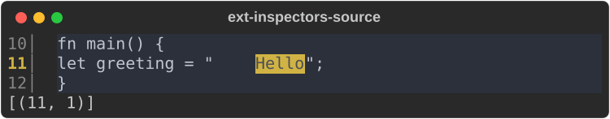
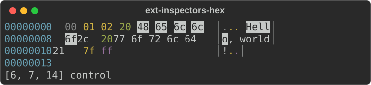
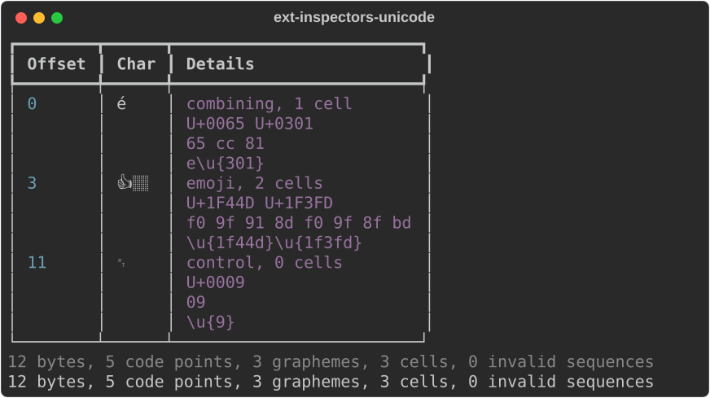
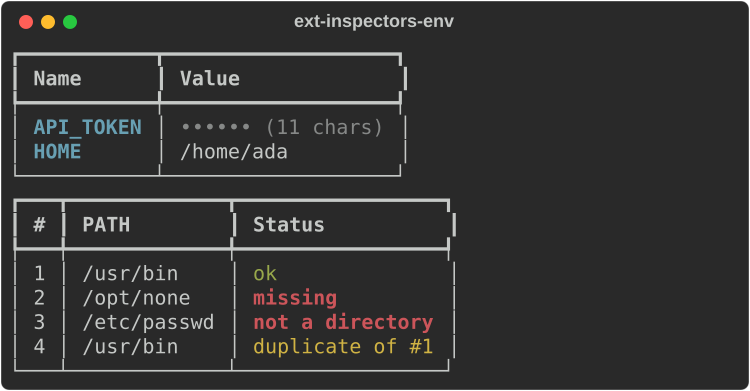

# Inspectors

Modules: `rs_rich.ext.source_view`, `hex`, `unicode_inspect`, `env_inspect`
(Rust: `rich_ext::source_view` and friends). They are the views behind the
`rich` binary's inspection commands.

## Source

`SourceView` shows code with line numbers, visible tabs and search matches.

```python
from rs_rich.console import Console
from rs_rich.ext import source_view

console = Console(width=60)
code = 'fn main() {\n\tlet greeting = "Hello";\n}\n'
view = source_view.SourceView(code, "text", search="hello", start_line=10)
console.print(view)
print(view.matches())
```



## Bytes

`HexView` is a hex dump with an ASCII column, byte classes told apart by
style, runs of identical lines collapsed, and highlighted needles. A needle
is `bytes`, or a string in the CLI's syntax: hex bytes (`"48 65"`) or a
quoted string (`'"Hello"'`).

```python
from rs_rich.ext import hex

data = b"\x00\x01\x02 Hello, world!\x7f\xff"
console.print(hex.HexView(data, bytes_per_line=8, highlight=b"Hello"))
print(hex.find_all(data, '"l"'), hex.byte_class(0x7f))
```



## Unicode

`UnicodeView` lists a string's grapheme clusters with code points, width and
kind (combining, emoji, invisible, control, bidi); for `bytes` it also shows
invalid UTF-8.

```python
from rs_rich.ext import unicode_inspect

console = Console(width=70)
view = unicode_inspect.UnicodeView("e\u0301👍🏽\t")
console.print(view)
print(view.summary_text())
```



## Environment

`EnvView` shows environment variables with secrets redacted and
`PATH`-like values split; `PathView` checks every entry of a search path.
`probe` replaces the file-system check, here so the example does not depend
on this machine.

```python
from rs_rich.ext import env_inspect

console.print(env_inspect.EnvView({"HOME": "/home/ada", "API_TOKEN": "sk-live-abc"}))
kinds = {"/usr/bin": "directory", "/etc/passwd": "file"}
path = env_inspect.PathView("PATH", "/usr/bin:/opt/none:/etc/passwd:/usr/bin", separator=":",
                            probe=lambda entry: kinds.get(entry, "missing"))
console.print(path)
```



```python
print(path.problems())
```

```text
[(2, '/opt/none', 'missing'), (3, '/etc/passwd', 'not a directory'), (4, '/usr/bin', 'duplicate of #1')]
```
