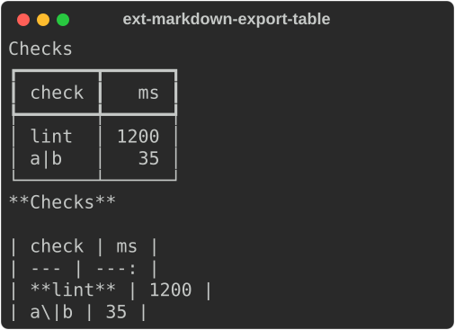

# GitHub Markdown export

```python
from rs_rich.ext import markdown_export
```

`rs_rich.ext.markdown_export` is `rich_ext::markdown_export`: renderables as
GitHub-flavoured Markdown, for pull request comments, issue bodies and job
summaries. A table printed to a terminal and pasted into a comment is a block
of box-drawing characters; exported, it is a table GitHub draws itself.

```python
from rs_rich.console import Console
from rs_rich.ext.markdown_export import to_gfm
from rs_rich.table import Table

table = Table(title="Checks")
table.add_column("check")
table.add_column("ms", justify="right")
table.add_row("[bold]lint[/]", "1200")
table.add_row("a|b", "35")
Console(width=40).print(table)
print(to_gfm(table))
```



## What becomes what

`to_gfm(value, options=None)` takes any renderable, a `str` (console markup)
or a `Text`, and returns one Markdown block without a trailing newline:

| Python | Markdown |
|---|---|
| `Table` | a GFM table: a header row, an alignment row from each column's `justify`, `\|` escaped; the title in bold above, the caption in italics below, the footer as a bold last row |
| `Tree` | nested lists (`hide_root` lists the children, `expanded=False` hides them) |
| `Panel` | a blockquote with the title in bold, or a `<details>` block (`PanelStyle`) |
| `Rule` | `---`, its title in bold after it |
| `Text`, `str` markup | inline Markdown: bold `**`, italic `*`, strike `~~`, code `` ` ``, links `[text](url)` |
| `Syntax` | a fenced code block with its language |
| `Markdown` | its source, as it is |
| `Group`, `Renderables` | each item as its own block, by these rules |
| anything else | its plain rendering in a ```` ```text ```` fence |

Colour, dim, underline and reverse have no Markdown equivalent and are
dropped. Text written in a code style (`code`, `markdown.code` or
`inline_code` by default) becomes inline code. A cell, label or panel body
that is not text is rendered and read back: a drawing (a nested table, a
chart) is fenced as text.

```python
from rs_rich.console import Group
from rs_rich.ext.markdown_export import to_gfm
from rs_rich.panel import Panel
from rs_rich.rule import Rule
from rs_rich.tree import Tree

tree = Tree("crates")
tree.add("rich").add("[code]table.rs[/]")
print(to_gfm(Group(Panel("all [b]green[/]", title="CI"), Rule("Files"), tree)))
```

```text
> **CI**
>
> all **green**

---

**Files**

- crates
  - rich
    - `table.rs`
```

Markup that does not parse raises `MarkupError`, as printing it does.
Strings you do not control belong in plain cells (`Table.add_plain_row`,
`Tree.add_plain`), which are never markup and are escaped in the output.

## Options and panels

`GfmOptions(*, width=100, panel=None, code_styles=None,
untitled_summary="Details")`: `width` is the width plain renderings are made
at; `panel` is a `PanelStyle` or its name; `code_styles` the style names
written as inline code; `untitled_summary` the summary of a details block
for a panel with no title. `PanelStyle.blockquote()` is the default, and
`PanelStyle.details(open=False)` a collapsible block (also
`PanelStyle("details", open=True)`).

```python
from rs_rich.ext.markdown_export import GfmOptions, PanelStyle, to_gfm
from rs_rich.panel import Panel

details = GfmOptions(panel=PanelStyle.details())
print(to_gfm(Panel("3 failures", title="Tests"), details))
```

```text
<details><summary>Tests</summary>

3 failures

</details>
```

`GfmExporter(options=None)` holds the options for repeated use:
`export(value)` is `to_gfm`, `markup(str)` writes markup as inline Markdown
(taking malformed markup literally), `text(text)` a `Text`, `code(code,
language="")` a fenced block, and `plain(renderable)` any renderable's plain
rendering.

## Documents and GitHub's limit

`GfmDocument(options=None)` builds a document block by block: `push(value)`,
`push_plain(renderable)`, `push_markdown(source)`, `push_code(code,
language="")` and `push_heading(level, markup)` each return the document, so
calls chain, and `finish()` (or `str(document)`) is the Markdown, blocks
separated by blank lines and ending in a newline.

A GitHub comment holds at most `GITHUB_COMMENT_LIMIT` (65,536) characters.
`fit_github_comment(markdown)` cuts a longer one at a line break, closes a
code fence or `<details>` block left open, and says how much was kept;
`truncate_markdown(markdown, limit)` does the same for any limit.

```python
from rs_rich.ext.markdown_export import GfmDocument, truncate_markdown
from rs_rich.text import Text

doc = GfmDocument().push_heading(2, "Report").push_markdown("- lint: ok\n- test: ok\n- docs: ok")
doc.push(Text("All three passed."))
print(doc.finish())
print(truncate_markdown(doc.finish(), 60))
```

```text
## Report

- lint: ok
- test: ok
- docs: ok

All three passed.

## Report


*Truncated: 10 of 63 characters shown.*

```
