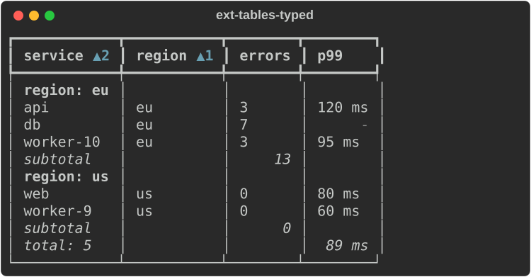
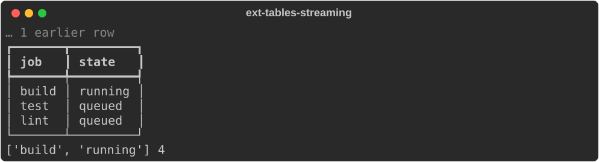
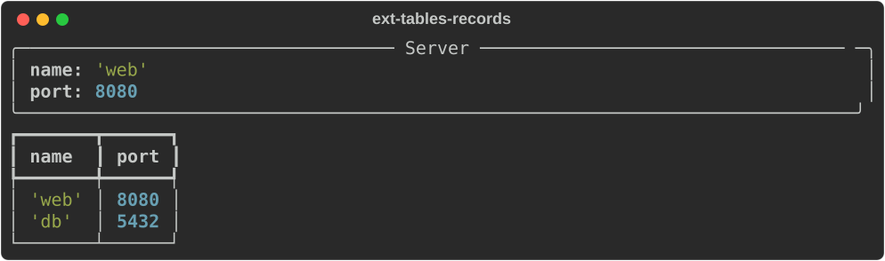
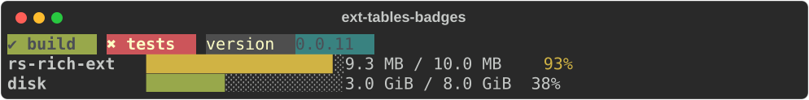
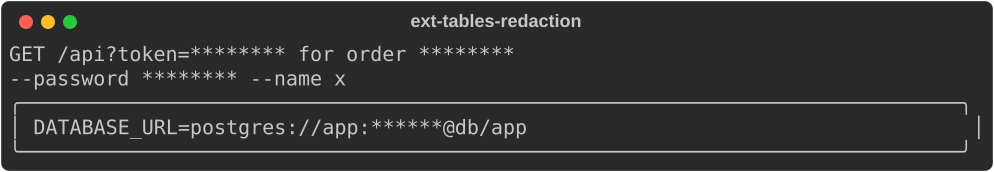

# Tables, badges and formatting

Modules: `rs_rich.ext.table`, `badge`, `size_bar`, `format`, `redact`,
`derive` (Rust: `rich_ext::table` and friends).

## Typed tables

`TableData(headers, rows, ...)` is a table of values rather than of
rendered cells. Headers are names or `DataColumn`s (also `table.Column`)
with a justification and a `format` callback that turns a value into a
string, markup or `Text`. Tables sort naturally (`worker-9` before
`worker-10`), group with aggregates, and add a totals row.

```python
from rs_rich.console import Console
from rs_rich.ext import table

console = Console(width=60)
def latency(value):
    return "[dim]-[/]" if value is None else f"{value:.0f} ms"

services = table.TableData(
    ["service", "region", table.Column("errors", justify="right"),
     table.Column("p99", justify="right", format=latency)],
    [["api", "eu", 3, 120.0], ["web", "us", 0, 80.0], ["db", "eu", 7, None],
     ["worker-10", "eu", 3, 95.0], ["worker-9", "us", 0, 60.0]],
    sort=[1, 0],
    group_by=table.GroupBy(1, aggregates=[table.Aggregate("sum", 2)]),
    totals=[table.Aggregate("count", 0), table.Aggregate("mean", 3)],
)
console.print(services)
```



`sort_by(keys)` returns a sorted copy (`SortKey(column, descending=True)`),
and `TableSort`/`TableGroup` do the same as pipeline stages.
`Aggregate.custom(column, function)` computes your own aggregate.

## Conditional styles

```text
StyleRule(column, op="eq", value=None, style="bold", *, target="cell")
StyleRule.parse(spec)
StyleRule.when(column, predicate, style, *, target="cell")
StyleRules(rules=())
StyleRules.from_toml(text)
```

A `StyleRule` styles a cell, its row or its whole column by value (Rust:
`rich_ext::table::rules`). It names a column (a header, or a 0-based index),
a comparison (`eq`, `ne`, `lt`, `le`, `gt`, `ge`, `contains`, `starts_with`,
`ends_with`, `empty`, `not_empty`, or `==`, `!=`, `<`, `<=`, `>`, `>=`), a
value and a style; `target="row"` styles the row, and `target="column"` every
cell of the column when any matches. A number compares as a number (text
that parses as one counts). `StyleRule.parse` reads the spec `rich
--style-rule` takes (`"latency>500:bold red"`, `"status=failed:row:on red"`),
and `StyleRule.when` takes a Python predicate over the cell's value.
`StyleRules` holds rules in order (where several match, the later wins), from
`StyleRule`s or specs; `from_toml` reads `[[rules]]` tables, as `rich --rules`
does. A bad rule raises `ValueError` naming it.

`TableData(..., rules=...)` and `style_rules(rules)`, `ext.data.TableView(...,
rules=...)` and `data.Profile.style_rules(rules)` apply them; any of them
takes a `StyleRules`, a `StyleRule`, a spec or a list of rules and specs.
Rules restyle; they never change the text.

```python
from rs_rich.ext.table import StyleRule, StyleRules

rules = StyleRules([
    "latency>500:bold red",
    StyleRule("status", "eq", "failed", "on red", target="row"),
])
print([rule.spec for rule in rules])
print(rules.rules[0].matches(612), rules.rules[0].matches("120"))
checks = table.TableData(
    ["service", "latency", "status"],
    [["web", 120, "ok"], ["api", 612, "failed"]],
    rules=rules,
)
console.print(checks)
```

```text
['latency>500:bold red', 'status==failed:row:on red']
True False
┏━━━━━━━━━┳━━━━━━━━━┳━━━━━━━━┓
┃ service ┃ latency ┃ status ┃
┡━━━━━━━━━╇━━━━━━━━━╇━━━━━━━━┩
│ web     │ 120     │ ok     │
│ api     │ 612     │ failed │
└─────────┴─────────┴────────┘
```

## Streaming tables

`StreamingTable` is a table of keyed rows for live output: `upsert` adds or
replaces a row (returning whether anything changed), `update_cell` changes
one cell, and a `window` or `capacity` keeps it short.

```python
jobs = table.StreamingTable(["job", "state"], window=("tail", 3))
for job in ["fetch", "build", "test", "lint"]:
    jobs.upsert(job, [job, "queued"])
jobs.update_cell("build", 1, "running")
console.print(jobs)
print(jobs["build"], len(jobs))
```



## Records

`derive.Record` shows named fields as a list, a panel or a one-row table;
`Record.from_object` reads a dataclass or an object's attributes, and
`records_table` puts many records in one table.

```python
import dataclasses
from rs_rich.ext import derive

@dataclasses.dataclass
class Server:
    name: str
    port: int

console.print(derive.Record.from_object(Server("web", 8080), presentation="panel"))
console.print(derive.records_table([Server("web", 8080), Server("db", 5432)]))
```



## Badges and size bars

```python
from rs_rich.ext import badge, size_bar

console.print(badge.Badges([
    badge.Badge.status("ok", "build"),
    badge.Badge.status("error", "tests"),
    badge.Badge.meta("version", "0.0.11"),
]))
console.print(size_bar.SizeBar.limit(9_300_000, 10_000_000, label="rs-rich-ext "))
console.print(size_bar.SizeBar(3 << 30, 8 << 30, label="disk        ", units="binary"))
```



## Formatting numbers and times

```python
from rs_rich.ext import format

print(format.format_size(1_500_000), format.format_size(1_572_864, units="binary"),
      format.format_rate(2_400_000.0), format.format_duration(3723), format.format_clock(3723),
      format.format_percent(0.4251, 1), format.format_number(1_234_567), format.format_compact(1_250_000.0))
print(format.format_relative(1_790_000_000, 1_790_010_800))
```

```text
1.5 MB 1.5 MiB 2.4 MB/s 1h 02m 03s 1:02:03 42.5% 1,234,567 1.2M
3 hours ago
```

## Redaction

`redact.Redactor` finds secrets (tokens, keys, passwords, credentials in
URLs, and your own patterns) and masks them in strings, ANSI text, command
lines, streamed chunks and exports. `Redacted(renderable, redactor)` masks a
renderable's output.

```python
from rs_rich.ext import redact
from rs_rich.panel import Panel

redactor = redact.Redactor(secrets=True, patterns=[("order", r"order (?P<secret>\d{4})")])
print(redactor.redact("GET /api?token=abc123 for order 1234"))
print(" ".join(redact.Redactor.secrets().redact_args(["--password", "pw", "--name", "x"])))
console.print(redact.Redacted(Panel("DATABASE_URL=postgres://app:s3cret@db/app"), redactor))
```


