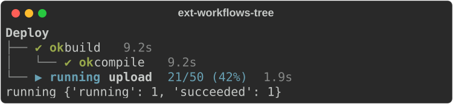
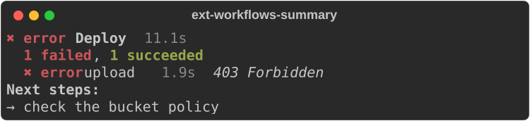
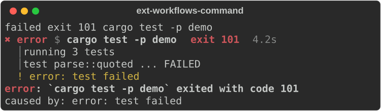
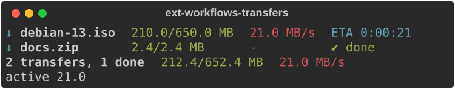
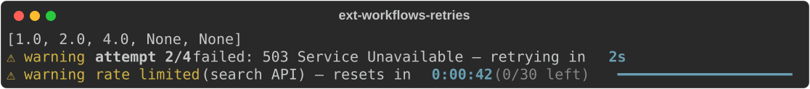

# Workflows and status

Modules: `rs_rich.ext.workflow`, `cancel`, `transfer`, `countdown`,
`notify` (Rust: `rich_ext::workflow` and friends). They show what a program is
doing: a tree of tasks, commands and their output, transfers, retries and
notifications.

Times are seconds. Pass a `ManualClock` (or `now=` values) for output that
does not depend on the wall clock, as these examples do.

## Task trees

`TaskTree` holds tasks by integer id. Start, finish, warn, fail, skip or
cancel them; the tree shows state, elapsed time and progress, and
`summary()` gives a `CompletionSummary` when the work is done.

```python
from rs_rich.console import Console
from rs_rich.ext import workflow

console = Console(width=60)
clock = workflow.ManualClock()
tree = workflow.TaskTree("Deploy", clock=clock)
build = tree.add("build")
compile_ = tree.add("compile", build)
upload = tree.add("upload")
tree.start(compile_)
clock.advance(9.2)
tree.succeed(compile_)
tree.start(upload)
tree.progress(upload, 21, 50)
clock.advance(1.9)
console.print(tree.view(animate=False))
print(tree.overall(), tree.counts())
```



```python
tree.fail(upload, "403 Forbidden")
console.print(tree.summary(next_steps=["check the bucket policy"]))
```



`tree.token(id)` gives the task's `CancelToken`; cancelling a task cancels
its children's tokens. `cancel.CancelToken` is also usable on its own:
`child()` makes a token cancelled with its parent.

## Commands

`CommandRecord` is a command, its output lines, status and duration.
`run_command(argv, on_update=...)` runs one and records it; `view()` renders
it with the last lines of output, and `diagnostic()` turns a failure into a
`Diagnostic`.

```python
record = workflow.CommandRecord(
    "cargo", ["test", "-p", "demo"],
    stdout="running 3 tests\ntest parse::quoted ... FAILED",
    stderr="error: test failed",
    status=101,
    duration=4.25,
)
print(record.state, record.detail, record.command_line)
console.print(record.view(tail=2))
```



## Transfers

`transfer.Transfer` tracks one download or upload: bytes, rate, ETA,
retries. `Transfers` renders several with a summary line.
`wrap_reader`/`wrap_writer` wrap a binary file so reading or writing updates
the transfer; `task_fields()` gives the `total`/`completed`/`description`
fields for an `rs_rich.progress` task.

```python
from rs_rich.ext import transfer

iso = transfer.Transfer("debian-13.iso", total=650_000_000)
for second in range(11):
    iso.update(second * 21_000_000, now=second)
docs = transfer.Transfer("docs.zip", total=2_400_000)
docs.finish(now=4)
console.print(transfer.Transfers([iso, docs], summary=True))
print(iso.state, iso.eta)
```



## Retries and rate limits

`countdown.Backoff` computes retry delays (exponential, capped, with seeded
jitter) and the status line for each attempt. `RetryStatus`, `RateLimit` and
`CountdownBar` render waits; `countdown_wait` sleeps in ticks and stops early
on a cancelled token.

```python
from rs_rich.ext import countdown

backoff = countdown.Backoff(1, factor=2.0, max=30, attempts=4)
print([backoff.delay(attempt) for attempt in range(1, 6)])
wide = Console(width=90)
wide.print(backoff.status(2, "503 Service Unavailable"))
wide.print(countdown.RateLimit(42, scope="search API", limit=30, remaining=0, bar=20))
```



## Notifications

`notify.Notifications` is a stack of toasts that expire; `Notification`
renders on its own too, as a line or (`toast="panel"`) a panel.

```python
from rs_rich.ext import notify

toasts = notify.Notifications(default_ttl=4)
toasts.push(notify.Notification("checksum verified", status="ok", title="Download"), 0)
toasts.push(notify.Notification("92% used", status="warning", title="Disk", ttl=30), 1)
toasts.expire(5)
console.print(toasts)
```


