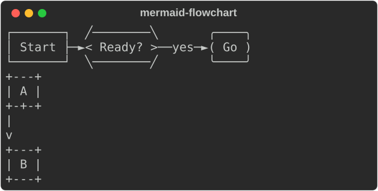
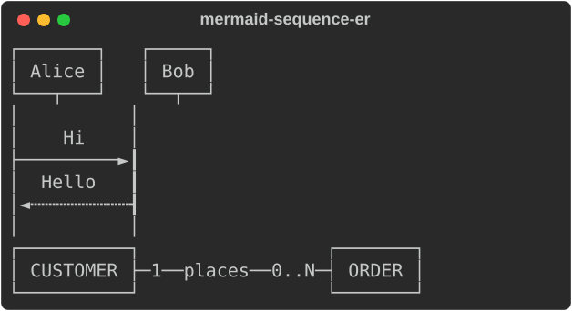
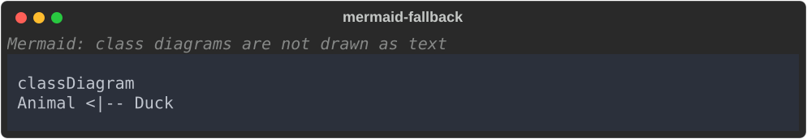
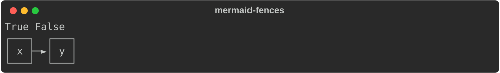

# Mermaid diagrams

```python
from rs_rich import mermaid
```

`rs_rich.mermaid` is the `rs-rich-mermaid` crate from Python. Rich has no
counterpart. Flowcharts and ER diagrams are drawn through the same layout as
[`rs_rich.diagram`](diagram.md), which also builds graphs in code and reads
DOT; sequence diagrams are drawn on lifelines.

## Mermaid

```text
Mermaid(source, *, backend="text", ascii=None, mmdc=None)
```

A renderable Mermaid diagram. Three kinds are drawn as text:

- flowcharts (`graph` / `flowchart`, in any direction, with the common node
  shapes, edge strokes, heads and labels);
- sequence diagrams (`sequenceDiagram`): participants and actors, every
  arrow, notes, activations, `loop` / `alt` / `opt` / `par` / `critical` /
  `break` / `rect` blocks, `autonumber` and a title;
- ER diagrams (`erDiagram`): entities with their attributes and keys, and
  relationships with their labels and cardinalities (`1`, `0..1`, `0..N`,
  `1..N`) at each end.

Anything the text renderer cannot draw (another diagram type, a syntax
error, a diagram too large to lay out) is shown as its source, in a code
block, under a one-line note saying why. What a drawing simplifies, and a
diagram wider than the console (which is cropped), get a note under it.

`ascii=True` draws with ASCII only; `None` follows the console.

```python
from rs_rich.console import Console
from rs_rich.mermaid import Mermaid

console = Console(width=50)
console.print(Mermaid("graph LR\n  A[Start] --> B{Ready?}\n  B -->|yes| C((Go))"))
console.print(Mermaid("graph TD\n  A --> B", ascii=True))
```



```python
console.print(Mermaid("sequenceDiagram\n  Alice->>+Bob: Hi\n  Bob-->>-Alice: Hello"))
console.print(Mermaid("erDiagram\n  direction LR\n  CUSTOMER ||--o{ ORDER : places"))
```



A class diagram is not drawn as text, so it is shown as its source:

```python
console.print(Mermaid("classDiagram\n  Animal <|-- Duck"))
```



### The mmdc backend

`backend="mmdc"` renders every diagram type with Mermaid's own CLI (`mmdc`:
Node and headless Chromium, installed separately) and shows the image
through `rs_rich.art`: Sixel where the terminal supports it, else quadrant
blocks. It needs a wheel built with the `mmdc` feature
(`mermaid.MERMAID_HAS_MMDC`); other builds, and any failure, fall back to
text with a note. `MmdcOptions(*, program="mmdc", timeout=20.0,
max_input=65536, max_output=16777216, puppeteer_config=None,
background="white")` says how to run it, and
`mmdc_render_png(source, options=None)` returns the PNG bytes (raising
`MmdcError`, or `NotImplementedError` without the feature).

## Parsing and drawing

Each kind drawn as text has a parser and a drawing function:

| Kind | Parse | Returns | Draw |
|---|---|---|---|
| Flowchart | `parse_flowchart(source)` | `Flowchart` (`direction`, `nodes`, `edges`, `notes`) | `draw_flowchart(chart, ascii=False)` |
| Sequence | `parse_sequence(source)` | `SequenceDiagram` (`title`, `participants`, `events`, `messages`, `notes`) | `draw_sequence(diagram, ascii=False)` |
| ER | `parse_er(source)` | `EntityDiagram` (`title`, `direction`, `entities`, `relationships`, `notes`) | `draw_er(diagram, ascii=False)` |

`parse_diagram(source)` picks the parser by the diagram's header, as
`Mermaid` does, and `draw_diagram(diagram, ascii=False)` draws any of the
three; under the crate's names they are `mermaid.parse` and `mermaid.draw`.
`is_sequence(source)` and `is_er(source)` read the header. Each drawing
function also takes the source, and returns a `MermaidDiagram` (`lines`,
`width`, and `notes` on what the drawing does not show). Where `Mermaid`
shows the source, these raise:

- `MermaidParseError`, with `kind` `"empty"`, `"unsupported"` (another
  diagram type; `parse_flowchart` given a sequence or ER diagram names the
  parser to use), `"too_large"` (over `MERMAID_MAX_SOURCE` bytes,
  `MERMAID_MAX_NODES` nodes or `MERMAID_MAX_EDGES` edges) or `"syntax"`
  (with its `line`);
- `MermaidLayoutError` when the diagram is too large to lay out.

Both derive from `MermaidError`.

```python
chart = mermaid.parse_flowchart("graph TD\n  A[Start] -.->|maybe| B((End))")
print(chart.direction, [node.shape for node in chart.nodes])
print(chart.edges[0])
print(mermaid.draw_flowchart(chart))
try:
    mermaid.parse_flowchart("graph TD\n  A -->")
except mermaid.MermaidParseError as error:
    print(error.kind, error.line, error)
```

```text
TD ['rect', 'circle']
FlowchartEdge(source=0, target=1, label='maybe', stroke='dotted', start=None, end='arrow', length=1)
┌───────┐
│ Start │
└───┬───┘
    ┆
  maybe
    ▼
 ╭─────╮
 ( End )
 ╰─────╯
syntax 2 line 2: an arrow needs a node after it
```

A sequence diagram's `events` are its statements in order, each with a
`kind` (`"message"`, `"note"`, `"activate"`, `"deactivate"`, `"start"`,
`"divider"` or `"end"`); `messages` are the messages alone. An ER diagram's
relationships carry each end's cardinality by name and as the drawing writes
it:

```python
diagram = mermaid.parse("sequenceDiagram\n  actor U as User\n  U->>+API: GET /items\n  API-->>-U: 200")
print([(p.label, p.kind) for p in diagram.participants])
print([event.kind for event in diagram.events])
print(diagram.messages[1])
er = mermaid.parse("erDiagram\n  CUSTOMER ||--o{ ORDER : places\n  CUSTOMER {\n    string id PK\n  }")
relationship = er.relationships[0]
print(relationship.source_cardinality, relationship.target_notation, er.entities[0].attributes[0])
try:
    mermaid.parse("pie\n  \"a\": 1")
except mermaid.MermaidParseError as error:
    print(error.kind, error)
```

```text
[('User', 'actor'), ('API', 'participant')]
['message', 'activate', 'message', 'deactivate']
SequenceMessage(source=1, target=0, text='200', line='dotted', start=None, end='arrow', number=None)
exactly_one 0..N ErAttribute(data_type='string', name='id', keys=['PK'], comment=None)
unsupported pie chart diagrams are not drawn as text
```

## Markdown fences

`MermaidFences(*, backend="text", ascii=None, mmdc=None)` is the fence
renderer for ```` ```mermaid ```` blocks in Markdown: `accepts(language)`
says whether it draws a fence, and `render_fence(language, code)` returns
the `Mermaid` for it (or `None`, leaving the fence to `Syntax`). It has the
signature of a Python fence renderer, `render_fence(language, code, console,
options)`, so it can be given wherever `rs_rich` takes one (see
[plugins](plugins.md)). The plugin that registers it with a plugin host is
`MermaidPlugin`, from `rs_rich.plugins` (re-exported here).

```python
fences = mermaid.MermaidFences()
print(fences.accepts("mermaid"), fences.accepts("python"))
console.print(fences.render_fence("mermaid", "graph LR\n  x --> y"))
```


