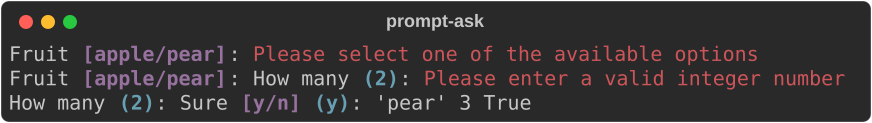

# Prompts

```python
from rs_rich.prompt import Prompt, IntPrompt, FloatPrompt, Confirm, InvalidResponse
```

`rs_rich.prompt` corresponds to `rich.prompt`. A prompt prints its question
(with the choices and the default), reads a line with `Console.input`, and
asks again until the response is valid. Pass `stream=` to read from a file
instead of standard input; `password=True` reads without echo (`getpass`).

```text
Prompt.ask(prompt="", *, console=None, password=False, choices=None,
           case_sensitive=True, show_default=True, show_choices=True,
           default=..., stream=None)
```

`Prompt` returns a `str`, `IntPrompt` an `int`, `FloatPrompt` a `float` and
`Confirm` a `bool` (`y` or `n`). An empty response returns `default` when
one is given.

```python
import io
from rs_rich.console import Console
from rs_rich.prompt import Confirm, IntPrompt, Prompt

console = Console(width=70)
fruit = Prompt.ask("Fruit", choices=["apple", "pear"], console=console,
                   stream=io.StringIO("kiwi\npear\n"))
count = IntPrompt.ask("How many", default=2, console=console, stream=io.StringIO("lots\n3\n"))
sure = Confirm.ask("Sure", default=True, console=console, stream=io.StringIO("y\n"))
print(repr(fruit), count, sure)
```



## Your own prompt

A subclass can change `response_type`, `choices`, `validate_error_message`,
`illegal_choice_message`, `prompt_suffix`, or any method: `make_prompt`,
`render_default`, `process_response` (raise `InvalidResponse(message)` to
reject a value), `on_validate_error`, `pre_prompt`, `get_input`.

```python
import io
from rs_rich.console import Console
from rs_rich.prompt import InvalidResponse, Prompt


class Username(Prompt):
    def process_response(self, value):
        value = super().process_response(value)
        if len(value) < 3:
            raise InvalidResponse("[prompt.invalid]At least 3 characters")
        return value


console = Console(width=70)
name = Username.ask("User", console=console, stream=io.StringIO("al\nalice\n"))
print(repr(name))
```


