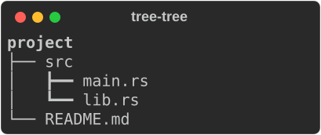

# Tree

```python
from rs_rich.console import Console
from rs_rich.tree import Tree
```

A `Tree` draws a hierarchy with guide lines. It corresponds to
`rich.tree.Tree` and renders byte for byte as Rich 15.0.0 does.

## Constructor

```text
Tree(label, *, style="tree", guide_style="tree.line", expanded=True,
     highlight=False, hide_root=False)
tree.add(label, *, style=None, guide_style=None, expanded=True,
         highlight=False) -> Tree
```

| Argument | Meaning |
|---|---|
| `label` | Any renderable: markup, a [`Text`](text.md), a [`Panel`](panel.md), [your own class](protocol.md). |
| `style` | A style for the label (and, by default, the children's). |
| `guide_style` | A style for the guide lines. A bold style draws heavy lines, `underline2` double ones. |
| `expanded` | `False` hides the children. |
| `highlight` | Highlight `str` labels (the root's setting applies to the whole tree). |
| `hide_root` | Leave the root's own line out. |

`add` returns the new child, so a branch can be built in one line. `children`
is the list of child trees, which you may change directly.

`tree.add_plain(label, ...)` (rs-rich's, not Rich's) adds a child whose
label is taken literally, never as markup: a `str` becomes a `Text`, `None`
is empty and any other value is its `str()`. It takes `add`'s keywords. Use
it for labels from data, such as file names, where a `[` would otherwise be
read as a tag (see [plain-text cells](table.md#plain-text-cells)).

```python
console = Console(width=30)
tree = Tree("[b]project[/]")
source = tree.add("src", guide_style="bold")
source.add("main.rs")
source.add("lib.rs")
tree.add("README.md")
console.print(tree)
```



On a console whose encoding is not UTF the guides are ASCII (`Tree.ASCII_GUIDES`),
as in Rich. A deep tree renders from an explicit stack, so depth is limited
only by memory; a tree that contains itself raises `RecursionError` when
printed.
