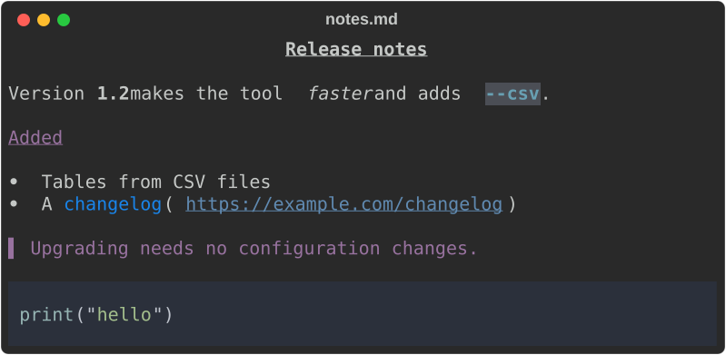
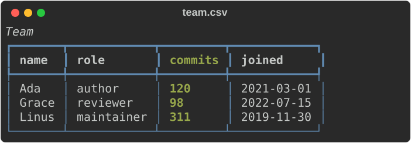
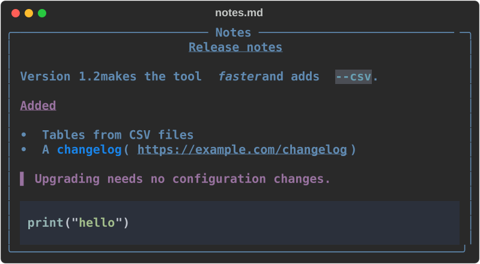
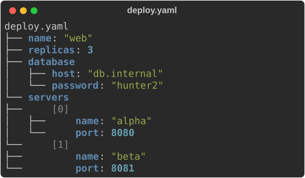
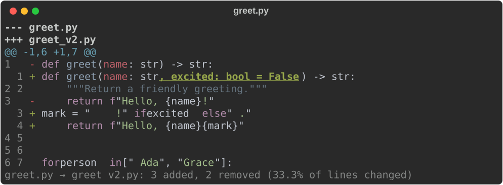

# 6. The CLI

```bash
cargo install rs-rich-cli      # installs a binary called `rich`
```

The pictures on this page are the commands' own output, exported with
`--export-svg` from the fixtures `scripts/smoke_cli.py` writes
(`python3 scripts/smoke_cli.py --screenshots docs/media/guide`).

## Rendering a file

With no mode flag, the type is detected from the extension:

```bash { .rich-playground data-kind="cli" }
rich README.md          # markdown
rich data.json          # pretty JSON
rich main.rs            # syntax highlighted
rich table.csv          # a table
rich notebook.ipynb     # a Jupyter notebook
```

`rich notes.md`, for example:



and `rich team.csv --title Team`:



Force a mode when the extension lies, or when reading stdin:

```bash { .rich-playground data-kind="cli" }
rich --markdown notes.txt
cat main.rs | rich --syntax -
```

`-` means standard input.

## Printing markup

```bash { .rich-playground data-kind="cli" }
rich -p "[bold red]Alert[/] disk at [bold]91%[/]"
```


Bad markup is reported rather than printed literally:

```console
$ rich -p "[/nope]"
rich: markup error: closing tag '[/nope]' at position 0 doesn't match any open tag
$ echo $?
4
```

Exit code 4 means a parse or render error in the input; the
[CLI guide](../guide/cli/index.md) lists every exit code.

## Fetching a URL

```bash
rich https://raw.githubusercontent.com/Textualize/rich/master/README.md
```

The render mode comes from the flag, else the URL's extension, else the response
`Content-Type`.

## Decorating output

```bash { .rich-playground data-kind="cli" }
rich --panel rounded --title "Notes" --style "bold blue" notes.md
rich --padding 1,4 --center report.md
rich --width 60 --rule "Section"
```

The first, on the same `notes.md`:



and the last:


## Exporting

Both exports write to a **path** and leave the terminal output intact, so you get
both at once:

```bash { .rich-playground data-kind="cli" }
rich -m README.md --export-html readme.html
rich -m README.md --export-svg readme.svg
rich -m README.md -o readme.html --export-svg readme.svg   # both
```

`-o` is short for `--export-html`. The HTML is self-contained — no external CSS,
fonts or images. The SVG loads its font from a CDN, so it needs a network
connection to show in the intended typeface; every picture on this site is an
SVG export like this one.

## Paging

```bash { .rich-playground data-kind="cli" }
rich --pager long-document.md
```

Pages through `$PAGER` (falling back to `less -R`, then `more`), keeping the
styling, unlike piping to a pager yourself.

## More commands

Beyond rendering files, `rich` has tool commands: `inspect` explores JSON, YAML,
TOML, XML, INI and dotenv as a tree; `diff` compares text files or renders a
patch; `view` shows any file; `hex`, `unicode` and `ansi explain` look inside
bytes, characters and escape sequences; `env` lists environment variables with
secrets masked; `capture` runs a command and shows or exports its output; and
`doctor` reports what `rich` detected. The [CLI walkthrough](../guide/cli/walkthrough.md)
shows each one. Two of them:

```bash { .rich-playground data-kind="cli" }
rich inspect deploy.yaml
```



```bash { .rich-playground data-kind="cli" }
rich diff greet.py greet_v2.py
```



## Full option list

`rich --help` prints every option, grouped by topic, and `rich COMMAND --help`
shows one command. The [CLI reference](../cli-reference.md) is generated from
that help text.
